<!-- source: DeepWiki mcp.deepwiki.com · repo zzli2022/Awesome-System2-Reasoning-LLM · page 7 Evaluation and Safety · fetched 2026-10-30 -->

# Evaluation and Safety

<details>
<summary>Relevant source files</summary>

The following files were used as context for generating this wiki page:

- [README.md](README.md)

</details>


## Purpose and Scope

This section covers the infrastructure for assessing reasoning capabilities and ensuring safe deployment of advanced System 2 reasoning models (Parts 10-11 of the research landscape). Evaluation provides the metrics and benchmarks necessary to measure progress in reasoning capabilities, while safety research addresses the unique risks introduced by models with deliberative, chain-of-thought reasoning abilities.

**Related sections:** For the core methodologies being evaluated, see [Core Methodologies](#4). For optimization techniques that affect evaluation efficiency, see [Efficient System2](#5.1). For multimodal evaluation approaches, see [Multimodal Extensions](#6).

**Key focus areas:**
- Benchmarking frameworks that test reasoning at various difficulty levels
- Domain-specific evaluation (mathematics, coding, medicine, multimodal)
- Process-level supervision and reward model evaluation
- Safety alignment techniques for reasoning models
- Attack vectors specific to chain-of-thought reasoning
- Tradeoffs between safety and reasoning capability

Sources: [README.md:41-43](), [README.md:351-453]()

---

## Benchmark Taxonomy

The evaluation landscape for System 2 reasoning models spans multiple dimensions: task difficulty, domain specialization, evaluation granularity (outcome vs. process), and modality.

### Mathematical Reasoning Benchmarks

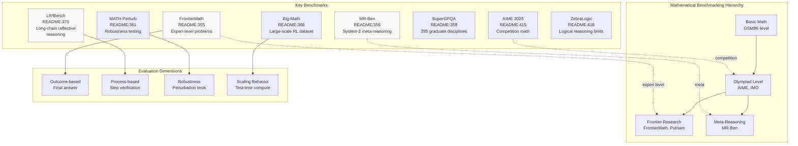

**Mathematical benchmark characteristics:**

| Benchmark | Focus | Difficulty | Evaluation Type | Reference |
|-----------|-------|-----------|-----------------|-----------|
| FrontierMath | Research-level problems | Expert | Outcome | [README.md:355]() |
| AIME 2025 | Competition mathematics | Olympiad | Outcome | [README.md:415]() |
| MR-Ben | Meta-reasoning | System-2 | Process | [README.md:356]() |
| MATH-Perturb | Robustness against perturbations | Variable | Robustness | [README.md:361]() |
| Big-Math | Large-scale RL training | Variable | Dataset | [README.md:366]() |
| SuperGPQA | Graduate-level, multi-discipline | Expert | Outcome | [README.md:359]() |
| LR²Bench | Long reflective reasoning chains | Complex | Process | [README.md:370]() |
| ZebraLogic | Logical reasoning limits | Hard | Outcome | [README.md:418]() |

Sources: [README.md:351-423]()

### Code Generation and Reasoning Benchmarks

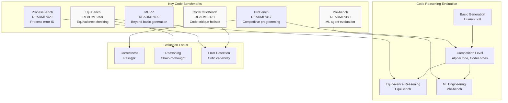

**Code benchmark focus areas:**
- **EquiBench**: Tests code reasoning via equivalence checking, requiring models to determine if different implementations are functionally equivalent
- **ProBench**: Competitive programming problems requiring advanced algorithmic reasoning
- **Mle-bench**: Evaluates ML agents on real machine learning engineering tasks
- **CodeCriticBench**: Holistic code critique capabilities beyond simple error detection
- **ProcessBench**: Identifies process-level errors in mathematical reasoning code

Sources: [README.md:358](), [README.md:380](), [README.md:409](), [README.md:417](), [README.md:429](), [README.md:431]()

### Multimodal Reasoning Benchmarks

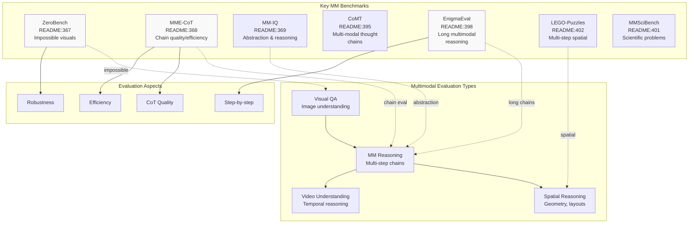

**Notable multimodal benchmarks:**
- **ZeroBench**: Tests models on "impossible" visual patterns that require going beyond surface-level perception
- **MME-CoT**: Evaluates chain-of-thought quality, robustness, and efficiency in multimodal reasoning
- **EnigmaEval**: Long-form multimodal reasoning challenges
- **LEGO-Puzzles**: Multi-step spatial reasoning requiring planning
- **MM-IQ**: Tests human-like abstraction and reasoning with visual patterns

Sources: [README.md:367-402]()

### Agent and Interactive Benchmarks

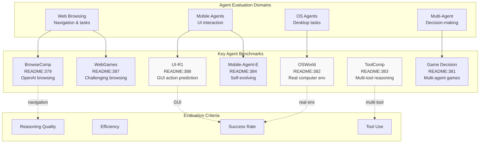

**Agent benchmark categories:**
- **Web browsing**: BrowseComp, WebGames test navigation and complex web task completion
- **Mobile/GUI**: UI-R1, Mobile-Agent-E evaluate smartphone and GUI interaction
- **OS-level**: OSWorld provides real computer environments for comprehensive testing
- **Tool use**: ToolComp assesses multi-tool reasoning and process supervision
- **Multi-agent**: Game-based decision-making in competitive/cooperative scenarios

Sources: [README.md:379-388]()

---

## Process Supervision and Reward Model Evaluation

Process-level evaluation assesses intermediate reasoning steps rather than just final answers, which is critical for System 2 reasoning models.

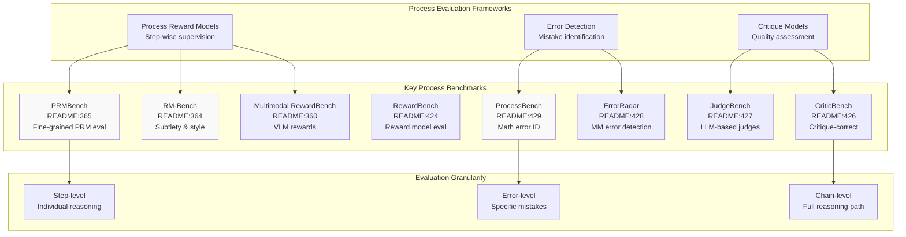

**Process supervision benchmark characteristics:**

| Benchmark | Type | Focus | Granularity | Reference |
|-----------|------|-------|-------------|-----------|
| PRMBench | PRM | Fine-grained process rewards | Step-level | [README.md:365]() |
| RM-Bench | PRM | Subtlety and style | Chain-level | [README.md:364]() |
| Multimodal RewardBench | PRM | Vision-language rewards | Step-level | [README.md:360]() |
| ProcessBench | Error | Math reasoning errors | Error-level | [README.md:429]() |
| ErrorRadar | Error | Multimodal error detection | Error-level | [README.md:428]() |
| CriticBench | Critique | Critique-correct reasoning | Chain-level | [README.md:426]() |
| JudgeBench | Judge | LLM-based evaluation | Chain-level | [README.md:427]() |

**Integration with Part 2 (Process Reward Models):**
- PRMBench directly evaluates techniques from [README.md:68-97]() like Math-Shepherd, AutoPSV
- Provides standardized metrics for comparing PRM approaches
- Tests generalization across different reasoning domains

Sources: [README.md:360](), [README.md:364-365](), [README.md:424-429]()

---

## General Reasoning and Robustness Evaluation

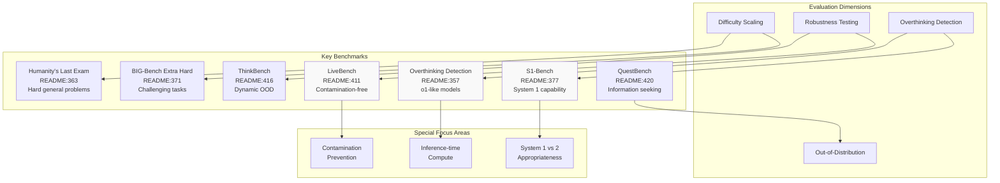

**Critical evaluation challenges:**
- **Contamination**: LiveBench provides contamination-limited evaluation for honest benchmarking
- **Overthinking**: Models may waste compute on simple problems better solved with System 1 thinking
- **OOD generalization**: ThinkBench tests dynamic out-of-distribution scenarios
- **System appropriateness**: S1-Bench evaluates when fast thinking suffices vs. when slow thinking is needed

Sources: [README.md:357](), [README.md:363](), [README.md:371](), [README.md:377](), [README.md:411](), [README.md:416](), [README.md:420]()

---

## Safety Infrastructure for Reasoning Models

Chain-of-thought reasoning introduces unique safety challenges. Models with deliberative capabilities can potentially reason their way around safety constraints or be manipulated through reasoning-specific attacks.

### Safety Landscape

```mermaid
graph TB
    subgraph "Safety Challenges"
        ALIGN["Alignment<br/>Safety reasoning"]
        ATTACK["Attack Vectors<br/>CoT exploitation"]
        HIDDEN["Hidden Risks<br/>Emergent behaviors"]
        TRADEOFF["Safety-Performance<br/>Tradeoffs"]
    end
    
    subgraph "Defense Mechanisms"
        DELIB_ALIGN["Deliberative Alignment<br/>README:439<br/>Reasoning-based safety"]
        GUARDREASONER["GuardReasoner<br/>README:443<br/>Reasoning safeguards"]
        SAFECHAIN["SafeChain<br/>README:444<br/>Long CoT safety"]
        THINKGUARD["ThinkGuard<br/>README:445<br/>Slow thinking guards"]
        STAR1["STAR-1<br/>README:453<br/>1K data alignment"]
    end
    
    subgraph "Attack Methods"
        HCOT["H-CoT<br/>README:447<br/>Hijacking CoT safety"]
        BOT["BoT<br/>README:448<br/>Backdoor attacks"]
        OVERTHINK_ATTACK["OverThink<br/>README:442<br/>Slowdown attacks"]
    end
    
    subgraph "Assessment"
        HIDDEN_RISKS["Hidden Risks R1<br/>README:449<br/>Safety assessment"]
        ILLUSORY["Illusory Safety<br/>README:450<br/>Redteaming report"]
        SAFETY_TAX["Safety Tax<br/>README:451<br/>Reasoning degradation"]
    end
    
    ALIGN --> DELIB_ALIGN
    ALIGN --> GUARDREASONER
    ALIGN --> SAFECHAIN
    ALIGN --> THINKGUARD
    ALIGN --> STAR1
    
    ATTACK --> HCOT
    ATTACK --> BOT
    ATTACK --> OVERTHINK_ATTACK
    
    HIDDEN --> HIDDEN_RISKS
    HIDDEN --> ILLUSORY
    
    TRADEOFF --> SAFETY_TAX
    
    style HCOT fill:#ffe6e6
    style DELIB_ALIGN fill:#e6ffe6
    style SAFETY_TAX fill:#fff6e6
```

Sources: [README.md:437-453]()

### Safety Alignment Approaches

**Deliberative Alignment** [README.md:439]()  
Leverages the reasoning capabilities themselves for safety. Models use chain-of-thought to reason about safety policies before generating responses. This approach exploits System 2 thinking for ethical deliberation.

**GuardReasoner** [README.md:443]()  
A reasoning-based safeguard system that uses deliberative processes to detect and prevent unsafe outputs. Integrates safety checks into the reasoning pipeline.

**SafeChain** [README.md:444]()  
Specifically addresses safety concerns in long chain-of-thought reasoning. As reasoning chains grow longer (thousands of tokens), maintaining safety throughout becomes critical.

**ThinkGuard** [README.md:445]()  
Implements "slow thinking" for guardrails, matching the deliberative nature of the models being protected. Uses multi-step reasoning to evaluate potential harms.

**STAR-1** [README.md:453]()  
Demonstrates that safer alignment can be achieved with minimal data (1K examples), suggesting efficiency improvements for safety tuning.

Sources: [README.md:439](), [README.md:443-445](), [README.md:453]()

### Attack Vectors and Vulnerabilities

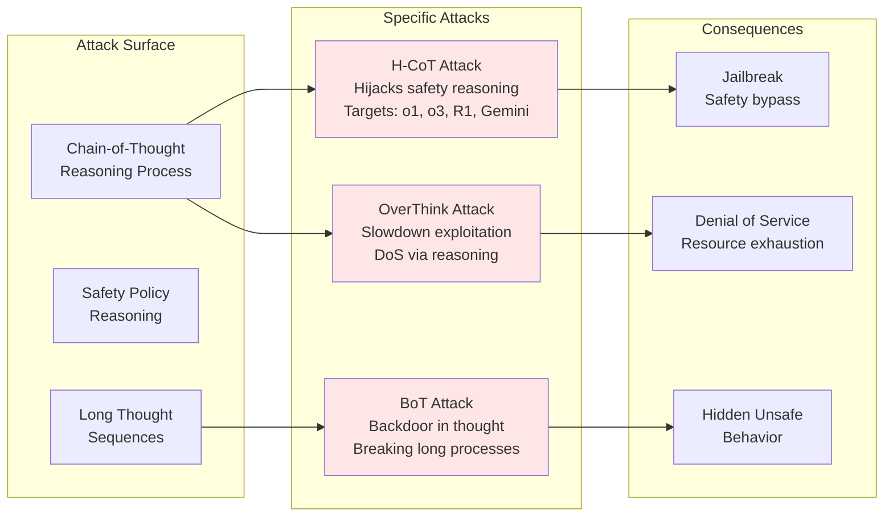

**H-CoT (Hijacking Chain-of-Thought)** [README.md:447]()  
A sophisticated jailbreak technique that manipulates the chain-of-thought reasoning process itself. Successfully attacks major reasoning models including:
- OpenAI o1 and o3
- DeepSeek-R1
- Gemini 2.0 Flash Thinking

The attack exploits the model's safety reasoning mechanism by inserting adversarial reasoning steps that lead to unsafe conclusions.

**BoT (Breaking of Thought)** [README.md:448]()  
A backdoor attack targeting long thought processes. Inserts malicious triggers into the reasoning chain that activate harmful behaviors while remaining hidden during normal operation.

**OverThink Attack** [README.md:442]()  
A denial-of-service attack that forces reasoning models into unnecessarily long deliberation, exhausting computational resources. Exploits the model's tendency to engage System 2 thinking even when unnecessary.

Sources: [README.md:442](), [README.md:447-448]()

### Safety Assessment and Challenges

**Research findings from safety assessments:**

| Finding | Source | Implication |
|---------|--------|-------------|
| DeepSeek-R1 RL strategies have shortcomings | [README.md:106]() | Reinforcement learning alone insufficient for safety |
| Hidden risks in R1 | [README.md:449]() | Comprehensive safety assessment needed |
| Illusory safety (redteaming) | [README.md:450]() | Even strong models (OpenAI, Anthropic, Google) vulnerable |
| Safety Tax | [README.md:451]() | Safety alignment degrades reasoning capability |
| OpenAI o1/o3 "think" about safety | [README.md:440]() | Promising direction but needs validation |

**Key challenge: Safety-Performance Tradeoff**  
The "Safety Tax" phenomenon [README.md:451]() reveals that safety alignment makes reasoning models "less reasonable." This creates a fundamental tension:
- Stronger safety constraints → Reduced reasoning capability
- Weaker safety constraints → Increased risk

**Blog post discussions:**
- Anthropic's faithfulness measurement [README.md:438](): Measuring whether CoT reasoning genuinely guides behavior
- Why researchers worry about DeepSeek [README.md:441](): Hidden safety warnings and concerns
- OpenAI's safety policy training [README.md:440](): Using reasoning for safety evaluation

Sources: [README.md:106](), [README.md:438-451]()

---

## Integration with Core Methodologies

Evaluation and safety considerations interact deeply with the core reasoning techniques from Parts 1-6.

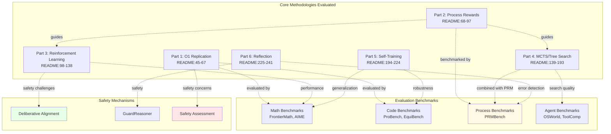

**Key integration patterns:**

1. **PRM → Benchmarks**: Process Reward Models from Part 2 directly evaluated by PRMBench [README.md:365]()
2. **RL → Safety**: Reinforcement Learning approaches (Part 3) create safety challenges requiring deliberative alignment [README.md:439]()
3. **MCTS → Process Evaluation**: Tree search methods (Part 4) benefit from step-wise process benchmarks
4. **O1 Replication → Comprehensive Testing**: O1-like systems tested across all benchmark categories
5. **Reflection → Error Detection**: Reflection mechanisms (Part 6) measured by error detection benchmarks

**Specific examples:**
- ReST-MCTS* [README.md:78](), [README.md:175](): Combines Parts 2, 4, 5; evaluated on math and process benchmarks
- DeepSeek-R1 [README.md:107](): Part 3 RL approach; requires safety assessment [README.md:449]()
- Math-Shepherd [README.md:73](): Part 2 PRM; benchmarked for automated supervision
- H-CoT attack [README.md:447](): Exploits reasoning from Parts 1-6; demonstrates need for safety infrastructure

Sources: [README.md:45-241](), [README.md:351-453]()

---

## Evaluation Methodology Patterns

Different evaluation approaches serve different purposes in assessing System 2 reasoning models.

```mermaid
graph TB
    subgraph "Evaluation Paradigms"
        OUTCOME["Outcome-based<br/>Final answer correctness"]
        PROCESS["Process-based<br/>Intermediate step quality"]
        ROBUSTNESS["Robustness-based<br/>Perturbation testing"]
        EFFICIENCY["Efficiency-based<br/>Compute vs. accuracy"]
    end
    
    subgraph "Outcome Evaluation"
        ACCURACY["Accuracy Metrics<br/>Pass@k, Exact match"]
        DIFFICULTY["Difficulty Scaling<br/>Easy → Expert"]
        DOMAIN["Domain Coverage<br/>Math, Code, Multimodal"]
    end
    
    subgraph "Process Evaluation"
        STEP_CORRECT["Step Correctness<br/>Per-step verification"]
        CHAIN_QUALITY["Chain Quality<br/>Coherence, efficiency"]
        ERROR_ID["Error Identification<br/>Mistake localization"]
    end
    
    subgraph "Meta-Evaluation"
        OVERTHINK_DETECT["Overthinking Detection<br/>README:357"]
        SYSTEM_SELECT["System Selection<br/>Fast vs. Slow"]
        TEST_TIME["Test-time Scaling<br/>Compute efficiency"]
    end
    
    OUTCOME --> ACCURACY
    OUTCOME --> DIFFICULTY
    OUTCOME --> DOMAIN
    
    PROCESS --> STEP_CORRECT
    PROCESS --> CHAIN_QUALITY
    PROCESS --> ERROR_ID
    
    EFFICIENCY --> OVERTHINK_DETECT
    EFFICIENCY --> SYSTEM_SELECT
    EFFICIENCY --> TEST_TIME
    
    ROBUSTNESS -.tests.-> ACCURACY
    ROBUSTNESS -.tests.-> STEP_CORRECT
    
    style OVERTHINK_DETECT fill:#fff9e6
    style STEP_CORRECT fill:#fff9e6
    style TEST_TIME fill:#fff9e6
```

**Outcome-based evaluation:**
- Traditional metrics: accuracy, pass@k, exact match
- Difficulty progression: basic → olympiad → research-level
- Examples: FrontierMath [README.md:355](), AIME [README.md:415]()

**Process-based evaluation:**
- Step-level correctness via PRMs
- Chain coherence and reasoning quality
- Error localization and diagnosis
- Examples: PRMBench [README.md:365](), ProcessBench [README.md:429]()

**Robustness evaluation:**
- Perturbation testing (MATH-Perturb [README.md:361]())
- Out-of-distribution generalization (ThinkBench [README.md:416]())
- Contamination prevention (LiveBench [README.md:411]())

**Efficiency evaluation:**
- Overthinking detection [README.md:357](): When does o1-like reasoning waste compute?
- System selection: Appropriateness of System 1 vs System 2
- Test-time compute scaling: Relationship between compute and performance

Sources: [README.md:355](), [README.md:357](), [README.md:365](), [README.md:411](), [README.md:415-416](), [README.md:429]()

---

## Domain-Specific Evaluation

### Medical Domain

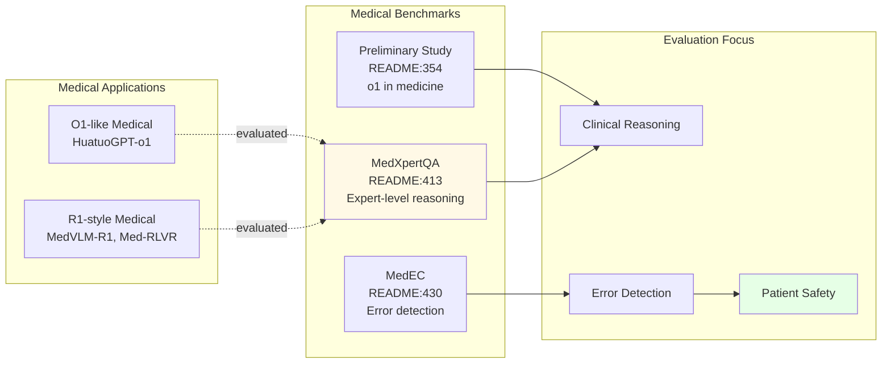

Medical domain requires specialized evaluation focusing on:
- Expert-level diagnostic reasoning
- Error detection for patient safety
- Multi-step clinical decision-making

Sources: [README.md:354](), [README.md:413](), [README.md:430]()

### Physics and Science

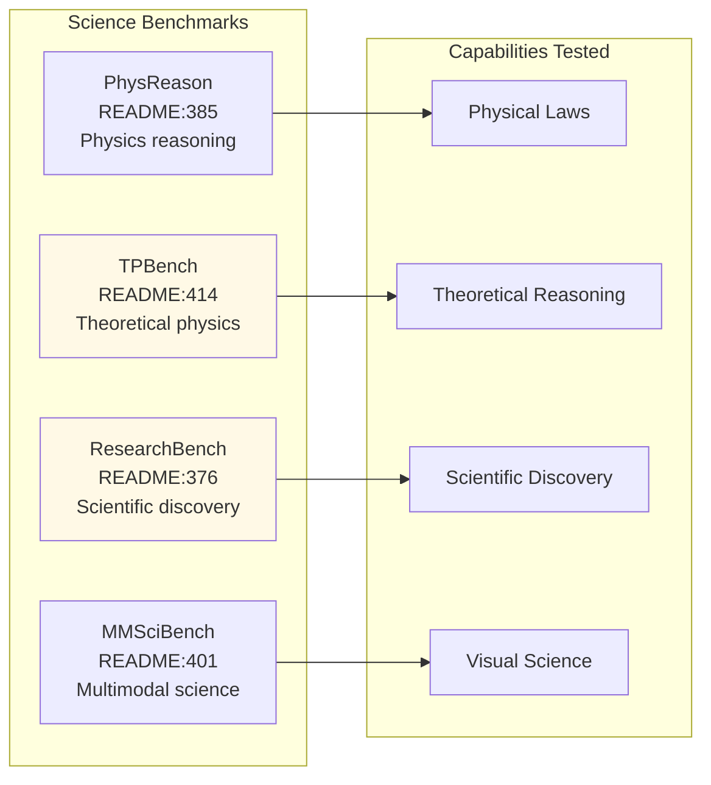

Scientific domain evaluation tests:
- Physical reasoning and simulation
- Theoretical proof construction
- Research-level problem solving
- Multimodal scientific understanding

Sources: [README.md:376](), [README.md:385](), [README.md:401](), [README.md:414]()

---

## Future Directions and Open Challenges

### Emerging Evaluation Needs

1. **Contamination-Free Benchmarking**
   - LiveBench [README.md:411]() addresses contamination
   - Need for continuously updated benchmarks
   - Private test sets for honest evaluation

2. **Long-Chain Reasoning Assessment**
   - LR²Bench [README.md:370]() for long reflective chains
   - EnigmaEval [README.md:398]() for extended multimodal reasoning
   - Evaluating chains with thousands of tokens

3. **Process Supervision at Scale**
   - PRMBench [README.md:365]() provides foundation
   - Need for automated step verification
   - Cross-domain process reward models

4. **Safety-Performance Balance**
   - Safety Tax [README.md:451]() identified tradeoff
   - Methods to maintain reasoning while ensuring safety
   - Principled approaches to alignment without degradation

### Research Questions

**Evaluation:**
- How to measure "overthinking" appropriately? [README.md:357]()
- What metrics best capture reasoning quality vs. final correctness?
- How to evaluate reasoning chains too long for human verification?
- Can we predict benchmark performance from model architecture?

**Safety:**
- How to defend against CoT-specific attacks like H-CoT? [README.md:447]()
- What is the minimal safety tax for reasoning models? [README.md:451]()
- How to ensure faithful reasoning (not just accurate outputs)? [README.md:438]()
- Can reasoning enhance or undermine safety?

### Benchmark Development Trends

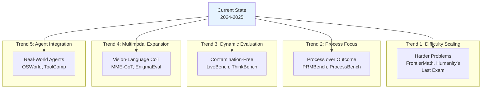

**Key trends:**
1. **Difficulty escalation**: Moving from basic to research-level problems
2. **Process-centric**: Shift from outcome to intermediate step evaluation
3. **Dynamic benchmarks**: Addressing contamination through continuous updates
4. **Multimodal reasoning**: Extending CoT evaluation beyond text
5. **Real-world agents**: Testing reasoning in interactive environments

Sources: [README.md:351-453]()

---

## Repository Data Structure

The benchmark and safety papers are cataloged in the repository's data layer.

**File structure:**
- `assets/paper.json`: Structured metadata for all papers including Parts 10-11
- `src/main.py`: Build script that processes paper metadata
- `README.md`: Hand-curated descriptions with expert commentary

**Data processing pipeline:**
```
paper.json (Part 10: lines ~351-433, Part 11: lines ~437-453)
    ↓
src/main.py: Load → Extract → Resolve
    ↓
src/table.md (chronological view)
src/list.md (categorized view)
```

The JSON structure groups papers by research part, with each entry containing:
- Title
- ArXiv/Conference venue
- Publication date
- Links to paper and code
- Category labels

**Build system:** See [Repository Structure and Maintenance](#10) for details on how benchmark and safety papers are processed and presented.

Sources: [README.md:1-509]()

---

## Summary

Evaluation and safety infrastructure provides critical feedback loops for System 2 reasoning research:

**Evaluation landscape:**
- **Mathematical**: FrontierMath, AIME, MR-Ben span basic to research-level
- **Code**: EquiBench, ProBench test reasoning in programming
- **Multimodal**: MME-CoT, EnigmaEval assess visual reasoning chains
- **Agent**: OSWorld, ToolComp evaluate interactive reasoning
- **Process**: PRMBench, ProcessBench enable step-level assessment

**Safety challenges:**
- **Attack vectors**: H-CoT, BoT, OverThink exploit reasoning processes
- **Defense mechanisms**: Deliberative Alignment, GuardReasoner, SafeChain
- **Tradeoffs**: Safety Tax reveals performance degradation from alignment
- **Assessment needs**: Hidden risks require comprehensive evaluation

**Integration patterns:**
- Process Reward Models (Part 2) benchmarked by PRMBench
- RL approaches (Part 3) create safety challenges
- O1 replication (Part 1) requires comprehensive evaluation across all dimensions
- MCTS (Part 4) benefits from process-level benchmarks

**Future directions:**
- Contamination-free dynamic benchmarks
- Long-chain reasoning assessment
- Safety-performance balance optimization
- Cross-domain process supervision

The evaluation and safety infrastructure ensures that advances in System 2 reasoning capabilities are measured reliably and deployed responsibly.

Sources: [README.md:41-43](), [README.md:351-453]()

---

