<!-- source: DeepWiki mcp.deepwiki.com · repo zzli2022/Awesome-System2-Reasoning-LLM · page 7.1 Benchmarks and Datasets · fetched 2026-10-30 -->

# Benchmarks and Datasets

<details>
<summary>Relevant source files</summary>

The following files were used as context for generating this wiki page:

- [README.md](README.md)
- [assets/paper.json](assets/paper.json)
- [src/list.md](src/list.md)

</details>


## Purpose and Scope

This page documents the evaluation infrastructure for System 2 reasoning capabilities in Large Language Models. It catalogs benchmarks, datasets, and evaluation frameworks that assess deliberate reasoning, step-by-step verification, and complex problem-solving across multiple domains. These resources enable researchers to measure progress in transitioning from fast, intuitive System 1 responses to slow, deliberate System 2 thinking.

For methodologies that these benchmarks evaluate, see [Core Methodologies](#4). For safety considerations in evaluation, see [Reasoning and Safety](#7.2).

**Sources:** [README.md:351-433]()

---

## Benchmark Taxonomy and Organization

The repository organizes benchmarks into several categories, each targeting different aspects of System 2 reasoning. The benchmarks are stored in structured metadata within the repository's data layer.

```mermaid
graph TB
    subgraph "Data_Layer"
        JSON["assets/paper.json<br/>Part 10: Benchmark and Datasets<br/>Structured Metadata"]
    end
    
    subgraph "Mathematical_Reasoning"
        FRONTIER["FrontierMath<br/>Advanced Mathematical Reasoning<br/>arXiv 2024-11"]
        MATHPERTURB["MATH-Perturb<br/>Hard Perturbations<br/>arXiv 2025-02"]
        BIGMATH["Big-Math<br/>Large-Scale RL Dataset<br/>arXiv 2025-02"]
        PUTNAM["Putnam-AXIOM<br/>Higher-Level Reasoning<br/>NeurIPS 2024"]
    end
    
    subgraph "Process_and_Reward"
        PRMBENCH["PRMBench<br/>Process-Level Rewards<br/>arXiv 2025-01"]
        RMBENCH["RM-Bench<br/>Reward Model Evaluation<br/>ICLR 2025"]
        TOOLCOMP["ToolComp<br/>Multi-Tool Supervision<br/>arXiv 2025-01"]
        PROCESSBENCH["ProcessBench<br/>Error Detection<br/>arXiv 2024-12"]
    end
    
    subgraph "Multimodal_Reasoning"
        MMECOT["MME-CoT<br/>Chain-of-Thought Quality<br/>arXiv 2025-02"]
        MMIQ["MM-IQ<br/>Abstraction & Reasoning<br/>arXiv 2025-02"]
        ZEROBENCH["ZeroBench<br/>Visual Reasoning<br/>arXiv 2025-02"]
        HUMANEVAL_V["HumanEval-V<br/>Visual Coding Tasks<br/>arXiv 2024-10"]
    end
    
    subgraph "Agent_Capabilities"
        OSWORLD["OSWorld<br/>Real Computer Environments<br/>NeurIPS 2024"]
        MLEBENCH["MLE-bench<br/>ML Engineering<br/>arXiv 2024-10"]
        BROWSECOMP["BrowseComp<br/>Browsing Agents<br/>OpenAI 2025-04"]
        MOBILE["Mobile-Agent-E<br/>Self-Evolving Assistant<br/>arXiv 2025-01"]
    end
    
    subgraph "Meta_Reasoning"
        MRBEN["MR-Ben<br/>System-2 Thinking<br/>NeurIPS 2024"]
        LONGREASON["LongReason<br/>Long-Context Reasoning<br/>arXiv 2025-01"]
        HUMANITY["Humanity's Last Exam<br/>Human-Level Challenge<br/>arXiv 2025-01"]
    end
    
    JSON --> FRONTIER
    JSON --> PRMBENCH
    JSON --> MMECOT
    JSON --> OSWORLD
    JSON --> MRBEN
```

**Sources:** [README.md:351-433](), [assets/paper.json:818-847]()

---

## Mathematical Reasoning Benchmarks

Mathematical reasoning benchmarks evaluate step-by-step problem-solving, proof generation, and numerical reasoning capabilities. These benchmarks range from competition-level problems to research-grade mathematical challenges.

### Core Mathematical Benchmarks

| Benchmark | Domain | Difficulty | Key Features | Reference |
|-----------|--------|------------|--------------|-----------|
| **FrontierMath** | Advanced Mathematics | Research-level | Evaluates cutting-edge mathematical reasoning | [README.md:355]() |
| **MATH-Perturb** | Math Word Problems | Competition + Perturbations | Tests robustness against hard variations | [README.md:361]() |
| **Big-Math** | Mathematical RL | Large-scale dataset | Dataset for reinforcement learning in math | [README.md:366]() |
| **Putnam-AXIOM** | Higher Mathematics | Olympiad/Competition | Functional and static benchmarking | [README.md:407]() |
| **AIME 2025** | Competition Math | High school competition | American Invitational Mathematics Examination | [README.md:415]() |

### Mathematical Benchmark Characteristics

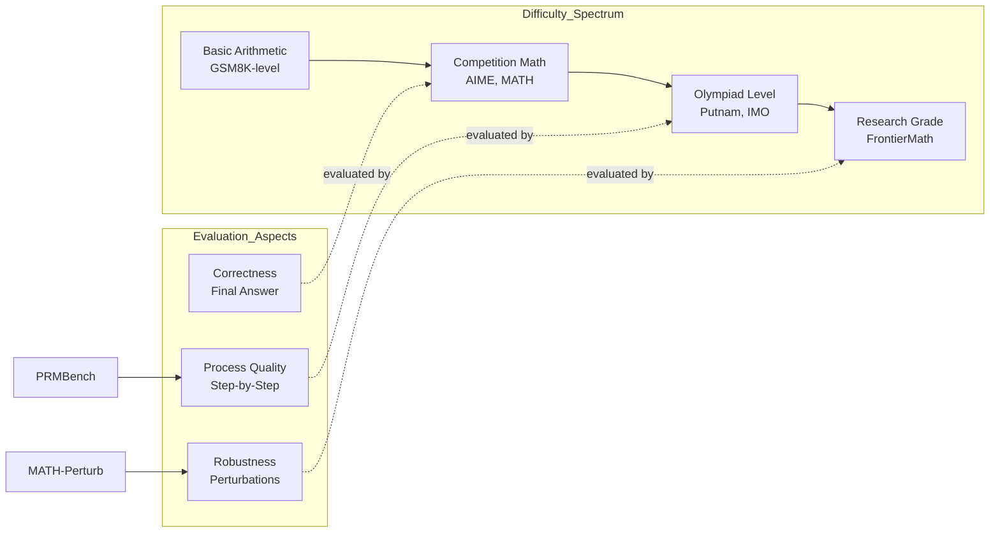

**Sources:** [README.md:355-366](), [README.md:407-415]()

---

## Code Generation and Programming Benchmarks

Code generation benchmarks assess LLMs' ability to solve programming challenges, understand visual logic, and perform software engineering tasks.

### Programming Evaluation Frameworks

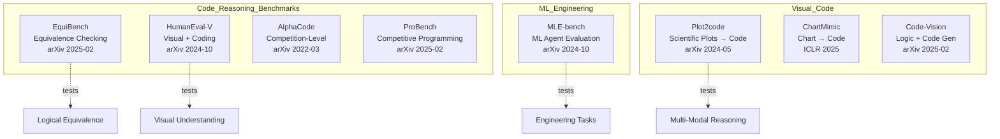

### Benchmark Difficulty and Focus

| Benchmark | Primary Focus | Reasoning Type | Evaluation Method |
|-----------|--------------|----------------|-------------------|
| **EquiBench** | Code equivalence checking | Logical reasoning | Equivalence verification |
| **HumanEval-V** | Visual understanding + coding | Multi-modal reasoning | Functional correctness |
| **MLE-bench** | ML engineering workflows | Agent-based problem solving | Task completion metrics |
| **ProBench** | Competitive programming | Algorithmic reasoning | Test case passing |
| **MHPP** | Beyond basic code generation | Advanced programming patterns | Multi-faceted evaluation |

**Sources:** [README.md:358-380](), [README.md:389-409]()

---

## Multimodal Reasoning Benchmarks

Multimodal benchmarks evaluate vision-language models' ability to perform step-by-step reasoning with visual inputs, combining perception with deliberate thinking.

### Multimodal Evaluation Landscape

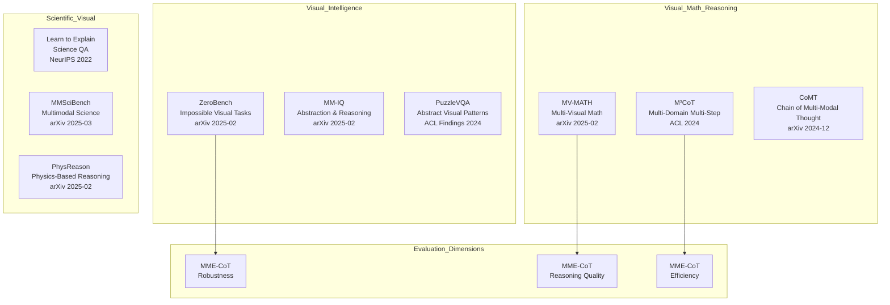

### Key Multimodal Benchmarks

| Benchmark | Visual Task Type | Reasoning Aspect | Notable Feature |
|-----------|------------------|------------------|-----------------|
| **MME-CoT** | General multi-modal | Quality, robustness, efficiency | Comprehensive CoT evaluation |
| **MM-IQ** | Abstract patterns | Human-like abstraction | Inspired by IQ tests |
| **MV-MATH** | Mathematical diagrams | Multi-visual contexts | Multiple visual inputs per problem |
| **ZeroBench** | Impossible tasks | Edge case detection | Tests model limitations |
| **LEGO-Puzzles** | Spatial reasoning | Multi-step spatial tasks | 3D reasoning challenges |

**Sources:** [README.md:367-403](), [assets/paper.json:818-847]()

---

## Agent and Tool Use Benchmarks

Agent benchmarks evaluate LLMs' ability to interact with tools, environments, and multi-step workflows, testing System 2 reasoning in interactive scenarios.

### Agent Capability Evaluation

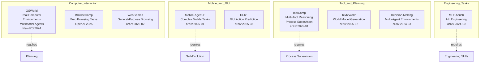

### Agent Benchmark Characteristics

| Benchmark | Environment Type | Action Space | Evaluation Focus |
|-----------|-----------------|--------------|------------------|
| **OSWorld** | Real computer OS | Keyboard, mouse, apps | Multi-modal task completion |
| **BrowseComp** | Web browsers | Navigation, form filling | Browsing agent capability |
| **Mobile-Agent-E** | Mobile devices | Touch, swipe, app control | Self-evolving assistance |
| **ToolComp** | Tool APIs | Function calling | Multi-tool reasoning & supervision |
| **MLE-bench** | ML platforms | Code, data, models | End-to-end ML engineering |
| **UI-R1** | GUI applications | Action prediction | Interface understanding |

**Sources:** [README.md:379-388]()

---

## Process Supervision and Error Detection Benchmarks

These benchmarks evaluate models' ability to verify reasoning steps, detect errors, and provide process-level rewards, which are critical for training System 2 reasoning systems.

### Process Reward and Error Detection Framework

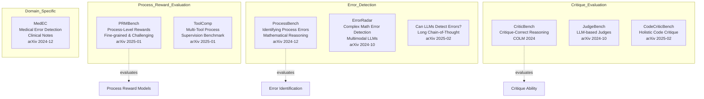

### Step-by-Step Verification Benchmarks

| Benchmark | Verification Target | Granularity | Domain |
|-----------|-------------------|-------------|--------|
| **PRMBench** | Process reward models | Step-level | Mathematics |
| **ProcessBench** | Process errors | Step-level | Mathematical reasoning |
| **ErrorRadar** | Complex reasoning errors | Multi-modal step-level | Mathematical reasoning |
| **CriticBench** | Critique-correct patterns | Solution-level | General reasoning |
| **MedEC** | Clinical reasoning errors | Note-level | Medical domain |
| **Can LLMs Detect Errors** | Long CoT errors | Token/step-level | General reasoning |

**Sources:** [README.md:365](), [README.md:383](), [README.md:424-433]()

---

## Reward Model Benchmarks

Reward model benchmarks specifically evaluate the quality of reward functions used in reinforcement learning and preference optimization for reasoning systems.

### Reward Model Evaluation Framework

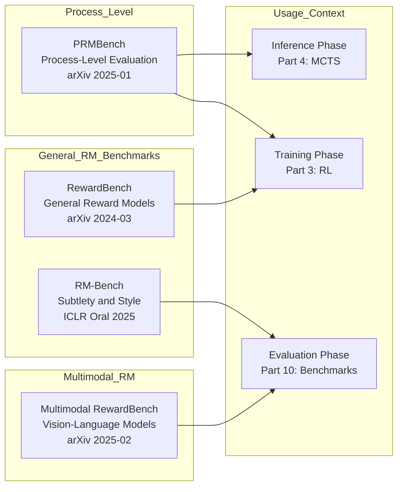

### Reward Model Assessment

| Benchmark | Reward Type | Evaluation Aspects | Target Models |
|-----------|-------------|-------------------|---------------|
| **RewardBench** | Outcome rewards | Preference alignment | General reward models |
| **RM-Bench** | Style & subtlety | Fine-grained preferences | Text reward models |
| **Multimodal RewardBench** | Multi-modal rewards | Vision-language alignment | VLM reward models |
| **PRMBench** | Process rewards | Step-level verification | Math reasoning PRMs |

**Sources:** [README.md:360](), [README.md:364-365](), [README.md:424]()

---

## General Reasoning and Meta-Reasoning Benchmarks

Meta-reasoning benchmarks evaluate higher-order cognitive abilities including planning, strategy selection, and reasoning about reasoning itself.

### Meta-Reasoning Evaluation

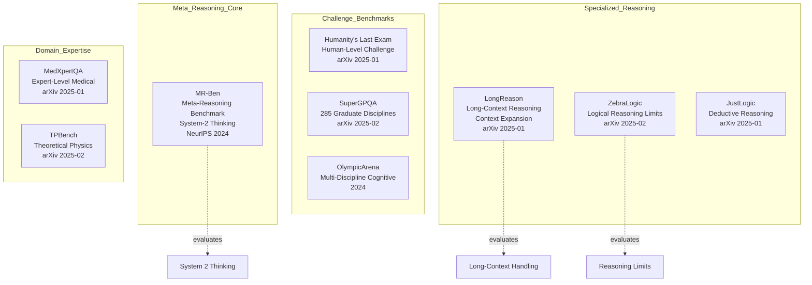

### Complexity and Coverage

| Benchmark | Primary Challenge | Coverage | Notable Aspect |
|-----------|------------------|----------|----------------|
| **MR-Ben** | Meta-reasoning | Cross-domain | System 2 thinking evaluation |
| **Humanity's Last Exam** | Human-level difficulty | Comprehensive | Designed to be challenging for future AI |
| **SuperGPQA** | Graduate-level knowledge | 285 disciplines | Breadth and depth |
| **LongReason** | Long-context reasoning | Synthetic long-context | Context expansion methodology |
| **ZebraLogic** | Logical reasoning limits | Logic puzzles | Scaling behavior analysis |
| **ThinkBench** | Out-of-distribution robustness | Dynamic evaluation | Avoids contamination |

**Sources:** [README.md:356-357](), [README.md:359-363](), [README.md:412-420]()

---

## Overthinking and Efficiency Benchmarks

Recent benchmarks specifically address the problem of overthinking—when models use excessive computation on simple tasks that should require only System 1 thinking.

### Overthinking Evaluation

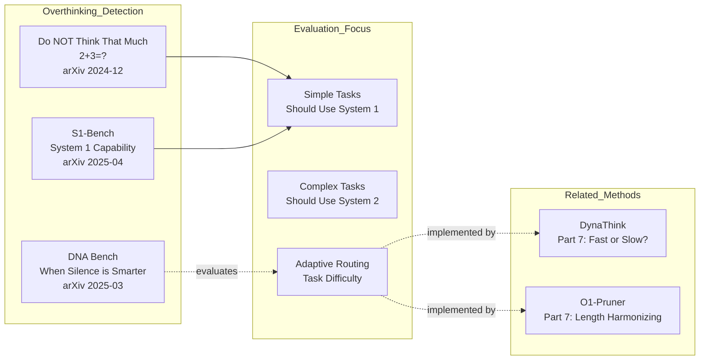

### Task Difficulty Stratification

| Benchmark | Focus | Task Types | Evaluation Metric |
|-----------|-------|------------|------------------|
| **Do NOT Think That Much** | Overthinking on simple tasks | Basic arithmetic, simple reasoning | Computation waste |
| **S1-Bench** | System 1 capability preservation | Fast-thinking tasks | Response quality vs. speed |
| **DNA Bench** | Silence as strategy | Tasks requiring no reasoning | Knowing when not to reason |

**Sources:** [README.md:357](), [README.md:374](), [README.md:377]()

---

## Robustness and Contamination-Free Benchmarks

These benchmarks address dataset contamination and robustness issues by using dynamic generation, recent problems, or perturbation techniques.

### Contamination Mitigation Strategies

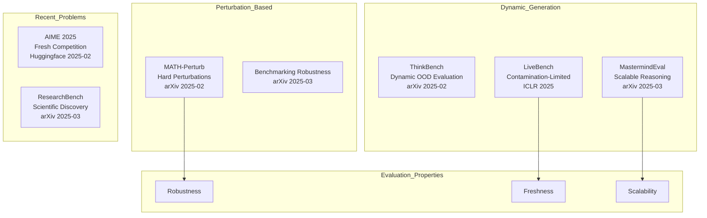

**Sources:** [README.md:411](), [README.md:415-421]()

---

## Benchmark Data Structure and Integration

The repository organizes benchmark metadata in a structured JSON format that supports programmatic access and automated documentation generation.

### Data Organization in paper.json

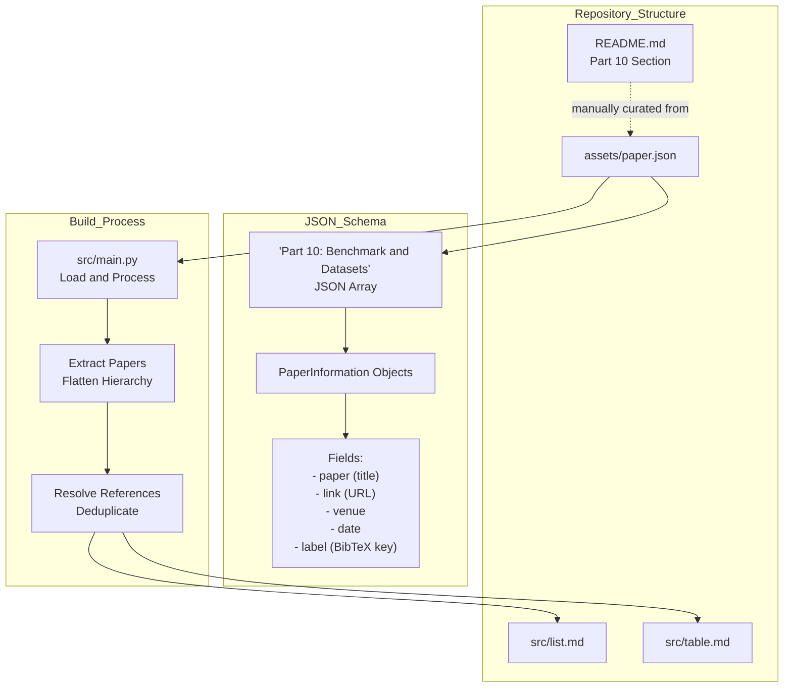

### Example Entry Structure

The benchmark entries in [assets/paper.json:818-847]() follow this structure:

```
"Part 10: Benchmark and Datasets": [
    {
        "paper": "MR-Ben: A Meta-Reasoning Benchmark...",
        "link": "https://openreview.net/forum?id=GN2qbxZlni",
        "venue": "NeurIPS",
        "date": "2024-12",
        "label": "li2024mrben"
    },
    ...
]
```

Each entry contains:
- **paper**: Full paper title
- **link**: Direct URL to paper (arXiv, OpenReview, ACL Anthology, etc.)
- **venue**: Publication venue or preprint server
- **date**: Publication date (YYYY-MM format)
- **label**: BibTeX citation key for cross-referencing

**Sources:** [assets/paper.json:818-847](), [src/list.md:124-129]()

---

## Cross-Cutting Benchmark Themes

Several themes emerge across the benchmark landscape that reflect the priorities and challenges in evaluating System 2 reasoning.

### Evaluation Dimensions Matrix

```mermaid
graph TB
    subgraph "Correctness_Dimension"
        FINAL["Final Answer Correctness"]
        PROCESS["Process Correctness"]
        STEPWISE["Step-wise Verification"]
    end
    
    subgraph "Efficiency_Dimension"
        COMPUTE["Computational Cost"]
        TOKENS["Token Usage"]
        TIME["Inference Time"]
    end
    
    subgraph "Robustness_Dimension"
        PERTURB["Perturbation Resistance"]
        OOD["Out-of-Distribution"]
        CONTAMINATION["Contamination-Free"]
    end
    
    subgraph "Capability_Dimension"
        COMPLEXITY["Problem Complexity"]
        MULTIMODAL["Multi-Modal Integration"]
        INTERACTIVE["Interactive/Agentic"]
    end
    
    PRMBENCH_DIM["PRMBench"] --> PROCESS
    MATHPERTURB_DIM["MATH-Perturb"] --> PERTURB
    MMECOT_DIM["MME-CoT"] --> COMPUTE
    MMECOT_DIM --> PROCESS
    OSWORLD_DIM["OSWorld"] --> INTERACTIVE
    FRONTIER_DIM["FrontierMath"] --> COMPLEXITY
```

### Benchmark Selection Guide

| Research Focus | Recommended Benchmarks | Key Metrics |
|----------------|----------------------|-------------|
| **Process Reward Models** | PRMBench, ToolComp, ProcessBench | Step-level accuracy, error detection |
| **Mathematical Reasoning** | FrontierMath, MATH-Perturb, AIME 2025 | Problem-solving accuracy, robustness |
| **Code Generation** | EquiBench, HumanEval-V, ProBench | Functional correctness, code quality |
| **Multimodal Reasoning** | MME-CoT, MM-IQ, ZeroBench | Visual understanding + reasoning |
| **Agent Capabilities** | OSWorld, BrowseComp, MLE-bench | Task completion, tool use |
| **Overthinking Analysis** | Do NOT Think, S1-Bench, DNA Bench | Efficiency vs. accuracy trade-off |
| **Meta-Reasoning** | MR-Ben, LongReason, Humanity's Last Exam | Higher-order reasoning |

**Sources:** [README.md:351-433]()

---

## Integration with Training and Evaluation Pipeline

Benchmarks serve multiple roles in the development lifecycle of System 2 reasoning models, from training data generation to final evaluation.

### Benchmark Usage Across Development Stages

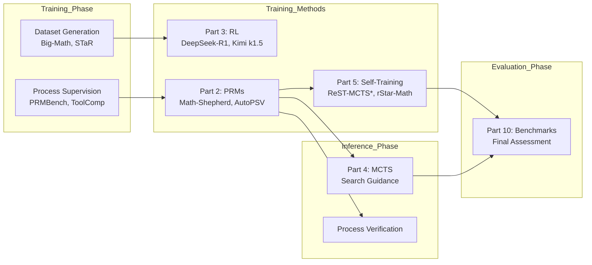

### Benchmark-to-Method Mapping

| Benchmark Category | Primary Use Case | Related Parts |
|-------------------|------------------|---------------|
| **Process Supervision** (PRMBench, ToolComp) | Training PRMs, guiding search | Parts 2, 4, 5 |
| **Mathematical** (FrontierMath, AIME) | Final evaluation of reasoning | Parts 1, 3, 4, 5 |
| **Multimodal** (MME-CoT, MM-IQ) | VLM reasoning assessment | Parts 9, 12 |
| **Agent** (OSWorld, BrowseComp) | Interactive reasoning | Part 9 |
| **Reward Models** (RM-Bench, RewardBench) | RM quality assessment | Parts 2, 3 |
| **Efficiency** (Do NOT Think, O1-Pruner) | Optimization validation | Part 7 |

**Sources:** [README.md:32-43](), [README.md:351-433]()

---

## Summary

The benchmark landscape for System 2 reasoning in LLMs has evolved rapidly, reflecting the field's maturation from basic reasoning to complex, multi-step problem-solving. Key observations:

1. **Specialization**: Benchmarks now target specific aspects—process supervision, multimodal reasoning, agent capabilities, and meta-reasoning.

2. **Difficulty Progression**: From competition-level math to research-grade problems (FrontierMath), pushing the boundaries of what LLMs can solve.

3. **Robustness Focus**: Increasing emphasis on perturbation resistance, contamination-free evaluation, and dynamic generation.

4. **Process over Outcome**: Growing attention to step-by-step verification (PRMBench, ProcessBench) beyond final answer correctness.

5. **Efficiency Awareness**: New benchmarks address overthinking and computational cost, recognizing that not all tasks need slow reasoning.

6. **Multi-Modal Integration**: Expansion beyond text to vision-language reasoning and interactive environments.

The structured metadata in [assets/paper.json:818-847]() enables systematic tracking of this evolving landscape, supporting both researchers selecting evaluation frameworks and practitioners monitoring field progress.

**Sources:** [README.md:351-433](), [assets/paper.json:818-847](), [src/list.md:124-129]()

---

