<!-- source: DeepWiki mcp.deepwiki.com · repo zzli2022/Awesome-System2-Reasoning-LLM · page 8 Technical Integration Patterns · fetched 2026-10-30 -->

# Technical Integration Patterns

Relevant source files

The following files were used as context for generating this wiki page:

- [README.md](README.md)
- [src/list.md](src/list.md)
- [src/table.md](src/table.md)

## Purpose and Scope

This page documents how different System 2 reasoning methodologies combine in practice to create production-ready reasoning systems. While individual methodologies are covered in [Core Methodologies](#4), this page focuses on **integration patterns**—how Process Reward Models, Reinforcement Learning, MCTS, Self-Training, and Reflection work together in real implementations.

Key coverage:
- **ReST-MCTS* Pipeline**: The canonical example of process reward + tree search + self-training integration
- **O1 Replication Architectures**: Different technical approaches to reproducing o1-like reasoning
- **Training-Time vs Inference-Time Strategies**: When and how to apply reasoning techniques
- **Multi-Method Synergies**: Practical combinations that achieve state-of-the-art results

For theoretical foundations of individual methods, see [Core Methodologies](#4). For production efficiency patterns, see [Efficient System2](#5.1).

**Sources**: [README.md:1-44]()

---

## Integration Taxonomy: Training-Time vs Inference-Time

System 2 reasoning techniques can be categorized by **when** they operate and **how** they combine:

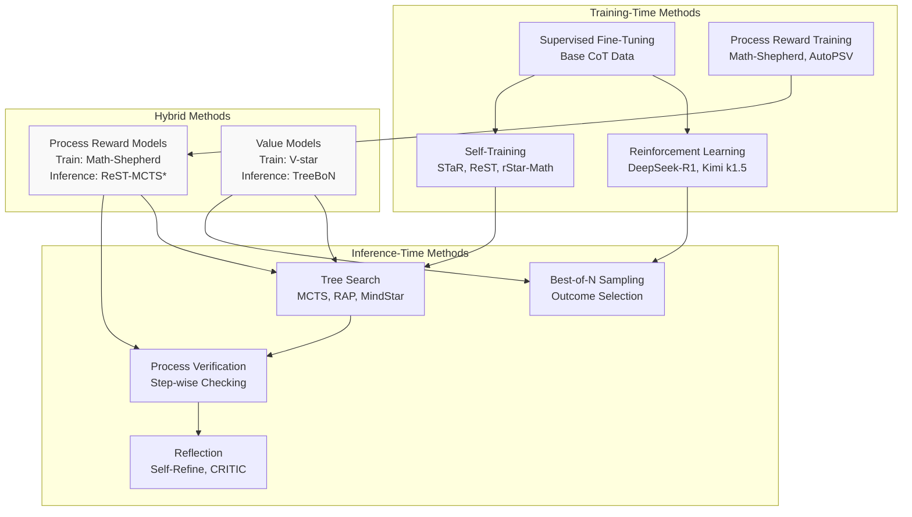

**Key Insight**: Most production systems use **multi-stage integration**:
1. **Training-time foundation**: RL or Self-Training to build base reasoning capability
2. **Inference-time amplification**: MCTS or Best-of-N to explore solution space
3. **Process-level guidance**: PRMs to guide both training and inference

**Sources**: [README.md:98-138](), [README.md:139-193](), [README.md:194-224]()

---

## The ReST-MCTS* Pipeline: Canonical Integration Pattern

**ReST-MCTS*** represents the most complete integration of core methodologies, combining Process Rewards, Tree Search, and Self-Training in a unified pipeline.

### Pipeline Architecture

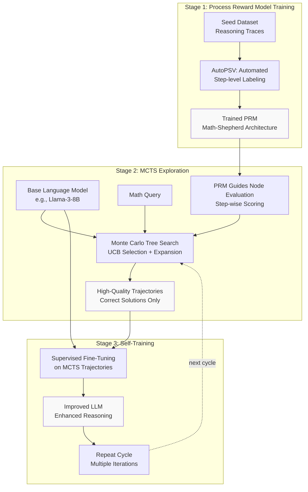

### Technical Components

| Component | Paper Reference | Technical Detail |
|-----------|----------------|------------------|
| **Process Reward Model** | Math-Shepherd | Automated labeling using Monte Carlo estimation, trains on step-level correctness |
| **Tree Search** | AlphaZero-like | UCB-based selection, PRM-guided expansion, value function combines outcome + process rewards |
| **Self-Training Loop** | ReST | Filters trajectories by correctness, multiple iterations with expanding dataset |
| **Integration Mechanism** | ReST-MCTS* | PRM serves as both (1) MCTS guidance and (2) trajectory filter for self-training |

**Key Innovation**: The PRM enables **self-evolving reasoning** without human annotations by:
1. Providing fine-grained step-level feedback during MCTS exploration
2. Filtering generated trajectories for self-training data quality
3. Improving with each iteration as the base model improves

**Sources**: [README.md:78](), [README.md:175](), [README.md:212](), [README.md:73-74]()

### Code-Level Integration Pattern

The ReST-MCTS* approach is implemented in multiple codebases with similar architectural patterns:

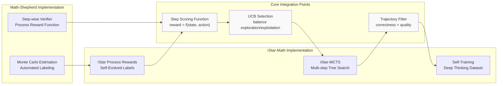

**Implementation References**:
- **ReST-MCTS* base**: Uses AlphaZero-style tree policy with PRM as value function
- **rStar-Math**: Extends with "deep thinking" trajectories and self-evolution
- **Math-Shepherd**: Provides automated PRM training without human labels

**Sources**: [README.md:78](), [README.md:175](), [README.md:188](), [README.md:220](), [README.md:73]()

---

## O1 Replication Architectures: Diverse Integration Strategies

Different teams have pursued distinct integration strategies to replicate o1-like reasoning capabilities. Each represents a different technical bet on which combinations work best.

### Architecture Comparison Matrix

| System | Training-Time | Inference-Time | Key Integration | Scale Focus |
|--------|--------------|----------------|-----------------|-------------|
| **DeepSeek-R1** | Pure RL (GRPO) | Native reasoning | RL incentivizes long CoT | Large-scale (671B params) |
| **Kimi k1.5** | Scaled RL | Native reasoning | Curriculum RL + data diversity | Large-scale (RL at scale) |
| **Marco-o1** | MCTS + Reflection | MCTS at inference | Reflection-augmented MCTS | Open-ended reasoning |
| **rStar-Math** | Self-Training + PRM | MCTS at inference | Self-evolved deep thinking | Small models (7B-32B) |
| **HuatuoGPT-o1** | Medical SFT + RL | MCTS + Reflection | Domain-specific integration | Medical reasoning |
| **Virgo (Vision)** | Multimodal SFT | MCTS + Visual reward | Vision-language integration | Multimodal reasoning |

### DeepSeek-R1: Pure RL Integration

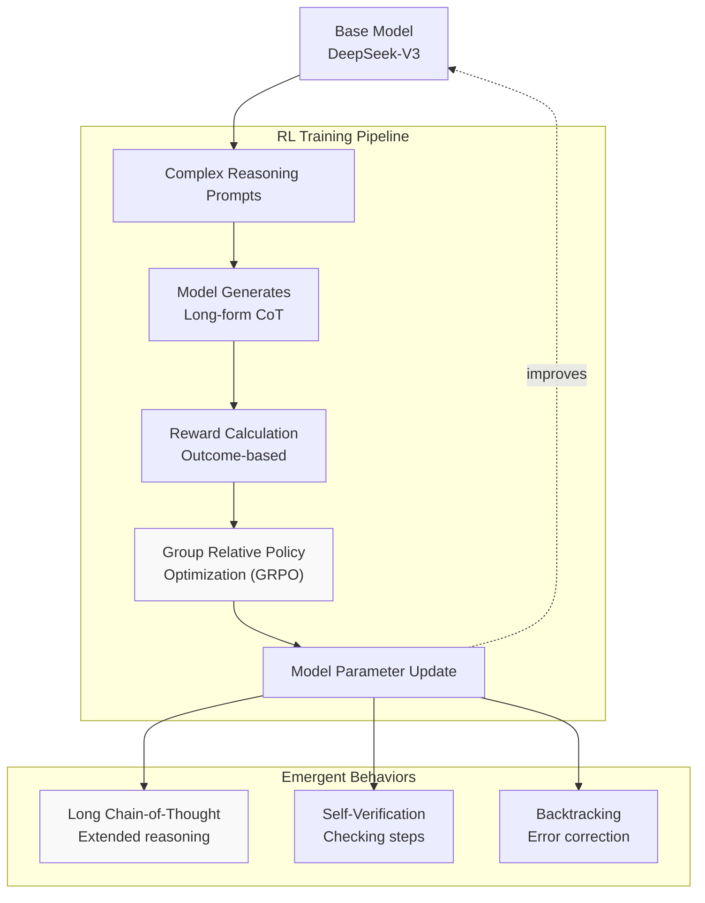

**Key Technical Decision**: DeepSeek-R1 uses **pure RL without explicit tree search**, betting that RL will naturally discover reasoning strategies. The GRPO algorithm enables this by:
- Training on groups of completions simultaneously
- Using relative rewards to reduce variance
- Incentivizing exploration of long reasoning chains

**Trade-off**: Higher compute during training, but no inference-time overhead.

**Sources**: [README.md:107](), [README.md:114]()

### rStar-Math: Self-Evolved Deep Thinking

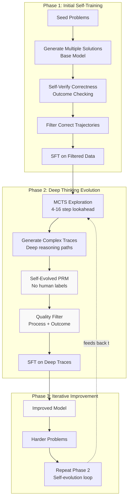

**Key Technical Decision**: rStar-Math focuses on **small models** (7B) achieving strong performance through:
- Self-evolved deep thinking trajectories (no human annotations)
- Iterative improvement through multiple training phases
- MCTS at inference time for test-time compute scaling

**Trade-off**: Requires multiple training iterations but achieves competitive performance at small scale.

**Sources**: [README.md:188](), [README.md:220](), [README.md:239]()

### Marco-o1: Reflection-Augmented MCTS

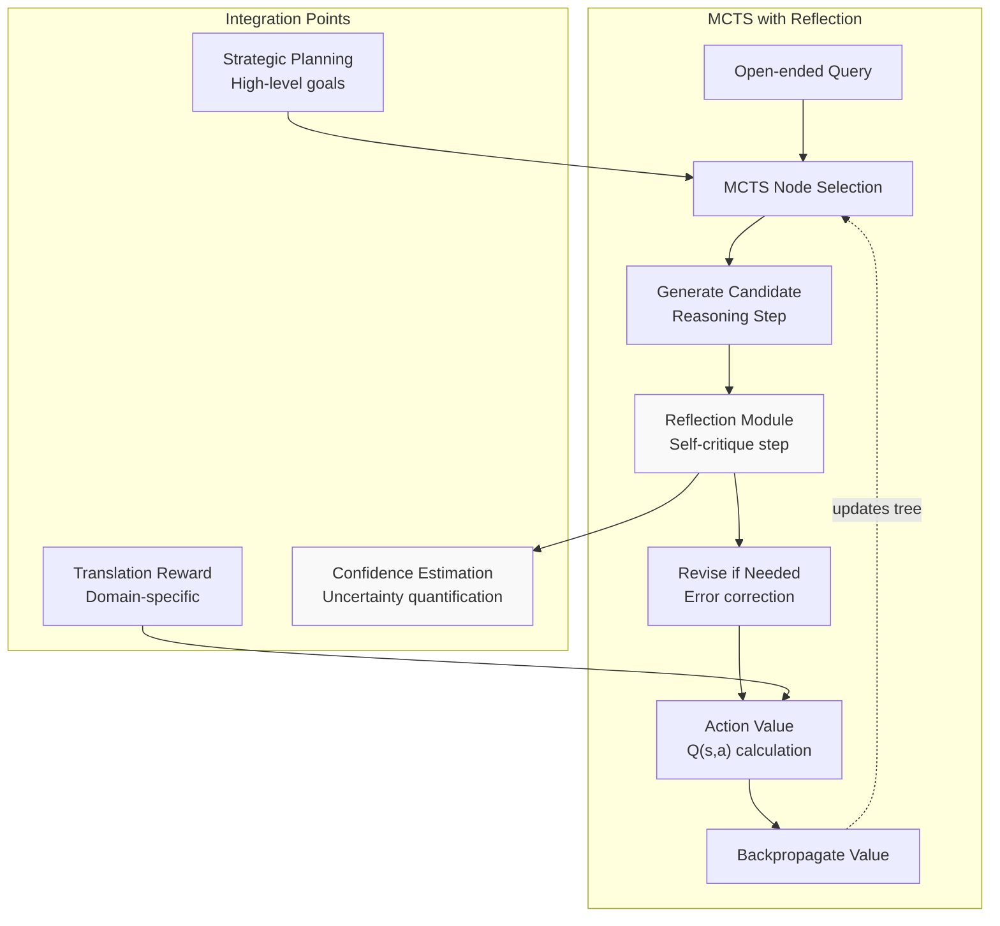

**Key Technical Decision**: Marco-o1 integrates **reflection at every MCTS step**, enabling:
- Real-time error detection during tree search
- Confidence-aware node evaluation
- Open-ended reasoning (e.g., translation, colloquial language)

**Trade-off**: More compute per MCTS step, but higher quality trajectories.

**Sources**: [README.md:49](), [README.md:172](), [README.md:234]()

---

## Training-Time vs Inference-Time Trade-offs

The choice between training-time and inference-time reasoning has fundamental implications:

### Comparison Framework

```mermaid
graph TB
    subgraph "Training-Time Reasoning"
        direction TB
        TRAIN_RL["Reinforcement Learning<br/>DeepSeek-R1, Kimi k1.5"]
        TRAIN_SELF["Self-Training<br/>rStar-Math, STaR"]
        TRAIN_DIST["Distillation<br/>O1 Replication Journey Part 2"]
        
        TRAIN_PROS["Advantages:<br/>- Fast inference<br/>- No search overhead<br/>- Native reasoning"]
        TRAIN_CONS["Disadvantages:<br/>- High training compute<br/>- Fixed at deployment<br/>- Limited adaptability"]
        
        TRAIN_RL -.example.-> TRAIN_PROS
        TRAIN_SELF -.example.-> TRAIN_PROS
        TRAIN_DIST -.example.-> TRAIN_PROS
        
        TRAIN_RL -.faces.-> TRAIN_CONS
    end
    
    subgraph "Inference-Time Reasoning"
        direction TB
        INF_MCTS["MCTS/Tree Search<br/>MindStar, rStar-Math"]
        INF_BEST["Best-of-N Sampling<br/>TreeBoN, PairJudge"]
        INF_REFLECT["Reflection<br/>Self-Refine, CRITIC"]
        
        INF_PROS["Advantages:<br/>- Test-time compute scaling<br/>- Adaptable per query<br/>- Verifiable paths"]
        INF_CONS["Disadvantages:<br/>- Slow inference<br/>- Compute per query<br/>- Quality depends on base"]
        
        INF_MCTS -.example.-> INF_PROS
        INF_BEST -.example.-> INF_PROS
        INF_REFLECT -.example.-> INF_PROS
        
        INF_MCTS -.faces.-> INF_CONS
    end
    
    subgraph "Hybrid Approaches"
        direction TB
        HYBRID_REST["ReST-MCTS*<br/>Train with inference search"]
        HYBRID_RSTAR["rStar-Math<br/>Self-train + MCTS inference"]
        HYBRID_DYN["DynaThink<br/>Dynamic routing"]
        
        HYBRID_BEST["Best of Both:<br/>- Strong base model (training)<br/>- Adaptive scaling (inference)<br/>- Efficient routing"]
    end
    
    TRAIN_RL -.combines with.-> HYBRID_REST
    INF_MCTS -.combines with.-> HYBRID_REST
    
    style HYBRID_BEST fill:#f9f9f9
```

### Technical Decision Matrix

| Use Case | Recommended Approach | Key Papers | Rationale |
|----------|---------------------|------------|-----------|
| **Production API** (latency-sensitive) | Training-time RL | DeepSeek-R1, Kimi k1.5 | Fast inference, amortized compute |
| **Research Benchmark** (accuracy-focused) | Inference-time MCTS | rStar-Math, MindStar | Test-time scaling for hard problems |
| **Small Model Deployment** | Hybrid (Self-train + MCTS) | rStar-Math, ReST-MCTS* | Compensate for limited capacity |
| **Domain-Specific** (medical, coding) | Training-time + domain PRMs | HuatuoGPT-o1, o1-Coder | Specialized knowledge + reasoning |
| **Dynamic Workload** | Adaptive routing | DynaThink, O1-Pruner | Fast for simple, slow for hard |

**Sources**: [README.md:107-108](), [README.md:188](), [README.md:246](), [README.md:254]()

---

## Multi-Method Synergy Patterns

Certain methodology combinations create **synergistic effects** where the whole exceeds the sum of parts:

### Synergy Pattern 1: PRM + MCTS + Self-Training

**Why it works**:
- **PRM** provides fine-grained guidance that MCTS lacks with outcome-only rewards
- **MCTS** explores diverse solution paths that simple sampling misses
- **Self-Training** converts exploration into improved base capability
- **Loop**: Improved base model → better MCTS exploration → higher quality training data

**Key Papers**: ReST-MCTS*, rStar-Math, Math-Shepherd

### Synergy Pattern 2: RL + Process Rewards

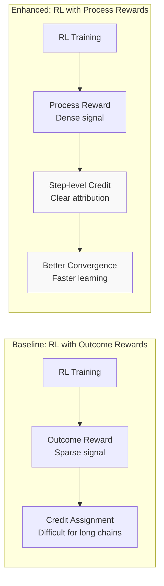

**Why it works**:
- **Dense feedback**: Process rewards provide signal at every reasoning step
- **Credit assignment**: Easier to identify which steps led to success/failure
- **Faster convergence**: More gradients per trajectory

**Key Papers**: Step-DPO, DeepSeek-R1 (implicit), AutoPSV

**Sources**: [README.md:76](), [README.md:77]()

### Synergy Pattern 3: Reflection + Tree Search

**Why it works**:
- **Reflection** detects errors in individual trajectories
- **Tree Search** explores alternative paths when errors detected
- **Combined**: Self-correction capability + systematic exploration

**Integration Points**:
1. Reflection as MCTS node evaluation
2. Reflection triggers backtracking in search
3. Reflection-revised nodes added to tree

**Key Papers**: Marco-o1, Mulberry, Vision-Language Self-Improve

**Sources**: [README.md:234](), [README.md:178](), [README.md:236]()

---

## Domain-Specific Integration Patterns

Different domains require adapted integration strategies:

### Mathematical Reasoning

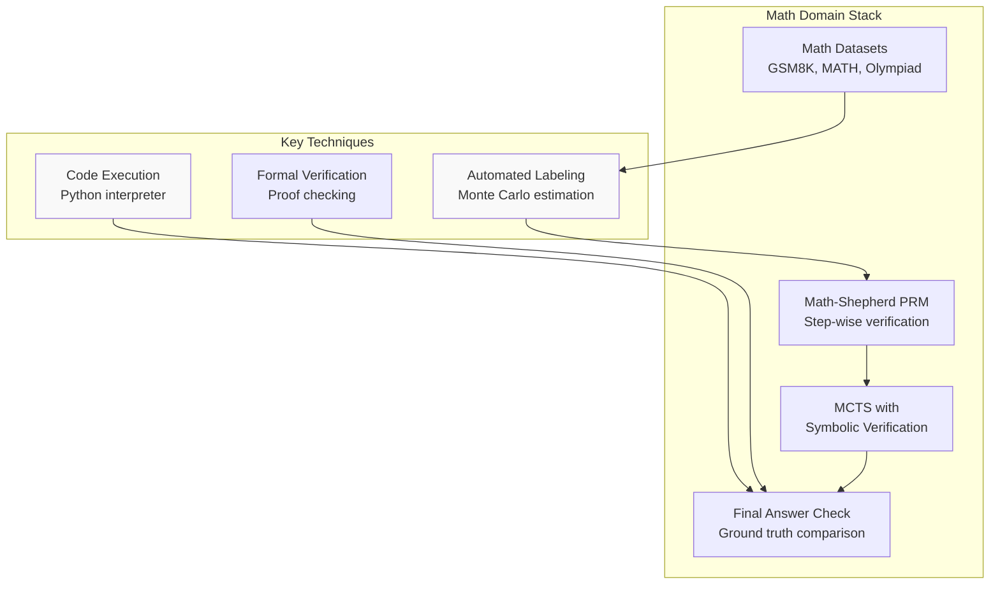

**Math-Specific Integrations**:
- **Automated PRM training**: Monte Carlo estimation for step labels (no humans needed)
- **Executable verification**: Python code execution for numerical checks
- **Symbolic reasoning**: Integration with computer algebra systems
- **Proof verification**: Lean/Coq integration for formal proofs

**Key Papers**: Math-Shepherd, rStar-Math, DeepSeekMath

**Sources**: [README.md:73](), [README.md:109]()

### Medical Reasoning

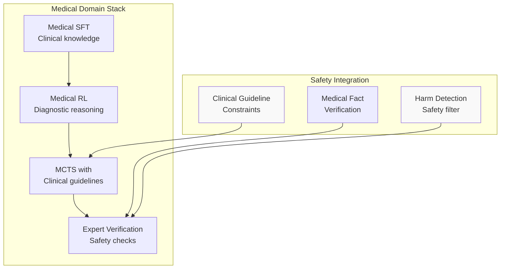

**Medical-Specific Integrations**:
- **Clinical guidelines as constraints**: MCTS pruning based on medical standards
- **Expert verification loop**: Human-in-the-loop for safety
- **Factual grounding**: RAG integration with medical knowledge bases
- **Harm detection**: Safety-aware reward shaping

**Key Papers**: HuatuoGPT-o1, MedVLM-R1, Med-RLVR

**Sources**: [README.md:53](), [README.md:117]()

### Code Generation

**Code-Specific Integrations**:
- **Execution feedback**: Test case results as rewards
- **Syntax verification**: AST parsing for correctness
- **Type checking**: Static analysis integration
- **Code search**: Tree search over program space

**Key Papers**: o1-Coder, CodeTree, RethinkMCTS

**Sources**: [README.md:52](), [README.md:169](), [README.md:162]()

---

## Efficiency Integration Patterns

Production systems require efficiency optimizations integrated throughout:

### Dynamic Routing Pattern

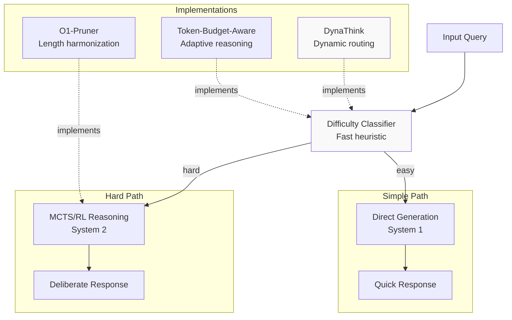

**Integration Points**:
- **Difficulty estimation**: Confidence-based or learned classifier
- **Budget allocation**: Dynamic token limits per query
- **Early stopping**: Terminate reasoning when confidence high
- **Caching**: Reuse reasoning traces for similar queries

**Key Papers**: DynaThink, O1-Pruner, Token-Budget-Aware LLM Reasoning

**Sources**: [README.md:246](), [README.md:254](), [README.md:248]()

### Latent Space Reasoning

**Pattern**: Compress reasoning into continuous latent space instead of token space

**Integration**:
- Training: Learn latent reasoning representations
- Inference: Reason in latent space, decode final answer
- Benefit: Faster reasoning, fewer tokens

**Key Papers**: Training LLMs to Reason in Continuous Latent Space, Efficient Reasoning with Hidden Thinking

**Sources**: [README.md:249](), [README.md:253](), [README.md:280]()

---

## Implementation Considerations

### Computational Resource Planning

| Integration Pattern | Training Compute | Inference Compute | Memory | Best For |
|---------------------|-----------------|------------------|---------|----------|
| **Pure RL** | Very High (weeks) | Low (native generation) | High (large models) | Production APIs |
| **MCTS at Inference** | Medium (SFT) | High (per query search) | Medium | Research, benchmarks |
| **ReST-MCTS*** | High (iterative) | Medium (improved base) | Medium | Balanced approach |
| **Self-Training** | Medium (multiple iterations) | Low (no search) | Low-Medium | Resource-constrained |
| **Hybrid Routing** | Medium | Variable (adaptive) | Medium | Variable workloads |

### Quality-Latency Trade-off Curves

Different integration patterns occupy different positions on the quality-latency frontier:

1. **High Quality, High Latency**: MCTS at inference (MindStar, rStar-Math)
2. **High Quality, Low Latency**: Large-scale RL (DeepSeek-R1, Kimi k1.5)
3. **Medium Quality, Low Latency**: Small model self-training + efficient routing
4. **Adaptive**: Dynamic routing systems (DynaThink)

**Sources**: [README.md:246-324]()

---

## Future Integration Directions

Emerging patterns in recent papers (2025):

### Multi-Modal Integration

- **Vision-language reasoning**: Virgo, LLaVA-o1, MM-Eureka
- **Pattern**: Extend text reasoning pipelines to visual inputs
- **Challenge**: Visual process rewards harder to define

**Sources**: [README.md:348](), [README.md:235]()

### Agentic Integration

- **Tool-augmented reasoning**: ARMAP, Search-o1, RAG-Gym
- **Pattern**: Integrate external tools with reasoning loops
- **Challenge**: Tool selection and composition

**Sources**: [README.md:85](), [README.md:60](), [README.md:187](), [README.md:350]()

### Efficient Long-Context Reasoning

- **Challenge**: Reasoning over documents exceeds context windows
- **Pattern**: Hierarchical reasoning + memory management
- **Papers**: LongReason, efficient attention mechanisms

**Sources**: [README.md:362]()

---

## Summary: Key Integration Principles

1. **Synergy over isolation**: Combined methods outperform individual techniques
2. **PRM as glue**: Process rewards enable integration of training and inference methods
3. **Trade-off awareness**: Choose integration based on latency, compute, and quality requirements
4. **Domain adaptation**: Modify integration patterns for specific domains (math, medical, code)
5. **Efficiency integration**: Build routing and optimization into core architecture, not as afterthought

**Production Recipe**: For most applications, start with training-time methods (RL or self-training) to build strong base capability, then add inference-time scaling (MCTS or Best-of-N) for hard queries, with dynamic routing to balance cost and quality.

**Sources**: [README.md:1-450]()

---

