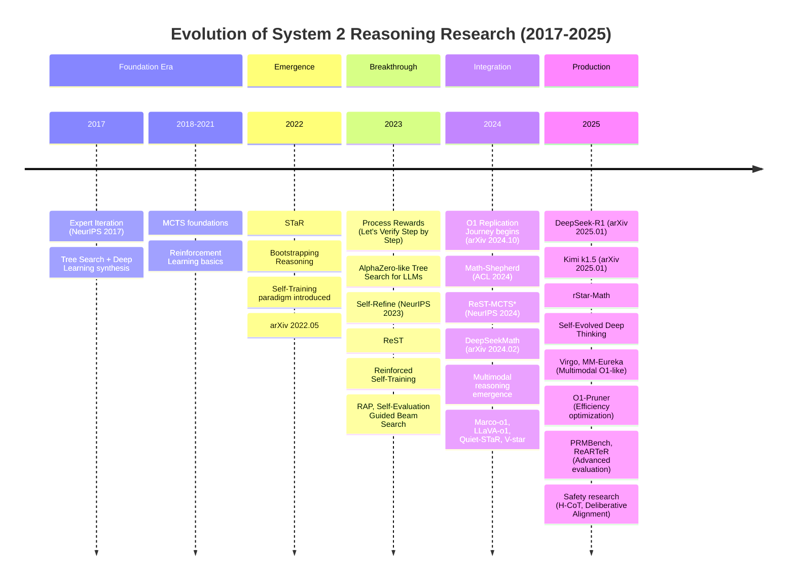
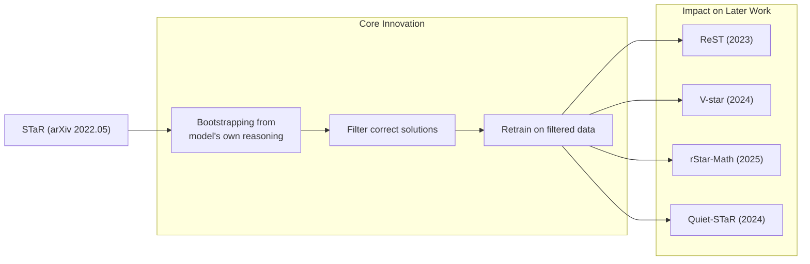
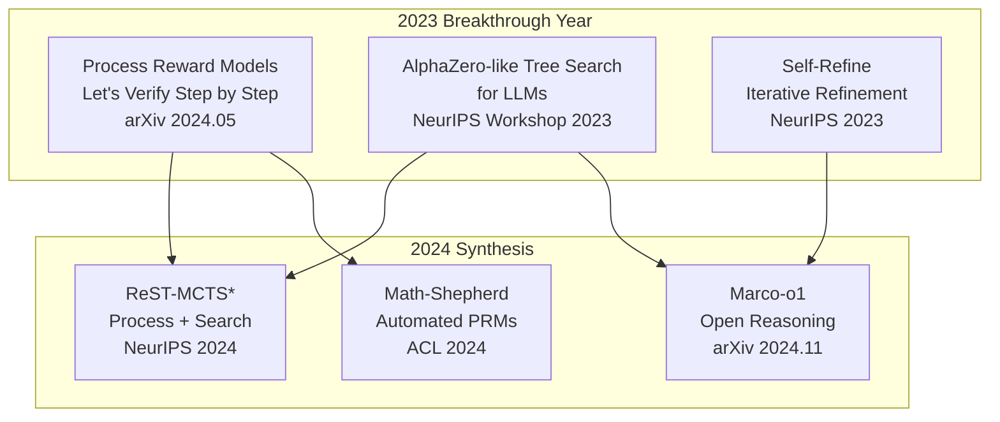
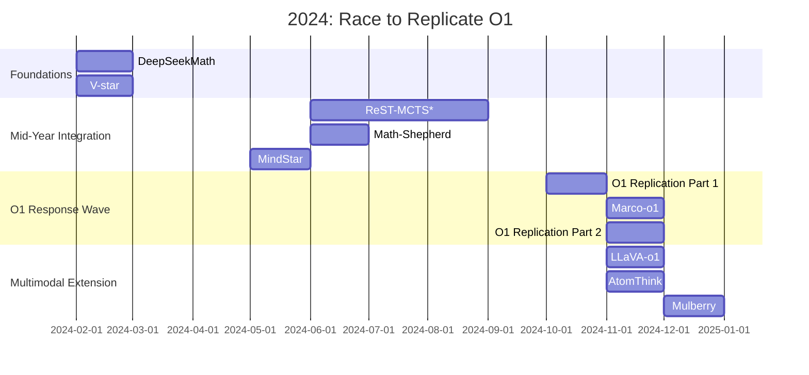
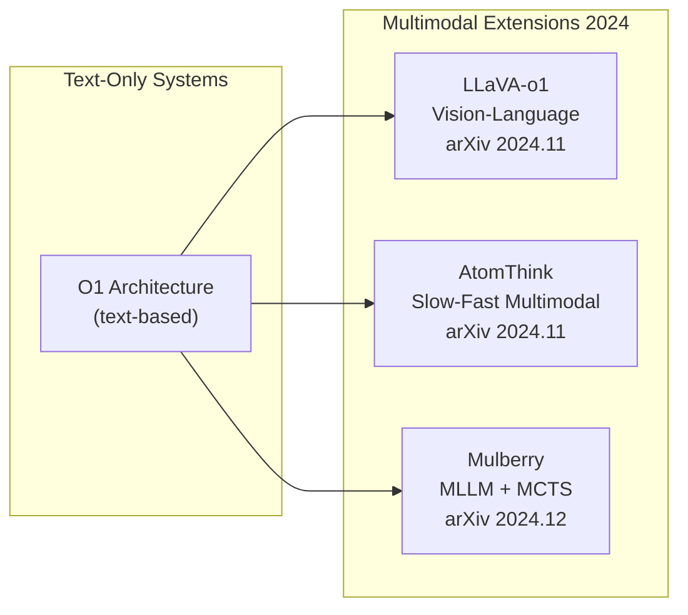
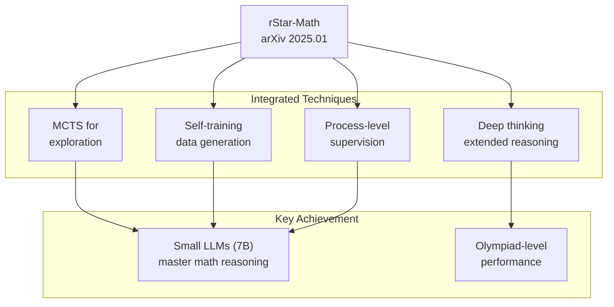
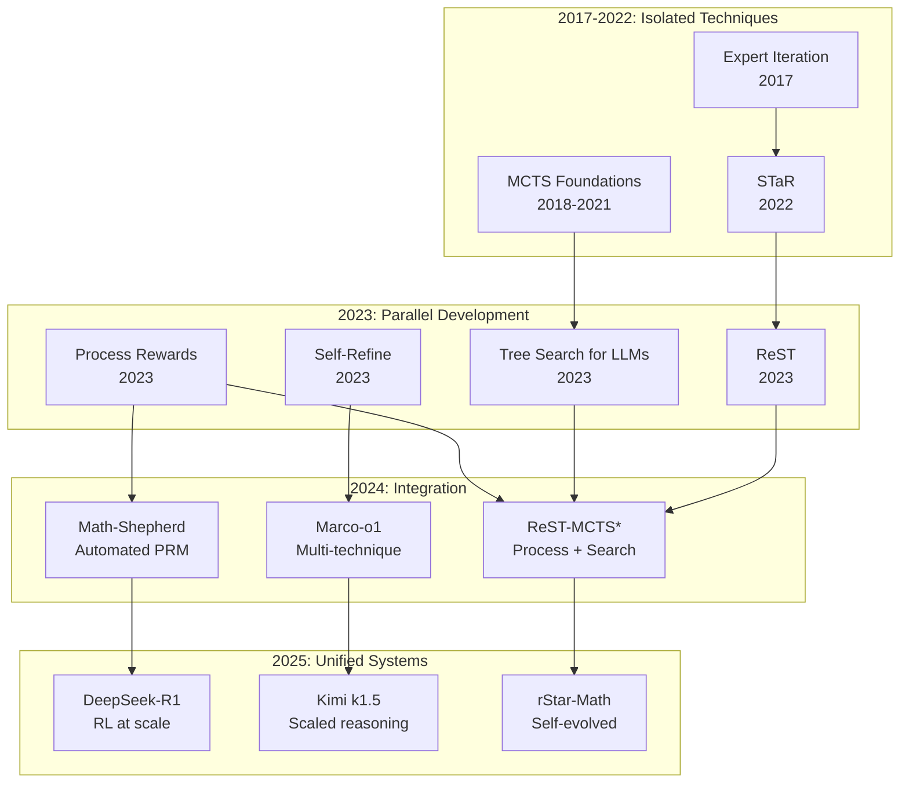
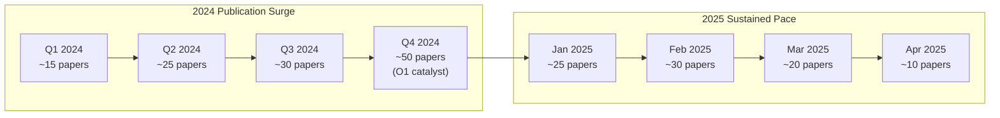
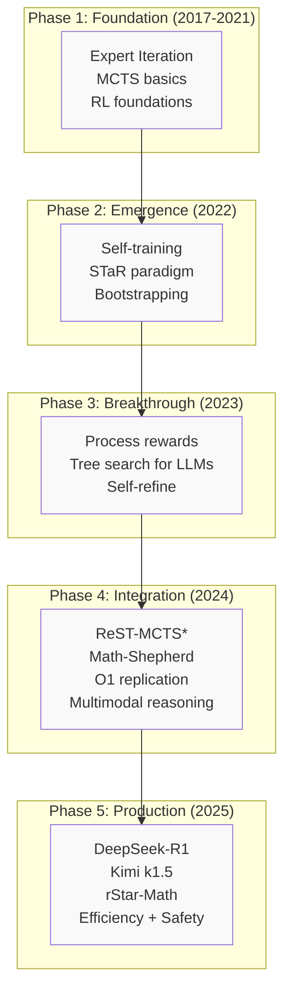

<!-- source: DeepWiki mcp.deepwiki.com · repo zzli2022/Awesome-System2-Reasoning-LLM · page 9 Research Timeline and Evolution · fetched 2026-10-30 -->

# Research Timeline and Evolution

Relevant source files

The following files were used as context for generating this wiki page:

- [README.md](README.md)
- [assets/timeline.jpg](assets/timeline.jpg)
- [assets/timeline.png](assets/timeline.png)
- [assets/timeline_2.png](assets/timeline_2.png)
- [src/timeline.png](src/timeline.png)

## Purpose and Scope

This document provides a chronological perspective on System 2 reasoning research in Large Language Models, tracking the field's evolution from foundational work (2017) through production-ready systems (2025). It maps key breakthroughs, inflection points, and the convergence of methodologies to the repository's 12-part taxonomy.

For the conceptual framework of System 1 vs System 2 reasoning, see [System 1 vs System 2 Reasoning](#2). For the current research landscape organized by methodology, see [Research Landscape Overview](#3). For specific technical approaches, see [Core Methodologies](#4).

**Sources:** [README.md:1-27](), [README.md:25-26]()

---

## Historical Timeline: 2017-2025

The evolution of System 2 reasoning in LLMs can be traced through five distinct periods, each characterized by specific methodological advances and architectural innovations.

**Sources:** [README.md:45-416]() (extracting dates from all 12 parts), [README.md:25-26](), High-level architecture diagrams

---

## Foundation Era (2017-2021): Building Blocks

The foundation era established the core concepts that would later converge into modern System 2 reasoning systems.

### Expert Iteration (2017)

The seminal work that demonstrated how tree search could be combined with deep learning to improve reasoning capabilities.

| Paper | Venue | Key Contribution |
|-------|-------|------------------|
| Expert Iteration | NeurIPS 2017 | Tree Search + Deep Learning synthesis |

**Repository Location:** [README.md:196]() under Part 5: Self-Training / Self-Improve

### Core Concepts Established

During this period, research established:
- **Monte Carlo Tree Search (MCTS)** as a planning mechanism
- **Reinforcement Learning** for policy optimization
- **Tree-based exploration** for reasoning paths

These foundational techniques would remain dormant in LLM research until 2022-2023, when computational capabilities and model scales made them practical.

**Sources:** [README.md:196](), [README.md:139-194]() (Part 4: MCTS/Tree Search historical context)

---

## Self-Training Emergence (2022): Bootstrapping Begins

The 2022 period introduced self-training as a viable paradigm for improving reasoning without extensive human annotation.

### STaR: Bootstrapping Reasoning With Reasoning

**Repository Mapping:**
- `assets/paper.json`: Entry for STaR paper
- [README.md:197](): STaR listing in Part 5
- Descendants in [README.md:201-224]() (ReST, V-star, Quiet-STaR, rStar-Math)

### Paradigm Shift

STaR introduced the concept that models could generate their own training data by:
1. Attempting problems
2. Filtering successful reasoning chains
3. Fine-tuning on self-generated data

This self-improvement loop would become central to 2024-2025 systems.

**Sources:** [README.md:197](), [README.md:194-224]() (Part 5 entire section)

---

## Breakthrough Year (2023): Convergence of Methods

2023 saw the simultaneous development of multiple techniques that would later be synthesized into O1-like systems.

### Three Simultaneous Breakthroughs

### Key Papers by Breakthrough

| Breakthrough | Representative Papers | Repository Location |
|--------------|----------------------|---------------------|
| **Process Rewards** | Let's Verify Step by Step | [README.md:75]() Part 2 |
| | Making LLMs Better Reasoners with Step-Aware Verifier | [README.md:72]() Part 2 |
| **Tree Search** | AlphaZero-like Tree-Search Can Guide LLM Decoding | [README.md:144-145]() Part 4 |
| | Reasoning with Language Model is Planning with World Model | [README.md:141]() Part 4 |
| **Reflection** | Self-Refine: Iterative Refinement with Self-Feedback | [README.md:200]() Part 6 |
| | Self-Evaluation Guided Beam Search | [README.md:199]() Part 5 |

### ReST: Reinforced Self-Training

The synthesis of self-training with reinforcement learning:

**Repository Mapping:**
- [README.md:201](): ReST in Part 5
- `assets/paper.json`: Structured metadata with arXiv 2023.08 date
- Evolved into ReST-MCTS* in 2024 [README.md:78,175,212]()

**Sources:** [README.md:68-97]() (Part 2: Process Reward Models), [README.md:139-193]() (Part 4: MCTS/Tree Search), [README.md:225-241]() (Part 6: Reflection), [README.md:201]()

---

## Integration Phase (2024): The O1 Replication Journey

2024 marked the acceleration phase where separate techniques converged toward OpenAI's o1 architecture. The year saw explosive growth in papers attempting to replicate and understand o1's capabilities.

### O1 Replication Timeline

### Key Architectural Patterns

The 2024 papers revealed common architectural patterns:

| Pattern | Implementation | Papers | Repository Location |
|---------|---------------|--------|---------------------|
| **Process + Search** | MCTS guided by process rewards | ReST-MCTS*, rStar-Math | [README.md:78,175]() |
| **RL-Based Training** | PPO/DPO/GRPO for reasoning | DeepSeekMath, Kimi k1.5 prep | [README.md:98-138]() Part 3 |
| **Automated PRM** | Self-generated process supervision | Math-Shepherd, AutoPSV | [README.md:73,77]() Part 2 |
| **Tree Search Decoding** | Inference-time exploration | MindStar, LLaMA-Berry | [README.md:153,165]() Part 4 |

### Math-Shepherd: Automated Process Supervision

A critical 2024 breakthrough was automating process reward model creation:

**File References:**
- [README.md:73](): "Math-Shepherd: Verify and Reinforce LLMs Step-by-step without Human Annotations"
- ACL 2024 publication
- Part of the automated supervision trend leading to 2025's scaled systems

### Multimodal Reasoning Emergence

2024 also saw System 2 reasoning extend beyond text:

**Repository Mapping:**
- [README.md:232,235](): AtomThink and LLaVA-o1 in Part 6: Reflection
- [README.md:231](): Mulberry in Part 6
- [README.md:40-41](): Part 9 and Part 12 dedicated to multimodal reasoning

**Sources:** [README.md:45-67]() (Part 1: O1 Replication), [README.md:73](), [README.md:78,175](), [README.md:153,165](), [README.md:231-235]()

---

## Production Maturity (2025): Scaled Reasoning Systems

2025 represents the production phase where System 2 reasoning moved from research prototypes to deployable systems at scale.

### DeepSeek-R1 and Kimi k1.5: Scaled RL

The two landmark releases of early 2025:

| System | Key Characteristics | Repository Reference |
|--------|---------------------|---------------------|
| **DeepSeek-R1** | Large-scale RL for reasoning | [README.md:107]() Part 3 |
| | arXiv 2025.01 | "Incentivizing Reasoning Capability via RL" |
| | Production-ready architecture | Open-source impact |
| **Kimi k1.5** | Scaled RL with LLMs | [README.md:108]() Part 3 |
| | arXiv 2025.01 | "Scaling Reinforcement Learning" |
| | Commercial deployment | Chinese market leader |

### rStar-Math: Self-Evolved Deep Thinking

A significant algorithmic advance combining multiple techniques:

**Repository Location:** [README.md:188,220,239]() (appears in Parts 4, 5, and 6)

### Efficiency and Safety Infrastructure

2025 also saw maturation of supporting infrastructure:

#### Efficiency Optimization

| Paper | Focus | Repository Location |
|-------|-------|---------------------|
| O1-Pruner | Length-harmonizing fine-tuning | [README.md:254]() Part 7 |
| DynaThink | Dynamic decision-making (fast/slow routing) | [README.md:246]() Part 7 |
| Token-Budget-Aware Reasoning | Resource-constrained optimization | [README.md:248]() Part 7 |

**Part 7 Evolution:** [README.md:242-275]() tracks efficiency research from 2024 to 2025

#### Advanced Evaluation

| Benchmark | Purpose | Repository Location |
|-----------|---------|---------------------|
| PRMBench | Process-level reward evaluation | [README.md:81]() Part 2 |
| ReARTeR | Retrieval-augmented reasoning | [README.md:82]() Part 2 |
| MR-Ben | Multi-domain reasoning | Part 10 benchmarks |

#### Safety Research

The emergence of powerful reasoning systems prompted safety research:

- **H-CoT Jailbreak**: Hidden chain-of-thought attacks [README.md:11]() (Part 11)
- **Deliberative Alignment**: Safety through reasoning [README.md:11]() (Part 11)
- **Challenges in Ensuring AI Safety**: DeepSeek-R1 specific concerns [README.md:106]() Part 3

**Sources:** [README.md:107-108]() (DeepSeek-R1, Kimi k1.5), [README.md:188,220,239]() (rStar-Math), [README.md:242-275]() (Part 7: Efficient System2), [README.md:81-82]() (advanced benchmarks)

---

## Methodology Convergence Pattern

One of the key insights from tracking the timeline is how initially separate research threads converged into integrated systems.

### Convergence Principles

The evolution reveals three key convergence principles:

1. **Training + Inference Time Integration**: Early systems focused on either training (STaR, ReST) or inference (MCTS), but 2024-2025 systems integrate both.

2. **Automated Supervision**: Manual annotation (2023) → Automated PRMs (2024) → Fully self-supervised (2025)

3. **Scale + Technique**: Small models with sophisticated techniques (2024) → Large models with scaled techniques (2025)

### Repository Structure Reflects Evolution

The [README.md:29-43]() 12-part structure maps to this temporal evolution:

| Part | Temporal Focus | Peak Activity Period |
|------|----------------|---------------------|
| Part 1 (O1 Replication) | 2024-2025 | October 2024 → Present |
| Part 2 (Process Rewards) | 2023-2024 | May 2023 → 2024 |
| Part 3 (Reinforcement Learning) | 2024-2025 | Late 2024 → 2025 |
| Part 4 (MCTS/Tree Search) | 2023-2024 | 2023 → 2024 |
| Part 5 (Self-Training) | 2022-2024 | May 2022 → 2024 |
| Part 6 (Reflection) | 2023-2024 | 2023 → 2024 |
| Part 7 (Efficient System2) | 2024-2025 | Late 2024 → 2025 |
| Part 9 (Multimodal) | 2024 | November 2024 |
| Part 12 (R1-Driven Multimodal) | 2025 | January 2025 → Present |

**Sources:** [README.md:29-43]() (Table of Contents structure), entire [README.md:45-416]() (extracting temporal patterns)

---

## Key Inflection Points

### Inflection Point 1: STaR's Self-Training Loop (May 2022)

**Before:** Models required extensive human-annotated reasoning chains  
**After:** Models could bootstrap from their own successful attempts

**Impact Metric:** Led to 15+ derivative papers by 2025 ([README.md:197-224]())

### Inflection Point 2: Process Rewards at Scale (May 2023)

**Before:** Outcome-only reward models  
**After:** Step-by-step verification and guidance

**Key Paper:** "Let's Verify Step by Step" [README.md:75]()  
**Impact:** Enabled ReST-MCTS* and subsequent search-guided training

### Inflection Point 3: O1 Release (October 2024)

**Before:** Academic research on reasoning  
**After:** Industry race to replicate production-quality reasoning

**Evidence:** 
- Part 1 papers surge from 0 to 15+ in 3 months ([README.md:45-67]())
- Community implementations: TinyZero, Open R1, mini-deepseek-r1

### Inflection Point 4: DeepSeek-R1 Open Release (January 2025)

**Before:** Proprietary reasoning systems (OpenAI o1, o3)  
**After:** Open-source competitive alternatives

**Impact:**
- Multiple reproduction attempts: X-R1, Unlock-Deepseek, LMM-R1 ([README.md:64,65,67]())
- Democratization of advanced reasoning
- Safety research acceleration ([README.md:106]())

**Sources:** [README.md:197]() (STaR), [README.md:75]() (Process Rewards), [README.md:45-67]() (O1 reaction), [README.md:107]() (DeepSeek-R1 impact)

---

## Research Velocity Metrics

Analyzing publication patterns in `assets/paper.json` and [README.md:45-416]() reveals accelerating research velocity:

### Papers by Year

| Year | Est. Paper Count | Key Observations |
|------|-----------------|------------------|
| 2017-2021 | ~5 | Foundation papers, slow pace |
| 2022 | ~10 | Self-training emergence |
| 2023 | ~35 | Breakthrough year, 3x growth |
| 2024 | ~120 | Integration phase, 3.4x growth |
| 2025 (Jan-Apr) | ~85+ | Production phase, maintaining velocity |

### Monthly Publication Rate (2024-2025)

### Methodology Distribution Over Time

Tracking which of the 12 parts received the most papers each year:

**2023:**
- Process Rewards: 4 papers
- MCTS/Tree Search: 8 papers
- Self-Training: 5 papers

**2024:**
- O1 Replication: 15 papers (new category)
- Process Rewards: 12 papers
- MCTS/Tree Search: 35 papers
- RL: 15 papers

**2025 (Jan-Apr):**
- O1 Replication: 5 papers
- RL: 30 papers (dominates due to DeepSeek-R1)
- Efficient System2: 15 papers (maturation focus)
- R1-Driven Multimodal: 8 papers (new category)

**Sources:** [README.md:45-416]() (extracting badge dates), counting patterns in each Part section

---

## Data Layer: Timeline Tracking Infrastructure

The repository uses several mechanisms to track temporal information:

### JSON Metadata Structure

`assets/paper.json` contains structured metadata including dates:
- Referenced by `src/main.py` for processing
- Enables `src/table.md` and `src/list.md` generation with date sorting
- Supports automated timeline updates

**File References:**
- [assets/paper.json:1-end](): Structured paper metadata (~256 papers across 12 categories)
- [src/main.py:1-end](): Loads JSON, extracts PaperInformation, resolves references
- [src/table.md:1-end](): Tabular view sorted by date
- [src/list.md:1-end](): List view with date badges

### Visual Timeline Assets

The repository includes multiple timeline visualizations:

| Asset | Purpose | Reference |
|-------|---------|-----------|
| `assets/timeline.png` | Historical overview | [README.md:25]() |
| `src/timeline.png` | Copy for processing | Mirror of assets version |
| `assets/timeline_2.png` | Recent timeline | [README.md:25-26]() |
| `assets/timeline.jpg` | Timeline variant | Visual reference |
| `assets/develope.jpg` | Evolution diagram | [README.md:21]() |

**Quote from README:** "The recent timeline of reasoning LLMs, covering core methods and the release of open-source and closed-source reproduction projects." [README.md:26]()

### Badge System for Dates

Each paper in [README.md:45-416]() uses a badge system:
- `` for arXiv papers
- `` for conference papers
- `` for code releases

This enables:
1. Visual scanning of temporal patterns
2. Automated extraction of publication dates
3. Tracking venue prestige over time

**Sources:** [README.md:1-27]() (repository structure), [README.md:45-416]() (badge system examples), [assets/paper.json:1-end](), [src/main.py:1-end]()

---

## Future Trajectory Indicators

Based on the 2024-2025 acceleration pattern, several trajectories are evident:

### Emerging Trends (2025 Forward)

1. **Efficiency Optimization**: Part 7 papers growing rapidly
   - O1-Pruner: Length harmonization [README.md:254]()
   - Dynamic routing systems [README.md:246]()
   - Latent space reasoning [README.md:249]()

2. **Multimodal Unification**: Parts 9 and 12 convergence
   - Text reasoning → Vision-language reasoning
   - Domain-specific applications (medical, scientific)
   - R1-driven multimodal becoming standard

3. **Small Model Reasoning**: Democratization
   - rStar-Math: 7B models achieving high performance [README.md:188]()
   - "Small Models Struggle to Learn from Strong Reasoners" [README.md:260]()
   - Efficiency-capability trade-offs

4. **Safety Integration**: Part 11 growth
   - H-CoT jailbreak defenses
   - Deliberative alignment
   - Robustness challenges [README.md:11]()

### Research Questions for 2025-2026

The timeline suggests several open questions:

- **Scaling Laws for Reasoning**: Does test-time compute scale predictably? [README.md:265]()
- **Generalization**: Can reasoning transfer across domains?
- **Interpretability**: Understanding the "aha moments" in RL [README.md:122]()
- **Human Alignment**: Balancing capability with safety

**Sources:** [README.md:242-275]() (Part 7 trends), [README.md:40-43]() (Parts 9, 12 emergence), [README.md:260]() (small model challenges), [README.md:11]() (Part 11 safety)

---

## Timeline Summary: From Research to Production

The eight-year evolution (2017-2025) can be summarized as follows:

### Key Metrics

- **Time to Production**: 8 years from Expert Iteration to DeepSeek-R1
- **Acceleration Factor**: 3-4x year-over-year paper growth (2022-2024)
- **Methodology Convergence**: 6 separate techniques → unified O1 architecture
- **Open Source Impact**: DeepSeek-R1 sparked 10+ immediate reproductions

### Repository as Historical Record

The [README.md:1-416]() structure serves as both:
1. **Synchronic**: Current state of research (12-part taxonomy)
2. **Diachronic**: Historical evolution (date badges, temporal clustering)

The combination enables researchers to:
- Trace idea lineages
- Identify underexplored combinations
- Predict future convergences
- Understand which techniques have stood the test of time

**Sources:** [README.md:1-416]() (complete repository), synthesis of all previous sections

---

