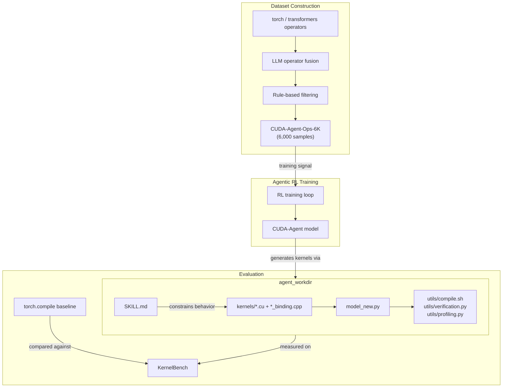
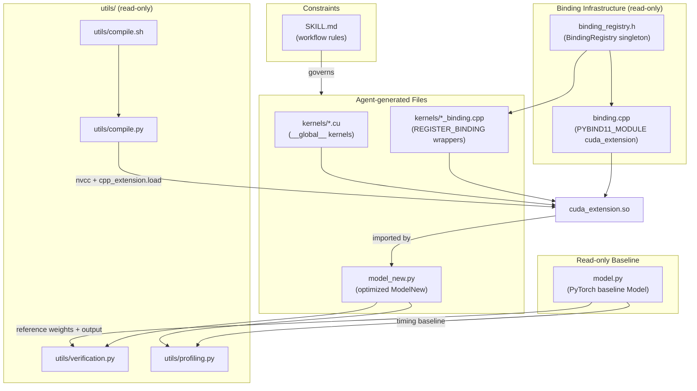
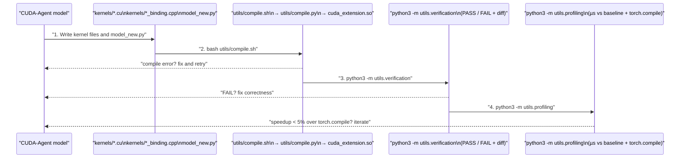

<!-- source: DeepWiki mcp.deepwiki.com · repo BytedTsinghua-SIA/CUDA-Agent · page 1 Overview · fetched 2026-10-26 -->

# Overview

<details>
<summary>Relevant source files</summary>

The following files were used as context for generating this wiki page:

- [README.md](README.md)
- [assets/agent_loop.png](assets/agent_loop.png)
- [assets/benchmark_chart.png](assets/benchmark_chart.png)

</details>


This page introduces the CUDA-Agent project: what it is, its high-level architecture, and how the two major subsystems relate to each other. For details on the training dataset, see [Training Dataset: CUDA-Agent-Ops-6K](#1.1). For a deep dive into the workspace itself, see [Agent Workspace (agent_workdir)](#2).

---

## What Is CUDA-Agent?

CUDA-Agent is a large language model trained with large-scale agentic reinforcement learning (RL) to generate high-performance CUDA kernels. It is described in [README.md:6-8]() as the first known RL-trained model to surpass advanced frontier models (Claude Opus 4.6, Gemini 2.5 Pro) on the KernelBench benchmark for CUDA kernel generation. It consistently outperforms the `torch.compile` baseline across all difficulty levels, with particularly strong gains on the hardest tasks.

The project consists of three separable concerns:

| Concern | Description | Key Artifact |
|---|---|---|
| **Dataset construction** | Build 6,000 RL training samples from PyTorch/Transformers operators | `CUDA-Agent-Ops-6K` (HuggingFace) |
| **Agentic RL training** | Train a model using the agent loop as the reward environment | CUDA-Agent model |
| **Evaluation** | Benchmark the model against `torch.compile` on KernelBench | KernelBench scores |

The released artifacts include the training dataset, the `SKILL.md` workflow specification, and the `agent_workdir` environment used during training and evaluation.

Sources: [README.md:1-54]()

---

## Top-Level Architecture

**Diagram: Major subsystems and their data flows**



Sources: [README.md:1-54]()

---

## The Two Major Subsystems

### 1. Training Dataset: CUDA-Agent-Ops-6K

The dataset pipeline collects reference operators from `torch` and `transformers`, uses an LLM to fuse them into compound tasks, then applies rule-based filtering. The 6,000 resulting samples are used as training signal for the agentic RL loop.

Filtering criteria (from [README.md:23-27]()):
- Must execute correctly in both eager mode and under `torch.compile`
- Stochastic operators and degenerate outputs are removed
- Runtime must fall within bounds
- Samples highly similar to KernelBench test cases are removed to reduce contamination

Full details are in [Training Dataset: CUDA-Agent-Ops-6K](#1.1).

---

### 2. Agent Workspace: `agent_workdir`

The `agent_workdir` directory is a standardized environment in which the agent iteratively writes, compiles, verifies, and benchmarks CUDA kernels. It is both the environment used during RL training and the workspace a user can run manually.

**Diagram: Files in `agent_workdir` and their roles**



Sources: [README.md:35-53]()

---

## The Agent Iterative Loop

The core operational cycle inside `agent_workdir` is: **implement → compile → verify → profile → iterate**. This loop is the reward environment for RL training.

**Diagram: Agent feedback loop mapped to script invocations**



The three CLI commands for running the loop manually are [README.md:49-53]():

```bash
bash utils/compile.sh
python3 -m utils.verification
python3 -m utils.profiling
```

Sources: [README.md:30-54]()

---

## Key Files at a Glance

| File/Directory | Role | Mutable by Agent? |
|---|---|---|
| `SKILL.md` | Workflow constraints and optimization rules | No |
| `model.py` | PyTorch baseline (`Model` class) | No |
| `model_new.py` | Optimized model (`ModelNew`) delegating to `cuda_extension` | Yes |
| `kernels/*.cu` | CUDA `__global__` kernel implementations | Yes |
| `kernels/*_binding.cpp` | PyTorch wrappers; use `REGISTER_BINDING` macro | Yes |
| `binding_registry.h` | `BindingRegistry` singleton; `REGISTER_BINDING` macro | No |
| `binding.cpp` | `PYBIND11_MODULE cuda_extension`; calls `applyBindings()` | No |
| `utils/compile.py` | Discovers sources, invokes `torch.utils.cpp_extension.load` | No |
| `utils/compile.sh` | Timing wrapper around `compile.py` | No |
| `utils/verification.py` | Checks `ModelNew` output against `Model` at `atol/rtol=1e-2` | No |
| `utils/profiling.py` | Benchmarks `torch_baseline`, `torch.compile`, `cuda_extension` µs | No |

Sources: [README.md:35-53]()

---

## Related Pages

- **[Training Dataset: CUDA-Agent-Ops-6K](#1.1)** — Full description of the 6,000-sample dataset construction pipeline and filtering criteria.
- **[Agent Workspace (agent_workdir)](#2)** — Structural walkthrough of every file and the full implement → compile → verify → profile loop.
- **[Workflow Constraints (SKILL.md)](#2.1)** — The rules encoded in `SKILL.md` that govern agent behavior and optimization strategy.
- **[Build System](#2.3)** — How `compile.py` discovers sources and invokes `torch.utils.cpp_extension.load`.
- **[CUDA Extension Architecture](#3)** — The two-phase lifecycle of the `cuda_extension` module: static registration and `applyBindings()` at import time.

---

