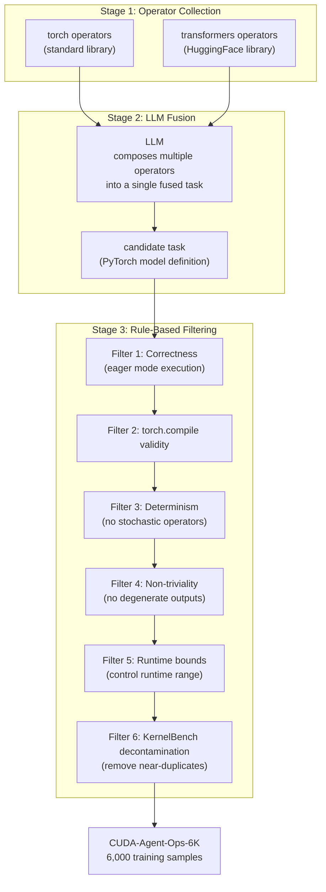
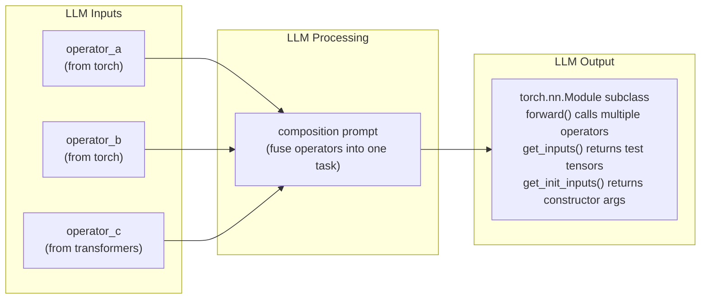
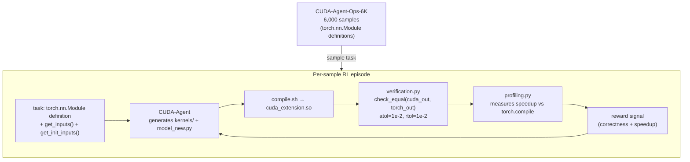

<!-- source: DeepWiki mcp.deepwiki.com · repo BytedTsinghua-SIA/CUDA-Agent · page 1.1 Training Dataset: CUDA-Agent-Ops-6K · fetched 2026-10-26 -->

# Training Dataset: CUDA-Agent-Ops-6K

Relevant source files

The following files were used as context for generating this wiki page:

- [README.md](README.md)
- [assets/data_pipeline.png](assets/data_pipeline.png)

This page covers the construction and composition of **CUDA-Agent-Ops-6K**, the 6,000-sample training dataset used to drive the agentic RL training loop for CUDA-Agent. It describes where the raw operator inputs come from, how an LLM synthesizes them into training tasks, and the six rule-based filtering passes that determine which samples are retained.

For details on how this dataset feeds into the RL training loop and the agent model itself, see the Overview ([1](#1)). For the agent workspace that the trained model operates inside, see [2](#2).

---

## Dataset at a Glance

| Property | Value |
|---|---|
| Total samples | 6,000 |
| Source operators | `torch` standard library + HuggingFace `transformers` |
| Synthesis method | LLM-driven operator fusion |
| Filtering method | Rule-based, six independent criteria |
| Public location | `BytedTsinghua-SIA/CUDA-Agent-Ops-6K` on Hugging Face |
| Role in system | Training signal for large-scale agentic RL |

Sources: [README.md:14-26]()

---

## Construction Pipeline

The dataset is produced through three sequential stages: **operator collection**, **LLM-based task synthesis**, and **rule-based filtering**.

**Figure 1: Data Synthesis Pipeline**

Sources: [README.md:19-26]()

---

## Stage 1: Operator Collection

Reference operators are drawn from two Python libraries:

- **`torch`** — the core PyTorch operator library, covering element-wise math, linear algebra, convolutions, activations, and reductions.
- **`transformers`** (HuggingFace) — attention mechanisms, layer normalization variants, positional encodings, and other transformer-specific primitives.

These operators serve as building blocks; individual operators are not directly used as training tasks. They are handed off to the LLM for composition.

Sources: [README.md:20-21]()

---

## Stage 2: LLM-Based Task Synthesis

An LLM receives a set of reference operators and is prompted to compose them into a single fused task. The output of this stage is a candidate PyTorch model definition — a `torch.nn.Module` subclass with a `forward` method that calls multiple operators in combination.

**Figure 2: LLM Synthesis — Inputs and Outputs**

The generated module follows the same interface used in the agent workspace (`model.py`): it exposes `get_inputs()` and `get_init_inputs()` functions so downstream filtering can instantiate and run the model without additional configuration. See [2.2](#2.2) for the full model interface specification.

Sources: [README.md:21-22]()

---

## Stage 3: Rule-Based Filtering

Six filters are applied in sequence. A sample must pass all six to enter the final dataset.

### Filter Overview Table

| # | Filter | What is checked | Failure condition |
|---|---|---|---|
| 1 | **Correctness** | Run the model in eager mode | Raises an exception or produces wrong output |
| 2 | **`torch.compile` validity** | Run the model under `torch.compile` | Fails to compile or produces different results from eager |
| 3 | **Determinism** | Run the model twice with identical inputs | Outputs differ between runs (stochastic operator present) |
| 4 | **Non-triviality** | Inspect the output tensor | All-zeros, all-NaN, or otherwise degenerate output |
| 5 | **Runtime bounds** | Measure execution time | Too fast (trivially cheap) or too slow (impractically large) |
| 6 | **KernelBench decontamination** | Compare against KernelBench test suite | Sample is too similar to an existing KernelBench problem |

Sources: [README.md:23-26]()

### Filter Detail

**Filter 1 — Correctness (eager mode)**
The candidate module is instantiated and executed using standard PyTorch eager execution. Any runtime error, shape mismatch, or device error causes rejection. This ensures every retained sample is a valid, runnable PyTorch computation.

**Filter 2 — `torch.compile` validity**
The same module is compiled with `torch.compile` and executed. The output must match the eager-mode output within a numerical tolerance. This is required because the training reward signal compares CUDA kernel output against the `torch.compile` baseline; a task that `torch.compile` cannot handle consistently would produce an unreliable signal.

**Filter 3 — Determinism**
The module is run twice under identical inputs and random seeds. If the outputs differ, the sample contains a stochastic operator (e.g., dropout, random sampling) and is discarded. Determinism is necessary because the RL verification step (see [2.4](#2.4)) performs exact numerical comparison.

**Filter 4 — Non-triviality**
The output tensor is inspected for degenerate values: all-zero, all-NaN, all-inf, or constant tensors. Such outputs indicate the operator combination collapsed to a trivial computation that offers no meaningful optimization target.

**Filter 5 — Runtime bounds**
Execution time is measured on a GPU. Samples that run too quickly (below a lower bound) provide no meaningful speedup opportunity. Samples that run too slowly (above an upper bound) would make the RL training loop impractically slow. Only samples within the target time window are retained.

**Filter 6 — KernelBench decontamination**
Each surviving sample is compared against the KernelBench evaluation benchmark. Samples that are highly similar to KernelBench test cases are removed to prevent training data contamination that could artificially inflate benchmark scores.

Sources: [README.md:23-26]()

---

## How the Dataset Feeds Into Training

**Figure 3: Dataset-to-Training Signal Flow**

Each training sample is a `torch.nn.Module` definition that becomes the `model.py` baseline inside an `agent_workdir` episode. The agent's reward is determined by whether its generated CUDA kernel produces correct output (via `verification.py`) and whether it achieves a speedup over `torch.compile` (via `profiling.py`). The dual correctness + `torch.compile` filtering in the construction pipeline ensures every training task has a reliable, reproducible reward signal.

For the full workspace structure used during training episodes, see [2](#2). For details on correctness verification, see [2.4](#2.4). For performance profiling mechanics, see [2.5](#2.5).

Sources: [README.md:6-8](), [README.md:19-26](), [README.md:32-44]()

---

