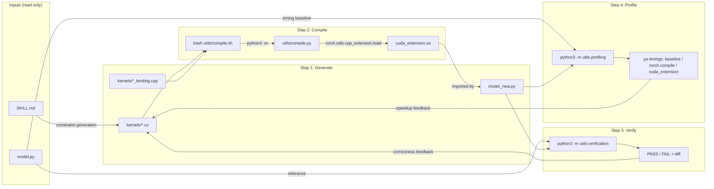
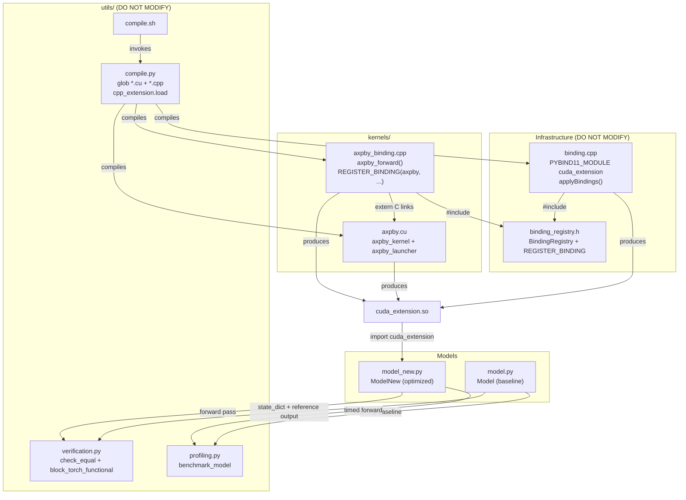
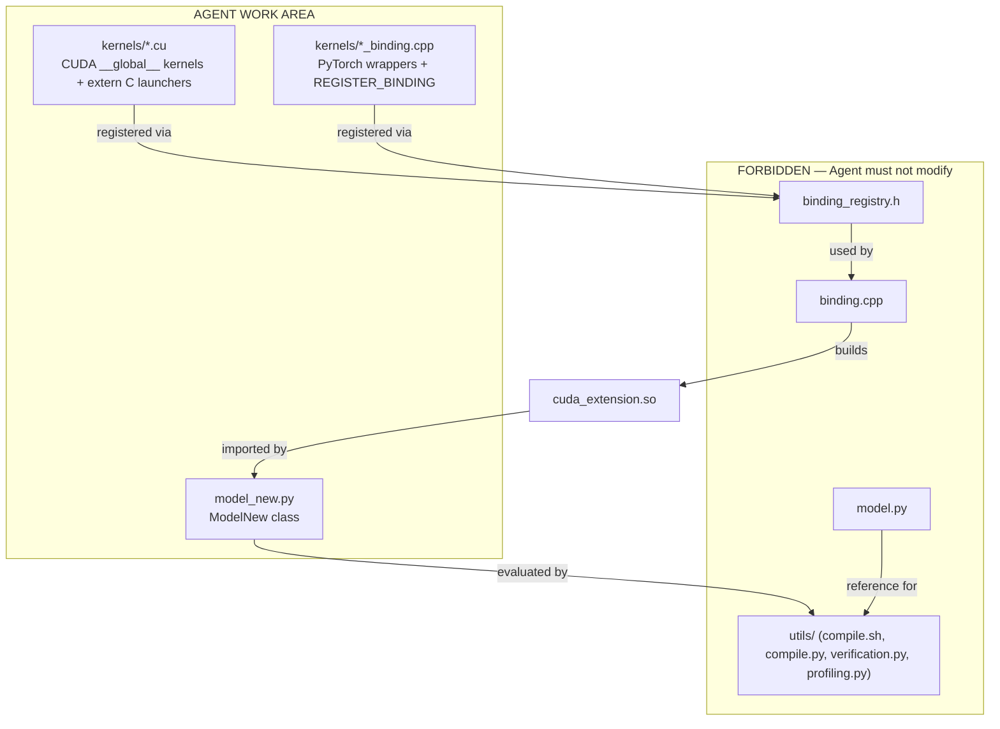

<!-- source: DeepWiki mcp.deepwiki.com · repo BytedTsinghua-SIA/CUDA-Agent · page 2 Agent Workspace (agent_workdir) · fetched 2026-10-26 -->

# Agent Workspace (agent_workdir)

<details>
<summary>Relevant source files</summary>

The following files were used as context for generating this wiki page:

- [README.md](README.md)
- [agent_workdir/SKILL.md](agent_workdir/SKILL.md)

</details>


This page describes the structure and operation of the `agent_workdir` directory: what each file does, how the files relate to each other, and how the full implement → compile → verify → profile → iterate cycle is executed. It serves as the entry point for understanding the workspace as a whole.

For the workflow constraints that govern agent behavior (the rules encoded in `SKILL.md`), see [Workflow Constraints (SKILL.md)](#2.1). For the build system details, see [Build System](#2.3). For correctness verification and performance profiling specifics, see [Correctness Verification](#2.4) and [Performance Profiling](#2.5). For the CUDA binding registry architecture, see [CUDA Extension Architecture](#3).

---

## Purpose

`agent_workdir` is a self-contained, standardized workspace in which an LLM-based agent generates and iteratively refines custom CUDA kernels to accelerate a given PyTorch model. The workspace provides:

- A **fixed baseline** (`model.py`) that the agent must not change
- A **target file** (`model_new.py`) where the agent writes its optimized model
- A **kernels directory** (`kernels/`) where all CUDA and binding source files live
- **Immutable build/test infrastructure** (`utils/`, `binding.cpp`, `binding_registry.h`) that the agent must not modify
- **Workflow rules** (`SKILL.md`) that constrain and guide agent decisions

Sources: [README.md:30-54](), [agent_workdir/SKILL.md:18-28]()

---

## Directory Structure

```
agent_workdir/
├── SKILL.md                  # Workflow rules for the agent (read-only by convention)
├── model.py                  # Baseline PyTorch model (DO NOT MODIFY)
├── model_new.py              # Agent-generated optimized model
├── binding_registry.h        # Binding registry singleton + REGISTER_BINDING macro (DO NOT MODIFY)
├── binding.cpp               # PYBIND11_MODULE entry point (DO NOT MODIFY)
├── kernels/
│   ├── axpby.cu              # Example: CUDA __global__ kernel + extern C launcher
│   └── axpby_binding.cpp     # Example: PyTorch wrapper + REGISTER_BINDING call
└── utils/
    ├── compile.sh            # Shell wrapper that times the build
    ├── compile.py            # Discovers sources, calls torch.utils.cpp_extension.load
    ├── verification.py       # Correctness check: ModelNew vs Model
    └── profiling.py          # Timing: baseline / torch.compile / cuda_extension
```

| File / Directory | Modifiable by Agent | Purpose |
|---|---|---|
| `SKILL.md` | No | Encodes workflow rules and optimization strategy |
| `model.py` | No | Immutable PyTorch baseline; provides reference outputs and weights |
| `model_new.py` | **Yes** | Agent's optimized model; delegates to `cuda_extension` |
| `binding_registry.h` | No | `BindingRegistry` singleton and `REGISTER_BINDING` macro |
| `binding.cpp` | No | `PYBIND11_MODULE` that calls `applyBindings()` at import |
| `kernels/*.cu` | **Yes** | CUDA kernel implementations (agent-authored) |
| `kernels/*_binding.cpp` | **Yes** | PyTorch tensor wrappers and `REGISTER_BINDING` calls |
| `utils/` | No | Build, verification, and profiling tools |

Sources: [agent_workdir/SKILL.md:18-28](), [README.md:36-44]()

---

## The Iterative Agent Loop

The agent follows a fixed five-step cycle. Each step produces artifacts consumed by the next.

**Diagram: The Iterative Loop — Files and Commands**



Sources: [README.md:47-53](), [agent_workdir/SKILL.md:166-174]()

---

## File Dependency Graph

This diagram maps every file in the workspace to the files it depends on at build time and runtime.

**Diagram: Static File Dependencies in `agent_workdir`**



Sources: [README.md:36-44](), [agent_workdir/SKILL.md:18-28]()

---

## Common Commands

All three commands are run from inside the `agent_workdir` directory.

| Command | Purpose |
|---|---|
| `bash utils/compile.sh` | Compile all `*.cu` and `*_binding.cpp` sources into `cuda_extension.so` |
| `python3 -m utils.verification` | Run correctness check comparing `ModelNew` against `Model` |
| `python3 -m utils.profiling` | Benchmark `Model`, `torch.compile(Model)`, and `ModelNew` |

An optional `TORCH_CUDA_ARCH_LIST` environment variable can be passed to target a specific GPU architecture:

```
TORCH_CUDA_ARCH_LIST=9.0 bash utils/compile.sh
```

Sources: [README.md:47-53](), [agent_workdir/SKILL.md:166-174]()

---

## Agent Modification Boundaries

The workspace enforces a strict separation between infrastructure (never touched) and agent work areas.

**Diagram: What the Agent May and May Not Modify**



Sources: [agent_workdir/SKILL.md:5-16](), [agent_workdir/SKILL.md:362-372]()

---

## Key Invariants

The workspace enforces several invariants that the agent (and any contributor) must maintain:

1. **`model.py` is read-only.** It provides the reference forward pass and the weight initialization used to seed `ModelNew`.
2. **`ModelNew` constructor signature must match `Model`.** Both are instantiated via `get_init_inputs()` return values; the `state_dict` from `Model` is loaded directly into `ModelNew`.
3. **No `torch.*` operators in C++ files.** All CUDA bindings use raw pointers and call through `extern "C"` launchers. `torch::*` and `torch::nn::functional::*` are forbidden in `.cu` and `_binding.cpp` files.
4. **No `torch` operations in `model_new.py` forward pass.** Only tensor creation helpers and calls to `cuda_extension.*` functions are allowed.
5. **`utils/`, `binding.cpp`, `binding_registry.h` are never modified.** Kernel authors only add files to `kernels/`.
6. **The minimum performance target is 5% faster than `torch.compile` baseline.**

Sources: [agent_workdir/SKILL.md:5-16](), [agent_workdir/SKILL.md:349-363]()

---

