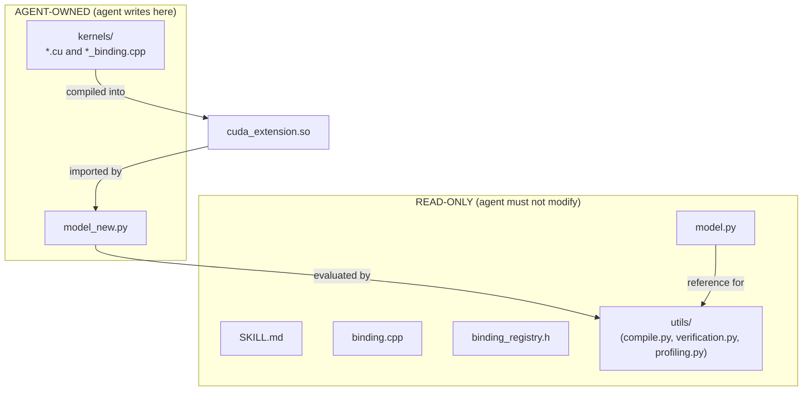
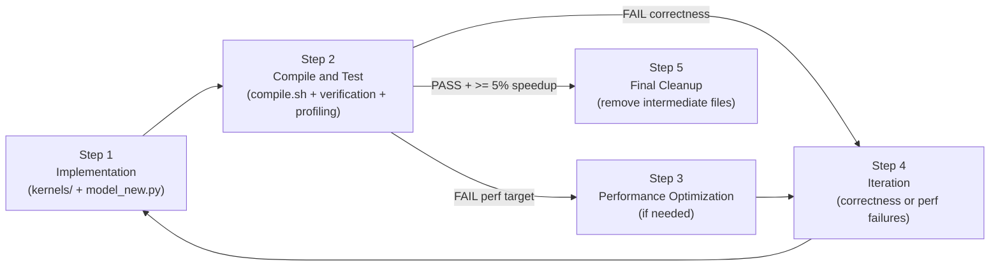
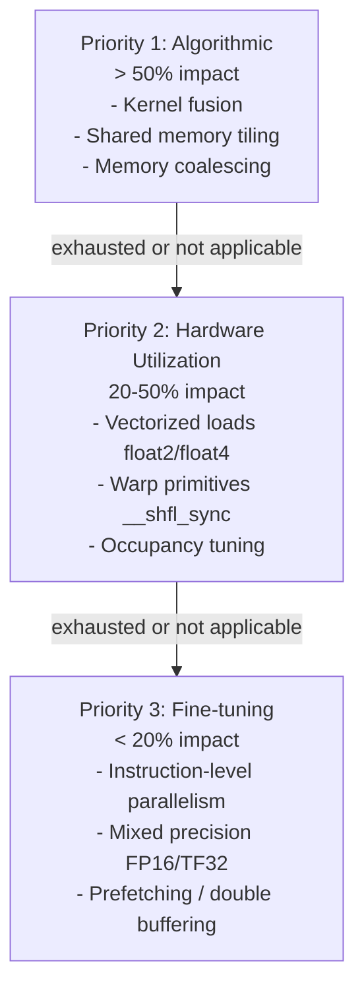

<!-- source: DeepWiki mcp.deepwiki.com · repo BytedTsinghua-SIA/CUDA-Agent · page 2.1 Workflow Constraints (SKILL.md) · fetched 2026-10-26 -->

# Workflow Constraints (SKILL.md)

<details>
<summary>Relevant source files</summary>

The following files were used as context for generating this wiki page:

- [README.md](README.md)
- [agent_workdir/SKILL.md](agent_workdir/SKILL.md)

</details>


`agent_workdir/SKILL.md` is the instruction document given to the CUDA-Agent model at inference time. It encodes the rules, optimization strategies, and iteration procedures that govern how the agent writes, tests, and refines CUDA kernels. This page documents the constraints and strategies defined in that file.

For the broader workspace structure and how files relate to each other, see [Agent Workspace (agent_workdir)](#2). For the build system invoked during the workflow, see [Build System](#2.3). For the verification and profiling tools referenced here, see [Correctness Verification](#2.4) and [Performance Profiling](#2.5).

---

## Purpose of SKILL.md

`SKILL.md` serves as a prompt-level specification. It tells the agent:

- What it is allowed and forbidden to do in each file type
- Which files to modify and which are read-only
- The multi-step workflow to follow (implement → compile → verify → profile → iterate)
- How to interpret profiling output and decide when the task is complete

The file begins with a direct role statement [agent_workdir/SKILL.md:1]():

> You are a PyTorch and CUDA expert. Accelerate the given PyTorch Model by creating a high-performance CUDA C++ extension, targeting the best possible performance with a minimum requirement of 5% faster than torch.compile baseline.

---

## Critical Restrictions

SKILL.md defines a hard boundary between what the agent may and may not do. These are not suggestions — violations cause either compilation errors or invalid benchmark results.

### Forbidden Actions

| Restriction | Rationale |
|---|---|
| No `torch::*` or `torch::nn::functional::*` in `.cu` / `_binding.cpp` | Prevents accidental use of PyTorch ops inside the kernel layer; pure CUDA interface required |
| No `torch` operations in `model_new.py` (beyond tensor creation) | Ensures the optimized model actually exercises custom kernels, not PyTorch fallbacks |
| No third-party libraries except cuBLAS (GEMM) and cuDNN (Conv) | Keeps dependencies predictable for the build system |
| No modifications to `utils/` | `compile.py`, `verification.py`, and `profiling.py` are fixed evaluation infrastructure |
| No modifications to `binding.cpp` or `binding_registry.h` | These are shared binding infrastructure; see [Binding Registry](#3.1) |

Sources: [agent_workdir/SKILL.md:5-16]()

### Permitted Actions

| Scope | Allowed |
|---|---|
| C++ kernel files (`.cu`) | Raw CUDA kernels, cuBLAS, cuDNN |
| Binding files (`_binding.cpp`) | PyTorch tensor validation, stream retrieval, `torch::empty_like` allocation |
| `model_new.py` | `torch.tensor` creation, custom extension ops, tensor property access |
| Work directory | `kernels/` (create freely), `model_new.py` (replace entirely) |

Sources: [agent_workdir/SKILL.md:13-16]()

---

## File Ownership Model

**Title: File Ownership in agent_workdir**



Sources: [agent_workdir/SKILL.md:19-28]()

---

## The Five-Step Workflow

SKILL.md defines a fixed sequence of five steps. Steps 1–4 form a loop; the agent iterates until success criteria are met.

**Title: SKILL.md Workflow Steps**



Sources: [agent_workdir/SKILL.md:36-279]()

### Step 1: Implementation

The agent creates two paired files per kernel in `kernels/`:

- A `.cu` file containing the `__global__` kernel and an `extern "C"` launcher function
- A `_binding.cpp` file containing the PyTorch wrapper, input validation, and `REGISTER_BINDING` call

The launcher accepts a `config` integer parameter to select between pre-compiled block size / tile size variants without recompilation [agent_workdir/SKILL.md:62-88]().

The agent also writes `model_new.py`, which must:
- Match the constructor signature of `model.py`'s `Model` class exactly (for `state_dict` compatibility)
- Call only `cuda_extension.*` ops in `forward()` — no `torch.nn.functional` calls [agent_workdir/SKILL.md:147-164]()

### Step 2: Compile and Test

```
TORCH_CUDA_ARCH_LIST=9.0 bash utils/compile.sh
sudo python3 -m utils.verification
sudo python3 -m utils.profiling
```

`TORCH_CUDA_ARCH_LIST` must match the target GPU. The `sudo` requirement reflects the sandbox execution environment [agent_workdir/SKILL.md:167-173]().

---

## Performance Target and Optimization Strategy

### Success Criteria

| Metric | Threshold |
|---|---|
| Minimum speedup | ≥ 5% faster than `torch.compile` baseline (≤ 0.95× baseline time) |
| Correctness tolerance | `atol=1e-2`, `rtol=1e-2` (enforced by `utils/verification.py`) |
| Code cleanliness | `kernels/` contains only the final implementation — no intermediate versions |

The goal is stated as *best possible performance*, not merely meeting the minimum. The minimum exists to prevent premature termination [agent_workdir/SKILL.md:248-263]().

### Optimization Priority Order

SKILL.md defines three tiers of optimization techniques, ordered by expected impact:

**Title: Optimization Priority Hierarchy**



Sources: [agent_workdir/SKILL.md:178-193]()

### Config Parameter Tuning

Config-based tuning is the **last resort**, used only when the agent is within 1.2× of the target and algorithmic options are exhausted [agent_workdir/SKILL.md:195-232]().

The mechanism:
1. The `.cu` launcher function accepts an integer `config` argument
2. A `switch` statement selects a pre-compiled template instantiation (e.g., `my_kernel_impl<256, 16>` vs `my_kernel_impl<128, 32>`)
3. A standalone `tune_kernel.py` script benchmarks each config value against real inputs
4. The best `config` value is hardcoded into `model_new.py`'s `forward()` call

This approach avoids recompilation: all config variants are compiled into the `.so` at build time; only the runtime dispatch changes [agent_workdir/SKILL.md:62-88]().

---

## Iteration Requirements

### Correctness Failures

Correctness failures are **mandatory to fix** before performance work continues [agent_workdir/SKILL.md:237-244]():

| Check | Common Causes |
|---|---|
| Wrong output values | Incorrect indexing, kernel math errors |
| NaN / Inf results | Division by zero, numerical instability |
| Mismatched shapes | Incorrect dimension calculations or reduction logic |
| Boundary violations | Missing `tid < size` guard, off-by-one in grid dimensions |
| Synchronization errors | `__syncthreads()` placed incorrectly relative to shared memory reuse |

Fixes must be applied to `kernels/*.cu` and `kernels/*_binding.cpp` only. Infrastructure files are not modified.

### Performance Iteration Schedule

| Iteration Range | Goal |
|---|---|
| Iterations 1–2 | Achieve minimum 5% improvement over `torch.compile` |
| Iterations 3–5 | Push for maximum speedup |
| Beyond iteration 5 | Continue until diminishing returns |

Sources: [agent_workdir/SKILL.md:258-263]()

---

## Optimization Checklist Summary

SKILL.md includes a structured checklist. The items map directly to CUDA optimization concepts:

**Essential (apply first):**
- Memory coalescing — consecutive threads access consecutive addresses
- Kernel fusion — reduce memory traffic by combining operations
- Shared memory caching — tile frequently reused data
- Grid-stride loops — handle inputs larger than the grid
- Boundary checks — every kernel must guard `tid < size`

**Performance (apply as needed):**
- Vectorized memory (`float2` / `float4`)
- Warp primitives (`__shfl_sync`, `__ballot_sync`)
- Occupancy tuning (block size vs. register usage)
- Shared memory bank conflict avoidance (padding)

**Advanced (final tuning):**
- Tensor Cores via WMMA/MMA for eligible GEMM operations
- Mixed precision (FP16 / TF32)
- Persistent kernels
- CUDA Graphs
- Double buffering

Sources: [agent_workdir/SKILL.md:296-324]()

---

## Common Issues Reference

SKILL.md embeds a troubleshooting table directly [agent_workdir/SKILL.md:326-347]():

### Compilation Errors

| Error | Solution |
|---|---|
| `undefined symbol` | Verify `extern "C"` declarations in `_binding.cpp` match the launcher signature in `.cu` |
| `no kernel image` | Ensure `TORCH_CUDA_ARCH_LIST` matches the target GPU architecture |

### Performance Issues

| Symptom | Likely Cause | Solution |
|---|---|---|
| Slower than baseline | No fusion | Combine kernels |
| Low SM efficiency | Poor occupancy | Tune block size |
| Low memory throughput | Uncoalesced access | Restructure memory access pattern |
| High kernel count | Missing fusion | Implement compound operations |

---

## Key Architectural Invariants

These rules reflect structural decisions in the workspace design rather than optimization preferences:

1. **`.cu` and `_binding.cpp` are always separate files.** This speeds up incremental compilation — CUDA and C++ compilation are independent.
2. **`config` parameters flow through bindings.** Template instantiations are fixed at compile time; runtime dispatch via `config` avoids recompilation during tuning.
3. **`kernels/` is the only modification zone.** `binding.cpp`, `binding_registry.h`, and `utils/` are treated as a fixed platform.
4. **`model_new.py` must be `state_dict`-compatible with `model.py`.** `utils/verification.py` transfers weights using `load_state_dict()` before comparison; mismatched parameter names cause the verification to fail. See [Correctness Verification](#2.4).
5. **Final cleanup is mandatory.** Before the task is marked complete, all intermediate kernel attempts (`*_v[0-9].cu`, `*_old.cu`, etc.) must be removed. Only the final implementation remains in `kernels/`.

Sources: [agent_workdir/SKILL.md:364-373](), [agent_workdir/SKILL.md:265-279]()

---

