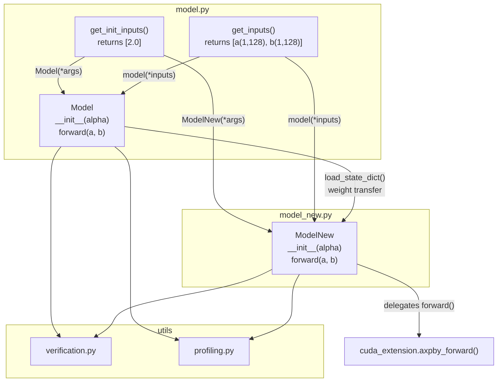
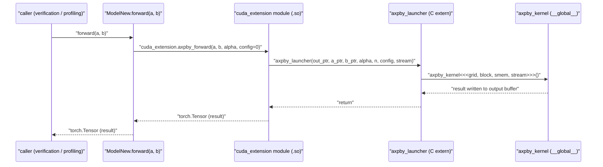

<!-- source: DeepWiki mcp.deepwiki.com · repo BytedTsinghua-SIA/CUDA-Agent · page 2.2 Model Files: Baseline and Optimized · fetched 2026-10-26 -->

# Model Files: Baseline and Optimized

<details>
<summary>Relevant source files</summary>

The following files were used as context for generating this wiki page:

- [agent_workdir/SKILL.md](agent_workdir/SKILL.md)
- [agent_workdir/model.py](agent_workdir/model.py)
- [agent_workdir/model_new.py](agent_workdir/model_new.py)

</details>


This page covers the two model files at the root of `agent_workdir`: `model.py` (the immutable baseline) and `model_new.py` (the agent-written optimized replacement). It describes each file's structure, their shared interface conventions, the `state_dict` compatibility requirement, and how `ModelNew` delegates computation to the compiled CUDA extension.

For how the compiled CUDA extension is built and loaded, see the [Build System](#2.3). For how the two models are used together during correctness checking, see [Correctness Verification](#2.4). For performance comparison, see [Performance Profiling](#2.5).

---

## Roles and Responsibilities

| File | Class | Mutable? | Purpose |
|---|---|---|---|
| `agent_workdir/model.py` | `Model` | **No** | Reference PyTorch implementation; provides ground-truth outputs and timing baseline |
| `agent_workdir/model_new.py` | `ModelNew` | **Yes** | Agent-written optimized model; replaces PyTorch ops with calls to `cuda_extension` |

`model.py` is explicitly marked "Do not change this file" [agent_workdir/model.py:3](). The agent writes `model_new.py` from scratch as its primary deliverable.

Sources: [agent_workdir/model.py:1-26](), [agent_workdir/model_new.py:1-13](), [agent_workdir/SKILL.md:26-27]()

---

## The Baseline: `model.py`

`model.py` defines the `Model` class and two module-level factory functions used across the entire workspace.

**Class: `Model`** [agent_workdir/model.py:9-16]()

`Model` is a standard `torch.nn.Module`. The example workspace implements a scaled vector addition: `alpha * a + b`. This uses only standard PyTorch operators (`torch.nn.functional` / tensor arithmetic) and serves as the correctness reference and the timing baseline against which `ModelNew` is measured.

**Factory functions:**

| Function | Returns | Used by |
|---|---|---|
| `get_init_inputs()` | `[2.0]` — constructor arguments | `verification.py`, `profiling.py` |
| `get_inputs()` | `[a, b]` — two random tensors of shape `(1, 128)` | `verification.py`, `profiling.py` |

These functions are the contract that ties both model files to the evaluation tools. Any task placed in `agent_workdir` must provide the same two functions in `model.py`, so the utilities can construct and invoke models without hardcoded knowledge of their signatures.

Sources: [agent_workdir/model.py:9-26]()

---

## The Optimized Model: `model_new.py`

`model_new.py` defines the `ModelNew` class. It must satisfy three constraints set by `SKILL.md`:

1. **Identical constructor signature** to `Model` — `__init__` arguments must match exactly so both classes can be constructed from `get_init_inputs()`.
2. **`state_dict` compatibility** — parameter names and shapes must match `Model` so that `verification.py` can transfer weights from `Model` into `ModelNew` via `load_state_dict`.
3. **No `torch.nn.functional` calls in `forward`** — computation must be delegated entirely to `cuda_extension` operators.

**Class: `ModelNew`** [agent_workdir/model_new.py:6-13]()

In the example workspace, `ModelNew.__init__` accepts `alpha: float` — the same argument as `Model.__init__`. The `forward` method replaces `self.alpha * a + b` with `cuda_extension.axpby_forward(a, b, self.alpha, 0)`, delegating to the compiled CUDA kernel.

Sources: [agent_workdir/model_new.py:1-13](), [agent_workdir/SKILL.md:152-163]()

---

## Shared Interface Diagram

The following diagram maps the two model classes and the factory functions to the workspace components that consume them.

**Diagram: Model Interface and Consumers**



Sources: [agent_workdir/model.py:9-26](), [agent_workdir/model_new.py:1-13]()

---

## Constructor Signature Compatibility

Both `Model` and `ModelNew` must be constructable from the same argument list returned by `get_init_inputs()`. The utilities call them identically:

```
Model(*get_init_inputs())    →  Model(2.0)
ModelNew(*get_init_inputs()) →  ModelNew(2.0)
```

If the signatures diverge, `verification.py` and `profiling.py` will fail at instantiation before any CUDA code runs.

Sources: [agent_workdir/model.py:11-13](), [agent_workdir/model_new.py:8-9]()

---

## `state_dict` Compatibility Requirement

`verification.py` transfers learned parameters from `Model` into `ModelNew` via `load_state_dict`. This ensures both models start from identical weights so output differences are attributable to the CUDA implementation, not to random initialization divergence.

For this to work:

- Every `nn.Parameter` or buffer registered in `Model` must have a counterpart with the **same name** and **same shape** in `ModelNew`.
- `ModelNew` must not add extra parameters that are absent from `Model`'s `state_dict` (unless declared with `strict=False`, which the utilities do not do by default).

In the example, `Model` stores only `self.alpha` as a plain Python float — not an `nn.Parameter` — so no parameter transfer is needed and both classes are trivially compatible. More complex tasks with weight tensors require careful mirroring of parameter names.

Sources: [agent_workdir/model.py:9-16](), [agent_workdir/model_new.py:6-13](), [agent_workdir/SKILL.md:154-156]()

---

## Delegation to `cuda_extension`

`ModelNew.forward` must not call any `torch.nn.functional` operators. Instead, every computation is expressed as a call to a function registered in the `cuda_extension` shared object. In the example:

```
cuda_extension.axpby_forward(a, b, self.alpha, 0)
```

The last argument (`0`) is a `config` selector that chooses among pre-compiled kernel variants without recompilation. This pattern — passing a `config` integer to select block size or tiling strategy at runtime — is the standard tuning mechanism described in `SKILL.md`.

**Diagram: `ModelNew.forward` Delegation Chain**



Sources: [agent_workdir/model_new.py:12-13](), [agent_workdir/SKILL.md:146-163]()

---

## Constraints Summary

| Constraint | `model.py` | `model_new.py` |
|---|---|---|
| May be modified | No | Yes |
| Must define `Model` / `ModelNew` class | `Model` | `ModelNew` |
| Must define `get_init_inputs()` | Yes | No |
| Must define `get_inputs()` | Yes | No |
| Constructor args must match `get_init_inputs()` | Yes | Yes |
| `state_dict` keys must match `Model` | n/a | Yes |
| `forward` may use `torch.nn.functional` | Yes | **No** |
| `forward` must call `cuda_extension` | No | Yes |

Sources: [agent_workdir/SKILL.md:6-10](), [agent_workdir/SKILL.md:146-163](), [agent_workdir/model.py:1-26](), [agent_workdir/model_new.py:1-13]()

---

