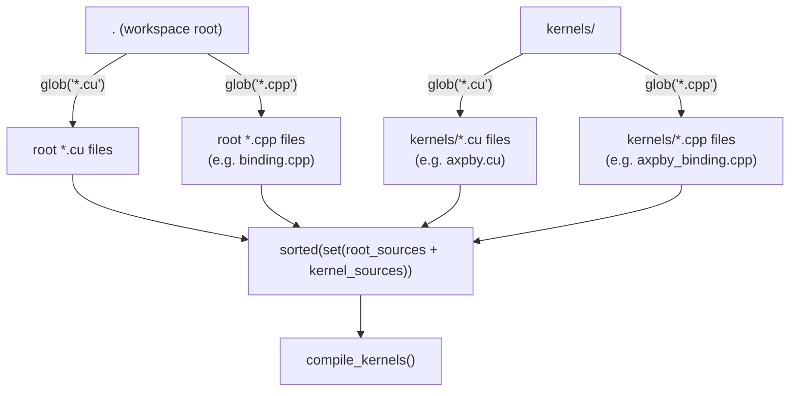
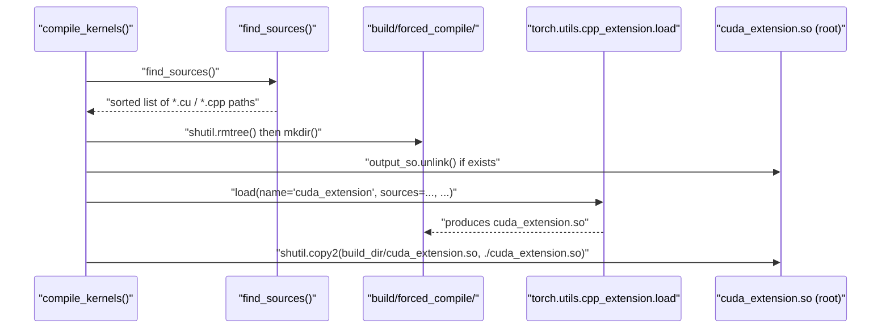

<!-- source: DeepWiki mcp.deepwiki.com · repo BytedTsinghua-SIA/CUDA-Agent · page 2.3 Build System · fetched 2026-10-26 -->

# Build System

<details>
<summary>Relevant source files</summary>

The following files were used as context for generating this wiki page:

- [agent_workdir/utils/__init__.py](agent_workdir/utils/__init__.py)
- [agent_workdir/utils/compile.py](agent_workdir/utils/compile.py)
- [agent_workdir/utils/compile.sh](agent_workdir/utils/compile.sh)

</details>


This page covers the mechanics of compiling CUDA kernel sources into the shared library that the optimized model imports. It explains the entry-point shell script, the Python compilation driver, source discovery rules, compiler flags, and where the output artifact is placed.

For the binding registration mechanism that makes compiled symbols callable from Python, see [CUDA Extension Architecture](#3). For how `model_new.py` imports and uses the compiled library, see [Model Files: Baseline and Optimized](#2.2).

---

## Overview

The build system has two layers:

| Layer | File | Role |
|---|---|---|
| Shell wrapper | `agent_workdir/utils/compile.sh` | Measures wall-clock compile time; delegates to Python |
| Python driver | `agent_workdir/utils/compile.py` | Discovers sources, invokes `torch.utils.cpp_extension.load` |
| Package marker | `agent_workdir/utils/__init__.py` | Makes `utils` importable as a package so `-m utils.compile` works |

The agent invokes the build step with a single command:

```bash
bash utils/compile.sh
```

The resulting artifact is `cuda_extension.so`, placed in the workspace root.

---

## compile.sh — Timing Wrapper

**Diagram: compile.sh execution flow**


Sources: [agent_workdir/utils/compile.sh:1-13]()

`compile.sh` does nothing beyond timing. It captures `START_TIME` and `END_TIME` using `date +%s.%N`, computes the difference with `awk`, prints it, and forwards the Python process exit code. This lets the agent log compile durations without embedding timing logic in Python.

---

## compile.py — Python Compilation Driver

### Source Discovery: `find_sources()`

[agent_workdir/utils/compile.py:11-20]()

`find_sources()` collects all `.cu` and `.cpp` files from two locations:

| Location | Glob patterns |
|---|---|
| Workspace root (`.`) | `*.cu`, `*.cpp` |
| `kernels/` subdirectory | `kernels/*.cu`, `kernels/*.cpp` |

The union of both sets is sorted and deduplicated before being passed to the compiler. This means the root-level `binding.cpp` and any files the agent creates under `kernels/` are all included automatically — no manual source list maintenance is required.

**Diagram: Source discovery to compiler input**



Sources: [agent_workdir/utils/compile.py:11-20]()

### Compilation: `compile_kernels()`

[agent_workdir/utils/compile.py:23-63]()

`compile_kernels()` performs these steps in order:

1. **Clean build directory** — `build/forced_compile/` is deleted and recreated fresh on every invocation. This prevents stale object files from masking errors.
2. **Remove old artifact** — any existing `cuda_extension.so` in the workspace root is deleted before the build starts.
3. **Invoke `cpp_ext.load()`** — calls `torch.utils.cpp_extension.load` with the parameters below.
4. **Copy artifact** — if `build/forced_compile/cuda_extension.so` was produced, it is copied to `./cuda_extension.so`.

**Diagram: compile_kernels() step sequence**



Sources: [agent_workdir/utils/compile.py:23-63]()

### Compiler Flags

The flags passed to `cpp_ext.load` are:

| Parameter | Value | Purpose |
|---|---|---|
| `name` | `'cuda_extension'` | Module name; becomes the `.so` filename |
| `with_cuda` | `True` | Enables nvcc for `.cu` files |
| `verbose` | `False` | Suppresses per-file compiler output |
| `extra_cflags` | `['-O3', '-std=c++17']` | C++ optimization and standard |
| `extra_cuda_cflags` | `['-O3', '--use_fast_math']` | CUDA optimization; enables fast math intrinsics |
| `build_directory` | `'build/forced_compile'` | Intermediate object files and the `.so` |

Sources: [agent_workdir/utils/compile.py:42-50]()

`--use_fast_math` trades IEEE 754 strict compliance for speed on the GPU — appropriate for the kernel optimization context where small floating-point deviations are acceptable within the `atol/rtol=1e-2` tolerance checked by the verifier (see [Correctness Verification](#2.4)).

---

## Output Artifact

On a successful build, `cuda_extension.so` appears in the workspace root. `model_new.py` imports it directly:

```python
import cuda_extension
```

On failure, `compile.py` prints the exception message and returns exit code `1`, which `compile.sh` propagates to the shell. No partial `.so` is left behind because the old file is deleted before compilation begins.

---

## utils Package Structure

`agent_workdir/utils/__init__.py` is intentionally empty [agent_workdir/utils/__init__.py:1-1](). Its only function is to make `utils` a Python package, which is required for the `-m utils.compile` invocation in `compile.sh`. The other modules in `utils/` — `verification.py` and `profiling.py` — are similarly accessed as `python3 -m utils.verification` and `python3 -m utils.profiling`.

```
agent_workdir/utils/
├── __init__.py        ← empty; makes utils a package
├── compile.sh         ← shell entry point (timing wrapper)
├── compile.py         ← Python build driver
├── verification.py    ← correctness checker (see 2.4)
└── profiling.py       ← performance profiler (see 2.5)
```

Sources: [agent_workdir/utils/__init__.py:1-1](), [agent_workdir/utils/compile.sh:1-13](), [agent_workdir/utils/compile.py:1-71]()

---

