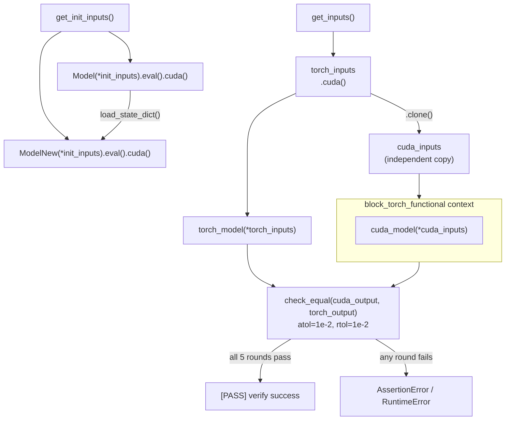
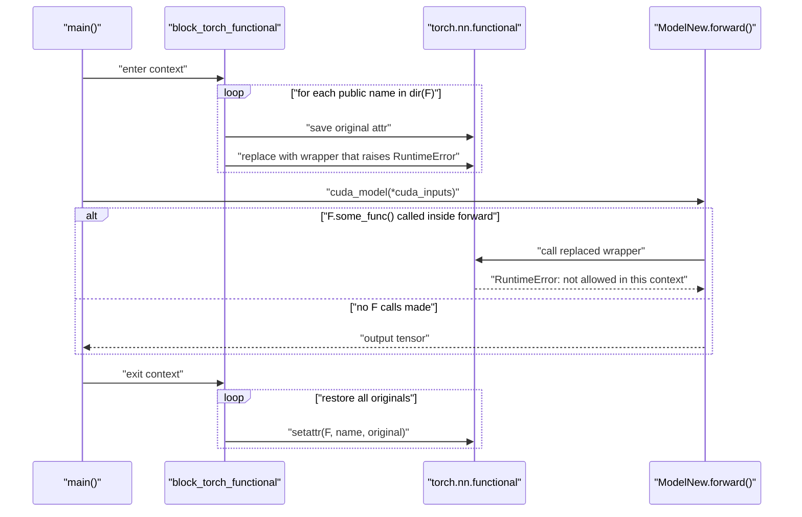
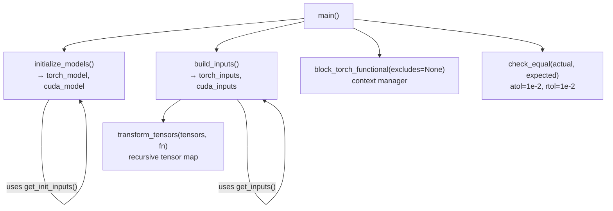

<!-- source: DeepWiki mcp.deepwiki.com · repo BytedTsinghua-SIA/CUDA-Agent · page 2.4 Correctness Verification · fetched 2026-10-26 -->

# Correctness Verification

<details>
<summary>Relevant source files</summary>

The following files were used as context for generating this wiki page:

- [agent_workdir/model.py](agent_workdir/model.py)
- [agent_workdir/model_new.py](agent_workdir/model_new.py)
- [agent_workdir/utils/verification.py](agent_workdir/utils/verification.py)

</details>


## Purpose and Scope

This page documents `agent_workdir/utils/verification.py`, the module responsible for asserting that a CUDA-extension model (`ModelNew`) produces numerically equivalent outputs to the PyTorch baseline model (`Model`). It covers model initialization, input construction, the enforcement mechanism that prevents `torch.nn.functional` use inside the CUDA model, and the numeric tolerance thresholds used for comparison.

For details on the models being compared, see the Model Files page ([2.2](#2.2)). For performance measurement after correctness is confirmed, see Performance Profiling ([2.5](#2.5)).

---

## What Verification Does

The verification module runs the same forward pass through both the baseline and the CUDA-extension model and asserts their outputs are numerically close. It performs this check **5 times**, each time with a freshly sampled set of inputs.

It enforces two invariants:

1. **Weight parity** — `ModelNew` is loaded with the exact state dict from `Model` before any forward pass.
2. **CUDA-only execution** — `ModelNew.forward` must not call any function from `torch.nn.functional`; a context manager blocks all such calls and raises a `RuntimeError` if any are invoked.

---

## Data Flow

**Diagram: Verification Data Flow**



Sources: [agent_workdir/utils/verification.py:85-99]()

---

## Model Initialization

The `initialize_models` function in [agent_workdir/utils/verification.py:65-73]() constructs both models identically:

| Step | Code construct | Effect |
|---|---|---|
| 1 | `get_init_inputs()` | Returns constructor arguments (e.g., `[2.0]` for `alpha`) |
| 2 | `Model(*init_inputs).eval().cuda()` | Baseline model on GPU, eval mode |
| 3 | `ModelNew(*init_inputs).eval().cuda()` | CUDA model on GPU, eval mode |
| 4 | `cuda_model.load_state_dict(torch_model.state_dict())` | Copies all weights from baseline to CUDA model |

The `load_state_dict` call ensures both models share the same trained weights, so any output divergence is attributable solely to the CUDA kernel implementation.

Sources: [agent_workdir/utils/verification.py:65-73](), [agent_workdir/model.py:1-26](), [agent_workdir/model_new.py:1-13]()

---

## Input Construction

The `build_inputs` function in [agent_workdir/utils/verification.py:76-82]() produces two independent input sets from the same random sample:

```
get_inputs()  →  torch_inputs (.cuda())
                     │
                     └─ .clone()  →  cuda_inputs
```

Cloning guarantees that in-place operations inside either model's forward pass cannot affect the other model's inputs. Both sets contain identical values at the start of each check round.

The `transform_tensors` helper [agent_workdir/utils/verification.py:12-19]() recursively applies a function to tensors regardless of whether they are bare tensors, lists, tuples, or dicts — matching whatever structure `get_inputs()` happens to return.

Sources: [agent_workdir/utils/verification.py:12-19](), [agent_workdir/utils/verification.py:76-82]()

---

## `block_torch_functional` Context Manager

**Diagram: block_torch_functional Mechanics**



The context manager is defined at [agent_workdir/utils/verification.py:40-62](). On entry it iterates over every public, callable attribute of `torch.nn.functional` and replaces each with a wrapper that raises `RuntimeError`. On exit it restores all originals via the saved `originals` dict.

An `excludes` parameter allows specific functions to remain callable, though the default call in `main()` passes no exclusions [agent_workdir/utils/verification.py:93]().

The purpose is to enforce the workspace rule that `ModelNew` must delegate all computation to the CUDA extension rather than falling back to PyTorch functional operations.

Sources: [agent_workdir/utils/verification.py:40-62](), [agent_workdir/utils/verification.py:89-95]()

---

## Output Comparison: `check_equal`

`check_equal` [agent_workdir/utils/verification.py:22-37]() compares the outputs of the two models recursively. It handles all output structures that a model might return:

| Output type | Comparison method |
|---|---|
| `torch.Tensor` | `torch.testing.assert_close(actual, expected, atol=1e-2, rtol=1e-2)` |
| `list` / `tuple` | Recursively compare each element in order |
| `dict` | Recursively compare each key present in `expected` |
| `str`, `float`, `int` | Exact equality (`==`) |
| Other | Raises `TypeError` |

The tolerance for tensors is `atol=1e-2, rtol=1e-2` [agent_workdir/utils/verification.py:35](). This is deliberately loose enough to accommodate floating-point accumulation differences between CUDA kernel implementations and PyTorch's reference paths, while still catching incorrect results.

Sources: [agent_workdir/utils/verification.py:22-37]()

---

## Main Execution Loop

The `main` function [agent_workdir/utils/verification.py:85-99]() ties all components together:

1. Calls `initialize_models()` once (weights are set once and reused across all rounds).
2. Runs 5 independent check rounds (`num_checks = 5`).
3. Each round: generates fresh inputs via `build_inputs()`, runs both forward passes, calls `check_equal`.
4. The CUDA model forward pass runs inside `block_torch_functional()`.
5. All forward passes run inside `torch.no_grad()`.
6. After all rounds pass, calls `torch.cuda.synchronize()` to flush any pending CUDA operations, then prints `[PASS] verify success`.

The module is invoked as:

```
python3 -m utils.verification
```

from inside `agent_workdir`, as described in the workspace loop (see [2](#2)).

Sources: [agent_workdir/utils/verification.py:85-103]()

---

## Function Reference

**Diagram: verification.py Public API**



| Function | Signature | Role |
|---|---|---|
| `initialize_models` | `() → (Model, ModelNew)` | Construct + weight-sync both models |
| `build_inputs` | `() → (list, list)` | Produce cloned GPU input pairs |
| `transform_tensors` | `(tensors, fn) → same structure` | Recursively apply fn to all tensors |
| `check_equal` | `(actual, expected) → None` | Assert numeric equivalence |
| `block_torch_functional` | `(excludes=None) → contextmanager` | Patch F to block all calls |
| `main` | `() → None` | Entry point; runs 5 check rounds |

Sources: [agent_workdir/utils/verification.py:1-103]()

---

