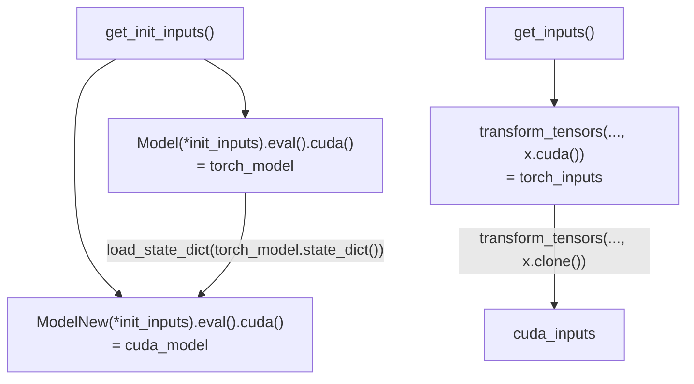
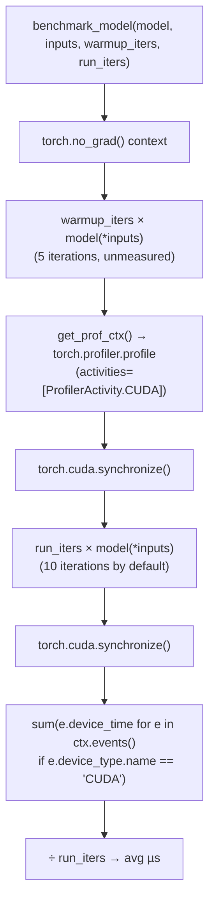
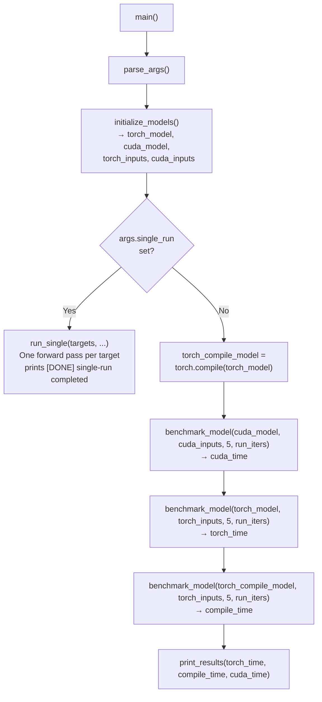

<!-- source: DeepWiki mcp.deepwiki.com · repo BytedTsinghua-SIA/CUDA-Agent · page 2.5 Performance Profiling · fetched 2026-10-26 -->

# Performance Profiling

<details>
<summary>Relevant source files</summary>

The following files were used as context for generating this wiki page:

- [agent_workdir/model.py](agent_workdir/model.py)
- [agent_workdir/model_new.py](agent_workdir/model_new.py)
- [agent_workdir/utils/profiling.py](agent_workdir/utils/profiling.py)

</details>


This page documents `utils/profiling.py`, which benchmarks three execution targets — the PyTorch baseline, `torch.compile`, and the custom CUDA extension — and reports their average CUDA device times in microseconds. This is step 4 of the implement → compile → verify → **profile** → iterate loop described in [Agent Workspace (agent_workdir)](#2).

For correctness checking (step 3), see [Correctness Verification](#2.4). For the workflow rules that define the performance target (5% over `torch.compile`), see [Workflow Constraints (SKILL.md)](#2.1).

---

## Overview

`utils/profiling.py` is invoked as:

```
python3 -m utils.profiling
```

It loads both `Model` (baseline) and `ModelNew` (CUDA extension), transfers weights via `state_dict`, runs warmup passes, and then times each target using `torch.profiler`. Results are printed as a single line of microsecond measurements.

---

## Three Benchmarked Targets

| Target name | Model class | Input variable | Compiled? |
|---|---|---|---|
| `torch_baseline` | `Model` | `torch_inputs` | No |
| `torch_compile` | `torch.compile(Model(...))` | `torch_inputs` | Yes, Triton backend |
| `cuda_extension` | `ModelNew` | `cuda_inputs` | No (hand-written CUDA) |

The `cuda_inputs` are a clone of `torch_inputs` so each target operates on independent tensors and cannot affect each other's results.

Sources: [agent_workdir/utils/profiling.py:99-117]()

---

## Initialization

**Diagram: Model and Input Setup**



Sources: [agent_workdir/utils/profiling.py:42-56]()

The `initialize_models` function [agent_workdir/utils/profiling.py:42-56]() handles all setup:

1. Calls `get_init_inputs()` from `model.py` to get constructor arguments (e.g., `alpha=2.0`).
2. Instantiates both `Model` and `ModelNew` with the same arguments on CUDA.
3. Transfers weights: `cuda_model.load_state_dict(torch_model.state_dict())`.
4. Calls `get_inputs()` from `model.py` and moves all tensors to CUDA via `transform_tensors`.
5. Clones `torch_inputs` into `cuda_inputs` so the two sets are independent.

`transform_tensors` [agent_workdir/utils/profiling.py:11-18]() is a recursive utility that applies a function to every `torch.Tensor` inside a nested list, tuple, or dict.

---

## Benchmark Execution

**Diagram: `benchmark_model` Control Flow**



Sources: [agent_workdir/utils/profiling.py:59-73]()

The core measurement function is `benchmark_model` [agent_workdir/utils/profiling.py:59-73]():

- **Warmup**: 5 forward passes run before measurement starts. This allows CUDA kernels to be JIT-compiled and GPU caches to warm up.
- **Profiling context**: `get_prof_ctx()` [agent_workdir/utils/profiling.py:21-26]() creates a `torch.profiler.profile` instance scoped to `ProfilerActivity.CUDA` only (no CPU events, no shape recording, no stack traces).
- **Synchronization**: `torch.cuda.synchronize()` is called before and after the timed loop to ensure all GPU work is complete before the profiler context closes.
- **Aggregation**: After the context exits, `ctx.events()` is iterated. Events with `device_type.name == "CUDA"` have their `device_time` summed and divided by `run_iters` to produce the average.

### Default Iteration Counts

| Phase | Count | Configurable? |
|---|---|---|
| Warmup | 5 | No (hardcoded) |
| Timed runs | 10 | Yes, `--iters` flag |

Sources: [agent_workdir/utils/profiling.py:109-110]()

---

## `main()` Flow

**Diagram: `main()` Execution Sequence**



Sources: [agent_workdir/utils/profiling.py:99-117]()

`torch.compile` wraps `torch_model` [agent_workdir/utils/profiling.py:108]() once before any benchmarking begins. The compilation overhead is not included in `compile_time`; only steady-state forward-pass performance is measured.

---

## `--single-run` Mode

The `--single-run` flag [agent_workdir/utils/profiling.py:35-38]() accepts a comma-separated list of target names and executes exactly one `torch.no_grad()` forward pass for each, printing `[DONE] single-run completed` when finished. No timing is recorded.

Valid target names are: `torch_baseline`, `torch_compile`, `cuda_extension`.

This mode is used by the agent loop to verify that a model can execute without crashing, separate from full benchmarking.

Sources: [agent_workdir/utils/profiling.py:85-96]()

---

## Output Format

`print_results` [agent_workdir/utils/profiling.py:76-82]() prints a single line:

```
Torch Baseline: 12.345us, Torch Compile: 8.901us, CUDA Extension: 7.234us
```

The three numbers are directly comparable. The agent's goal (per SKILL.md) is for `CUDA Extension` to be at least 5% faster than `Torch Compile`.

---

## Key Symbols Reference

| Symbol | Kind | Role |
|---|---|---|
| `benchmark_model` | function | Runs warmup + timed profiler loop, returns avg µs |
| `get_prof_ctx` | function | Creates `torch.profiler.profile` for CUDA activities |
| `initialize_models` | function | Instantiates and weight-syncs both models |
| `transform_tensors` | function | Recursively applies a tensor transform |
| `run_single` | function | One-shot execution without measurement |
| `print_results` | function | Formats and prints the three µs timings |
| `parse_args` | function | Handles `--iters` and `--single-run` CLI flags |
| `ProfilerActivity.CUDA` | enum value | Restricts profiler to GPU-side events only |
| `e.device_time` | attribute | Per-event CUDA kernel wall time in µs |

Sources: [agent_workdir/utils/profiling.py:1-121]()

---

