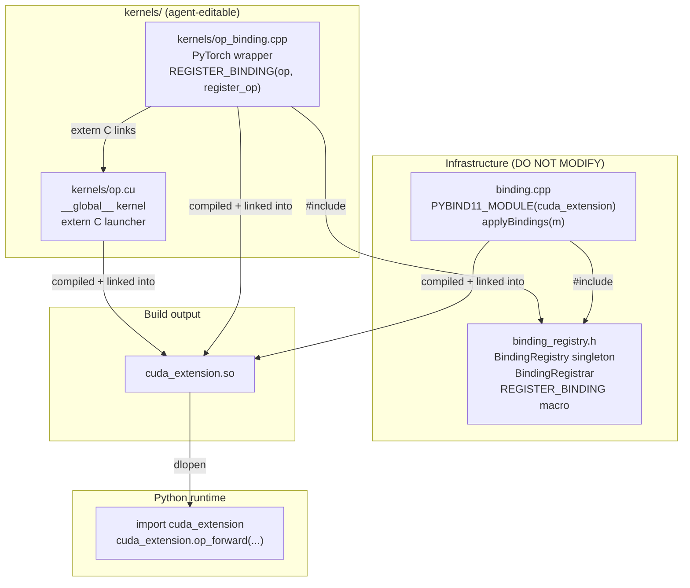

<!-- source: DeepWiki mcp.deepwiki.com · repo BytedTsinghua-SIA/CUDA-Agent · page 3 CUDA Extension Architecture · fetched 2026-10-26 -->

# CUDA Extension Architecture

<details>
<summary>Relevant source files</summary>

The following files were used as context for generating this wiki page:

- [agent_workdir/SKILL.md](agent_workdir/SKILL.md)
- [agent_workdir/binding.cpp](agent_workdir/binding.cpp)
- [agent_workdir/binding_registry.h](agent_workdir/binding_registry.h)

</details>


This page describes the overall architecture of the CUDA extension system used in `agent_workdir`: the two-phase lifecycle, the roles of each infrastructure file, and the convention by which individual kernel files integrate without touching shared infrastructure. For a deep dive into `BindingRegistry` internals, see [Binding Registry](#3.1). For a complete walkthrough of a single kernel from `.cu` to Python callable, see [Kernel Implementation: The axpby Example](#3.2). For how the compiled `.so` is consumed by the optimized model, see [Model Files: Baseline and Optimized](#2.2).

---

## Overview

The CUDA extension compiles into a shared library (`cuda_extension.so`) that Python imports as a module. The system is split into two tiers:

| Tier | Files | Mutable? | Role |
|---|---|---|---|
| Infrastructure | `binding_registry.h`, `binding.cpp` | **No** | Module entry point, registry mechanism |
| Kernel | `kernels/*.cu`, `kernels/*_binding.cpp` | **Yes** | Kernel logic and Python wrapper per op |

The central design goal is that adding a new kernel requires **no changes** to infrastructure files. Each kernel registers itself at static initialization time using the `REGISTER_BINDING` macro, and the infrastructure collects and exposes all registrations automatically when Python imports the module.

Sources: [agent_workdir/binding.cpp:1-10](), [agent_workdir/binding_registry.h:1-49](), [agent_workdir/SKILL.md:18-28]()

---

## Two-Phase Lifecycle

The system operates in two distinct phases separated by the build/run boundary.

**Phase 1 — Build time (static initialization):** When `compile.py` compiles and links all `.cu` and `_binding.cpp` files, each `_binding.cpp` file's `REGISTER_BINDING(...)` call creates a file-scope static `BindingRegistrar` object. C++ initializes these objects before any `main()` runs, causing each one to call `BindingRegistry::getInstance().registerBinding(...)` and enqueue a binding function into the registry's internal list.

**Phase 2 — Runtime (Python import):** When Python executes `import cuda_extension`, the dynamic linker runs the `PYBIND11_MODULE(cuda_extension, m)` initializer in `binding.cpp`. This calls `BindingRegistry::getInstance().applyBindings(m)`, which iterates the enqueued list and calls each binding function, invoking `m.def(...)` to expose the C++ function to Python.

**Lifecycle Sequence Diagram**

```mermaid
sequenceDiagram
    box "Build time"
        participant BC["axpby_binding.cpp"]
        participant MACRO["REGISTER_BINDING macro"]
        participant REG["BindingRegistry::bindings_"]
    end
    box "Runtime"
        participant PY["Python: import cuda_extension"]
        participant MOD["PYBIND11_MODULE (binding.cpp)"]
        participant APPLY["applyBindings()"]
    end

    BC->>MACRO: "REGISTER_BINDING(axpby, register_axpby)"
    MACRO->>REG: "BindingRegistrar ctor → registerBinding(name, lambda)"
    Note over BC,REG: "Static init: runs before main(), once per _binding.cpp"

    PY->>MOD: "import cuda_extension"
    MOD->>APPLY: "BindingRegistry::getInstance().applyBindings(m)"
    loop "for each entry in bindings_"
        APPLY->>PY: "m.def(axpby_forward, &axpby_forward, ...)"
    end
    Note over PY: "cuda_extension.axpby_forward now callable"
```

Sources: [agent_workdir/binding_registry.h:40-49](), [agent_workdir/binding.cpp:7-9]()

---

## Infrastructure Files

The following two files are fixed and must not be modified by kernel authors.

### `binding_registry.h`

Defines the complete registration mechanism in a single header. Key entities:

| Entity | Kind | Purpose |
|---|---|---|
| `BindingRegistry` | Singleton class | Owns the list of all registered bindings |
| `BindingFunction` | Type alias (`std::function<void(pybind11::module&)>`) | Type of each registration callback |
| `getInstance()` | Static method | Returns the one `BindingRegistry` instance |
| `registerBinding(name, func)` | Method | Appends a `{name, func}` pair to `bindings_` |
| `applyBindings(m)` | Method | Iterates `bindings_` and calls each `func(m)` |
| `BindingRegistrar` | Helper class | Calls `registerBinding` from its constructor, enabling static-init auto-registration |
| `REGISTER_BINDING(name, func)` | Preprocessor macro | Expands to a `static BindingRegistrar` variable scoped to the translation unit |

The header deliberately includes only `<pybind11/pybind11.h>` and `<pybind11/stl.h>`, not `torch/extension.h`, to minimize compilation time.

Sources: [agent_workdir/binding_registry.h:1-49]()

### `binding.cpp`

Contains only the `PYBIND11_MODULE` entry point. Its entire body is three lines:

[agent_workdir/binding.cpp:7-9]()

It includes `binding_registry.h` and delegates all module population to `applyBindings`. No kernel-specific code appears here.

Sources: [agent_workdir/binding.cpp:1-10]()

---

## Kernel File Convention

Each CUDA operation is implemented as a paired set of files inside `kernels/`:

| File | Depends on | Contains |
|---|---|---|
| `kernels/<op>.cu` | `<cuda_runtime.h>` only | `__global__` kernel(s) + `extern "C"` launcher |
| `kernels/<op>_binding.cpp` | `<torch/types.h>`, `<torch/csrc/utils/pybind.h>`, `binding_registry.h` | PyTorch wrapper function + `REGISTER_BINDING` call |

The `.cu` file has **no PyTorch dependency**. The `_binding.cpp` file has **no kernel logic**. The launcher is declared `extern "C"` in the `.cu` file and re-declared in `_binding.cpp` so that the linker can resolve it without name mangling.

`REGISTER_BINDING` at the bottom of each `_binding.cpp` is the only hook needed. It creates a static object whose constructor runs at load time, invisibly wiring the kernel into the module.

Sources: [agent_workdir/SKILL.md:31-33](), [agent_workdir/SKILL.md:39-143](), [agent_workdir/binding_registry.h:47-49]()

---

## Component Dependency Diagram

The diagram below maps the architecture to actual file and code entity names.

**Component and Dependency Diagram**



Sources: [agent_workdir/binding_registry.h:1-49](), [agent_workdir/binding.cpp:1-10](), [agent_workdir/SKILL.md:18-28]()

---

## `REGISTER_BINDING` Macro Expansion

The macro is defined as:

[agent_workdir/binding_registry.h:47-49]()

For a call like `REGISTER_BINDING(axpby, register_axpby)`, it expands to:

```
static BindingRegistrar _registrar_axpby("axpby", [](pybind11::module& m) { register_axpby(m); });
```

The `static` keyword ensures exactly one instance is created per translation unit at startup. The lambda wraps the registration function so that `BindingRegistry` can store it as a `BindingFunction` (`std::function<void(pybind11::module&)>`) without needing to know the concrete function type at registry-definition time.

Sources: [agent_workdir/binding_registry.h:40-49]()

---

## Design Constraints Summary

The following constraints are enforced by `SKILL.md` and embedded in the infrastructure design:

- `torch::*` and `torch::nn::functional::*` must not appear in `.cu` files or in the `extern "C"` launcher. PyTorch types are allowed only in `_binding.cpp`.
- `torch/extension.h` is deliberately not included anywhere (see [Binding Registry](#3.1) for rationale).
- `binding.cpp` and `binding_registry.h` are read-only for kernel authors. All per-kernel work lives in `kernels/`.
- The `config` parameter convention (an `int` passed through bindings to the launcher `switch` statement) allows runtime kernel variant selection without recompilation.

Sources: [agent_workdir/SKILL.md:3-16](), [agent_workdir/SKILL.md:364-373]()

---

