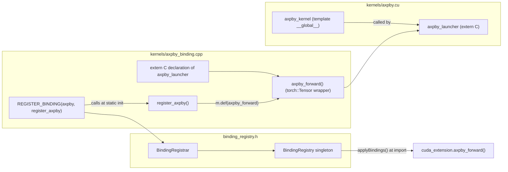
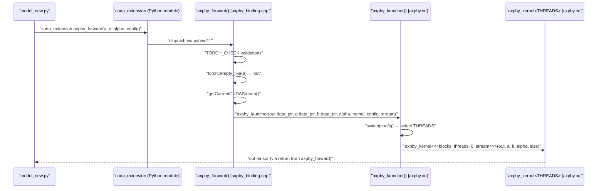

<!-- source: DeepWiki mcp.deepwiki.com · repo BytedTsinghua-SIA/CUDA-Agent · page 3.2 Kernel Implementation: The axpby Example · fetched 2026-10-26 -->

# Kernel Implementation: The axpby Example

<details>
<summary>Relevant source files</summary>

The following files were used as context for generating this wiki page:

- [agent_workdir/SKILL.md](agent_workdir/SKILL.md)
- [agent_workdir/binding_registry.h](agent_workdir/binding_registry.h)
- [agent_workdir/kernels/axpby.cu](agent_workdir/kernels/axpby.cu)
- [agent_workdir/kernels/axpby_binding.cpp](agent_workdir/kernels/axpby_binding.cpp)

</details>


This page walks through a complete, working kernel from raw CUDA source to Python-callable function, using `axpby` (the operation `alpha * a + b`) as the concrete example. It covers the `.cu` file, the `_binding.cpp` file, and the `REGISTER_BINDING` call that wires everything into `cuda_extension`.

For the registry infrastructure that makes auto-registration possible, see [Binding Registry](#3.1). For how the build system discovers these files and compiles them into `cuda_extension.so`, see [Build System](#2.3).

---

## Overview: The Two-File Pattern

Every kernel in the `kernels/` directory follows a strict two-file convention enforced by the workspace rules.

**Figure: Two-file pattern for the axpby kernel**



Sources: [`agent_workdir/kernels/axpby.cu`](), [`agent_workdir/kernels/axpby_binding.cpp`](), [`agent_workdir/binding_registry.h`]()

| File | Contains | PyTorch dependency |
|---|---|---|
| `kernels/axpby.cu` | `__global__` kernel, `extern "C"` launcher | None — pure CUDA |
| `kernels/axpby_binding.cpp` | `torch::Tensor` wrapper, `REGISTER_BINDING` | `torch/types.h`, `c10/cuda/CUDAStream.h` |

The `.cu` file has zero PyTorch dependency by design. This accelerates compilation and keeps GPU logic self-contained.

Sources: [`agent_workdir/SKILL.md:31-33`]()

---

## The CUDA Kernel (`axpby.cu`)

### Template kernel: `axpby_kernel`

[`agent_workdir/kernels/axpby.cu:3-10`]()

The kernel is a `template<int THREADS>` `__global__` function. The template parameter `THREADS` allows the compiler to generate a distinct version for each block size (128, 256, 512). At compile time, the compiler can specialize register allocation and unrolling per instantiation.

The body uses a **grid-stride loop**:

```
tid = blockIdx.x * blockDim.x + threadIdx.x
stride = blockDim.x * gridDim.x
for i = tid; i < size; i += stride:
    out[i] = alpha * a[i] + b[i]
```

The grid-stride pattern means a single launch handles any tensor size regardless of how many CUDA blocks are launched. It also ensures coalesced global memory reads: consecutive threads (same warp) access consecutive addresses in `a[]` and `b[]`.

### The `extern "C"` launcher: `axpby_launcher`

[`agent_workdir/kernels/axpby.cu:12-42`]()

The launcher has a pure C interface — no C++ name mangling, no PyTorch types. This is deliberate: it lets the `_binding.cpp` file declare it with a simple `extern "C"` forward declaration and link against the compiled `.cu` object without any header dependency on CUDA kernel code.

The launcher signature:

```
axpby_launcher(float* out, const float* a, const float* b,
               float alpha, int size, int config, cudaStream_t stream)
```

The `config` integer selects the block size via a `switch` statement:

| `config` value | Threads per block | Template instantiation |
|---|---|---|
| `1` | 128 | `axpby_kernel<128>` |
| `2` | 512 | `axpby_kernel<512>` |
| default (`0`) | 256 | `axpby_kernel<256>` |

The block count is always computed as `(size + threads - 1) / threads` to cover all elements. A guard `if (size <= 0) return;` at the top prevents zero-size launches.

The `cudaStream_t stream` parameter is passed through directly to the kernel launch (`<<<blocks, threads, 0, stream>>>`). This keeps execution on the same CUDA stream as the calling PyTorch code, which is essential for correct ordering with other GPU work.

Sources: [`agent_workdir/kernels/axpby.cu:12-42`]()

---

## The Binding Layer (`axpby_binding.cpp`)

### Includes and `extern "C"` declaration

[`agent_workdir/kernels/axpby_binding.cpp:1-15`]()

The file includes:

- `<torch/types.h>` and `<torch/csrc/utils/pybind.h>` instead of the heavier `torch/extension.h`. This reduces compile time.
- `<cuda_runtime.h>` for `cudaStream_t`.
- `<c10/cuda/CUDAStream.h>` for `c10::cuda::getCurrentCUDAStream()`.
- `"../binding_registry.h"` for `REGISTER_BINDING`.

The `extern "C"` declaration mirrors the launcher signature exactly. This is the only way the C++ compiler knows about the symbol produced by `nvcc` compiling `axpby.cu`.

### The PyTorch wrapper: `axpby_forward`

[`agent_workdir/kernels/axpby_binding.cpp:17-38`]()

`axpby_forward` is a `static torch::Tensor` function that bridges Python/PyTorch types to the raw C launcher.

**Input validation** — seven `TORCH_CHECK` calls before any GPU work:

| Check | Condition |
|---|---|
| `a.is_cuda()` | `a` must be a CUDA tensor |
| `b.is_cuda()` | `b` must be a CUDA tensor |
| `a.is_contiguous()` | `a` memory layout must be contiguous |
| `b.is_contiguous()` | `b` memory layout must be contiguous |
| `a.dtype() == torch::kFloat32` | `a` must be float32 |
| `b.dtype() == torch::kFloat32` | `b` must be float32 |
| `a.sizes() == b.sizes()` | shapes must match |

If any check fails, PyTorch raises a `RuntimeError` with the message string before any GPU code runs.

**Output allocation**: `torch::empty_like(a)` allocates an uninitialized output tensor with the same shape, dtype, and device as `a`. This is the only permitted allocation method (see [Workflow Constraints](#2.1)).

**Stream retrieval**: `c10::cuda::getCurrentCUDAStream().stream()` fetches the `cudaStream_t` for the current PyTorch CUDA stream. Passing this to the launcher ensures kernel execution is ordered correctly within the PyTorch execution graph.

**Launcher call**: Raw `data_ptr<float>()` pointers are extracted from the tensors, `alpha` is narrowed from `double` to `float` via `static_cast`, `a.numel()` gives the flat element count, and the call is delegated to `axpby_launcher`.

### The registration function: `register_axpby`

[`agent_workdir/kernels/axpby_binding.cpp:40-42`]()

```cpp
static void register_axpby(pybind11::module& m) {
    m.def("axpby_forward", &axpby_forward, py::arg("a"), py::arg("b"),
          py::arg("alpha"), py::arg("config") = 0);
}
```

This function receives a `pybind11::module&` reference and calls `m.def` to expose `axpby_forward` to Python. Named arguments (`py::arg`) are declared so callers can use keyword syntax. `config` defaults to `0` (256 threads), which is the most common block size.

### `REGISTER_BINDING`: the auto-registration macro

[`agent_workdir/kernels/axpby_binding.cpp:44`]()

```cpp
REGISTER_BINDING(axpby, register_axpby);
```

This expands (via [`agent_workdir/binding_registry.h:48-49`]()) to a static-duration `BindingRegistrar` object whose constructor calls `BindingRegistry::getInstance().registerBinding("axpby", ...)`. Because the object is `static`, it is constructed before `main()` runs. When Python later does `import cuda_extension`, `PYBIND11_MODULE` in `binding.cpp` calls `applyBindings(m)`, which invokes `register_axpby(m)` and makes `cuda_extension.axpby_forward` available.

---

## End-to-End Call Flow

**Figure: Runtime call path from Python to GPU**



Sources: [`agent_workdir/kernels/axpby.cu`](), [`agent_workdir/kernels/axpby_binding.cpp`]()

---

## Config Parameter: Runtime Tuning Without Recompilation

The `config` integer is intentionally surfaced all the way to the Python API. Because three template instantiations (`<128>`, `<256>`, `<512>`) are baked into the compiled `.so`, the caller can switch between them at runtime without recompiling.

`SKILL.md` describes a tuning script pattern where the agent benchmarks each `config` value on target input shapes and selects the fastest one, then hardcodes that value in `model_new.py`.

Sources: [`agent_workdir/SKILL.md:195-231`]()

---

## Constraints Enforced by This Pattern

| Rule | Where enforced |
|---|---|
| No `torch::*` calls in `.cu` files | `axpby.cu` has no PyTorch includes |
| No `torch/extension.h` | `axpby_binding.cpp` uses `torch/types.h` + `torch/csrc/utils/pybind.h` |
| Output allocation via `empty_like` only | `axpby_binding.cpp:26` |
| Stream passed through from PyTorch | `c10::cuda::getCurrentCUDAStream()` in `axpby_binding.cpp:27` |
| No modifications to `binding.cpp` or `binding_registry.h` | `REGISTER_BINDING` is the only touch-point |
| Kernels placed only in `kernels/` | Both files live in `agent_workdir/kernels/` |

Sources: [`agent_workdir/SKILL.md:3-16`](), [`agent_workdir/kernels/axpby_binding.cpp`]()