# Page: Overview

# Overview

<details>
<summary>Relevant source files</summary>

The following files were used as context for generating this wiki page:

- [README.md](README.md)
- [assets/agent_loop.png](assets/agent_loop.png)
- [assets/benchmark_chart.png](assets/benchmark_chart.png)

</details>


This page introduces the CUDA-Agent project: what it is, its high-level architecture, and how the two major subsystems relate to each other. For details on the training dataset, see [Training Dataset: CUDA-Agent-Ops-6K](#1.1). For a deep dive into the workspace itself, see [Agent Workspace (agent_workdir)](#2).

---

## What Is CUDA-Agent?

CUDA-Agent is a large language model trained with large-scale agentic reinforcement learning (RL) to generate high-performance CUDA kernels. It is described in [README.md:6-8]() as the first known RL-trained model to surpass advanced frontier models (Claude Opus 4.6, Gemini 2.5 Pro) on the KernelBench benchmark for CUDA kernel generation. It consistently outperforms the `torch.compile` baseline across all difficulty levels, with particularly strong gains on the hardest tasks.

The project consists of three separable concerns:

| Concern | Description | Key Artifact |
|---|---|---|
| **Dataset construction** | Build 6,000 RL training samples from PyTorch/Transformers operators | `CUDA-Agent-Ops-6K` (HuggingFace) |
| **Agentic RL training** | Train a model using the agent loop as the reward environment | CUDA-Agent model |
| **Evaluation** | Benchmark the model against `torch.compile` on KernelBench | KernelBench scores |

The released artifacts include the training dataset, the `SKILL.md` workflow specification, and the `agent_workdir` environment used during training and evaluation.

Sources: [README.md:1-54]()

---

## Top-Level Architecture

**Diagram: Major subsystems and their data flows**

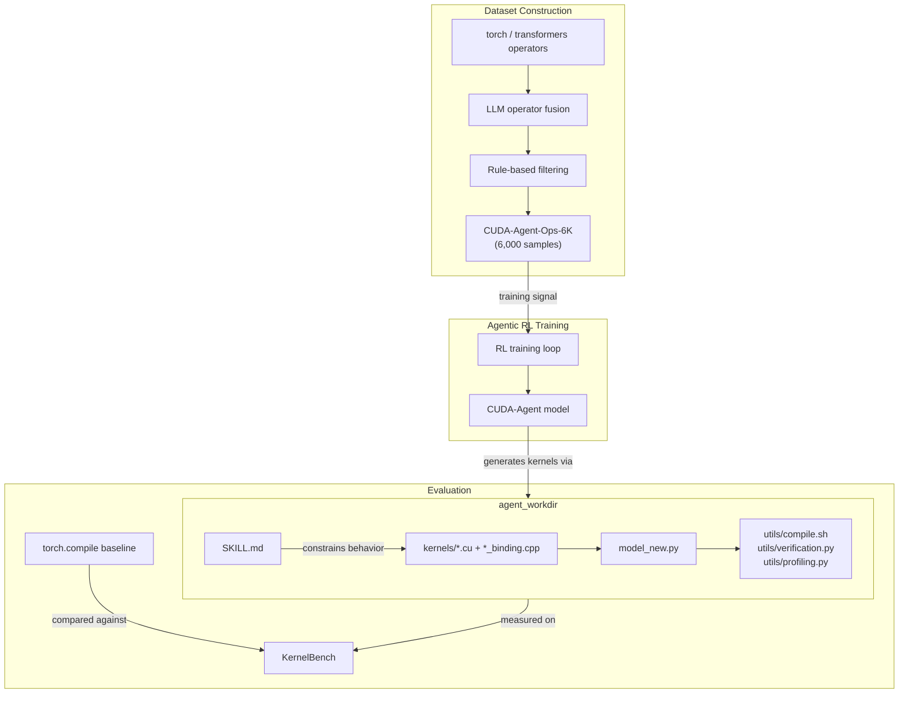

Sources: [README.md:1-54]()

---

## The Two Major Subsystems

### 1. Training Dataset: CUDA-Agent-Ops-6K

The dataset pipeline collects reference operators from `torch` and `transformers`, uses an LLM to fuse them into compound tasks, then applies rule-based filtering. The 6,000 resulting samples are used as training signal for the agentic RL loop.

Filtering criteria (from [README.md:23-27]()):
- Must execute correctly in both eager mode and under `torch.compile`
- Stochastic operators and degenerate outputs are removed
- Runtime must fall within bounds
- Samples highly similar to KernelBench test cases are removed to reduce contamination

Full details are in [Training Dataset: CUDA-Agent-Ops-6K](#1.1).

---

### 2. Agent Workspace: `agent_workdir`

The `agent_workdir` directory is a standardized environment in which the agent iteratively writes, compiles, verifies, and benchmarks CUDA kernels. It is both the environment used during RL training and the workspace a user can run manually.

**Diagram: Files in `agent_workdir` and their roles**

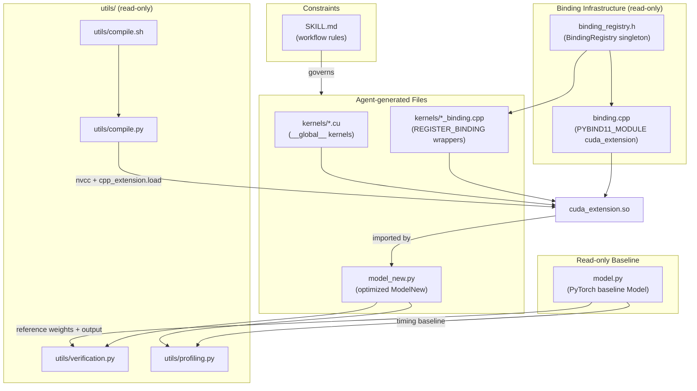

Sources: [README.md:35-53]()

---

## The Agent Iterative Loop

The core operational cycle inside `agent_workdir` is: **implement → compile → verify → profile → iterate**. This loop is the reward environment for RL training.

**Diagram: Agent feedback loop mapped to script invocations**

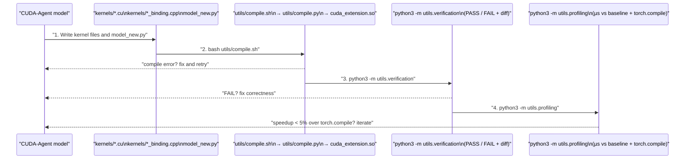

The three CLI commands for running the loop manually are [README.md:49-53]():

```bash
bash utils/compile.sh
python3 -m utils.verification
python3 -m utils.profiling
```

Sources: [README.md:30-54]()

---

## Key Files at a Glance

| File/Directory | Role | Mutable by Agent? |
|---|---|---|
| `SKILL.md` | Workflow constraints and optimization rules | No |
| `model.py` | PyTorch baseline (`Model` class) | No |
| `model_new.py` | Optimized model (`ModelNew`) delegating to `cuda_extension` | Yes |
| `kernels/*.cu` | CUDA `__global__` kernel implementations | Yes |
| `kernels/*_binding.cpp` | PyTorch wrappers; use `REGISTER_BINDING` macro | Yes |
| `binding_registry.h` | `BindingRegistry` singleton; `REGISTER_BINDING` macro | No |
| `binding.cpp` | `PYBIND11_MODULE cuda_extension`; calls `applyBindings()` | No |
| `utils/compile.py` | Discovers sources, invokes `torch.utils.cpp_extension.load` | No |
| `utils/compile.sh` | Timing wrapper around `compile.py` | No |
| `utils/verification.py` | Checks `ModelNew` output against `Model` at `atol/rtol=1e-2` | No |
| `utils/profiling.py` | Benchmarks `torch_baseline`, `torch.compile`, `cuda_extension` µs | No |

Sources: [README.md:35-53]()

---

## Related Pages

- **[Training Dataset: CUDA-Agent-Ops-6K](#1.1)** — Full description of the 6,000-sample dataset construction pipeline and filtering criteria.
- **[Agent Workspace (agent_workdir)](#2)** — Structural walkthrough of every file and the full implement → compile → verify → profile loop.
- **[Workflow Constraints (SKILL.md)](#2.1)** — The rules encoded in `SKILL.md` that govern agent behavior and optimization strategy.
- **[Build System](#2.3)** — How `compile.py` discovers sources and invokes `torch.utils.cpp_extension.load`.
- **[CUDA Extension Architecture](#3)** — The two-phase lifecycle of the `cuda_extension` module: static registration and `applyBindings()` at import time.

---

# Page: Training Dataset: CUDA-Agent-Ops-6K

# Training Dataset: CUDA-Agent-Ops-6K

<details>
<summary>Relevant source files</summary>

The following files were used as context for generating this wiki page:

- [README.md](README.md)
- [assets/data_pipeline.png](assets/data_pipeline.png)

</details>


This page covers the construction and composition of **CUDA-Agent-Ops-6K**, the 6,000-sample training dataset used to drive the agentic RL training loop for CUDA-Agent. It describes where the raw operator inputs come from, how an LLM synthesizes them into training tasks, and the six rule-based filtering passes that determine which samples are retained.

For details on how this dataset feeds into the RL training loop and the agent model itself, see the Overview ([1](#1)). For the agent workspace that the trained model operates inside, see [2](#2).

---

## Dataset at a Glance

| Property | Value |
|---|---|
| Total samples | 6,000 |
| Source operators | `torch` standard library + HuggingFace `transformers` |
| Synthesis method | LLM-driven operator fusion |
| Filtering method | Rule-based, six independent criteria |
| Public location | `BytedTsinghua-SIA/CUDA-Agent-Ops-6K` on Hugging Face |
| Role in system | Training signal for large-scale agentic RL |

Sources: [README.md:14-26]()

---

## Construction Pipeline

The dataset is produced through three sequential stages: **operator collection**, **LLM-based task synthesis**, and **rule-based filtering**.

**Figure 1: Data Synthesis Pipeline**

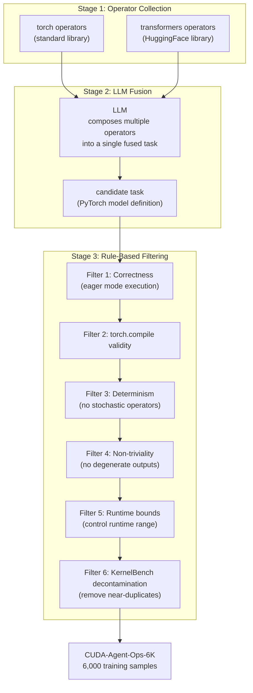

Sources: [README.md:19-26]()

---

## Stage 1: Operator Collection

Reference operators are drawn from two Python libraries:

- **`torch`** — the core PyTorch operator library, covering element-wise math, linear algebra, convolutions, activations, and reductions.
- **`transformers`** (HuggingFace) — attention mechanisms, layer normalization variants, positional encodings, and other transformer-specific primitives.

These operators serve as building blocks; individual operators are not directly used as training tasks. They are handed off to the LLM for composition.

Sources: [README.md:20-21]()

---

## Stage 2: LLM-Based Task Synthesis

An LLM receives a set of reference operators and is prompted to compose them into a single fused task. The output of this stage is a candidate PyTorch model definition — a `torch.nn.Module` subclass with a `forward` method that calls multiple operators in combination.

**Figure 2: LLM Synthesis — Inputs and Outputs**

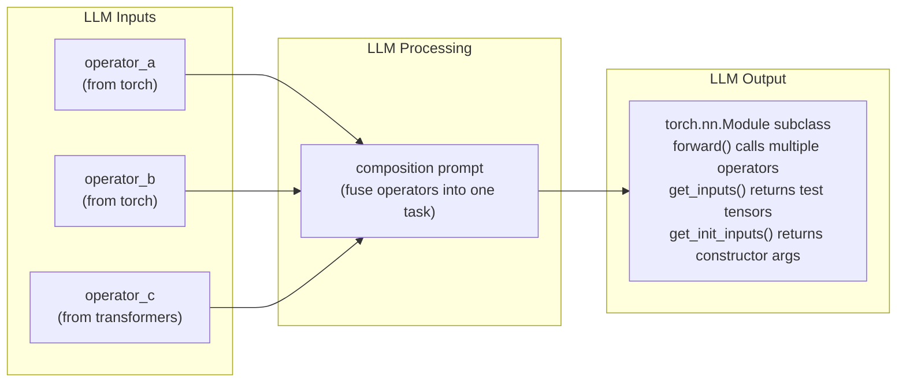

The generated module follows the same interface used in the agent workspace (`model.py`): it exposes `get_inputs()` and `get_init_inputs()` functions so downstream filtering can instantiate and run the model without additional configuration. See [2.2](#2.2) for the full model interface specification.

Sources: [README.md:21-22]()

---

## Stage 3: Rule-Based Filtering

Six filters are applied in sequence. A sample must pass all six to enter the final dataset.

### Filter Overview Table

| # | Filter | What is checked | Failure condition |
|---|---|---|---|
| 1 | **Correctness** | Run the model in eager mode | Raises an exception or produces wrong output |
| 2 | **`torch.compile` validity** | Run the model under `torch.compile` | Fails to compile or produces different results from eager |
| 3 | **Determinism** | Run the model twice with identical inputs | Outputs differ between runs (stochastic operator present) |
| 4 | **Non-triviality** | Inspect the output tensor | All-zeros, all-NaN, or otherwise degenerate output |
| 5 | **Runtime bounds** | Measure execution time | Too fast (trivially cheap) or too slow (impractically large) |
| 6 | **KernelBench decontamination** | Compare against KernelBench test suite | Sample is too similar to an existing KernelBench problem |

Sources: [README.md:23-26]()

### Filter Detail

**Filter 1 — Correctness (eager mode)**
The candidate module is instantiated and executed using standard PyTorch eager execution. Any runtime error, shape mismatch, or device error causes rejection. This ensures every retained sample is a valid, runnable PyTorch computation.

**Filter 2 — `torch.compile` validity**
The same module is compiled with `torch.compile` and executed. The output must match the eager-mode output within a numerical tolerance. This is required because the training reward signal compares CUDA kernel output against the `torch.compile` baseline; a task that `torch.compile` cannot handle consistently would produce an unreliable signal.

**Filter 3 — Determinism**
The module is run twice under identical inputs and random seeds. If the outputs differ, the sample contains a stochastic operator (e.g., dropout, random sampling) and is discarded. Determinism is necessary because the RL verification step (see [2.4](#2.4)) performs exact numerical comparison.

**Filter 4 — Non-triviality**
The output tensor is inspected for degenerate values: all-zero, all-NaN, all-inf, or constant tensors. Such outputs indicate the operator combination collapsed to a trivial computation that offers no meaningful optimization target.

**Filter 5 — Runtime bounds**
Execution time is measured on a GPU. Samples that run too quickly (below a lower bound) provide no meaningful speedup opportunity. Samples that run too slowly (above an upper bound) would make the RL training loop impractically slow. Only samples within the target time window are retained.

**Filter 6 — KernelBench decontamination**
Each surviving sample is compared against the KernelBench evaluation benchmark. Samples that are highly similar to KernelBench test cases are removed to prevent training data contamination that could artificially inflate benchmark scores.

Sources: [README.md:23-26]()

---

## How the Dataset Feeds Into Training

**Figure 3: Dataset-to-Training Signal Flow**

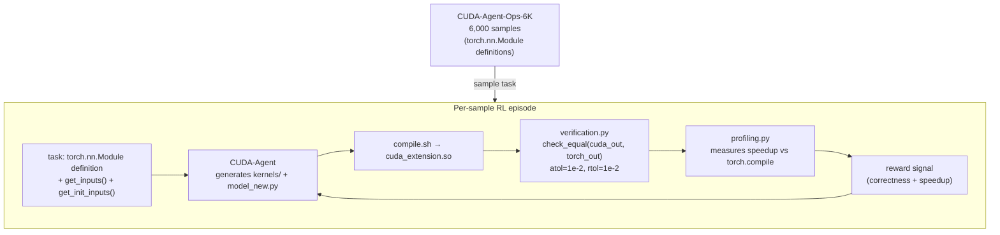

Each training sample is a `torch.nn.Module` definition that becomes the `model.py` baseline inside an `agent_workdir` episode. The agent's reward is determined by whether its generated CUDA kernel produces correct output (via `verification.py`) and whether it achieves a speedup over `torch.compile` (via `profiling.py`). The dual correctness + `torch.compile` filtering in the construction pipeline ensures every training task has a reliable, reproducible reward signal.

For the full workspace structure used during training episodes, see [2](#2). For details on correctness verification, see [2.4](#2.4). For performance profiling mechanics, see [2.5](#2.5).

Sources: [README.md:6-8](), [README.md:19-26](), [README.md:32-44]()

---

# Page: Agent Workspace (agent_workdir)

# Agent Workspace (agent_workdir)

<details>
<summary>Relevant source files</summary>

The following files were used as context for generating this wiki page:

- [README.md](README.md)
- [agent_workdir/SKILL.md](agent_workdir/SKILL.md)

</details>


This page describes the structure and operation of the `agent_workdir` directory: what each file does, how the files relate to each other, and how the full implement → compile → verify → profile → iterate cycle is executed. It serves as the entry point for understanding the workspace as a whole.

For the workflow constraints that govern agent behavior (the rules encoded in `SKILL.md`), see [Workflow Constraints (SKILL.md)](#2.1). For the build system details, see [Build System](#2.3). For correctness verification and performance profiling specifics, see [Correctness Verification](#2.4) and [Performance Profiling](#2.5). For the CUDA binding registry architecture, see [CUDA Extension Architecture](#3).

---

## Purpose

`agent_workdir` is a self-contained, standardized workspace in which an LLM-based agent generates and iteratively refines custom CUDA kernels to accelerate a given PyTorch model. The workspace provides:

- A **fixed baseline** (`model.py`) that the agent must not change
- A **target file** (`model_new.py`) where the agent writes its optimized model
- A **kernels directory** (`kernels/`) where all CUDA and binding source files live
- **Immutable build/test infrastructure** (`utils/`, `binding.cpp`, `binding_registry.h`) that the agent must not modify
- **Workflow rules** (`SKILL.md`) that constrain and guide agent decisions

Sources: [README.md:30-54](), [agent_workdir/SKILL.md:18-28]()

---

## Directory Structure

```
agent_workdir/
├── SKILL.md                  # Workflow rules for the agent (read-only by convention)
├── model.py                  # Baseline PyTorch model (DO NOT MODIFY)
├── model_new.py              # Agent-generated optimized model
├── binding_registry.h        # Binding registry singleton + REGISTER_BINDING macro (DO NOT MODIFY)
├── binding.cpp               # PYBIND11_MODULE entry point (DO NOT MODIFY)
├── kernels/
│   ├── axpby.cu              # Example: CUDA __global__ kernel + extern C launcher
│   └── axpby_binding.cpp     # Example: PyTorch wrapper + REGISTER_BINDING call
└── utils/
    ├── compile.sh            # Shell wrapper that times the build
    ├── compile.py            # Discovers sources, calls torch.utils.cpp_extension.load
    ├── verification.py       # Correctness check: ModelNew vs Model
    └── profiling.py          # Timing: baseline / torch.compile / cuda_extension
```

| File / Directory | Modifiable by Agent | Purpose |
|---|---|---|
| `SKILL.md` | No | Encodes workflow rules and optimization strategy |
| `model.py` | No | Immutable PyTorch baseline; provides reference outputs and weights |
| `model_new.py` | **Yes** | Agent's optimized model; delegates to `cuda_extension` |
| `binding_registry.h` | No | `BindingRegistry` singleton and `REGISTER_BINDING` macro |
| `binding.cpp` | No | `PYBIND11_MODULE` that calls `applyBindings()` at import |
| `kernels/*.cu` | **Yes** | CUDA kernel implementations (agent-authored) |
| `kernels/*_binding.cpp` | **Yes** | PyTorch tensor wrappers and `REGISTER_BINDING` calls |
| `utils/` | No | Build, verification, and profiling tools |

Sources: [agent_workdir/SKILL.md:18-28](), [README.md:36-44]()

---

## The Iterative Agent Loop

The agent follows a fixed five-step cycle. Each step produces artifacts consumed by the next.

**Diagram: The Iterative Loop — Files and Commands**

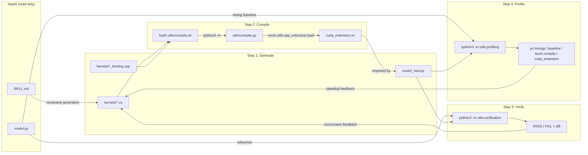

Sources: [README.md:47-53](), [agent_workdir/SKILL.md:166-174]()

---

## File Dependency Graph

This diagram maps every file in the workspace to the files it depends on at build time and runtime.

**Diagram: Static File Dependencies in `agent_workdir`**

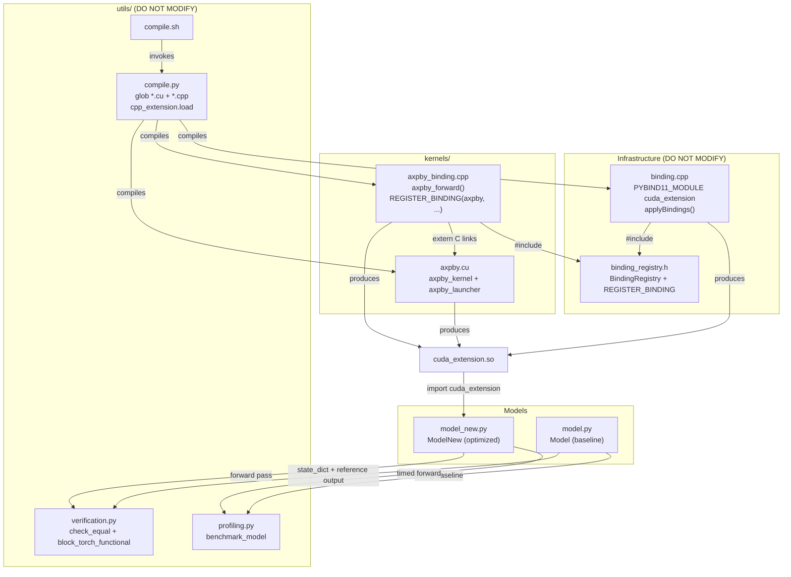

Sources: [README.md:36-44](), [agent_workdir/SKILL.md:18-28]()

---

## Common Commands

All three commands are run from inside the `agent_workdir` directory.

| Command | Purpose |
|---|---|
| `bash utils/compile.sh` | Compile all `*.cu` and `*_binding.cpp` sources into `cuda_extension.so` |
| `python3 -m utils.verification` | Run correctness check comparing `ModelNew` against `Model` |
| `python3 -m utils.profiling` | Benchmark `Model`, `torch.compile(Model)`, and `ModelNew` |

An optional `TORCH_CUDA_ARCH_LIST` environment variable can be passed to target a specific GPU architecture:

```
TORCH_CUDA_ARCH_LIST=9.0 bash utils/compile.sh
```

Sources: [README.md:47-53](), [agent_workdir/SKILL.md:166-174]()

---

## Agent Modification Boundaries

The workspace enforces a strict separation between infrastructure (never touched) and agent work areas.

**Diagram: What the Agent May and May Not Modify**

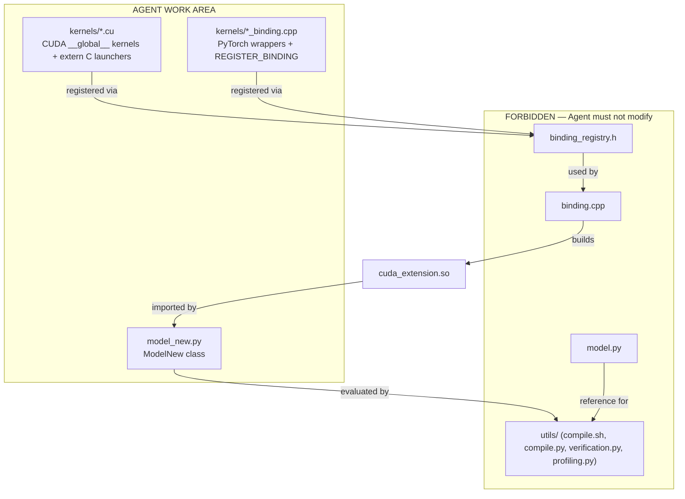

Sources: [agent_workdir/SKILL.md:5-16](), [agent_workdir/SKILL.md:362-372]()

---

## Key Invariants

The workspace enforces several invariants that the agent (and any contributor) must maintain:

1. **`model.py` is read-only.** It provides the reference forward pass and the weight initialization used to seed `ModelNew`.
2. **`ModelNew` constructor signature must match `Model`.** Both are instantiated via `get_init_inputs()` return values; the `state_dict` from `Model` is loaded directly into `ModelNew`.
3. **No `torch.*` operators in C++ files.** All CUDA bindings use raw pointers and call through `extern "C"` launchers. `torch::*` and `torch::nn::functional::*` are forbidden in `.cu` and `_binding.cpp` files.
4. **No `torch` operations in `model_new.py` forward pass.** Only tensor creation helpers and calls to `cuda_extension.*` functions are allowed.
5. **`utils/`, `binding.cpp`, `binding_registry.h` are never modified.** Kernel authors only add files to `kernels/`.
6. **The minimum performance target is 5% faster than `torch.compile` baseline.**

Sources: [agent_workdir/SKILL.md:5-16](), [agent_workdir/SKILL.md:349-363]()

---

# Page: Workflow Constraints (SKILL.md)

# Workflow Constraints (SKILL.md)

<details>
<summary>Relevant source files</summary>

The following files were used as context for generating this wiki page:

- [README.md](README.md)
- [agent_workdir/SKILL.md](agent_workdir/SKILL.md)

</details>


`agent_workdir/SKILL.md` is the instruction document given to the CUDA-Agent model at inference time. It encodes the rules, optimization strategies, and iteration procedures that govern how the agent writes, tests, and refines CUDA kernels. This page documents the constraints and strategies defined in that file.

For the broader workspace structure and how files relate to each other, see [Agent Workspace (agent_workdir)](#2). For the build system invoked during the workflow, see [Build System](#2.3). For the verification and profiling tools referenced here, see [Correctness Verification](#2.4) and [Performance Profiling](#2.5).

---

## Purpose of SKILL.md

`SKILL.md` serves as a prompt-level specification. It tells the agent:

- What it is allowed and forbidden to do in each file type
- Which files to modify and which are read-only
- The multi-step workflow to follow (implement → compile → verify → profile → iterate)
- How to interpret profiling output and decide when the task is complete

The file begins with a direct role statement [agent_workdir/SKILL.md:1]():

> You are a PyTorch and CUDA expert. Accelerate the given PyTorch Model by creating a high-performance CUDA C++ extension, targeting the best possible performance with a minimum requirement of 5% faster than torch.compile baseline.

---

## Critical Restrictions

SKILL.md defines a hard boundary between what the agent may and may not do. These are not suggestions — violations cause either compilation errors or invalid benchmark results.

### Forbidden Actions

| Restriction | Rationale |
|---|---|
| No `torch::*` or `torch::nn::functional::*` in `.cu` / `_binding.cpp` | Prevents accidental use of PyTorch ops inside the kernel layer; pure CUDA interface required |
| No `torch` operations in `model_new.py` (beyond tensor creation) | Ensures the optimized model actually exercises custom kernels, not PyTorch fallbacks |
| No third-party libraries except cuBLAS (GEMM) and cuDNN (Conv) | Keeps dependencies predictable for the build system |
| No modifications to `utils/` | `compile.py`, `verification.py`, and `profiling.py` are fixed evaluation infrastructure |
| No modifications to `binding.cpp` or `binding_registry.h` | These are shared binding infrastructure; see [Binding Registry](#3.1) |

Sources: [agent_workdir/SKILL.md:5-16]()

### Permitted Actions

| Scope | Allowed |
|---|---|
| C++ kernel files (`.cu`) | Raw CUDA kernels, cuBLAS, cuDNN |
| Binding files (`_binding.cpp`) | PyTorch tensor validation, stream retrieval, `torch::empty_like` allocation |
| `model_new.py` | `torch.tensor` creation, custom extension ops, tensor property access |
| Work directory | `kernels/` (create freely), `model_new.py` (replace entirely) |

Sources: [agent_workdir/SKILL.md:13-16]()

---

## File Ownership Model

**Title: File Ownership in agent_workdir**

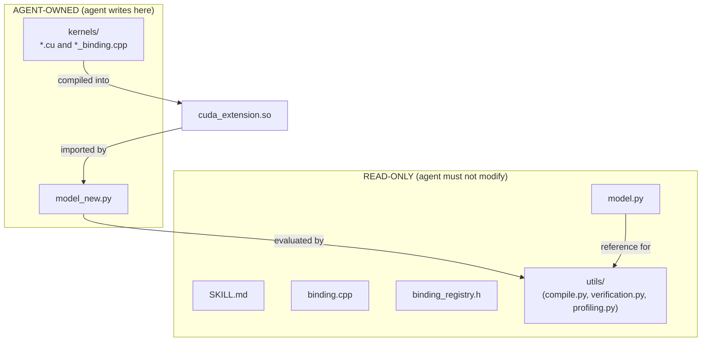

Sources: [agent_workdir/SKILL.md:19-28]()

---

## The Five-Step Workflow

SKILL.md defines a fixed sequence of five steps. Steps 1–4 form a loop; the agent iterates until success criteria are met.

**Title: SKILL.md Workflow Steps**

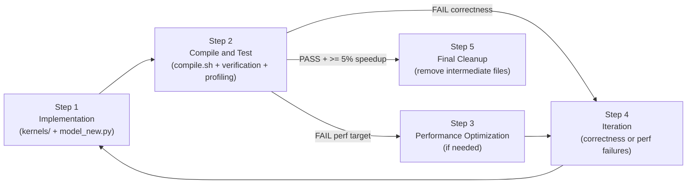

Sources: [agent_workdir/SKILL.md:36-279]()

### Step 1: Implementation

The agent creates two paired files per kernel in `kernels/`:

- A `.cu` file containing the `__global__` kernel and an `extern "C"` launcher function
- A `_binding.cpp` file containing the PyTorch wrapper, input validation, and `REGISTER_BINDING` call

The launcher accepts a `config` integer parameter to select between pre-compiled block size / tile size variants without recompilation [agent_workdir/SKILL.md:62-88]().

The agent also writes `model_new.py`, which must:
- Match the constructor signature of `model.py`'s `Model` class exactly (for `state_dict` compatibility)
- Call only `cuda_extension.*` ops in `forward()` — no `torch.nn.functional` calls [agent_workdir/SKILL.md:147-164]()

### Step 2: Compile and Test

```
TORCH_CUDA_ARCH_LIST=9.0 bash utils/compile.sh
sudo python3 -m utils.verification
sudo python3 -m utils.profiling
```

`TORCH_CUDA_ARCH_LIST` must match the target GPU. The `sudo` requirement reflects the sandbox execution environment [agent_workdir/SKILL.md:167-173]().

---

## Performance Target and Optimization Strategy

### Success Criteria

| Metric | Threshold |
|---|---|
| Minimum speedup | ≥ 5% faster than `torch.compile` baseline (≤ 0.95× baseline time) |
| Correctness tolerance | `atol=1e-2`, `rtol=1e-2` (enforced by `utils/verification.py`) |
| Code cleanliness | `kernels/` contains only the final implementation — no intermediate versions |

The goal is stated as *best possible performance*, not merely meeting the minimum. The minimum exists to prevent premature termination [agent_workdir/SKILL.md:248-263]().

### Optimization Priority Order

SKILL.md defines three tiers of optimization techniques, ordered by expected impact:

**Title: Optimization Priority Hierarchy**

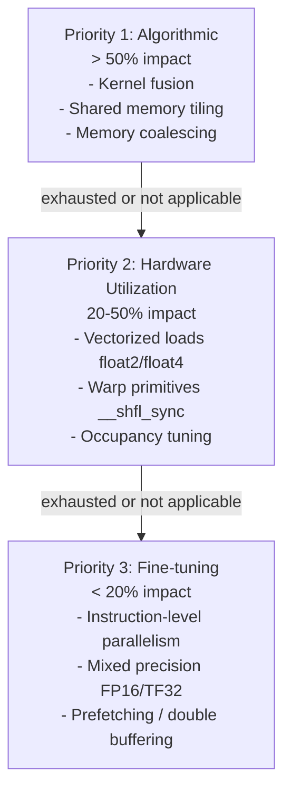

Sources: [agent_workdir/SKILL.md:178-193]()

### Config Parameter Tuning

Config-based tuning is the **last resort**, used only when the agent is within 1.2× of the target and algorithmic options are exhausted [agent_workdir/SKILL.md:195-232]().

The mechanism:
1. The `.cu` launcher function accepts an integer `config` argument
2. A `switch` statement selects a pre-compiled template instantiation (e.g., `my_kernel_impl<256, 16>` vs `my_kernel_impl<128, 32>`)
3. A standalone `tune_kernel.py` script benchmarks each config value against real inputs
4. The best `config` value is hardcoded into `model_new.py`'s `forward()` call

This approach avoids recompilation: all config variants are compiled into the `.so` at build time; only the runtime dispatch changes [agent_workdir/SKILL.md:62-88]().

---

## Iteration Requirements

### Correctness Failures

Correctness failures are **mandatory to fix** before performance work continues [agent_workdir/SKILL.md:237-244]():

| Check | Common Causes |
|---|---|
| Wrong output values | Incorrect indexing, kernel math errors |
| NaN / Inf results | Division by zero, numerical instability |
| Mismatched shapes | Incorrect dimension calculations or reduction logic |
| Boundary violations | Missing `tid < size` guard, off-by-one in grid dimensions |
| Synchronization errors | `__syncthreads()` placed incorrectly relative to shared memory reuse |

Fixes must be applied to `kernels/*.cu` and `kernels/*_binding.cpp` only. Infrastructure files are not modified.

### Performance Iteration Schedule

| Iteration Range | Goal |
|---|---|
| Iterations 1–2 | Achieve minimum 5% improvement over `torch.compile` |
| Iterations 3–5 | Push for maximum speedup |
| Beyond iteration 5 | Continue until diminishing returns |

Sources: [agent_workdir/SKILL.md:258-263]()

---

## Optimization Checklist Summary

SKILL.md includes a structured checklist. The items map directly to CUDA optimization concepts:

**Essential (apply first):**
- Memory coalescing — consecutive threads access consecutive addresses
- Kernel fusion — reduce memory traffic by combining operations
- Shared memory caching — tile frequently reused data
- Grid-stride loops — handle inputs larger than the grid
- Boundary checks — every kernel must guard `tid < size`

**Performance (apply as needed):**
- Vectorized memory (`float2` / `float4`)
- Warp primitives (`__shfl_sync`, `__ballot_sync`)
- Occupancy tuning (block size vs. register usage)
- Shared memory bank conflict avoidance (padding)

**Advanced (final tuning):**
- Tensor Cores via WMMA/MMA for eligible GEMM operations
- Mixed precision (FP16 / TF32)
- Persistent kernels
- CUDA Graphs
- Double buffering

Sources: [agent_workdir/SKILL.md:296-324]()

---

## Common Issues Reference

SKILL.md embeds a troubleshooting table directly [agent_workdir/SKILL.md:326-347]():

### Compilation Errors

| Error | Solution |
|---|---|
| `undefined symbol` | Verify `extern "C"` declarations in `_binding.cpp` match the launcher signature in `.cu` |
| `no kernel image` | Ensure `TORCH_CUDA_ARCH_LIST` matches the target GPU architecture |

### Performance Issues

| Symptom | Likely Cause | Solution |
|---|---|---|
| Slower than baseline | No fusion | Combine kernels |
| Low SM efficiency | Poor occupancy | Tune block size |
| Low memory throughput | Uncoalesced access | Restructure memory access pattern |
| High kernel count | Missing fusion | Implement compound operations |

---

## Key Architectural Invariants

These rules reflect structural decisions in the workspace design rather than optimization preferences:

1. **`.cu` and `_binding.cpp` are always separate files.** This speeds up incremental compilation — CUDA and C++ compilation are independent.
2. **`config` parameters flow through bindings.** Template instantiations are fixed at compile time; runtime dispatch via `config` avoids recompilation during tuning.
3. **`kernels/` is the only modification zone.** `binding.cpp`, `binding_registry.h`, and `utils/` are treated as a fixed platform.
4. **`model_new.py` must be `state_dict`-compatible with `model.py`.** `utils/verification.py` transfers weights using `load_state_dict()` before comparison; mismatched parameter names cause the verification to fail. See [Correctness Verification](#2.4).
5. **Final cleanup is mandatory.** Before the task is marked complete, all intermediate kernel attempts (`*_v[0-9].cu`, `*_old.cu`, etc.) must be removed. Only the final implementation remains in `kernels/`.

Sources: [agent_workdir/SKILL.md:364-373](), [agent_workdir/SKILL.md:265-279]()

---

# Page: Model Files: Baseline and Optimized

# Model Files: Baseline and Optimized

<details>
<summary>Relevant source files</summary>

The following files were used as context for generating this wiki page:

- [agent_workdir/SKILL.md](agent_workdir/SKILL.md)
- [agent_workdir/model.py](agent_workdir/model.py)
- [agent_workdir/model_new.py](agent_workdir/model_new.py)

</details>


This page covers the two model files at the root of `agent_workdir`: `model.py` (the immutable baseline) and `model_new.py` (the agent-written optimized replacement). It describes each file's structure, their shared interface conventions, the `state_dict` compatibility requirement, and how `ModelNew` delegates computation to the compiled CUDA extension.

For how the compiled CUDA extension is built and loaded, see the [Build System](#2.3). For how the two models are used together during correctness checking, see [Correctness Verification](#2.4). For performance comparison, see [Performance Profiling](#2.5).

---

## Roles and Responsibilities

| File | Class | Mutable? | Purpose |
|---|---|---|---|
| `agent_workdir/model.py` | `Model` | **No** | Reference PyTorch implementation; provides ground-truth outputs and timing baseline |
| `agent_workdir/model_new.py` | `ModelNew` | **Yes** | Agent-written optimized model; replaces PyTorch ops with calls to `cuda_extension` |

`model.py` is explicitly marked "Do not change this file" [agent_workdir/model.py:3](). The agent writes `model_new.py` from scratch as its primary deliverable.

Sources: [agent_workdir/model.py:1-26](), [agent_workdir/model_new.py:1-13](), [agent_workdir/SKILL.md:26-27]()

---

## The Baseline: `model.py`

`model.py` defines the `Model` class and two module-level factory functions used across the entire workspace.

**Class: `Model`** [agent_workdir/model.py:9-16]()

`Model` is a standard `torch.nn.Module`. The example workspace implements a scaled vector addition: `alpha * a + b`. This uses only standard PyTorch operators (`torch.nn.functional` / tensor arithmetic) and serves as the correctness reference and the timing baseline against which `ModelNew` is measured.

**Factory functions:**

| Function | Returns | Used by |
|---|---|---|
| `get_init_inputs()` | `[2.0]` — constructor arguments | `verification.py`, `profiling.py` |
| `get_inputs()` | `[a, b]` — two random tensors of shape `(1, 128)` | `verification.py`, `profiling.py` |

These functions are the contract that ties both model files to the evaluation tools. Any task placed in `agent_workdir` must provide the same two functions in `model.py`, so the utilities can construct and invoke models without hardcoded knowledge of their signatures.

Sources: [agent_workdir/model.py:9-26]()

---

## The Optimized Model: `model_new.py`

`model_new.py` defines the `ModelNew` class. It must satisfy three constraints set by `SKILL.md`:

1. **Identical constructor signature** to `Model` — `__init__` arguments must match exactly so both classes can be constructed from `get_init_inputs()`.
2. **`state_dict` compatibility** — parameter names and shapes must match `Model` so that `verification.py` can transfer weights from `Model` into `ModelNew` via `load_state_dict`.
3. **No `torch.nn.functional` calls in `forward`** — computation must be delegated entirely to `cuda_extension` operators.

**Class: `ModelNew`** [agent_workdir/model_new.py:6-13]()

In the example workspace, `ModelNew.__init__` accepts `alpha: float` — the same argument as `Model.__init__`. The `forward` method replaces `self.alpha * a + b` with `cuda_extension.axpby_forward(a, b, self.alpha, 0)`, delegating to the compiled CUDA kernel.

Sources: [agent_workdir/model_new.py:1-13](), [agent_workdir/SKILL.md:152-163]()

---

## Shared Interface Diagram

The following diagram maps the two model classes and the factory functions to the workspace components that consume them.

**Diagram: Model Interface and Consumers**

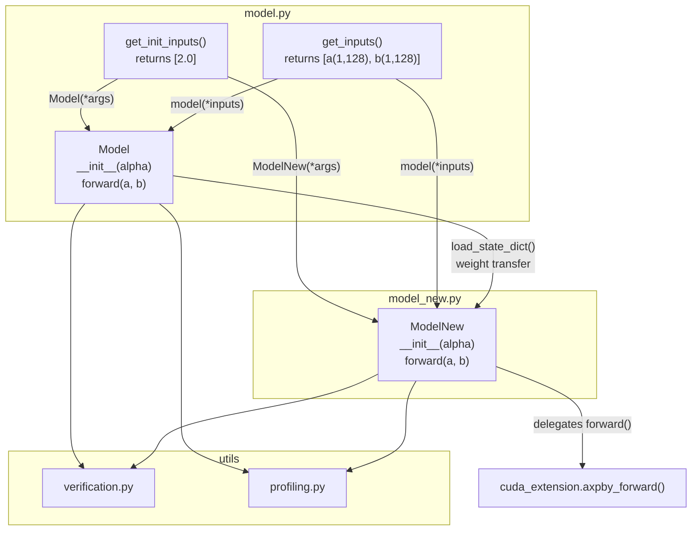

Sources: [agent_workdir/model.py:9-26](), [agent_workdir/model_new.py:1-13]()

---

## Constructor Signature Compatibility

Both `Model` and `ModelNew` must be constructable from the same argument list returned by `get_init_inputs()`. The utilities call them identically:

```
Model(*get_init_inputs())    →  Model(2.0)
ModelNew(*get_init_inputs()) →  ModelNew(2.0)
```

If the signatures diverge, `verification.py` and `profiling.py` will fail at instantiation before any CUDA code runs.

Sources: [agent_workdir/model.py:11-13](), [agent_workdir/model_new.py:8-9]()

---

## `state_dict` Compatibility Requirement

`verification.py` transfers learned parameters from `Model` into `ModelNew` via `load_state_dict`. This ensures both models start from identical weights so output differences are attributable to the CUDA implementation, not to random initialization divergence.

For this to work:

- Every `nn.Parameter` or buffer registered in `Model` must have a counterpart with the **same name** and **same shape** in `ModelNew`.
- `ModelNew` must not add extra parameters that are absent from `Model`'s `state_dict` (unless declared with `strict=False`, which the utilities do not do by default).

In the example, `Model` stores only `self.alpha` as a plain Python float — not an `nn.Parameter` — so no parameter transfer is needed and both classes are trivially compatible. More complex tasks with weight tensors require careful mirroring of parameter names.

Sources: [agent_workdir/model.py:9-16](), [agent_workdir/model_new.py:6-13](), [agent_workdir/SKILL.md:154-156]()

---

## Delegation to `cuda_extension`

`ModelNew.forward` must not call any `torch.nn.functional` operators. Instead, every computation is expressed as a call to a function registered in the `cuda_extension` shared object. In the example:

```
cuda_extension.axpby_forward(a, b, self.alpha, 0)
```

The last argument (`0`) is a `config` selector that chooses among pre-compiled kernel variants without recompilation. This pattern — passing a `config` integer to select block size or tiling strategy at runtime — is the standard tuning mechanism described in `SKILL.md`.

**Diagram: `ModelNew.forward` Delegation Chain**

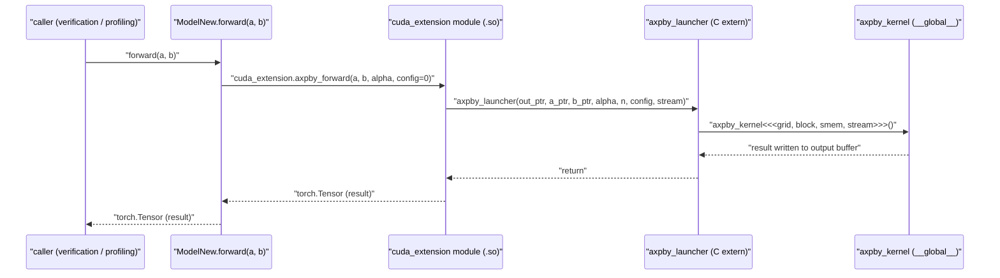

Sources: [agent_workdir/model_new.py:12-13](), [agent_workdir/SKILL.md:146-163]()

---

## Constraints Summary

| Constraint | `model.py` | `model_new.py` |
|---|---|---|
| May be modified | No | Yes |
| Must define `Model` / `ModelNew` class | `Model` | `ModelNew` |
| Must define `get_init_inputs()` | Yes | No |
| Must define `get_inputs()` | Yes | No |
| Constructor args must match `get_init_inputs()` | Yes | Yes |
| `state_dict` keys must match `Model` | n/a | Yes |
| `forward` may use `torch.nn.functional` | Yes | **No** |
| `forward` must call `cuda_extension` | No | Yes |

Sources: [agent_workdir/SKILL.md:6-10](), [agent_workdir/SKILL.md:146-163](), [agent_workdir/model.py:1-26](), [agent_workdir/model_new.py:1-13]()

---

# Page: Build System

# Build System

<details>
<summary>Relevant source files</summary>

The following files were used as context for generating this wiki page:

- [agent_workdir/utils/__init__.py](agent_workdir/utils/__init__.py)
- [agent_workdir/utils/compile.py](agent_workdir/utils/compile.py)
- [agent_workdir/utils/compile.sh](agent_workdir/utils/compile.sh)

</details>


This page covers the mechanics of compiling CUDA kernel sources into the shared library that the optimized model imports. It explains the entry-point shell script, the Python compilation driver, source discovery rules, compiler flags, and where the output artifact is placed.

For the binding registration mechanism that makes compiled symbols callable from Python, see [CUDA Extension Architecture](#3). For how `model_new.py` imports and uses the compiled library, see [Model Files: Baseline and Optimized](#2.2).

---

## Overview

The build system has two layers:

| Layer | File | Role |
|---|---|---|
| Shell wrapper | `agent_workdir/utils/compile.sh` | Measures wall-clock compile time; delegates to Python |
| Python driver | `agent_workdir/utils/compile.py` | Discovers sources, invokes `torch.utils.cpp_extension.load` |
| Package marker | `agent_workdir/utils/__init__.py` | Makes `utils` importable as a package so `-m utils.compile` works |

The agent invokes the build step with a single command:

```bash
bash utils/compile.sh
```

The resulting artifact is `cuda_extension.so`, placed in the workspace root.

---

## compile.sh — Timing Wrapper

**Diagram: compile.sh execution flow**

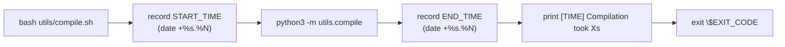

Sources: [agent_workdir/utils/compile.sh:1-13]()

`compile.sh` does nothing beyond timing. It captures `START_TIME` and `END_TIME` using `date +%s.%N`, computes the difference with `awk`, prints it, and forwards the Python process exit code. This lets the agent log compile durations without embedding timing logic in Python.

---

## compile.py — Python Compilation Driver

### Source Discovery: `find_sources()`

[agent_workdir/utils/compile.py:11-20]()

`find_sources()` collects all `.cu` and `.cpp` files from two locations:

| Location | Glob patterns |
|---|---|
| Workspace root (`.`) | `*.cu`, `*.cpp` |
| `kernels/` subdirectory | `kernels/*.cu`, `kernels/*.cpp` |

The union of both sets is sorted and deduplicated before being passed to the compiler. This means the root-level `binding.cpp` and any files the agent creates under `kernels/` are all included automatically — no manual source list maintenance is required.

**Diagram: Source discovery to compiler input**

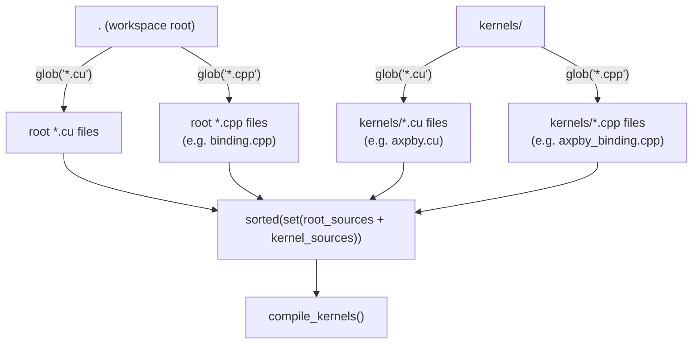

Sources: [agent_workdir/utils/compile.py:11-20]()

### Compilation: `compile_kernels()`

[agent_workdir/utils/compile.py:23-63]()

`compile_kernels()` performs these steps in order:

1. **Clean build directory** — `build/forced_compile/` is deleted and recreated fresh on every invocation. This prevents stale object files from masking errors.
2. **Remove old artifact** — any existing `cuda_extension.so` in the workspace root is deleted before the build starts.
3. **Invoke `cpp_ext.load()`** — calls `torch.utils.cpp_extension.load` with the parameters below.
4. **Copy artifact** — if `build/forced_compile/cuda_extension.so` was produced, it is copied to `./cuda_extension.so`.

**Diagram: compile_kernels() step sequence**

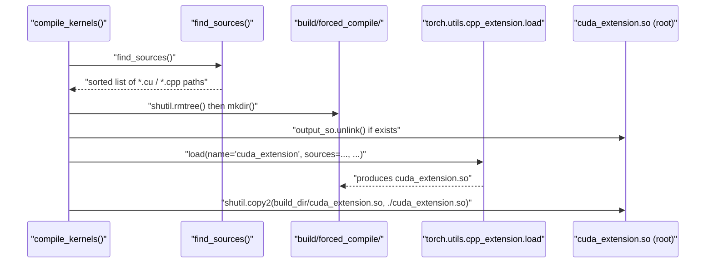

Sources: [agent_workdir/utils/compile.py:23-63]()

### Compiler Flags

The flags passed to `cpp_ext.load` are:

| Parameter | Value | Purpose |
|---|---|---|
| `name` | `'cuda_extension'` | Module name; becomes the `.so` filename |
| `with_cuda` | `True` | Enables nvcc for `.cu` files |
| `verbose` | `False` | Suppresses per-file compiler output |
| `extra_cflags` | `['-O3', '-std=c++17']` | C++ optimization and standard |
| `extra_cuda_cflags` | `['-O3', '--use_fast_math']` | CUDA optimization; enables fast math intrinsics |
| `build_directory` | `'build/forced_compile'` | Intermediate object files and the `.so` |

Sources: [agent_workdir/utils/compile.py:42-50]()

`--use_fast_math` trades IEEE 754 strict compliance for speed on the GPU — appropriate for the kernel optimization context where small floating-point deviations are acceptable within the `atol/rtol=1e-2` tolerance checked by the verifier (see [Correctness Verification](#2.4)).

---

## Output Artifact

On a successful build, `cuda_extension.so` appears in the workspace root. `model_new.py` imports it directly:

```python
import cuda_extension
```

On failure, `compile.py` prints the exception message and returns exit code `1`, which `compile.sh` propagates to the shell. No partial `.so` is left behind because the old file is deleted before compilation begins.

---

## utils Package Structure

`agent_workdir/utils/__init__.py` is intentionally empty [agent_workdir/utils/__init__.py:1-1](). Its only function is to make `utils` a Python package, which is required for the `-m utils.compile` invocation in `compile.sh`. The other modules in `utils/` — `verification.py` and `profiling.py` — are similarly accessed as `python3 -m utils.verification` and `python3 -m utils.profiling`.

```
agent_workdir/utils/
├── __init__.py        ← empty; makes utils a package
├── compile.sh         ← shell entry point (timing wrapper)
├── compile.py         ← Python build driver
├── verification.py    ← correctness checker (see 2.4)
└── profiling.py       ← performance profiler (see 2.5)
```

Sources: [agent_workdir/utils/__init__.py:1-1](), [agent_workdir/utils/compile.sh:1-13](), [agent_workdir/utils/compile.py:1-71]()

---

# Page: Correctness Verification

# Correctness Verification

<details>
<summary>Relevant source files</summary>

The following files were used as context for generating this wiki page:

- [agent_workdir/model.py](agent_workdir/model.py)
- [agent_workdir/model_new.py](agent_workdir/model_new.py)
- [agent_workdir/utils/verification.py](agent_workdir/utils/verification.py)

</details>


## Purpose and Scope

This page documents `agent_workdir/utils/verification.py`, the module responsible for asserting that a CUDA-extension model (`ModelNew`) produces numerically equivalent outputs to the PyTorch baseline model (`Model`). It covers model initialization, input construction, the enforcement mechanism that prevents `torch.nn.functional` use inside the CUDA model, and the numeric tolerance thresholds used for comparison.

For details on the models being compared, see the Model Files page ([2.2](#2.2)). For performance measurement after correctness is confirmed, see Performance Profiling ([2.5](#2.5)).

---

## What Verification Does

The verification module runs the same forward pass through both the baseline and the CUDA-extension model and asserts their outputs are numerically close. It performs this check **5 times**, each time with a freshly sampled set of inputs.

It enforces two invariants:

1. **Weight parity** — `ModelNew` is loaded with the exact state dict from `Model` before any forward pass.
2. **CUDA-only execution** — `ModelNew.forward` must not call any function from `torch.nn.functional`; a context manager blocks all such calls and raises a `RuntimeError` if any are invoked.

---

## Data Flow

**Diagram: Verification Data Flow**

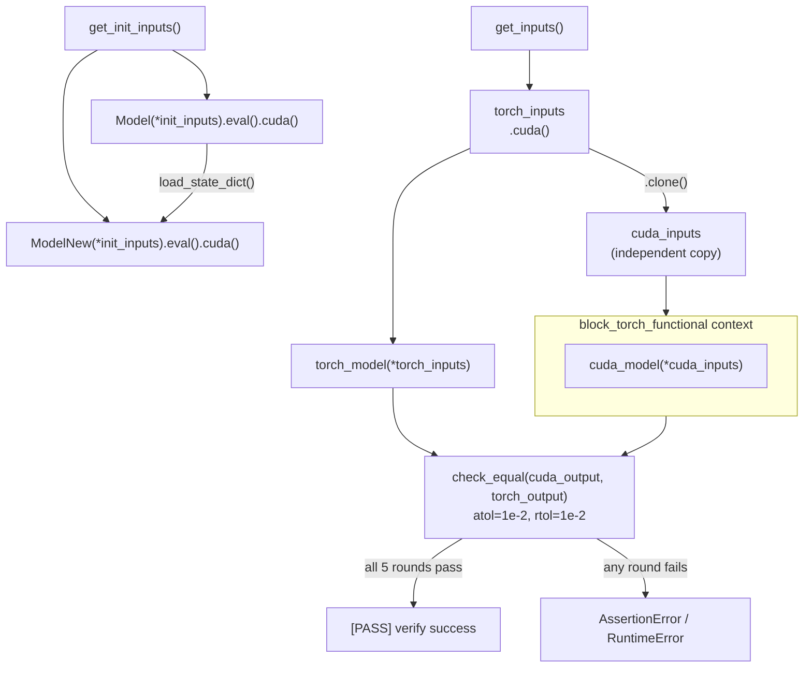

Sources: [agent_workdir/utils/verification.py:85-99]()

---

## Model Initialization

The `initialize_models` function in [agent_workdir/utils/verification.py:65-73]() constructs both models identically:

| Step | Code construct | Effect |
|---|---|---|
| 1 | `get_init_inputs()` | Returns constructor arguments (e.g., `[2.0]` for `alpha`) |
| 2 | `Model(*init_inputs).eval().cuda()` | Baseline model on GPU, eval mode |
| 3 | `ModelNew(*init_inputs).eval().cuda()` | CUDA model on GPU, eval mode |
| 4 | `cuda_model.load_state_dict(torch_model.state_dict())` | Copies all weights from baseline to CUDA model |

The `load_state_dict` call ensures both models share the same trained weights, so any output divergence is attributable solely to the CUDA kernel implementation.

Sources: [agent_workdir/utils/verification.py:65-73](), [agent_workdir/model.py:1-26](), [agent_workdir/model_new.py:1-13]()

---

## Input Construction

The `build_inputs` function in [agent_workdir/utils/verification.py:76-82]() produces two independent input sets from the same random sample:

```
get_inputs()  →  torch_inputs (.cuda())
                     │
                     └─ .clone()  →  cuda_inputs
```

Cloning guarantees that in-place operations inside either model's forward pass cannot affect the other model's inputs. Both sets contain identical values at the start of each check round.

The `transform_tensors` helper [agent_workdir/utils/verification.py:12-19]() recursively applies a function to tensors regardless of whether they are bare tensors, lists, tuples, or dicts — matching whatever structure `get_inputs()` happens to return.

Sources: [agent_workdir/utils/verification.py:12-19](), [agent_workdir/utils/verification.py:76-82]()

---

## `block_torch_functional` Context Manager

**Diagram: block_torch_functional Mechanics**

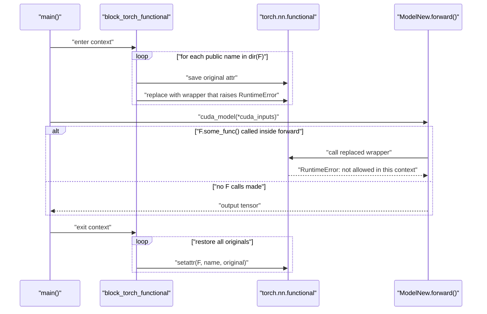

The context manager is defined at [agent_workdir/utils/verification.py:40-62](). On entry it iterates over every public, callable attribute of `torch.nn.functional` and replaces each with a wrapper that raises `RuntimeError`. On exit it restores all originals via the saved `originals` dict.

An `excludes` parameter allows specific functions to remain callable, though the default call in `main()` passes no exclusions [agent_workdir/utils/verification.py:93]().

The purpose is to enforce the workspace rule that `ModelNew` must delegate all computation to the CUDA extension rather than falling back to PyTorch functional operations.

Sources: [agent_workdir/utils/verification.py:40-62](), [agent_workdir/utils/verification.py:89-95]()

---

## Output Comparison: `check_equal`

`check_equal` [agent_workdir/utils/verification.py:22-37]() compares the outputs of the two models recursively. It handles all output structures that a model might return:

| Output type | Comparison method |
|---|---|
| `torch.Tensor` | `torch.testing.assert_close(actual, expected, atol=1e-2, rtol=1e-2)` |
| `list` / `tuple` | Recursively compare each element in order |
| `dict` | Recursively compare each key present in `expected` |
| `str`, `float`, `int` | Exact equality (`==`) |
| Other | Raises `TypeError` |

The tolerance for tensors is `atol=1e-2, rtol=1e-2` [agent_workdir/utils/verification.py:35](). This is deliberately loose enough to accommodate floating-point accumulation differences between CUDA kernel implementations and PyTorch's reference paths, while still catching incorrect results.

Sources: [agent_workdir/utils/verification.py:22-37]()

---

## Main Execution Loop

The `main` function [agent_workdir/utils/verification.py:85-99]() ties all components together:

1. Calls `initialize_models()` once (weights are set once and reused across all rounds).
2. Runs 5 independent check rounds (`num_checks = 5`).
3. Each round: generates fresh inputs via `build_inputs()`, runs both forward passes, calls `check_equal`.
4. The CUDA model forward pass runs inside `block_torch_functional()`.
5. All forward passes run inside `torch.no_grad()`.
6. After all rounds pass, calls `torch.cuda.synchronize()` to flush any pending CUDA operations, then prints `[PASS] verify success`.

The module is invoked as:

```
python3 -m utils.verification
```

from inside `agent_workdir`, as described in the workspace loop (see [2](#2)).

Sources: [agent_workdir/utils/verification.py:85-103]()

---

## Function Reference

**Diagram: verification.py Public API**

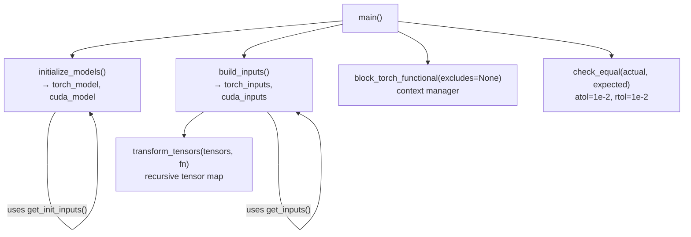

| Function | Signature | Role |
|---|---|---|
| `initialize_models` | `() → (Model, ModelNew)` | Construct + weight-sync both models |
| `build_inputs` | `() → (list, list)` | Produce cloned GPU input pairs |
| `transform_tensors` | `(tensors, fn) → same structure` | Recursively apply fn to all tensors |
| `check_equal` | `(actual, expected) → None` | Assert numeric equivalence |
| `block_torch_functional` | `(excludes=None) → contextmanager` | Patch F to block all calls |
| `main` | `() → None` | Entry point; runs 5 check rounds |

Sources: [agent_workdir/utils/verification.py:1-103]()

---

# Page: Performance Profiling

# Performance Profiling

<details>
<summary>Relevant source files</summary>

The following files were used as context for generating this wiki page:

- [agent_workdir/model.py](agent_workdir/model.py)
- [agent_workdir/model_new.py](agent_workdir/model_new.py)
- [agent_workdir/utils/profiling.py](agent_workdir/utils/profiling.py)

</details>


This page documents `utils/profiling.py`, which benchmarks three execution targets — the PyTorch baseline, `torch.compile`, and the custom CUDA extension — and reports their average CUDA device times in microseconds. This is step 4 of the implement → compile → verify → **profile** → iterate loop described in [Agent Workspace (agent_workdir)](#2).

For correctness checking (step 3), see [Correctness Verification](#2.4). For the workflow rules that define the performance target (5% over `torch.compile`), see [Workflow Constraints (SKILL.md)](#2.1).

---

## Overview

`utils/profiling.py` is invoked as:

```
python3 -m utils.profiling
```

It loads both `Model` (baseline) and `ModelNew` (CUDA extension), transfers weights via `state_dict`, runs warmup passes, and then times each target using `torch.profiler`. Results are printed as a single line of microsecond measurements.

---

## Three Benchmarked Targets

| Target name | Model class | Input variable | Compiled? |
|---|---|---|---|
| `torch_baseline` | `Model` | `torch_inputs` | No |
| `torch_compile` | `torch.compile(Model(...))` | `torch_inputs` | Yes, Triton backend |
| `cuda_extension` | `ModelNew` | `cuda_inputs` | No (hand-written CUDA) |

The `cuda_inputs` are a clone of `torch_inputs` so each target operates on independent tensors and cannot affect each other's results.

Sources: [agent_workdir/utils/profiling.py:99-117]()

---

## Initialization

**Diagram: Model and Input Setup**

```mermaid
flowchart TD
    gi["get_init_inputs()"]
    get_in["get_inputs()"]

    gi --> TM["Model(*init_inputs).eval().cuda()\n= torch_model"]
    gi --> CM["ModelNew(*init_inputs).eval().cuda()\n= cuda_model"]
    TM -->|"load_state_dict(torch_model.state_dict())"| CM

    get_in --> TI["transform_tensors(..., x.cuda())\n= torch_inputs"]
    TI -->|"transform_tensors(..., x.clone())"| CI["cuda_inputs"]
```

Sources: [agent_workdir/utils/profiling.py:42-56]()

The `initialize_models` function [agent_workdir/utils/profiling.py:42-56]() handles all setup:

1. Calls `get_init_inputs()` from `model.py` to get constructor arguments (e.g., `alpha=2.0`).
2. Instantiates both `Model` and `ModelNew` with the same arguments on CUDA.
3. Transfers weights: `cuda_model.load_state_dict(torch_model.state_dict())`.
4. Calls `get_inputs()` from `model.py` and moves all tensors to CUDA via `transform_tensors`.
5. Clones `torch_inputs` into `cuda_inputs` so the two sets are independent.

`transform_tensors` [agent_workdir/utils/profiling.py:11-18]() is a recursive utility that applies a function to every `torch.Tensor` inside a nested list, tuple, or dict.

---

## Benchmark Execution

**Diagram: `benchmark_model` Control Flow**

```mermaid
flowchart TD
    start["benchmark_model(model, inputs, warmup_iters, run_iters)"]
    start --> no_grad["torch.no_grad() context"]
    no_grad --> warmup["warmup_iters × model(*inputs)\n(5 iterations, unmeasured)"]
    warmup --> prof["get_prof_ctx() → torch.profiler.profile\n(activities=[ProfilerActivity.CUDA])"]
    prof --> sync1["torch.cuda.synchronize()"]
    sync1 --> timed["run_iters × model(*inputs)\n(10 iterations by default)"]
    timed --> sync2["torch.cuda.synchronize()"]
    sync2 --> collect["sum(e.device_time for e in ctx.events()\n  if e.device_type.name == 'CUDA')"]
    collect --> avg["÷ run_iters → avg µs"]
```

Sources: [agent_workdir/utils/profiling.py:59-73]()

The core measurement function is `benchmark_model` [agent_workdir/utils/profiling.py:59-73]():

- **Warmup**: 5 forward passes run before measurement starts. This allows CUDA kernels to be JIT-compiled and GPU caches to warm up.
- **Profiling context**: `get_prof_ctx()` [agent_workdir/utils/profiling.py:21-26]() creates a `torch.profiler.profile` instance scoped to `ProfilerActivity.CUDA` only (no CPU events, no shape recording, no stack traces).
- **Synchronization**: `torch.cuda.synchronize()` is called before and after the timed loop to ensure all GPU work is complete before the profiler context closes.
- **Aggregation**: After the context exits, `ctx.events()` is iterated. Events with `device_type.name == "CUDA"` have their `device_time` summed and divided by `run_iters` to produce the average.

### Default Iteration Counts

| Phase | Count | Configurable? |
|---|---|---|
| Warmup | 5 | No (hardcoded) |
| Timed runs | 10 | Yes, `--iters` flag |

Sources: [agent_workdir/utils/profiling.py:109-110]()

---

## `main()` Flow

**Diagram: `main()` Execution Sequence**

```mermaid
flowchart TD
    main["main()"]
    main --> pa["parse_args()"]
    pa --> im["initialize_models()\n→ torch_model, cuda_model,\n  torch_inputs, cuda_inputs"]
    im --> sr{"args.single_run\nset?"}

    sr -->|Yes| run_single["run_single(targets, ...)\nOne forward pass per target\nprints [DONE] single-run completed"]
    sr -->|No| compile["torch_compile_model =\ntorch.compile(torch_model)"]
    compile --> bm1["benchmark_model(cuda_model, cuda_inputs, 5, run_iters)\n→ cuda_time"]
    bm1 --> bm2["benchmark_model(torch_model, torch_inputs, 5, run_iters)\n→ torch_time"]
    bm2 --> bm3["benchmark_model(torch_compile_model, torch_inputs, 5, run_iters)\n→ compile_time"]
    bm3 --> pr["print_results(torch_time, compile_time, cuda_time)"]
```

Sources: [agent_workdir/utils/profiling.py:99-117]()

`torch.compile` wraps `torch_model` [agent_workdir/utils/profiling.py:108]() once before any benchmarking begins. The compilation overhead is not included in `compile_time`; only steady-state forward-pass performance is measured.

---

## `--single-run` Mode

The `--single-run` flag [agent_workdir/utils/profiling.py:35-38]() accepts a comma-separated list of target names and executes exactly one `torch.no_grad()` forward pass for each, printing `[DONE] single-run completed` when finished. No timing is recorded.

Valid target names are: `torch_baseline`, `torch_compile`, `cuda_extension`.

This mode is used by the agent loop to verify that a model can execute without crashing, separate from full benchmarking.

Sources: [agent_workdir/utils/profiling.py:85-96]()

---

## Output Format

`print_results` [agent_workdir/utils/profiling.py:76-82]() prints a single line:

```
Torch Baseline: 12.345us, Torch Compile: 8.901us, CUDA Extension: 7.234us
```

The three numbers are directly comparable. The agent's goal (per SKILL.md) is for `CUDA Extension` to be at least 5% faster than `Torch Compile`.

---

## Key Symbols Reference

| Symbol | Kind | Role |
|---|---|---|
| `benchmark_model` | function | Runs warmup + timed profiler loop, returns avg µs |
| `get_prof_ctx` | function | Creates `torch.profiler.profile` for CUDA activities |
| `initialize_models` | function | Instantiates and weight-syncs both models |
| `transform_tensors` | function | Recursively applies a tensor transform |
| `run_single` | function | One-shot execution without measurement |
| `print_results` | function | Formats and prints the three µs timings |
| `parse_args` | function | Handles `--iters` and `--single-run` CLI flags |
| `ProfilerActivity.CUDA` | enum value | Restricts profiler to GPU-side events only |
| `e.device_time` | attribute | Per-event CUDA kernel wall time in µs |

Sources: [agent_workdir/utils/profiling.py:1-121]()

---

# Page: CUDA Extension Architecture

# CUDA Extension Architecture

<details>
<summary>Relevant source files</summary>

The following files were used as context for generating this wiki page:

- [agent_workdir/SKILL.md](agent_workdir/SKILL.md)
- [agent_workdir/binding.cpp](agent_workdir/binding.cpp)
- [agent_workdir/binding_registry.h](agent_workdir/binding_registry.h)

</details>


This page describes the overall architecture of the CUDA extension system used in `agent_workdir`: the two-phase lifecycle, the roles of each infrastructure file, and the convention by which individual kernel files integrate without touching shared infrastructure. For a deep dive into `BindingRegistry` internals, see [Binding Registry](#3.1). For a complete walkthrough of a single kernel from `.cu` to Python callable, see [Kernel Implementation: The axpby Example](#3.2). For how the compiled `.so` is consumed by the optimized model, see [Model Files: Baseline and Optimized](#2.2).

---

## Overview

The CUDA extension compiles into a shared library (`cuda_extension.so`) that Python imports as a module. The system is split into two tiers:

| Tier | Files | Mutable? | Role |
|---|---|---|---|
| Infrastructure | `binding_registry.h`, `binding.cpp` | **No** | Module entry point, registry mechanism |
| Kernel | `kernels/*.cu`, `kernels/*_binding.cpp` | **Yes** | Kernel logic and Python wrapper per op |

The central design goal is that adding a new kernel requires **no changes** to infrastructure files. Each kernel registers itself at static initialization time using the `REGISTER_BINDING` macro, and the infrastructure collects and exposes all registrations automatically when Python imports the module.

Sources: [agent_workdir/binding.cpp:1-10](), [agent_workdir/binding_registry.h:1-49](), [agent_workdir/SKILL.md:18-28]()

---

## Two-Phase Lifecycle

The system operates in two distinct phases separated by the build/run boundary.

**Phase 1 — Build time (static initialization):** When `compile.py` compiles and links all `.cu` and `_binding.cpp` files, each `_binding.cpp` file's `REGISTER_BINDING(...)` call creates a file-scope static `BindingRegistrar` object. C++ initializes these objects before any `main()` runs, causing each one to call `BindingRegistry::getInstance().registerBinding(...)` and enqueue a binding function into the registry's internal list.

**Phase 2 — Runtime (Python import):** When Python executes `import cuda_extension`, the dynamic linker runs the `PYBIND11_MODULE(cuda_extension, m)` initializer in `binding.cpp`. This calls `BindingRegistry::getInstance().applyBindings(m)`, which iterates the enqueued list and calls each binding function, invoking `m.def(...)` to expose the C++ function to Python.

**Lifecycle Sequence Diagram**

```mermaid
sequenceDiagram
    box "Build time"
        participant BC["axpby_binding.cpp"]
        participant MACRO["REGISTER_BINDING macro"]
        participant REG["BindingRegistry::bindings_"]
    end
    box "Runtime"
        participant PY["Python: import cuda_extension"]
        participant MOD["PYBIND11_MODULE (binding.cpp)"]
        participant APPLY["applyBindings()"]
    end

    BC->>MACRO: "REGISTER_BINDING(axpby, register_axpby)"
    MACRO->>REG: "BindingRegistrar ctor → registerBinding(name, lambda)"
    Note over BC,REG: "Static init: runs before main(), once per _binding.cpp"

    PY->>MOD: "import cuda_extension"
    MOD->>APPLY: "BindingRegistry::getInstance().applyBindings(m)"
    loop "for each entry in bindings_"
        APPLY->>PY: "m.def(axpby_forward, &axpby_forward, ...)"
    end
    Note over PY: "cuda_extension.axpby_forward now callable"
```

Sources: [agent_workdir/binding_registry.h:40-49](), [agent_workdir/binding.cpp:7-9]()

---

## Infrastructure Files

The following two files are fixed and must not be modified by kernel authors.

### `binding_registry.h`

Defines the complete registration mechanism in a single header. Key entities:

| Entity | Kind | Purpose |
|---|---|---|
| `BindingRegistry` | Singleton class | Owns the list of all registered bindings |
| `BindingFunction` | Type alias (`std::function<void(pybind11::module&)>`) | Type of each registration callback |
| `getInstance()` | Static method | Returns the one `BindingRegistry` instance |
| `registerBinding(name, func)` | Method | Appends a `{name, func}` pair to `bindings_` |
| `applyBindings(m)` | Method | Iterates `bindings_` and calls each `func(m)` |
| `BindingRegistrar` | Helper class | Calls `registerBinding` from its constructor, enabling static-init auto-registration |
| `REGISTER_BINDING(name, func)` | Preprocessor macro | Expands to a `static BindingRegistrar` variable scoped to the translation unit |

The header deliberately includes only `<pybind11/pybind11.h>` and `<pybind11/stl.h>`, not `torch/extension.h`, to minimize compilation time.

Sources: [agent_workdir/binding_registry.h:1-49]()

### `binding.cpp`

Contains only the `PYBIND11_MODULE` entry point. Its entire body is three lines:

[agent_workdir/binding.cpp:7-9]()

It includes `binding_registry.h` and delegates all module population to `applyBindings`. No kernel-specific code appears here.

Sources: [agent_workdir/binding.cpp:1-10]()

---

## Kernel File Convention

Each CUDA operation is implemented as a paired set of files inside `kernels/`:

| File | Depends on | Contains |
|---|---|---|
| `kernels/<op>.cu` | `<cuda_runtime.h>` only | `__global__` kernel(s) + `extern "C"` launcher |
| `kernels/<op>_binding.cpp` | `<torch/types.h>`, `<torch/csrc/utils/pybind.h>`, `binding_registry.h` | PyTorch wrapper function + `REGISTER_BINDING` call |

The `.cu` file has **no PyTorch dependency**. The `_binding.cpp` file has **no kernel logic**. The launcher is declared `extern "C"` in the `.cu` file and re-declared in `_binding.cpp` so that the linker can resolve it without name mangling.

`REGISTER_BINDING` at the bottom of each `_binding.cpp` is the only hook needed. It creates a static object whose constructor runs at load time, invisibly wiring the kernel into the module.

Sources: [agent_workdir/SKILL.md:31-33](), [agent_workdir/SKILL.md:39-143](), [agent_workdir/binding_registry.h:47-49]()

---

## Component Dependency Diagram

The diagram below maps the architecture to actual file and code entity names.

**Component and Dependency Diagram**

```mermaid
graph TD
    subgraph "Infrastructure (DO NOT MODIFY)"
        BRH["binding_registry.h\nBindingRegistry singleton\nBindingRegistrar\nREGISTER_BINDING macro"]
        BCP["binding.cpp\nPYBIND11_MODULE(cuda_extension)\napplyBindings(m)"]
        BCP -->|"#include"| BRH
    end

    subgraph "kernels/ (agent-editable)"
        CU["kernels/op.cu\n__global__ kernel\nextern C launcher"]
        BIND["kernels/op_binding.cpp\nPyTorch wrapper\nREGISTER_BINDING(op, register_op)"]
        BIND -->|"#include"| BRH
        BIND -->|"extern C links"| CU
    end

    subgraph "Build output"
        SO["cuda_extension.so"]
    end

    subgraph "Python runtime"
        PY["import cuda_extension\ncuda_extension.op_forward(...)"]
    end

    BCP -->|"compiled + linked into"| SO
    BIND -->|"compiled + linked into"| SO
    CU -->|"compiled + linked into"| SO
    SO -->|"dlopen"| PY
```

Sources: [agent_workdir/binding_registry.h:1-49](), [agent_workdir/binding.cpp:1-10](), [agent_workdir/SKILL.md:18-28]()

---

## `REGISTER_BINDING` Macro Expansion

The macro is defined as:

[agent_workdir/binding_registry.h:47-49]()

For a call like `REGISTER_BINDING(axpby, register_axpby)`, it expands to:

```
static BindingRegistrar _registrar_axpby("axpby", [](pybind11::module& m) { register_axpby(m); });
```

The `static` keyword ensures exactly one instance is created per translation unit at startup. The lambda wraps the registration function so that `BindingRegistry` can store it as a `BindingFunction` (`std::function<void(pybind11::module&)>`) without needing to know the concrete function type at registry-definition time.

Sources: [agent_workdir/binding_registry.h:40-49]()

---

## Design Constraints Summary

The following constraints are enforced by `SKILL.md` and embedded in the infrastructure design:

- `torch::*` and `torch::nn::functional::*` must not appear in `.cu` files or in the `extern "C"` launcher. PyTorch types are allowed only in `_binding.cpp`.
- `torch/extension.h` is deliberately not included anywhere (see [Binding Registry](#3.1) for rationale).
- `binding.cpp` and `binding_registry.h` are read-only for kernel authors. All per-kernel work lives in `kernels/`.
- The `config` parameter convention (an `int` passed through bindings to the launcher `switch` statement) allows runtime kernel variant selection without recompilation.

Sources: [agent_workdir/SKILL.md:3-16](), [agent_workdir/SKILL.md:364-373]()

---

# Page: Binding Registry

# Binding Registry

<details>
<summary>Relevant source files</summary>

The following files were used as context for generating this wiki page:

- [agent_workdir/binding.cpp](agent_workdir/binding.cpp)
- [agent_workdir/binding_registry.h](agent_workdir/binding_registry.h)

</details>


## Purpose and Scope

This page documents the infrastructure that connects CUDA kernel implementations to the Python module `cuda_extension`. Specifically, it covers:

- `binding_registry.h`: the `BindingRegistry` singleton, `BindingRegistrar`, and the `REGISTER_BINDING` macro
- `binding.cpp`: the `PYBIND11_MODULE` entry point that drives the final assembly of the Python module

This page focuses on the *mechanism* of registration. For how a concrete kernel uses `REGISTER_BINDING` end-to-end, see the worked example in [Kernel Implementation: The axpby Example](#3.2). For how the build system compiles these files together, see [Build System](#2.3).

---

## Why a Registry?

The extension module aggregates an arbitrary number of kernels that the agent writes into `kernels/`. Without a registry, every new kernel would require a manual edit to `binding.cpp` to call `m.def(...)` for each new function.

The registry solves this by inverting the dependency: each `*_binding.cpp` file registers itself at static initialization time. `binding.cpp` never needs to know the names of the kernels — it just calls `applyBindings()` and all registered functions are wired into the module automatically.

An additional design choice: the header deliberately avoids `#include <torch/extension.h>` and instead uses only minimal pybind11 headers ([agent_workdir/binding_registry.h:1-12]()). This significantly reduces compilation time, since the full PyTorch extension header is very heavy.

Sources: [agent_workdir/binding_registry.h:1-12](), [agent_workdir/binding.cpp:1-10]()

---

## Components

The registry consists of three cooperating pieces:

| Component | Defined in | Role |
|---|---|---|
| `BindingRegistry` | `binding_registry.h` | Singleton that stores all `(name, func)` pairs and applies them to a pybind11 module |
| `BindingRegistrar` | `binding_registry.h` | Helper whose constructor calls `BindingRegistry::registerBinding` — used only to trigger side effects at static init |
| `REGISTER_BINDING(name, func)` | `binding_registry.h` | Macro that declares a `static BindingRegistrar` in the calling translation unit |
| `PYBIND11_MODULE(cuda_extension, m)` | `binding.cpp` | The pybind11 module entry point; calls `applyBindings(m)` to populate the module |

Sources: [agent_workdir/binding_registry.h:15-49](), [agent_workdir/binding.cpp:1-10]()

---

## `BindingRegistry` — The Singleton

`BindingRegistry` ([agent_workdir/binding_registry.h:15-37]()) is a Meyer's singleton. Its key members are:

- **`BindingFunction`** — a type alias for `std::function<void(pybind11::module&)>`. This is the unit of registration: a callable that, when invoked with a pybind11 module, calls `m.def(...)` to expose a C++ function to Python. ([agent_workdir/binding_registry.h:17]())
- **`bindings_`** — a `std::vector<std::pair<std::string, BindingFunction>>` that accumulates registrations. ([agent_workdir/binding_registry.h:35]())
- **`getInstance()`** — returns the single `BindingRegistry` instance via a function-local static. ([agent_workdir/binding_registry.h:19-22]())
- **`registerBinding(name, func)`** — appends a `(name, func)` pair to `bindings_`. ([agent_workdir/binding_registry.h:24-26]())
- **`applyBindings(m)`** — iterates over `bindings_` and calls each `func(m)`, populating the module. ([agent_workdir/binding_registry.h:28-31]())

The constructor is `private` and defaulted, preventing external instantiation. ([agent_workdir/binding_registry.h:36]())

Sources: [agent_workdir/binding_registry.h:15-37]()

---

## `BindingRegistrar` — Static Initialization Trigger

`BindingRegistrar` ([agent_workdir/binding_registry.h:40-45]()) is a RAII helper with a single purpose: its constructor calls `BindingRegistry::getInstance().registerBinding(name, func)`. Instances of this class are never used after construction; they exist purely to run their constructors as a side effect.

When a `static BindingRegistrar` is defined at file scope (as the `REGISTER_BINDING` macro does), the C++ runtime guarantees its constructor runs before `main()` — specifically, during dynamic initialization of that translation unit.

Sources: [agent_workdir/binding_registry.h:40-45]()

---

## `REGISTER_BINDING` Macro

```
#define REGISTER_BINDING(name, func) \
    static BindingRegistrar _registrar_##name(#name, [](pybind11::module& m) { func(m); })
```
[agent_workdir/binding_registry.h:48-49]()

When a `*_binding.cpp` file calls `REGISTER_BINDING(axpby, register_axpby)`, the macro expands to a static-duration `BindingRegistrar` object named `_registrar_axpby`. Its constructor fires at static initialization and pushes a lambda wrapping `register_axpby(m)` into the registry's `bindings_` list.

The `name` token (`axpby`) is both:
1. Used as a suffix in the variable name (`_registrar_axpby`) to avoid name collisions across translation units.
2. Stringified to `"axpby"` and stored as the key in the registry pair (informational only; the actual Python function name is set by `m.def(...)` inside the registration function).

Sources: [agent_workdir/binding_registry.h:47-49]()

---

## `binding.cpp` — The Module Entry Point

[agent_workdir/binding.cpp:1-10]() is intentionally minimal:

```cpp
PYBIND11_MODULE(cuda_extension, m) {
    BindingRegistry::getInstance().applyBindings(m);
}
```

At Python `import cuda_extension` time, pybind11 calls this module initializer. It retrieves the singleton and iterates over every registered `BindingFunction`, calling each one with `m`. Each call executes one or more `m.def(...)` statements, making the kernel functions callable from Python.

`binding.cpp` includes only `<pybind11/pybind11.h>` and `binding_registry.h`. It has no knowledge of any individual kernel.

Sources: [agent_workdir/binding.cpp:1-10]()

---

## Lifecycle Diagrams

### Diagram: Static Initialization Phase (Build → First Import)

```mermaid
sequenceDiagram
    box "Build + Static Init (before main)"
        participant BF as "*_binding.cpp translation unit"
        participant MACRO as "REGISTER_BINDING macro"
        participant REGISTRAR as "BindingRegistrar constructor"
        participant REGISTRY as "BindingRegistry::bindings_"
    end
    box "Runtime (Python import)"
        participant PY as "Python: import cuda_extension"
        participant MODULE as "PYBIND11_MODULE(cuda_extension)"
        participant APPLY as "BindingRegistry::applyBindings(m)"
    end

    BF->>MACRO: "REGISTER_BINDING(axpby, register_axpby)"
    MACRO->>REGISTRAR: "static BindingRegistrar _registrar_axpby(...)"
    REGISTRAR->>REGISTRY: "push_back({\"axpby\", lambda{register_axpby(m)}})"
    Note over BF,REGISTRY: "Each *_binding.cpp self-registers; binding.cpp is never touched"

    PY->>MODULE: "dlopen + call module init"
    MODULE->>APPLY: "getInstance().applyBindings(m)"
    loop "for each (name, func) in bindings_"
        APPLY->>PY: "func(m)  →  m.def(\"axpby_forward\", ...)"
    end
    Note over PY: "cuda_extension.axpby_forward is now callable"
```

Sources: [agent_workdir/binding_registry.h:40-49](), [agent_workdir/binding.cpp:7-9]()

---

### Diagram: Code Entity Relationships

```mermaid
graph TD
    subgraph header["agent_workdir/binding_registry.h"]
        BF["BindingFunction\n(type alias: std::function<void(module&)>)"]
        BR["BindingRegistry\n- bindings_: vector of pairs\n- registerBinding()\n- applyBindings()\n- getInstance()"]
        BRRR["BindingRegistrar\n- constructor calls registerBinding()"]
        MACRO["REGISTER_BINDING(name, func)\nmacro → static BindingRegistrar _registrar_##name"]
        BF -->|"stored in"| BR
        BRRR -->|"calls"| BR
        MACRO -->|"expands to"| BRRR
    end

    subgraph entrypoint["agent_workdir/binding.cpp"]
        MOD["PYBIND11_MODULE(cuda_extension, m)\ncalls applyBindings(m)"]
        MOD -->|"getInstance()"| BR
    end

    subgraph kernel["agent_workdir/kernels/*_binding.cpp"]
        REG["REGISTER_BINDING(axpby, register_axpby)\nat file scope"]
        REGFN["register_axpby(m)\ncalls m.def(\"axpby_forward\", ...)"]
        REG -->|"macro expands →"| BRRR
        REGFN -->|"wrapped by lambda in"| BF
    end

    subgraph pymodule["Python: import cuda_extension"]
        PYCALL["cuda_extension.axpby_forward(...)"]
    end

    MOD -->|"applyBindings → m.def()"| PYCALL
```

Sources: [agent_workdir/binding_registry.h:15-49](), [agent_workdir/binding.cpp:1-10]()

---

## Key Design Properties

| Property | Mechanism |
|---|---|
| `binding.cpp` never modified | Kernels register themselves; `applyBindings` is generic |
| No name collision across kernels | `_registrar_##name` token-pastes the kernel name into the variable name |
| Minimal compile time | `binding_registry.h` only includes `<pybind11/pybind11.h>` and `<pybind11/stl.h>`, not `<torch/extension.h>` |
| Registration order | Follows dynamic initialization order of translation units (order within a single `.so` is unspecified but deterministic per build) |
| Singleton lifetime | `BindingRegistry::getInstance()` uses a function-local `static`, constructed on first call and destroyed at program exit |

Sources: [agent_workdir/binding_registry.h:1-49]()

---

# Page: Kernel Implementation: The axpby Example

# Kernel Implementation: The axpby Example

<details>
<summary>Relevant source files</summary>

The following files were used as context for generating this wiki page:

- [agent_workdir/SKILL.md](agent_workdir/SKILL.md)
- [agent_workdir/binding_registry.h](agent_workdir/binding_registry.h)
- [agent_workdir/kernels/axpby.cu](agent_workdir/kernels/axpby.cu)
- [agent_workdir/kernels/axpby_binding.cpp](agent_workdir/kernels/axpby_binding.cpp)

</details>


This page walks through a complete, working kernel from raw CUDA source to Python-callable function, using `axpby` (the operation `alpha * a + b`) as the concrete example. It covers the `.cu` file, the `_binding.cpp` file, and the `REGISTER_BINDING` call that wires everything into `cuda_extension`.

For the registry infrastructure that makes auto-registration possible, see [Binding Registry](#3.1). For how the build system discovers these files and compiles them into `cuda_extension.so`, see [Build System](#2.3).

---

## Overview: The Two-File Pattern

Every kernel in the `kernels/` directory follows a strict two-file convention enforced by the workspace rules.

**Figure: Two-file pattern for the axpby kernel**

```mermaid
flowchart LR
    subgraph cu["kernels/axpby.cu"]
        kernel["axpby_kernel (template __global__)"]
        launcher["axpby_launcher (extern C)"]
        kernel -->|"called by"| launcher
    end

    subgraph binding["kernels/axpby_binding.cpp"]
        decl["extern C declaration of axpby_launcher"]
        wrapper["axpby_forward() (torch::Tensor wrapper)"]
        reg["register_axpby()"]
        macro["REGISTER_BINDING(axpby, register_axpby)"]
        decl --> wrapper
        wrapper --> launcher
        reg -->|"m.def(axpby_forward)"| wrapper
        macro -->|"calls at static init"| reg
    end

    subgraph infra["binding_registry.h"]
        registrar["BindingRegistrar"]
        registry["BindingRegistry singleton"]
        registrar --> registry
    end

    macro --> registrar
    registry -->|"applyBindings() at import"| py["cuda_extension.axpby_forward()"]
```

Sources: [`agent_workdir/kernels/axpby.cu`](), [`agent_workdir/kernels/axpby_binding.cpp`](), [`agent_workdir/binding_registry.h`]()

| File | Contains | PyTorch dependency |
|---|---|---|
| `kernels/axpby.cu` | `__global__` kernel, `extern "C"` launcher | None — pure CUDA |
| `kernels/axpby_binding.cpp` | `torch::Tensor` wrapper, `REGISTER_BINDING` | `torch/types.h`, `c10/cuda/CUDAStream.h` |

The `.cu` file has zero PyTorch dependency by design. This accelerates compilation and keeps GPU logic self-contained.

Sources: [`agent_workdir/SKILL.md:31-33`]()

---

## The CUDA Kernel (`axpby.cu`)

### Template kernel: `axpby_kernel`

[`agent_workdir/kernels/axpby.cu:3-10`]()

The kernel is a `template<int THREADS>` `__global__` function. The template parameter `THREADS` allows the compiler to generate a distinct version for each block size (128, 256, 512). At compile time, the compiler can specialize register allocation and unrolling per instantiation.

The body uses a **grid-stride loop**:

```
tid = blockIdx.x * blockDim.x + threadIdx.x
stride = blockDim.x * gridDim.x
for i = tid; i < size; i += stride:
    out[i] = alpha * a[i] + b[i]
```

The grid-stride pattern means a single launch handles any tensor size regardless of how many CUDA blocks are launched. It also ensures coalesced global memory reads: consecutive threads (same warp) access consecutive addresses in `a[]` and `b[]`.

### The `extern "C"` launcher: `axpby_launcher`

[`agent_workdir/kernels/axpby.cu:12-42`]()

The launcher has a pure C interface — no C++ name mangling, no PyTorch types. This is deliberate: it lets the `_binding.cpp` file declare it with a simple `extern "C"` forward declaration and link against the compiled `.cu` object without any header dependency on CUDA kernel code.

The launcher signature:

```
axpby_launcher(float* out, const float* a, const float* b,
               float alpha, int size, int config, cudaStream_t stream)
```

The `config` integer selects the block size via a `switch` statement:

| `config` value | Threads per block | Template instantiation |
|---|---|---|
| `1` | 128 | `axpby_kernel<128>` |
| `2` | 512 | `axpby_kernel<512>` |
| default (`0`) | 256 | `axpby_kernel<256>` |

The block count is always computed as `(size + threads - 1) / threads` to cover all elements. A guard `if (size <= 0) return;` at the top prevents zero-size launches.

The `cudaStream_t stream` parameter is passed through directly to the kernel launch (`<<<blocks, threads, 0, stream>>>`). This keeps execution on the same CUDA stream as the calling PyTorch code, which is essential for correct ordering with other GPU work.

Sources: [`agent_workdir/kernels/axpby.cu:12-42`]()

---

## The Binding Layer (`axpby_binding.cpp`)

### Includes and `extern "C"` declaration

[`agent_workdir/kernels/axpby_binding.cpp:1-15`]()

The file includes:

- `<torch/types.h>` and `<torch/csrc/utils/pybind.h>` instead of the heavier `torch/extension.h`. This reduces compile time.
- `<cuda_runtime.h>` for `cudaStream_t`.
- `<c10/cuda/CUDAStream.h>` for `c10::cuda::getCurrentCUDAStream()`.
- `"../binding_registry.h"` for `REGISTER_BINDING`.

The `extern "C"` declaration mirrors the launcher signature exactly. This is the only way the C++ compiler knows about the symbol produced by `nvcc` compiling `axpby.cu`.

### The PyTorch wrapper: `axpby_forward`

[`agent_workdir/kernels/axpby_binding.cpp:17-38`]()

`axpby_forward` is a `static torch::Tensor` function that bridges Python/PyTorch types to the raw C launcher.

**Input validation** — seven `TORCH_CHECK` calls before any GPU work:

| Check | Condition |
|---|---|
| `a.is_cuda()` | `a` must be a CUDA tensor |
| `b.is_cuda()` | `b` must be a CUDA tensor |
| `a.is_contiguous()` | `a` memory layout must be contiguous |
| `b.is_contiguous()` | `b` memory layout must be contiguous |
| `a.dtype() == torch::kFloat32` | `a` must be float32 |
| `b.dtype() == torch::kFloat32` | `b` must be float32 |
| `a.sizes() == b.sizes()` | shapes must match |

If any check fails, PyTorch raises a `RuntimeError` with the message string before any GPU code runs.

**Output allocation**: `torch::empty_like(a)` allocates an uninitialized output tensor with the same shape, dtype, and device as `a`. This is the only permitted allocation method (see [Workflow Constraints](#2.1)).

**Stream retrieval**: `c10::cuda::getCurrentCUDAStream().stream()` fetches the `cudaStream_t` for the current PyTorch CUDA stream. Passing this to the launcher ensures kernel execution is ordered correctly within the PyTorch execution graph.

**Launcher call**: Raw `data_ptr<float>()` pointers are extracted from the tensors, `alpha` is narrowed from `double` to `float` via `static_cast`, `a.numel()` gives the flat element count, and the call is delegated to `axpby_launcher`.

### The registration function: `register_axpby`

[`agent_workdir/kernels/axpby_binding.cpp:40-42`]()

```cpp
static void register_axpby(pybind11::module& m) {
    m.def("axpby_forward", &axpby_forward, py::arg("a"), py::arg("b"),
          py::arg("alpha"), py::arg("config") = 0);
}
```

This function receives a `pybind11::module&` reference and calls `m.def` to expose `axpby_forward` to Python. Named arguments (`py::arg`) are declared so callers can use keyword syntax. `config` defaults to `0` (256 threads), which is the most common block size.

### `REGISTER_BINDING`: the auto-registration macro

[`agent_workdir/kernels/axpby_binding.cpp:44`]()

```cpp
REGISTER_BINDING(axpby, register_axpby);
```

This expands (via [`agent_workdir/binding_registry.h:48-49`]()) to a static-duration `BindingRegistrar` object whose constructor calls `BindingRegistry::getInstance().registerBinding("axpby", ...)`. Because the object is `static`, it is constructed before `main()` runs. When Python later does `import cuda_extension`, `PYBIND11_MODULE` in `binding.cpp` calls `applyBindings(m)`, which invokes `register_axpby(m)` and makes `cuda_extension.axpby_forward` available.

---

## End-to-End Call Flow

**Figure: Runtime call path from Python to GPU**

```mermaid
sequenceDiagram
    participant PY as "model_new.py"
    participant EXT as "cuda_extension (Python module)"
    participant FWD as "axpby_forward() [axpby_binding.cpp]"
    participant LAUNCH as "axpby_launcher() [axpby.cu]"
    participant GPU as "axpby_kernel<THREADS> [axpby.cu]"

    PY->>EXT: "cuda_extension.axpby_forward(a, b, alpha, config)"
    EXT->>FWD: "dispatch via pybind11"
    FWD->>FWD: "TORCH_CHECK validations"
    FWD->>FWD: "torch::empty_like(a) → out"
    FWD->>FWD: "getCurrentCUDAStream()"
    FWD->>LAUNCH: "axpby_launcher(out.data_ptr, a.data_ptr, b.data_ptr, alpha, numel, config, stream)"
    LAUNCH->>LAUNCH: "switch(config) → select THREADS"
    LAUNCH->>GPU: "axpby_kernel<<<blocks, threads, 0, stream>>>(out, a, b, alpha, size)"
    GPU-->>PY: "out tensor (via return from axpby_forward)"
```

Sources: [`agent_workdir/kernels/axpby.cu`](), [`agent_workdir/kernels/axpby_binding.cpp`]()

---

## Config Parameter: Runtime Tuning Without Recompilation

The `config` integer is intentionally surfaced all the way to the Python API. Because three template instantiations (`<128>`, `<256>`, `<512>`) are baked into the compiled `.so`, the caller can switch between them at runtime without recompiling.

`SKILL.md` describes a tuning script pattern where the agent benchmarks each `config` value on target input shapes and selects the fastest one, then hardcodes that value in `model_new.py`.

Sources: [`agent_workdir/SKILL.md:195-231`]()

---

## Constraints Enforced by This Pattern

| Rule | Where enforced |
|---|---|
| No `torch::*` calls in `.cu` files | `axpby.cu` has no PyTorch includes |
| No `torch/extension.h` | `axpby_binding.cpp` uses `torch/types.h` + `torch/csrc/utils/pybind.h` |
| Output allocation via `empty_like` only | `axpby_binding.cpp:26` |
| Stream passed through from PyTorch | `c10::cuda::getCurrentCUDAStream()` in `axpby_binding.cpp:27` |
| No modifications to `binding.cpp` or `binding_registry.h` | `REGISTER_BINDING` is the only touch-point |
| Kernels placed only in `kernels/` | Both files live in `agent_workdir/kernels/` |

Sources: [`agent_workdir/SKILL.md:3-16`](), [`agent_workdir/kernels/axpby_binding.cpp`]()