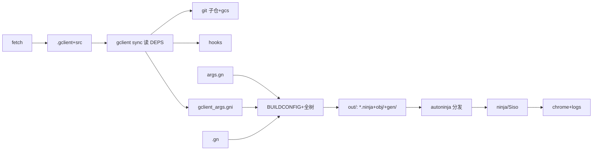

# 1.1 · 构建总流程：gclient/gn/ninja 与 out 产物结构

> 定制的第 0 步：`fetch/gclient sync → gn gen → autoninja` 每步做什么、产出什么。基线 @8fe2331。本机被墙走 GitHub 镜像、`src/out/` 未生成——产物结构据源码与文档交叉实证。

## ① 角色定位

构建链是三级火箭：**gclient**（依赖编排）→ **GN**（元构建系统，BUILD.gn→ninja 规则）→ **ninja/Siso**（执行器）。gclient 在 depot_tools（本机 `/home/lwz/depot_tools/`）；GN 配置 `build/config/BUILDCONFIG.gn` 与数千 BUILD.gn 在仓内，GN 工具本体已迁 gn.googlesource.com（`src/tools/gn/README.md:1` 只剩 roll 桩）。图谱 16 层最底的地基带：args 选错，上层改得再对也编不出预期形态。定制热区=`out/<dir>/args.gn` 与 DEPS。

## ② 定制切入点全景表

（表内 docs/linux=docs/linux/build_instructions.md、docs/android=docs/android_build_instructions.md）

| 想改什么 | 动哪里 | 难度 | 影响面 |
|---|---|---|---|
| 换/加输出目录 | `gn gen out/<名>`（须 out 子目录 docs/linux:198） | 改配置 | 目录隔离 |
| 只编 chrome | `autoninja -C out/Default chrome`（docs/linux:493）；真身 chrome/BUILD.gn:134→:163 | 改配置 | 时间大减 |
| 挂自己的目标 | args.gn 设 `root_extra_deps`（BUILD.gn:69、:289） | 改配置 | 零侵入 |
| Debug↔Release | `is_debug`（BUILDCONFIG.gn:160） | 改配置 | 全局 |
| 发布级优化 | `is_official_build`（BUILDCONFIG.gn:136；与 component 互斥 BUILD.gn:72-76） | 改配置 | 优化级 |
| 链接提速 | `is_component_build`（BUILDCONFIG.gn:171；Android/iOS 被 :176-181 禁） | 改配置 | so 群 |
| 符号取舍 | `symbol_level`（compiler.gni:153，推导 :117-150）+ blink/v8_symbol_level（docs/linux:397-402） | 改配置 | 链接时间×可调试 |
| 编译缓存/分布式 | `cc_wrapper="ccache"/"sccache"/"icecc"/"distcc"`（cc_wrapper.gni:33） | 改配置(+环境) | 全部 cc/cxx |
| 远程执行 | `use_remoteexec`+`use_siso`（docs/linux:374-377；rbe.gni:26、siso.gni:21） | 改配置+账号 | 全部动作 |
| 交叉编译 Android | .gclient `target_os=['linux','android']`（docs/android:87-91）**加** args.gn `target_os="android"`（:149；默认 arm64 BUILDCONFIG.gn:54-59） | 改配置+依赖 | 全工具链 |
| 换品牌 | `is_chrome_branded`（chrome_build.gni:12）；buildflag 出口 build/BUILD.gn:21 | 改配置 | 图标/名称 |
| 复用预设配方 | args.gn `import("//build/args/headless.gn")`（:1-13） | 改配置 | 整组参数 |
| gclient 变量桥 | DEPS:39-40 `gclient_gn_args_file`→生成 build/config/gclient_args.gni | 改配置 | checkout_* 进 GN |
| 嵌入方覆盖/子项目默认 | `build_overrides/build.gni`（.gn:443；build/BUILD.gn:11）+ `.gn` default_args（:31） | 改逻辑 | libc++/v8 默认 |
| 系统依赖 | `build/install-build-deps.sh`（shim，:7 exec .py） | 环境 | apt 包 |
| sysroot/编译器钉点 | DEPS gcs：sysroot :637、clang :924→third_party/llvm-build | 改配置 | libc/clang 版本 |

## ③ 关键源码走读：全链四段

**gclient。** `fetch --nohooks chromium`（docs/linux:74）生成 .gclient 与 src/，此后靠 `gclient sync`。图纸是仓内 DEPS：`vars`（:61）可被 custom_vars 覆盖；`deps`（:622）分 git 仓与 `dep_type:'gcs'`（GCS 直下，如 clang :924）；`hooks`（:4208）sync 后触发（:4225 landmines 配置变更自动爆破 out）。gclient 还**写文件**：按 DEPS:39-40 把 gclient_gn_args 变量写成 `build/config/gclient_args.gni`——镜像用户必踩（⑥）。

**gn gen：BUILD.gn→build.ninja。** `.gn`：:11 指定 buildconfig、:14 密封 Python、:31 default_args。加载顺序（BUILDCONFIG.gn:9-15 注释）：**先 args.gn→再 .gn→最后 BUILDCONFIG.gn**，其上下文执行其余全部构建文件，非下划线变量皆全局（:336-347）。参数声明有顺序依赖：is_official_build（:136）→is_debug（:160）→is_component_build（:171）。工具链选择 :220-316：Android 走 `//build/toolchain/android:android_clang_$target_cpu`（:266），assert 仅 Linux 宿主（:265）。GN 从根 BUILD.gn 递归加载（:5-9：新 BUILD.gn 必须能被依赖链触达，否则 GN 不知道它存在）；group("gn_all")（:88）聚合主目标，root_extra_deps（:69）是零侵入挂载点。

**out/：gen 的产物。** `gn gen out/Default`（docs/linux:192）写入：`args.gn`（配置回执）、`build.ninja`+`toolchain.ninja`（docs/clang.md:89 让你翻它核对 `rule cc` 实际命令）、`obj/`（每 target 一个 .ninja + .o）、`gen/`（buildflag/mojo/grit 生成物）、`.ninja_deps`（依赖日志，siso.gni:9 用它判目录归属）、`.ninja_log`（耗时日志，post_build_ninja_summary.py:69 解析）。本机无 out，此段**未经本机构建实证**。

**autoninja：执行分发。** 永远用 autoninja 而非裸 ninja/siso（docs/linux:382-383；自动选最优 -j）。`use_siso`（siso.gni:21）默认由 use_siso_default（:7）推出——仅当 `build/config/siso/.sisoenv` 存在（sync 时按 rbe_instance 生成，docs/linux:277-280）且非 ninja 旧目录（:9）才 true；否则走 ninja 并被劝退（autoninja.py:41-43）。官方明示 **Siso 是主构建工具**（docs/linux:185-188）。

## ④ 实操：两个最小改动

**A：零侵入挂载自有目标。** 新建 `vendor/hello/BUILD.gn`：

```gn
executable("hello") {
  sources = [ "hello.cc" ]
  deps = [ "//base" ]
}
```

`gn args out/Default` 追加一行：

```gn
root_extra_deps = [ "//vendor/hello:hello" ]
```

机制：:69 的 arg 在 :289 进根目标，GN 递归加载即触达新文件；`autoninja -C out/Default hello` 单独编它。

**B：首次编译推荐 args。** `gn args out/Fast` 写：

```gn
is_component_build = true   # BUILDCONFIG.gn:171
symbol_level = 1            # compiler.gni:153
blink_symbol_level = 0      # docs/linux:397-402
v8_symbol_level = 0
```

`autoninja -C out/Fast chrome` 后跑 `out/Fast/chrome`（docs/linux:511）；另开 out/Rel 配 is_official_build=true 做发布臂，互不污染。

## ⑤ 依赖与数据流



契约：DEPS=gclient↔GN 交接面；args.gn=人↔GN 唯一契约面（改后 autoninja 自动重跑 gn gen）。

## ⑥ 坑与勘误（本机实证 2026-10）

- **"构建工具是 ninja"过时**：官方明写 Siso 为主（docs/linux:185-188）；但 use_siso 默认 false（siso.gni:7），须 .sisoenv 启用——本机无此文件，autoninja 走 ninja（autoninja.py:41-43 劝退）。`src/tools/gn/` 也非 GN 家（README.md:1，只剩 roll 桩），教程在 gn 仓 docs/quick_start.md（docs/linux:187）——1.3 篇引 tools/gn/tutorial/ 属过时，特此更正。
- **install-build-deps.sh 是 shim**：真身是 .py（sh:7 exec 实证）；Linux 构建文档也已搬家→ docs/linux/build_instructions.md。
- **被墙清单与绕行**：①googlesource git 长流被代理链路掐死（GnuTLS×代理缺陷，clone_loop.sh:1-4）→ 绕行 ghfast/gh-proxy 镜像轮转（clone_loop.sh:12-17），本仓即此路线；②gclient sync 同样受阻（fetch_loop.sh:22，fetch.log 不存在=从未跑通）；③CIPD/GCS 二进制缺失：buildtools/linux64/ 无 gn；④子仓不全：v8 已补，angle 仍空。
- **镜像 checkout 直接 gn gen 必挂**：gclient_args.gni 由 gclient 生成，无 sync 则缺文件，build/BUILD.gn:11→build_overrides/build.gni:6 的 import 链必炸。补救=自写最小 gclient_args.gni（静态推断）。
- **use_remoteexec × cc_wrapper 互斥**（cc_wrapper.gni:36）；**official × component 也互斥**（BUILD.gn:72-76）。
- **is_official_build 与品牌无关**（BUILDCONFIG.gn:126-131 注释）；品牌是 is_chrome_branded 且需 Google 内部资源（chrome_build.gni:9-10）。
- **Android 交叉编译改两处**：.gclient target_os 管依赖，args.gn target_os 管 GN 配置，只改后者必缺工具链（docs/android:87-91 vs :149）。

## ⑦ 验证方法

- 参数：`gn args out/Default --list`（全参数+当前值+声明处）、`--list=is_component_build`（单参数溯源）；目标：`gn ls out/Default`（docs/linux:499）、`gn refs --testonly=true --type=executable --all <文件.cc>` 反查测试归属（docs/linux:537）。
- 规则：`cat out/Default/toolchain.ninja` 看 `rule cc` 实际命令（docs/clang.md:89）；产物：`out/Default/chrome --version`，慢目标 post_build_ninja_summary.py。
- 本机前置自检：`test -f build/config/gclient_args.gni` / `test -x buildtools/linux64/gn` / `ls third_party/llvm-build/Release+Asserts/bin/clang`——任一失败先补 sync。

## ⑧ 延伸

- 本系列：1.2 GN 语言、1.3 args 矩阵、1.4 品牌打包、3.3 品牌定制；全景 01-custom-dev-map.md。机制背景：../onboarding/ONBOARDING.md、../explain/。
- 官方文档：docs/linux/build_instructions.md、docs/clang.md、build/config/siso/README.md；GN 本体文档在 gn.googlesource.com/gn。
- 图谱层位：build/ 属第 16 层地基带（按 `//build/` 前缀过滤取节点）。
