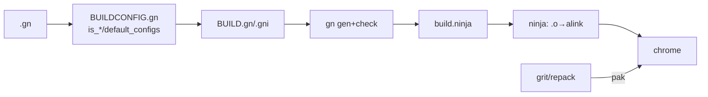

# 1.2 · GN 语言与 BUILD.gn 深解：target/依赖/sources 平台过滤/模板复用

## ① 角色定位

GN 是 Chromium 的元构建系统：不编译任何东西，只把 BUILD.gn/.gni 翻译成 ninja 规则（总流程见 1.1 篇）。整树入口由根 `.gn` 锁定：`.gn:11` 指向 BUILDCONFIG.gn，它先于一切构建文件执行、非下划线变量即全局（BUILDCONFIG.gn:13-15 自述）——BUILD.gn 里直接用的 `is_linux`/`is_win` 全部派生自 BUILDCONFIG.gn:336-347。`//build/` 在图谱 16 层属最底层地基带。定制者与 GN 是声明式契约：声明 sources/依赖/开关，GN 推演依赖图生成增量规则。

## ② 定制切入点全景表

| 定制需求 | 动哪里（file:line） | 难度 | 影响面 |
|---|---|---|---|
| 给现有 target 加源文件 | `chrome/browser/BUILD.gn:1007`（"core"） | 改配置 | 仅该 target；带平台后缀 |
| 新建自己的模块 | 仿 `components/qr_code_generator/BUILD.gn:47` | 改配置 | 新目录零侵入 |
| 挂进 chrome 二进制 | `chrome/BUILD.gn:1643` group("dependencies") | 改配置 | Linux 静态链入 |
| 平台条件编译 | `chrome/browser/BUILD.gn:1810`；变量源 BUILDCONFIG.gn:336-347 | 改配置 | 单平台生效 |
| 加编译开关 config | `build/config/compiler/BUILD.gn:2419`+`configs +=` | 改配置 | 进 default_configs 才全局 |
| 开 RTTI/异常（默认关） | `configs -= [":no_rtti"]` 再 `+= [":rtti"]`（compiler/BUILD.gn:2345/2353/2419/2432；默认挂 BUILDCONFIG.gn:382-383） | 改配置 | 单 target；有联动豁免 |
| Rust 混编 | `build/config/rust.gni:34`+仿 qr_code_generator/BUILD.gn:70 | 改逻辑 | cxx/Crubit 桥 |
| deps 与 public_deps 之分 | 范本 `chrome/browser/BUILD.gn:2230` | 改配置 | 依赖者能否 include 你的头 |
| 头文件搜索路径传播 | 仿 `third_party/boringssl/BUILD.gn:18-23`+`:172` | 改配置 | 依赖者 -I 生效 |
| data/运行时文件随行 | `chrome/BUILD.gn:178` | 改配置 | 产物与测试分发 |
| 资源打进 pak | grit `chrome/browser/resources/BUILD.gn:349`；聚合 `chrome/chrome_paks.gni:113` | 改逻辑 | grd+repack 链 |
| 自定义模板复用 | `chrome/chrome_paks.gni:29`+`writing_gn_templates.md:161-219` | 改逻辑 | 展开为多子 target |
| 链接器选项 | `chrome/browser/BUILD.gn:78`（ldflags 不自动传播） | 改配置 | 平台链接行为 |
| target 可见性收口 | `components/qr_code_generator/BUILD.gn:75` | 改配置 | 防误依赖 |

## ③ 关键源码走读：一个 .cc 如何变成 chrome 二进制

**第一段 sources 声明与平台过滤。** `chrome/browser/BUILD.gn:1006` 的 `source_set("core")` 是浏览器主逻辑的新家（巨型 "browser" target 正被拆出），L1007-1046 列跨平台源文件。平台差异不靠过滤靠显式追加——`docs/no_sources_assignment_filter.md:7` 钉版：2020 年 10 月起 `set_sources_assignment_filter` 弃用，官方模式即其 L17-38 的 `if (is_mac) sources += [...]`。活样本：`:1810` `if (is_linux)` 加 `chrome_browser_main_linux.cc`；`:1845` `if (is_android)` 加 15 个 `*_android.cc`；`:1788` `if (!is_win && !is_android)` 加 `_posix.cc`。文件名后缀（`_linux/_win/_mac/_posix/_android/_ash`）与分支一一对应，凭后缀定位归属；`use_dbus` 等非平台开关同样走 if（L1805-1807）。

**第二段 configs——自动继承的编译开关底座。** BUILDCONFIG.gn:367-395 定义 `default_compiler_configs`（27 项：chromium_code/compiler/no_exceptions/no_rtti/...），经 `set_defaults("source_set"/"static_library")`（:449-455）挂到每种 target 默认值——空 source_set 已带全套警告、优化、`-fno-rtti -fno-exceptions`。修改用先减后加（`chrome/BUILD.gn:164-165` 范本：`configs -= [":thinlto_optimize_default"]` 再 `+= [":thinlto_optimize_max"]`）。config 本体是纯声明如 `config("no_rtti")`（compiler/BUILD.gn:2353-2363，L2355 有 `if (!use_rtti)` 豁免）。传播三通道：`configs` 仅本 target；`public_configs` 传直接依赖者（boringssl 经 BUILD.gn:172 挂载 external_config 的 include_dirs，全树 `#include <openssl/...>` 因此可解析）；`all_dependent_configs` 传所有传递依赖者（base/BUILD.gn:1130 起）。坑：ldflags 不自动传播（chrome/browser/BUILD.gn:76-77 注释明说）。

**第三段 toolchain 规则。** configs 汇总的 defines/include_dirs/cflags 流向 `build/toolchain/gcc_toolchain.gni:364` 的 `tool("cxx")`：command 模板（L370）含 `{{defines}} {{include_dirs}} {{cflags}} {{cflags_cc}}` 槽位，gn gen 按 target 填槽成 ninja 规则，output/depfile（L365-366）构成增量指纹。**改的每个 config 都变成命令行差异**。

**第四段链接聚合。** Linux 桌面版是单可执行静态大链接：`chrome/BUILD.gn:163` `executable("chrome_initial")` 的 deps 第一项 `:dependencies` 是纯聚合 group（L1643-1687），收拢 `//chrome/browser`、`//chrome/renderer` 等全部功能库（L306-307 注释直言 Linux 把功能库直接链进可执行文件）；非 component build 另挂版本脚本裁导出符号（L354-359）。外层 `group("chrome")`（L134-155）给 ninja 命令行用（L143-150 警告别往 group 加 deps）。Windows 另一条路：小 chrome.exe + `shared_library("chrome_dll")`（L423）。

**第五段 6404 行为什么还能维护——四招。** ① import 集中顶部：L5-45 共 41 个 gni，平台 import 再套 if（L51-58）。② 巨型 target 正在消失：`source_set("browser")`（L2216）是纯聚合器，L5182-5187 钉版"intentionally has no sources... Do NOT add sources here"，`sources = []` 刻意放末尾让意外 `sources +=` 被清空；真实源码住 source_set("core")（L1006）与数百个小 target。③ 循环依赖收进公共组：browser 与子 target 互相 include 会断 GN 图，解法 `group("browser_public_dependencies")`（L5213，L5190-5212 注释释原理）。④ 一致性靠 assert 与哨兵：`assert(!is_fuchsia,...)`（L60）、buildflag_header 集中生成（L93-113）、.gn:87 豁免显式登记。

**模板复用范式**看 `chrome/chrome_paks.gni`：`template("chrome_repack_percent")`（L29-111）包装内建 repack，`forward_variables_from`（L33-39）白名单透传；`template("chrome_paks")`（L667-749）组合前者+extra_paks+locales，group 收口——模板套模板、group 聚合，把"100%/200%×多语言 pak"矩阵压成一次调用。`build/nocompile.gni:62` 是另一范式：模板改写 target 类型（action_foreach，L74 补 configs）。

## ④ 实操：加自定义模块三步（最小 patch）

**第 1 步 新目录 BUILD.gn**（场景：新建 `components/my_feature/` 给 browser 进程用）

```gn
# components/my_feature/BUILD.gn（新文件）
source_set("my_feature") {
  sources = [ "my_feature.cc" ]
  public = [ "my_feature.h" ]     # 对外头文件，gn check 只放行它
  public_deps = [ "//base" ]      # 头文件 include "base/..." 需要
  if (is_linux) {
    sources += [ "my_feature_linux.cc" ]
  }
}
```

选型：`source_set`＝独立 .o 集合链进依赖者（默认）；`static_library`＝归档 .a（thin archive，compiler/BUILD.gn:2392）；`component`＝component build 时 so 否则静态（base/BUILD.gn:245 范本）。

**第 2 步 挂 deps。** 在 source_set("browser") 的 deps（chrome/browser/BUILD.gn L2256 起）插一行：

```diff
     "//chrome/browser/enterprise/connectors/reporting:impl",
+    "//components/my_feature",
     "//chrome/browser/external_protocol",
```

要 chrome 主程序直接用则挂 `chrome/BUILD.gn:1644` 的 public_deps。

**第 3 步 头文件搜索路径。** include 从树根写起，default_include_dirs 已含源码根，通常无需加 -I；引入第三方前缀才用 public_configs 仿 boringssl（:18-23 定义 config，:172 挂载）。

**Rust 混编版**：第 1 步换 `rust_static_library`（范本 qr_code_generator/BUILD.gn:70-80：crate_root/sources 指 .rs、cxx_bindings 生成 C++ 桥；C++ 侧 L55-62 二选一 rust 桥或 Crubit），前置 enable_rust（rust.gni:34 默认开）。

## ⑤ 依赖与数据流



输入 BUILD.gn/gni+args.gn（见 1.3 篇），输出 build.ninja 与生成物。三契约：① config 值只在 target 边界流动，ldflags 永不自动传播；② deps 声明"链接你"，public_deps 额外声明"我的头暴露你的头"，gn check 按此校验；③ 运行时文件走 data/data_deps（chrome/BUILD.gn:178）。

## ⑥ 坑与勘误

- **set_sources_assignment_filter 已禁用**（no_sources_assignment_filter.md:7）：自动过滤直接报错，正解是显式 if 追加。
- **exec_script 有 allowlist 铁闸**（.gn:435-463）：文件不在 allowlist（//chrome/version.gni 在 .gn:445）则 gn gen 失败。.gn:386-433 劝退：慢、易 stale、破坏 git grep；要版本号用 action 生成文件（version.gni:9-13 同劝退）。
- **tools/gn/tutorial/ 是孤儿示例**（本机实证）：四个 .cc 仍在但全树无 BUILD.gn 引用；GN 文档本体在 gn.googlesource.com 仓（1.1 篇勘误）。hello.cc:13 起的 `#if defined(TWO_PEOPLE)` defines 手法仍成立。
- **gn check 不是可选项**：gn gen 默认校验头文件依赖，漏声明在别人构建时才炸。.gn:87-378 有 300+ 条豁免——历史债，勿模仿。
- **configs 先减后加**：与默认冲突必须先 `configs -=` 再加（chrome/BUILD.gn:164-165），否则两份 flag 同进命令行。
- **rtti/exceptions 默认全局关**（BUILDCONFIG.gn:382-383）：单 target 开启注意 use_rtti 豁免（compiler/BUILD.gn:2355）与 libc++ 联动。
- **往 source_set("browser") 加 sources 会被无声清空**：L5187 设计如此；新代码进独立小 target 再挂 deps。

## ⑦ 验证方法

- 图完整性：`gn gen out/Default` 即校验；`gn check out/Default //components/my_feature/` 复查。
- 入图与否：`gn ls out/Default //components/my_feature:*`；挂载：`gn desc out/Default //chrome/browser:browser deps | grep my_feature`；反向 `gn refs`。
- config 生效：`gn desc ... config`；`ninja -C out/Default -t commands <.o>` 看真实命令行 -I/-D/-fno-rtti。
- 平台分支：`gn args --list=is_linux` 溯源；另开 out 改 target_os 对比 sources。
- 本机自检：`test -x buildtools/linux64/gn`——本机无 gn（1.1 篇实证），补 sync 后才可跑。

## ⑧ 延伸

- 本系列：`1.3-args-matrix.md`、`1.1-build-overview.md`、`1.4-packaging-distribution.md`；全景 `01-custom-dev-map.md`。
- 官方文档：`build/docs/writing_gn_templates.md`（L161-219 三戒：action 粒度/中间 target 命名 `__`/visibility 只挂最终 target）、`docs/component_build.md`、gn.googlesource.com/gn/docs/reference.md。
- 图谱层位：`//build/` 前缀对应地基层；browser 拆分演进按 filePath 前缀 `chrome/browser/` 查 knowledge-graph.json。
