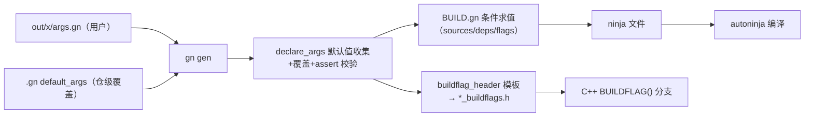

# 1.3 · args.gn 参数矩阵与构建变体

> 定制 Chromium 的第一课：**args.gn 决定你编出的是什么东西**。同一份源码，几十个参数的组合产出从 10 秒增量编译的开发版到官方发布版、从 Linux 桌面到 Android APK 的全部变体。本篇给出参数全景、声明位置地图与定制配方。

## ① 角色定位

GN 构建系统是"两层结构"：`BUILD.gn` 文件群描述目标（target）与依赖图，而 **`declare_args()` 声明的构建参数**是横切整张依赖图的全局开关。你在 `out/<dir>/args.gn` 里写下的每一个变量，会在 `gn gen` 时被求值并影响：

- 哪些源文件被编译进目标（`sources` 的条件分支）
- 编译器/链接器 flags（`build/config/compiler/`）
- 生成哪些 buildflag 头文件（C++ 代码里 `BUILDFLAG()` 分支）
- 产物形态（组件库/单二进制/APK/跨平台目标）

参数声明的"宪法"在 `build/config/BUILDCONFIG.gn`（它被仓根 `.gn` 文件指定为 buildconfig），各子域参数散布在对应 `.gni` 文件中——**找参数声明位置是定制者的日常操作**，本篇的地图直接省掉这一步。

## ② 定制切入点全景表

| 想改什么 | 动哪里 | 难度 | 影响面 |
|---|---|---|---|
| 换构建目录配置 | `out/<dir>/args.gn`（gn args 编辑或手写） | 改配置 | 仅该目录 |
| 用官方预设配方 | `build/args/`（如 `headless.gn`：`import("//build/args/headless.gn")`） | 改配置 | 整组参数 |
| 声明自定义参数 | 业务目录下 `*.gni` 加 `declare_args() { my_feature = false }` | 改配置 | 全依赖图可见 |
| 让 C++ 感知参数 | `build/buildflag_header.gni` 模板生成 `*_buildflags.h` → 代码里 `BUILDFLAG(my_feature)` | 改逻辑 | 编译期分支 |
| 控制 OS/交叉编译 | `target_os`（`BUILDCONFIG.gn:49-50`：空则取 host_os） | 改配置 | 整条工具链 |
| 切 Debug/Release/官方 | `is_debug`/`is_official_build`（`BUILDCONFIG.gn:136,160`） | 改配置 | 优化级别/DCHECK/符号 |
| 组件构建（链接提速） | `is_component_build`（`BUILDCONFIG.gn:171`） | 改配置 | 产物从单 exe 变 so 群 |
| Chrome 品牌资源 | `is_chrome_branded`（`build/config/chrome_build.gni:12` 默认 false） | 改配置 | 图标/名字/官方资源 |
| 符号级（链接速度×可调试） | `symbol_level`（声明于 `build/config/compiler/compiler.gni`，117-133 行有默认值推导） | 改配置 | 链接时间、包体、栈回溯质量 |
| 编译加速 wrapper | `cc_wrapper`（`build/toolchain/cc_wrapper.gni`）配 ccache/sccache | 改配置 | 全部编译动作 |
| 远程编译 | remoteexec/Reclient 相关 args（见 `build/toolchain/` 配置群） | 改配置+环境 | 全部编译动作 |
| UI 后端开关 | `use_aura`/`toolkit_views`/`use_glib`（`build/config/ui.gni:24-40`，按 OS 默认推导） | 改配置 | ui/ 层链接目标 |
| ozone 后端选择 | `ozone_platform_*` 群（`build/config/ozone.gni`） | 改配置 | Linux 显示/输入后端 |
| Android 专属 | `build/config/android/` 与 `build/config/chromeos/args.gni` 各自的 declare_args | 改配置 | APK 打包/NDK |
| 看/查所有参数 | `gn args <out> --list` / `--list=is_component_build`（命令行工具） | 只读 | - |

## ③ 关键源码走读：参数如何流经构建系统

**第一站：声明与求值顺序。** `.gn`（仓根 dotfile）→ GN 解析器先执行 `BUILDCONFIG.gn`。所有 `declare_args()` 在全部 BUILD.gn 求值**之前**统一收集默认值，然后用你 args.gn 里的值覆盖（`.gn` 文件 `default_args` 段优先级介于两者之间——官方用它给被 DEPS 进来的子项目改默认值，如本仓对 v8/webrtc/crashpad 的覆盖，`.gn` 中 `default_args = {...}` 段可见 rtc_link_task_queue_impl 等实例）。

**第二站：派生与约束。** `BUILDCONFIG.gn:128-180` 是参数派生逻辑的样本：

- `is_debug = !is_official_build`（160 行）：官方构建自动关 debug
- `is_component_build = is_debug && current_os != "android" && ...`（171 行）
- 随后一串 `assert`（175-180 行）封死非法组合：`is_debug && is_official_build`、Android/iOS/watchOS 上的 component build——**改参数前先读 assert，它们是官方写的"参数相容表"**。

**第三站：参数的两个消费通道。**
1. **GN 层**：BUILD.gn 里 `if (is_android) { sources += [...] }` 之类条件（1.2 篇展开）。
2. **C++ 层**：`build/buildflag_header.gni` 的模板把 GN 布尔转成 `foo_buildflags.h` 中的 `BUILDFLAG()` 宏；而 OS 宏（`IS_ANDROID`/`IS_LINUX`/`ARCH_CPU_ARM64`）来自静态头 `build/build_config.h`，走预处理器。**记住这个分工：改构建参数用前者，平台判断用后者。**

**第四站：官方配方目录。** `build/args/README.txt` 明确了配方机制：把一组 flag 组合存成 `.gni`（示例含 `target_os = "android"`、`use_ozone = true` 等），用户 `import("//build/args/foo.gni")` 一行启用。现存的 `headless.gn` 与 `chromeos/` 就是官方实例——**你的产品变体也应该这么做**（放 `build_overrides/` 或业务目录，不污染 build/）。

## ④ 实操：三份配方与一个自定义参数

**日常开发配方**（链接快、增量快）：
```gn
# out/dev/args.gn
is_component_build = true
is_debug = true
symbol_level = 1          # x64 上 0 也可回溯，见 compiler.gni:124-127 注释
use_remoteexec = false    # 无远程集群时
```

**对外发布配方**：
```gn
is_official_build = true
is_debug = false
symbol_level = 2
is_chrome_branded = false   # 自家品牌保持 false，配合 3.3 篇品牌定制
```

**Android 交叉编译**：
```gn
target_os = "android"
is_debug = false            # 注意 BUILDCONFIG.gn:180：android 禁 component build
```

**加自己的参数并让 C++ 感知**（全链最小示例）：
1. 业务目录建 `mycompany/buildflags.gni`：`declare_args() { enable_my_ai_panel = false }`
2. 建 `BUILD.gn` 用 `buildflag_header("my_buildflags")` 模板生成头文件（模板用法见 `build/buildflag_header.gni`，仓内现成范式可 grep `buildflag_header(` 任取一份照抄）
3. C++ 代码 `#include "mycompany/my_buildflags.h"` 后 `if (BUILDFLAG(enable_my_ai_panel)) {...}`
4. 编译时 `out/x/args.gn` 加 `enable_my_ai_panel = true`，或命令行 `gn args out/x` 交互编辑

## ⑤ 依赖与数据流



上游输入是用户 args + 仓默认；下游两路分别进 GN 依赖图与 C++ 编译期。**改动 args 后必须重跑 gn gen（autoninja 会自动触发）**；删除参数不会自动清理旧 buildflag 头，怪异行为时先 `gn clean`。

## ⑥ 坑与勘误

- **"is_debug=false 就是发布版"是错的**（`BUILDCONFIG.gn:132-135` 注释官方原话）：发布必须 `is_official_build=true`（带来完整优化、PNARGS、发布级 DCHECK 处理）。误解源自 args 名字直觉。
- **component build 在 Android 不可用**：180 行 assert 明拒；Android 开发想提速走 `is_java_debug`/增量 java 编译路线。
- **symbol_level=0 在 ARM 上不可回溯**（`compiler.gni:124-127` 注释实证：x86/x64 可以，arm 要 ≥1）。
- **args.gn 里写未声明变量会报"not used"警告但 gen 继续**——拼错参数名（`is_offical_build`）是最常见静默失败：**改完必查 `gn args out/x --list=<名字>` 回读确认**。
- **改 args 影响全局时会触发大面积重编**（如 is_component_build 切换≈全量重链）——为不同目的建多个 out 目录是标准做法。
- 本机实证背景（2026-10）：googlesource/CIPD 被墙，本仓源码取自 GitHub 镜像 chromium/chromium @8fe2331；`gn gen` 尚未在本机跑通，上述命令行为据源码与官方文档整理（注意：src 内 `tools/gn/` 仅是 roll 桩，GN 文档真身在 gn.googlesource.com，1.1 篇勘误），待构建链打通后验证回填。

## ⑦ 验证方法

- `gn args out/x --list`：列出全部参数与当前值（发现拼错名的最快手段）
- `gn args out/x --list=is_component_build`：单参数溯源（声明文件+当前值+默认值）
- 产物验证：`is_component_build=true` 时 out 下出现大量 `.so`；`is_official_build` 影响 chrome 二进制体积（可 du 对比）
- buildflag 验证：编一个 `static_assert(BUILDFLAG(x))` 转译错误即可确认宏值

## ⑧ 延伸

- 机制底盘：本系列 1.1（总流程）、1.2（GN 语言）；buildflag 宏与平台宏的 C++ 侧：5.1
- 品牌参数落地：3.3（is_chrome_branded 之后的事）
- 图谱层位：build/config 层（knowledge-graph 第 16 层地基带）；相关 explain 篇：`../explain/base-thread-pool.md`（args 无直接关联，但同属"地基"阅读线）
- 官方文档：`docs/linux/build_instructions.md`（Siso 主构建，1.1 勘误）、`docs/component_build.md`、`docs/deterministic_builds.md`
