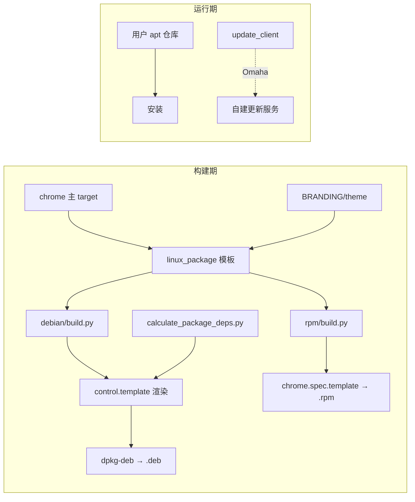

# 1.4 · 品牌与打包分发：从编译产物到可安装包

> 编出来的 `out/x/chrome` 只是个二进制；交付用户需要安装包（deb/rpm/msi/dmg/apk）、签名与更新通道。本篇走读 Chromium 官方打包链，给出自产品分发的全部切入点。与 3.3 分工：那篇管"品牌资产长什么样"，本篇管"包是怎么造出来的、怎么持续分发"。

## ① 角色定位

`chrome/installer/` 是独立于浏览器代码的"发行工程"子系统：Linux 侧用 Python+模板生成 deb/rpm，Windows 侧是 mini_installer 压缩自解压链，macOS 侧是 dmg/签章脚本，Android 侧则在 `chrome/android/`（APK 走 gradle，见 5.2/5.3）。**打包链是纯构建期代码（GN target + Python 模板），几乎不改 C++**——定制友好度最高的子系统之一。

## ② 定制切入点全景表

| 想改什么 | 动哪里 | 难度 | 影响面 |
|---|---|---|---|
| 出 deb 包 | `autoninja -C out/x "chrome/installer/linux:stable_deb"`（target 由 BUILD.gn:687 `linux_package("stable")` 派生） | 改配置 | Linux 交付 |
| 出 rpm 包 | 同上 `...linux:stable_rpm`（deb/rpm 同一 linux_package 模板双产物） | 改配置 | Fedora 系 |
| 加自己的发行渠道 | 模仿 687-695 行加 `linux_package("mychannel")`（channel 变量贯穿包名/资源路径） | 改配置 | deb/rpm 变体 |
| 包元数据（依赖/描述） | `chrome/installer/linux/debian/control.template`（@@PACKAGE@@/@@deb_depends@@ 等模板变量，已实证） | 改模板 | 安装器行为 |
| rpm spec | `chrome/installer/linux/rpm/chrome.spec.template` | 改模板 | rpm 元数据 |
| deb 版本号策略 | `chrome/installer/linux/debian/deb_version.py`（版本串生成规则） | 改逻辑 | 升级判定 |
| 系统依赖计算 | `calculate_package_deps.py`（自动算 Depends） | 改逻辑 | 依赖清单 |
| flatpak 发行 | `chrome/installer/linux/flatpak/`（现成 flatpak 清单） | 改配置 | 沙箱分发 |
| Windows 安装器 | `chrome/installer/mini_installer/`（自解压+setup.exe） | 动架构 | win 交付 |
| macOS 打包 | `chrome/installer/mac/`（dmg+签章脚本群） | 改配置 | mac 交付 |
| 安装后首跑逻辑 | `chrome/installer/setup/`、`launcher_support/`（win 为主） | 改逻辑 | 首跑体验 |
| 更新通道 | Omaha 协议（Google 更新服务，开源实现 `components/update_client/`）或自建（见 §4） | 动架构 | 升级链路 |
| 主程序重定位/打包目录 | `chrome/installer/linux/common/`（安装脚本骨架、repo 布局） | 改脚本 | 文件落位 |

## ③ 关键源码走读：Linux deb 是怎么造出来的

**第一站：GN target。** `chrome/installer/linux/BUILD.gn:687` 的 `linux_package("stable")` 与 695 行 `linux_package("unstable")` 展示了 channel 模式：channel 字符串决定包名后缀（`mybrowser-stable.deb`）、desktop 文件、图标路径与资源目录（3.3 的 `$branding_dir/BRANDING` 就在 401 行被这里消费）。模板内部先触发 `chrome` 主目标构建，收集 `out/x/chrome` 产物树，再进入 Python 打包脚本。

**第二站：Python 组装。** `chrome/installer/linux/debian/build.py` 是 deb 的总装线：读 `control.template` 替换 `@@` 变量（Source/Package 名、`@@deb_depends@@` 依赖列表）、注入 maintainer 脚本、调 dpkg-deb 收包。依赖清单不是手写的——`calculate_package_deps.py` 用 `ldd` 类扫描实际 ELF 动态依赖生成（增量准确，删了系统库依赖会自动反映）。

**第三站：版本串。** `deb_version.py` 把 `chrome/VERSION`（157.0.8093.0）编译进 debian 版本字段并处理 channel 后缀——你的产品版本线（3.3 §6 建议独立版本）在此生效。

**rpm 侧同构**：`rpm/build.py` + `chrome.spec.template`，差异只在 spec 语法与 rpmlint 检查（`lint_package.py`/`rpmlint.conf`）。

## ④ 实操：两条自发行路线

**路线甲（最省事）：系统包 + 手动更新。** 用 stable/unstable 模板出 deb/rpm，放自家 apt/yum 仓库（`build_repo_package.py` 与 `control_repo.template` 就是为 repo 化准备的），用户 `apt upgrade` 跟进。适合内网/受控用户群。**零 C++ 改动**。

**路线乙：接管更新客户端。** Chromium 的自动更新（Google 之外）本质是 `components/update_client/`（ Omaha 协议客户端，开源）。自产品想让浏览器"自己检查更新"：保留 update_client、把更新服务器 URL 指向自建 Omaha 兼容服务（社区有开源实现），CRX 差分包格式照用。工作量集中在服务端；客户端侧主要改 URL 常量与策略（`chrome/browser/updater/` 一带）。

**发行版上架**（可选）：flatpak 清单现成（`chrome/installer/linux/flatpak/`）；国内信创场景走 deb 系（UOS/麒麟）注意 5.1/5.2 的平台分支。

## ⑤ 依赖与数据流

## ⑥ 坑与勘误

- **deb/rpm 是同一 GN target 的双产物**：别去找两个独立 target，`linux_package` 模板一次定义两个输出。
- `@@` 模板变量清单以 `control.template`/`build.py` 实际为准（本文实证了 Package/Depends/Maintainer 等，完整集合读模板全文）——文档跟不上代码，以模板为准。
- mini_installer（Windows）是**压缩自解压**架构（setup 资源嵌在单 exe），与 Linux 的 dpkg 链完全两套，别按 Linux 思路改 win。
- 打包脚本要求 build 目录里已有完整 chrome 产物：先 `autoninja chrome` 再打 包 target（或直接 ninja 包 target，依赖图会自动带上）。
- 自建更新服务必须处理**版本单调性**（Omaha 用版本比较协议），版本串回退会导致重复更新循环。
- 本机未构建（1.1 同因），target 名以 BUILD.gn 为准实证，命令输出待构建链打通回填。

## ⑦ 验证方法

- `dpkg -I out/stable/mybrowser-stable_*.deb`：元数据三查（名字/版本/依赖）
- `dpkg -c`：文件落位检查（/opt/mybrowser/...）
- 干净容器安装+启动：`docker run ubuntu && dpkg -i && mybrowser --version`
- 更新链：降级/升级两个包轮装，确认版本判定正确

## ⑧ 延伸

- 品牌资产侧：3.3；Android APK 与签名：5.2/5.3；Windows/macOS 深入：各自 installer 目录 + `docs/windows_build_instructions.md`、`docs/mac_build_instructions.md`
- 图谱层位：chrome 外壳层 installer 子图；相关 repo-docs：`docs/deterministic_builds.md`（可复现打包）
