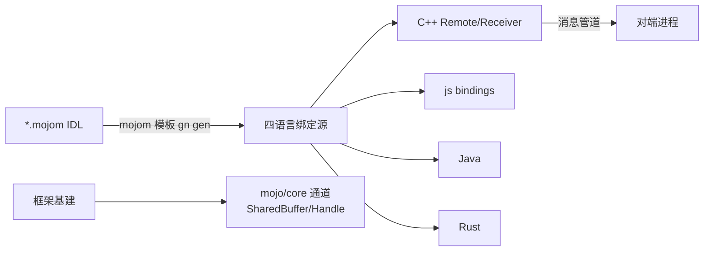

# 10.1 · Mojo 入门：接口定义与自定义服务第一课

> Chromium 的进程间通信已全面 mojo 化（旧 IPC 基本退役）：加任何跨进程能力=写 .mojom+挂服务。本篇给定制者最小知识闭环：定义接口→生成绑定→两进程对通。10.2/10.3 再讲完整服务实战与版图。

## ① 角色定位

mojo 是"接口定义语言（IDL）+多语言绑定（C++/Java/JS/Rust）+消息管道"三合一。目录结构即分工（`mojo/public/` 实证）：`mojom/` 是生成器工具链，`cpp/`、`java/`、`js/`、`rust/` 是各语言绑定库，`interfaces/` 是 mojo 自举接口。**定制者的日常=在业务目录写 .mojom 文件，在 BUILD.gn 用 `mojom()` 模板生成绑定，两端 include 生成的头**。

## ② 定制切入点全景表

| 想改什么 | 动哪里 | 难度 | 影响面 |
|---|---|---|---|
| 定义新接口 | 业务目录 `*.mojom`（module+interface 语法，样例 `mojo/public/mojom/base/time.mojom:6-27`：module 声明+[Stable] struct 字段） | 改配置 | 新 IPC 面 |
| 生成 C++ 绑定 | BUILD.gn 里 `mojom("my_api") {...}`（真实范式：`services/network/public/mojom/BUILD.gn:14 mojom("mojom_ip_address")`） | 改配置 | 编译期 |
| 数据结构版本化 | `[Stable]` 标注（time.mojom:8 实证）+ extensible 枚举 | 改配置 | 跨版本兼容 |
| 同步调用 | interface 方法标 `[Sync]`（慎用，9.1 钉过单进程同步限制坑） | 改配置 | 死锁风险面 |
| 关联接口 | `PendingReceiver<T>`/`PendingRemote<T>` 参数传递（接口工厂模式） | 改逻辑 | 服务级联 |
| C++ 服务端 | `Receiver<T>`/`SelfOwnedReceiver` 挂实现对象 | 改逻辑 | browser/utility 进程侧 |
| C++ 客户端 | `Remote<T>` 持句柄调方法 | 改逻辑 | 任意进程侧 |
| Java 侧绑定 | 同一 .mojom 生成 java 绑定（Android 进程，3.2 的 JNI 之外另一通道） | 改逻辑 | Android UI↔native |
| JS 侧绑定 | WebUI 页面直调 mojo（4.2 WebUI 篇的 mojo 桥就是它） | 改逻辑 | chrome:// 页面 |
| Rust 侧绑定 | `mojo/public/rust/`（新栈，2.1 走读提过 rust 绑定生成） | 改逻辑 | rust 模块 |
| 服务注册 | ServiceManager/ServiceFactory 挂载（10.2 展开） | 动架构 | 独立服务进程 |
| 消息观测 | mojo 的 tracing/`mojo::core` 调试设施 | 只读 | 调试 |

## ③ 关键源码走读：一个接口的一生

**第一站：IDL 语法（最简样例）。** `mojo/public/mojom/base/time.mojom` 是官方基础类型样例（6-27 行实证）：`module mojo_base.mojom;` 定命名空间；`[Stable] struct Time { int64 internal_value; };`——**[Stable] 的含义：该结构进入版本化兼容模式（哈希校验布局），跨版本升级不许破坏性变更**。业务接口写 `interface Foo { Bar(string x) => (bool ok); };`（方法带返回箭头=异步响应）。

**第二站：生成（BUILD.gn 模板）。** `services/network/public/mojom/BUILD.gn:14` 的 `mojom("mojom_ip_address") { sources = [...] }`——mojom 模板在 gn gen 期调生成器，产出各语言绑定源（C++ 头/实现、java、js、rust 按 args）。**新增接口三步：写 .mojom→BUILD.gn 加 mojom target→deps 挂到两端**（1.2 篇的模块化三步在此套用）。

**第三站：使用（C++ 两端）。** 服务端：实现 `Foo` 接口的纯虚类（生成头里），`mojo::Receiver<Foo> receiver_(impl_, receiver)` 绑定管道端点；客户端：`mojo::Remote<Foo> remote_` 绑另一端，`remote_->Bar(...)` 即跨进程调用，回调/未来值收响应。**句柄可再传递**（`PendingRemote<Foo>` 作为另一个 mojo 方法的参数）——这是 Chromium 服务级联的标准形态（A 进程把 B 的接口句柄递给 C 进程）。

## ④ 实操：browser→renderer 自定义消息最小链

1. `chrome/browser/myfeature/public/mojom/myfeature.mojom`：
   ```mojo
   module myfeature.mojom;
   interface PageNotifier {
     Notify(string message) => ();
   };
   ```
2. 同目录 BUILD.gn：`mojom("mojo_bindings") { sources = ["myfeature.mojom"] }`
3. browser 侧实现+挂 Receiver；renderer 侧拿 Remote（传递途径：2.1 的 ContentRendererClient 注入时机/或走 RenderFrame MojoBinderMap——4.2 的 frame 机制）
4. 两端 BUILD.gn 各 deps 该 mojom target，编译即得绑定
（完整服务化+进程注册见 10.2；本例聚焦"接口对通"本身）

## ⑤ 依赖与数据流



IDL 是唯一事实源；语言栈只是视图。管道底层（named pipe/共享内存）对业务透明。

## ⑥ 坑与勘误

- **[Stable] 一旦标上不能反悔**（哈希锚定）；没标的 struct 随时可改但跨版本不兼容——内部接口随意，跨版本持久的才标。
- `[Sync]` 同步调用是 footgun：**单进程模式下语义变化**（9.1 实证 1256 行 sync 限制放宽）、重入死锁风险；新代码一律异步。
- **不要手工编辑生成的绑定文件**（out 目录生成物，重编即覆盖）。
- mojo 绑定的生命周期=管道生命周期：Remote 析构=连接断开，服务端 `set_disconnect_handler` 必须处理（进程崩溃感知也走这）。
- Java/JS 绑定的类型映射与 C++ 有差（如 int64→JS number 精度），跨语言接口字段类型保守选。
- 老 IPC（IPC::Message 那套）教程已过时，现存代码多为历史遗留——新代码一律 mojo。

## ⑦ 验证方法

- 生成验证：编 mojom target 后 out 目录 grep 生成头（*.mojom.h）
- 链路验证：接口方法里 LOG + 对端断点；或 chrome://tracing 抓 mojo 消息类别
- 断连验证：杀对端进程，disconnect handler 应触发
- 稳定性：`[Stable]` 接口改字段后跨旧新版本混跑（升级测试）

## ⑧ 延伸

- 服务化实战与版图：10.2/10.3；WebUI 的 mojo 桥：4.2；单进程语义：9.1
- 图谱层位：mojo 层（16 层中第 12-13 层服务带）；基础类型全集：`mojo/public/mojom/base/`
- 官方文档：repo-docs 里 mojo 设计文档（已转档，grep "mojo" 索引）
