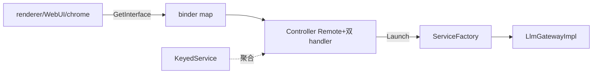

# 10.2 · 加自定义 mojo 服务实战：从 .mojom 到独立进程全流程

> 10.1 讲了 .mojom 语法与绑定生成；本篇升级为完整服务工程：**定义接口 → 实现服务端 → 注册挂载（进程形态决策）→ 三入口消费**。贯穿示例"给 AI 浏览器加 LLM 网关"（呼应 12.x）。现行源码已无独立 ServiceManager。

## ① 角色定位

Chromium 服务化（services/ 下 30+ 服务）本质是**把可崩溃、可沙箱、可闲置退出的功能从 browser 进程剥出去**。browser 是唯一常驻宿主，三类挂载点：(a) `ServiceProcessHost::Launch` 拉起独立 utility 进程；(b) `BrowserInterfaceBroker` binder map 把实现留在 browser 进程内；(c) WebUI 专属 broker 面向 chrome:// 页面。定制惯例：服务代码放 `services/<name>/`（`public/mojom/` 接口+实现），消费端在 chrome/browser。

## ② 定制切入点全景表

| 想做什么 | 动哪里 | 难度 | 影响面 |
|---|---|---|---|
| 加全新接口 | `services/<name>/public/mojom/*.mojom`+`mojom()` target（样例 `services/passage_embeddings/public/mojom/BUILD.gn:7`） | 改配置 | 新 IPC 面 |
| 服务实现 | `<name>_service.{h,cc}` 构造收 `PendingReceiver`（`passage_embeddings_service.h:21`） | 改逻辑 | 新服务进程 |
| 注册进 utility | `chrome/utility/services.cc:499` 里 `services.Add(RunXxx)`（Run 样例 :280） | 改逻辑 | utility 生命周期 |
| 沙箱声明 | mojom 标 `[ServiceSandbox=sandbox.mojom.Sandbox.kService]`（`echo.mojom:13`） | 改配置 | 安全边界 |
| 拉起进程 | `ServiceProcessHost::Launch<Interface>`（最简例 `file_util_service.cc:18`） | 改逻辑 | 进程开销 |
| 空闲退出 | `set_idle_handler`（实战 `passage_embeddings_service_controller.cc:355`） | 改逻辑 | 常驻时长 |
| 崩溃恢复 | `set_disconnect_handler`（`screen_ai_service_handler_base.cc:263`） | 改逻辑 | 可靠性 |
| 进程内全局 | `map->Add<Interface>(&Binder)`（`browser_interface_binders.cc:1413`） | 改逻辑 | browser 进程 |
| 按 profile 隔离 | KeyedService 暴露 `BindXxx`（`chrome_browser_interface_binders.cc:412`） | 改逻辑 | 多 profile 隔离 |
| 暴露给 renderer | frame 级 `chrome_content_browser_client_receiver_bindings.cc:348`；进程级 :233 | 改逻辑 | Web 能见面 |
| 暴露给 WebUI | `chrome_browser_interface_binders_webui.cc:458`+`ForWebUI<Ctrl>().Add<Iface>()` | 改逻辑 | chrome:// 页面 |
| 暴露给扩展 | 同 :363 extension 分支 | 改逻辑 | 扩展 API 面 |
| 暴露给子进程 | `ExposeInterfacesToChild`（`content_browser_client.h:1471`） | 改逻辑 | GPU/utility 消费 |
| 版本演进 | `[Stable]`+extensible enum（10.1）+同名接口不许重复 Add | 改配置 | 跨版本兼容 |
| 测试桩 | `OverrideXxxBinderForTesting`（`device_service.h:134`） | 改逻辑 | 仅测试 |

## ③ 关键源码走读

**A. 现行注册链**。旧资料的 `ServiceManagerContext`、`RunService`、manifest.json 声明**全部已删**。现行三件套：browser 侧 `ServiceProcessHost::Launch`（`content/public/browser/service_process_host.h:197-214`）→ utility 侧 `ContentUtilityClient::Register{Main,IO}ThreadServices`（`content_utility_client.h:43,49`）→ `mojo::ServiceFactory` 按接口名分发（`service_factory.h:74`）。

**B. utility 独立进程六跳**（passage_embeddings 实证）：
1. browser 首请求：`MaybeLaunchService`（`passage_embeddings_service_controller.cc:355`）造管道+挂双 handler。
2. content 拉起：`Launch<Interface>` 返回 `Remote`；沙箱由 traits 读 mojom `[ServiceSandbox]` 属性（`service_process_host.h:45-54`，**缺失即 static_assert 编译失败**）→ `LaunchServiceProcess`（`service_process_host_impl.cc:47`）把 receiver 塞进 `WithBoundServiceInterfaceOnChildProcess`（`utility_process_host.h:160`）。
3. 孵化：沙箱写命令行 `--service-sandbox-type`（`utility_process_host.cc:401`）；就绪后递进首接口（:320）。
4. utility 分发：`BindServiceInterface`（`utility_thread_impl.cc:52`）**惰性**建 IO 线程 factory（:68），认领不了 post 主线程 `HandleServiceRequest`（:212）。
5. embedder 注册表：`content::RegisterMainThreadServices`（`content/utility/services.cc:406`）末行 :462 交棒 `ChromeContentUtilityClient`（`chrome_content_utility_client.cc:85`）→ `chrome/utility/services.cc:499` 聚合 `services.Add(RunPassageEmbeddingsService)`(:504)，Run 一行（:280）。
6. 生命周期：`RunService`（`service_factory.h:113`）持实例到管道断开；`OnServiceTerminated`（`utility_thread_impl.cc:112`）计数**归零即进程自退**——utility 进程随需求起停的机制本体。

**C. browser 进程内全局（device 模式）**。BatteryMonitor 链：renderer `GetInterface` → frame binder map（`browser_interface_binders.cc:1413`→:733 安全检查）→ `GetDeviceService().BindBatteryMonitor`。`GetDeviceService`（`content/browser/device/device_service.cc:131-148`）惰性单例+PostTask 延迟（过早初始化与 Network Service 死锁）；`DeviceService` 是"根接口+N 个 Bind 子接口"门面（`services/device/public/mojom/device_service.mojom`，实现分派 `device_service.cc:157`）。

**D. KeyedService（per-profile）**。样板 `BindModelBroker`（`chrome_browser_interface_binders.cc:412-422`，注册 :495）：frame→`Profile::FromBrowserContext`→factory `GetForProfile`→`BindModelBroker(receiver)`（`ReceiverSet` 多客户端）。11.1 同构。

## ④ 实操：LlmGateway 四步

**1 接口**（BUILD.gn 照抄 `services/passage_embeddings/public/mojom/BUILD.gn:5-13`）：

```mojo
module llm_gateway.mojom;
import "sandbox/policy/mojom/sandbox.mojom";
struct CompleteRequest { string prompt; string model_id; uint32 max_tokens = 1024; };
[ServiceSandbox=sandbox.mojom.Sandbox.kService]
interface LlmGateway {
  Complete(CompleteRequest req) => (CompleteResponse resp);
  BindSession(pending_receiver<LlmSession> session);  // 流式回推
};
interface LlmSession { StreamChunk(string delta); };
```

**2 服务端**：骨架抄 `services/test/echo/echo_service.h:21`——实现 mojom 虚类+`mojo::Receiver` 成员；`Complete` 跑线程池后回调（禁 `[Sync]`）。

**3 注册**：`chrome/utility/services.cc:499` 加 `services.Add(RunLlmGateway);`（Run 见 B5）。browser 侧：

```cpp
llm_remote_ = content::ServiceProcessHost::Launch<llm_gateway::mojom::LlmGateway>(
    ServiceProcessHost::Options().WithDisplayName(u"LLM Gateway").Pass());
llm_remote_.set_idle_handler(base::Seconds(30), ResetOnIdle);
```

**形态决策**：模型推理/第三方库→utility 独立进程；轻量、要读 profile/pref→browser in-process（§C）；per-profile→KeyedService（§D）；需 GPU 走特化沙箱（`audio_service.mojom:20` kAudio）。

**4 三入口**：(a) renderer——`PopulateChromeFrameBinders`（`chrome_browser_interface_binders.cc:452`）加 `map->Add<LlmSessionHost>(&Binder)`，renderer 侧 `GetInterface`（`browser_interface_broker_proxy.h:40`）；(b) WebUI——`ForWebUI<AiSettingsUI>().Add<LlmGatewayHandler>()`（挂 `chrome_browser_interface_binders_webui.cc:458` 区域，4.2 已走读）；(c) chrome 层直接持 `mojo::Remote<LlmGateway>`。

## ⑤ 依赖与数据流



契约：utility 沙箱内**没有** profile/pref/文件系统，要什么由 browser 显式喂（要网络传 `PendingRemote<URLLoaderFactory>`，device 服务即此模式）。

## ⑥ 坑与勘误

1. **ServiceManager 资料过时**（文档对比）：`content/public/browser/utility_process_host.h` 已移出 public，现 `utility_process_host.h:58` 的 `final` 类只能经 `Launch` 用。
2. **漏标 `[ServiceSandbox]` 编译期炸**（源码实证）：static_assert（`service_process_host.h:48-52`）；沙箱只对 Launch 生效，in-process 不套。
3. **注册时机全惰性**：utility 首请求才建 factory（`utility_thread_impl.cc:215`）；device 单例延迟启动（`device_service.cc:137-146`）。
4. **utility 用完即走**：计数归零自退（`utility_thread_impl.cc:112`）——别存跨请求长活状态；Remote reset 即杀进程。
5. **idle handler 需一次 IPC 才生效**：`print_backend_service_manager.cc:1093` 实证（`Poke()`）。
6. **跨 profile**：device_service 全局无 profile；LLM 记用量/偏好必须 KeyedService。
7. **重复注册 CHECK 崩溃**：WebUI broker 同接口重复 Add 即 `CHECK(!Contains)`（`web_ui_browser_interface_broker_registry.h:34`）。
8. **frame 级 vs 进程级暴露的安全差异**：`RegisterBrowserInterfaceBindersForFrame` 文档粒度、`ExposeInterfacesToRenderer` 进程粒度，暴露面审计先分清。
9. **Android 双实现**：device 多接口走 `GetJavaInterfaceProvider()` 转 Java（`device_service.cc:157` `#if`）。

## ⑦ 验证方法

- 进程起来了：任务管理器看 `WithDisplayName`；`GetRunningProcessInfo()`（`service_process_host.h:232`）；chrome://process-internals。
- 接口没注册的典型报错：utility 端 `DLOG(ERROR) "Cannot run unknown service"`（`utility_thread_impl.cc:226`）。
- 沙箱生效：仿 echo `LoadNativeLibrary`（沙箱下应失败）；browsertest 样板 `service_process_host_browsertest.cc`。
- 生命周期：`Crash()` 看退出与重启；空闲后进程消失。
- 端到端：WebUI `Mojo.bindInterface`（4.2）；单测抄 `services/device/device_service_test_base.h`。

## ⑧ 延伸

官方权威 `docs/mojo_and_services.md`："Building a Simple Out-of-Process Service"(:251)、"Specifying a sandbox"(:423)。姊妹篇：10.1、10.3（服务化版图）、11.1（KeyedService）、12.1/12.4（AI 集成）、4.2（WebUI 消费侧）、9.2（沙箱定制）。图谱 Service 进程层与 Browser 层 broker 节点；`work4ai/讲透Chromium/` 的 ONBOARDING.md 与 explain/ 索引。
