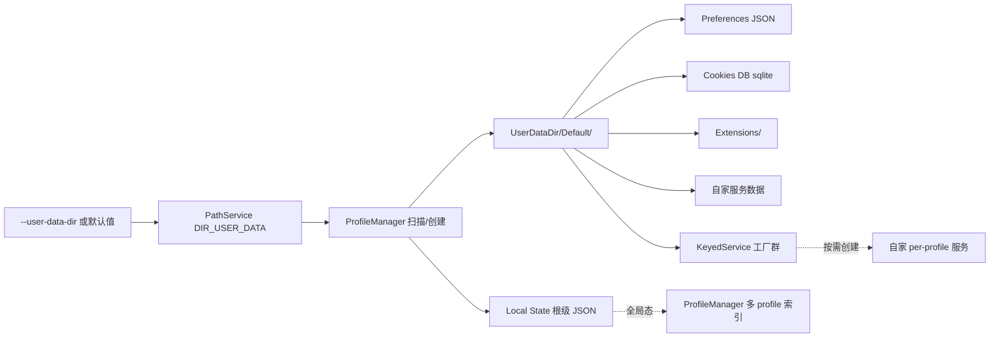

# 11.1 · Profile 与用户数据目录定制

> 用户的一切（书签/历史/Cookie/扩展/偏好/密码）落在哪、怎么初始化、怎么隔离——定制发行版必须搞清的"数据底盘"。机制向深解见 `../explain/chrome-profile.md`，本篇专注定制视角：改名、换位、多开、隔离、预置数据。

## ① 角色定位

Profile 是 chrome 层概念（content/ 不知道它）：一个用户身份的浏览器状态集合，物理上=用户数据目录（UserDataDir）下的一个子目录（默认 `Default/`）。`chrome/browser/profiles/` 是子系统主体（`profile.cc` 658 行接口实现、`profile_manager.cc` 2380 行创建/加载/调度），路径解析在 `chrome/common/chrome_paths.cc`（chrome::DIR_USER_DATA 等 PathService case）。

## ② 定制切入点全景表

| 想改什么 | 动哪里 | 难度 | 影响面 |
|---|---|---|---|
| 用户数据目录位置 | 启动开关 `--user-data-dir`；默认值：`chrome_paths.cc` `GetDefaultUserDataDirectory()`（`chrome::DIR_USER_DATA` case，151-155 行实证）+ 各平台 `chrome/common/chrome_paths_<plat>` 文件 | 改配置 | 数据落盘根 |
| 目录名（与官方版隔离） | 同上改默认目录（3.3 §6 同款坑）；安装器打包的默认路径（1.4） | 改配置 | 共存隔离 |
| 首个 profile 目录名 | `chrome::kInitialProfile`（"Default"，`profile_manager.cc:938/958` 消费）定义于 chrome_constants | 改配置 | 目录布局 |
| 多 profile 目录前缀 | `kMultiProfileDirPrefix`（"Profile "，`profile_manager.cc:1141` 实证） | 改配置 | 多身份布局 |
| profile 创建流程挂点 | `ProfileManager::CreateProfile...` 一族（2380 行文件主体）+ `profile.cc` 的 OnCreate 启动序列 | 改逻辑 | 初始化时序 |
| 每 profile 服务注册 | `profile.cc` 里 KeyedService 工厂依赖声明（BrowserContextKeyedServiceFactory，AI 数据服务 `ai_data_keyed_service_factory` 是现成范式，12.1） | 改逻辑 | 加自家 per-profile 服务 |
| Local State（全局态） | UserDataDir 根的 Local State JSON（ProfileManager/浏览器级偏好） | 改配置 | 全局状态 |
| 预置书签/偏好 | master_preferences（首次安装注入）或 starter pack；本质是首次 profile 创建时合入默认值 | 改配置 | 开箱体验 |
| profile 锁/单实例 | ProcessSingleton（`chrome/browser/startup/` 一带） | 改逻辑 | 多开行为 |
| Guest/隐身定制 | profile.cc 的 incognito 分支 + guest 模式策略 | 改逻辑 | 临时会话 |
| 迁移老数据 | profile_manager 的迁移钩子（版本升级目录迁移） | 动架构 | 升级链路 |
| 企业管控 | policy 注入 pref 默认值（`components/policy/`，11.2 呼应） | 改配置 | 受管环境 |

## ③ 关键源码走读：目录是怎么定下来的

**第一站：PathService。** `chrome/common/chrome_paths.cc:151-155`：`case chrome::DIR_USER_DATA: GetDefaultUserDataDirectory(&cur); create_dir = true;`——用户数据根由 PathService 统一供给，`GetDefaultUserDataDirectory()` 的平台分叉在 chrome_paths 的平台文件里（Linux：XDG_DATA_HOME 语义；Android/mac/win 各异）。**改默认位置=改这里或让用户传 `--user-data-dir`；命令行优先级高于默认值**。

**第二站：profile 相对目录。** `profile_manager.cc:938` `relative_profile_dir.AppendASCII(chrome::kInitialProfile)` 与 958 行返回初始 profile 名——单 profile 用户永远住 `UserDataDir/Default/`；创建第二个起走 `kMultiProfileDirPrefix + 数字`（1141 行）。改这两个常量即可重排目录布局（注意与本地状态里记录的路径一致性，改完老数据要迁移）。

**第三站：Profile 启动序列。** `profile.cc`（658 行）承载 Profile 作为 BrowserContext 的创建后初始化：注册路径、初始化 pref 服务（Local State 与 profile 内 Preferences 两个 JSON）、拉起 KeyedService 依赖图。**定制者最常挂的位置=在 profile 初始化尾部注册自家 KeyedService**——照抄 `ai_data_keyed_service_factory`（12.1 §2）的依赖声明，你的服务就获得了"每 profile 一份、惰性创建、随 profile 销毁"的全部生命周期管理。

## ④ 实操：三个高频定制

**A. 换数据根目录+目录名**（自家产品标准动作）：改 `GetDefaultUserDataDirectory()` 返回自家路径（或安装器传入），改 `kInitialProfile` 为 `Main`——配合 3.3 用户数据隔离清单，与用户已装浏览器互不干扰。

**B. 预置出厂状态**：首次 profile 创建时合入默认书签/首页/搜索引擎——官方通道是 master_preferences（安装器读）+ pref 默认值改动（11.2）；更稳的做法是 `profile.cc` 初始化序列里检测首建（profile_manager 的创建回调）注入一次。

**C. 便携版**（数据随程序目录走）：`GetDefaultUserDataDirectory()` 改为相对 exe 路径（`base::DIR_EXE`，chrome_paths.cc:141 已有该 case 范式）+ 关 ProcessSingleton 的全局锁语义（或按目录加锁）——U 盘浏览器形态。

## ⑤ 依赖与数据流

上游是路径解析，中游是 manager 调度，下游是各存储文件与 KeyedService 生命周期——**定制只碰上游（路径/常量）或挂下游（服务注册），中游慎动**。

## ⑥ 坑与勘误

- **`--user-data-dir` 才是真源**：调试时它覆盖一切默认值；测试自家默认路径逻辑时别带着旧开关跑。
- Local State 记录 profile 目录名映射——改 `kInitialProfile` 后老用户数据会"消失"（实为索引失配），必须配套迁移或版本门槛。
- **Profile ≠ 进程**：多 profile 可同进程（多 Browser 对象），进程模型（9.x）与 profile 数正交。
- guest/incognito 的数据目录语义不同（内存态/临时态），便携化改造要单独处理，否则"隐身数据落盘"是隐私事故。
- KeyedService 的依赖顺序由 factory 显式声明——新服务依赖书签服务就要在 factory 里 `DependsOn`，漏了会随机拿到 null（惰性创建时序问题，现象偶现极难查）。
- Android 的 profile 结构被简化（`profiles/android/` 一带），桌面多 profile 逻辑不能直接平移（5.2 篇展开）。

## ⑦ 验证方法

- `chrome://version` 用户数据路径行（3.3 §7 同款检查点）
- 首启后 `ls UserDataDir/`：Default（或改名后）、Local State、Crashpad 等落位
- 双 profile：profile 切换后各自 Preferences 内容独立（grep 一个 pref 值对比）
- 便携化：拷贝程序目录到另一机器，数据应跟随出现

## ⑧ 延伸

- 机制深解：`../explain/chrome-profile.md`（Profile 生命周期六阶段）
- 偏好系统：11.2（PrefService）；策略管控：11.3；AI 服务挂载：12.1
- 图谱层位：chrome 外壳层 profile 子图（ProfileManager 69 节点大子图）
