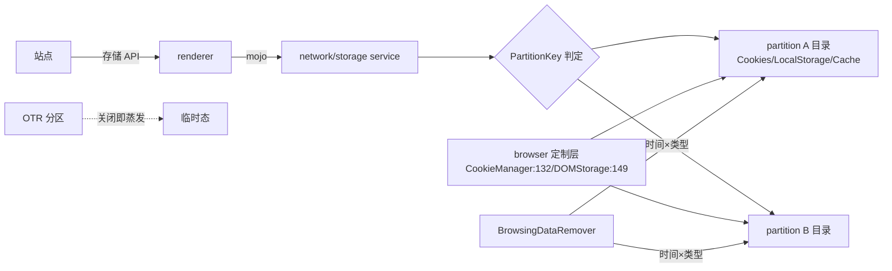

# 11.3 · 存储体系与隐私裁剪：数据留存策略定制

> 网站数据（Cookie/localStorage/缓存/IndexedDB）落在哪、按什么粒度分区、怎么配置留存边界——隐私产品/信创合规/无痕增强类定制的知识面。与 3.3 分工：那篇管"别连 Google 服务"，本篇管"本地数据怎么留、留多久、按谁分"。

## ① 角色定位

存储栈三层：**分区层**（StoragePartition——站点的数据隔离单元，网站数据归属的"账户"）→ **组件层**（cookie（services/network 侧）/DOM storage（storage/common+components）/IndexedDB/quota）→ **磁盘层**（profile 目录下的数据库文件群，11.1 布局）。嵌入者总接口=`content/public/browser/storage_partition.h`（381 行）：`GetPath()`（:98）、`GetCookieManagerForBrowserProcess()`（:132）、`GetDOMStorageContext()`（:149）等一族 getter——**每类存储一个 manager，全从 partition 取**。

## ② 定制切入点全景表

| 想干什么 | 动哪里 | 难度 | 影响面 |
|---|---|---|---|
| 站点数据隔离粒度 | StoragePartition 的切分（默认第一方分区；OTPA/存储分区键策略在 content 层） | 改配置→改逻辑 | 隔离边界 |
| 取某站全部数据 | `StoragePartition::GetPath()`（:98）目录级清除（BrowsingDataRemover 走这个粒度） | 改逻辑 | 站点数据删除 |
| Cookie 管控 | CookieManager（:132，mojo 面）+policy（11.2 的 cookie 策略通道） | 改配置 | 跨站追踪 |
| localStorage/IndexedDB | DOMStorageContext（:149）+ components 层实现 | 改逻辑 | 大容量数据 |
| 退出即焚 | 无痕（OTR）分区语义复用：自产品把默认分区做成 OTR 化（profile 的 off-the-record 变体，11.1 guest 坑呼应） | 改逻辑 | 全留存策略 |
| TTL/容量限额 | quota 管理与 eviction（storage 分区配额） | 改配置 | 磁盘占用 |
| 缓存瘦身 | HTTP cache 大小/位置（network service 侧配置）+ 磁盘 cache 目录 | 改配置 | 缓存面 |
| 数据导出/迁移 | partition 目录级打包（11.1 迁移钩子联动） | 改逻辑 | 换机/备份 |
| 隐私报告 | WebUI 自建页面展示各站数据占用（4.2 流程+partition 枚举） | 改逻辑 | 透明化 |
| 清理调度 | BrowsingDataRemover 的定时化（自家周期策略：退出清/每日清） | 改逻辑 | 自动化 |
| 指纹面收紧 | storage partition key 的聚合（EPHEMERAL-隔离开关类） | 改配置 | 反指纹 |
| 嵌入者全托管 | 自制浏览器（路线 B）里 partition 的创建参数（storage_partition_params.h 一带） | 动架构 | 2.2 嵌入面 |

## ③ 关键源码走读：数据的"户口"体系

**第一站：partition 即户口。** 每个站点的 cookie/storage/缓存归属哪个 partition，由 partition key（site+ONC/storage key 演化）决定——**同 partition 共享数据，跨 partition 物理隔离**（不同磁盘子目录）。9.1 的进程隔离与它同构但不同层：进程是"执行"隔离，partition 是"数据"隔离。

**第二站：manager 族。** storage_partition.h 的 getter 族（:132/:149 等）暴露各存储的 mojo manager——browser 侧对存储的全部操作（增删查配额）都经这些接口。**定制"某站数据导出"= 枚举 partition→各 manager 拉清单**。

**第三站：清理与蒸发。** BrowsingDataRemover 是官方删除管线（时间范围×数据类型矩阵）；OTR 分区（无痕）在 profile 关闭时整目录蒸发——**"退出即焚"产品的最短实现=默认 OTR 化**（牺牲：无历史/自动填充，产品取舍自明）。

## ④ 实操：「隐私优先浏览器」三件套

1. 默认 OTR 化（或 BrowsingDataRemover 的退出钩子全清）——留存策略归零；
2. 附加周期清理（启动时清 N 天前数据：BrowsingDataRemover 时间范围参数）；
3. 数据透明页：chrome://mydata（4.2 自建页面）枚举 partition 占用——差异化卖点。

合规侧（信创/企业）：数据全留存反向（审计导出钩子）+ 固定磁盘加密（LUKS 之下 partition 目录天然落密文区）。

## ⑤ 依赖与数据流

## ⑥ 坑与勘误

- **"删 cookie=删干净"是错觉**：localStorage/IndexedDB/cache/Service Worker 各自独立，必须过 BrowsingDataRemover 全类型清单（残留=追踪面）。
- partition key 策略随隐私迭代（第三方 cookie 弃用系列）——**自产品的隔离承诺别绑死当前默认**，做成可配置。
- OTR 化的暗坑：扩展数据/pref 不在 OTR 语义内（11.1/11.2 的 profile 级数据仍持久）——"退出即焚"要做组合清理。
- quota 满了的行为是 eviction（静默驱逐）不是报错——测试大容量场景要看驱逐日志。
- Service Worker 是存储里最"活"的部分（可自启动），无痕增强必须连 SW 一起清，否则后台复活。
- partition 目录与 9.1 进程沙箱无直接绑定——"同进程=同数据"不成立（进程模型是执行面）。

## ⑦ 验证方法

- DevTools Application 面板：逐存储类型查（肉眼对照 partition 粒度）
- 退出重进测"焚"：OTR/清理钩子后 profile 目录 du 对比
- 第三方隔离验证：跨站内嵌 iframe 的 storage 读写归属（partition 隔离生效则互不可见）
- chrome://settings/content/all 一带官方页对照自家数据页数字

## ⑧ 延伸

- 目录布局：11.1；pref（不在站点数据域）：11.2；cookie 网络面：6.1；嵌入参数：2.2/2.3
- 图谱层位：content browser 侧 storage 子图+services 层；repo-docs：storage 设计文档（grep storage 索引）
