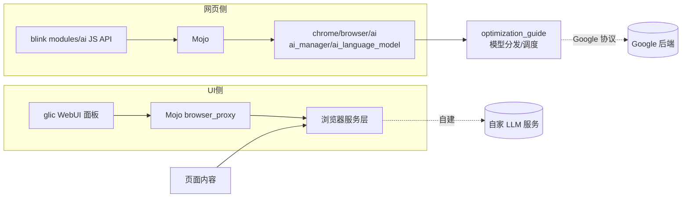

# 12.1 · AI 集成注入点全景评估（自制 AI 浏览器路线图）

> 把 LLM 能力装进浏览器：Google 自己已经趟出三条路（built-in AI API / glic 侧栏 / AI Mode 搜索），本篇从定制者视角盘点全部注入位与成本，为 kylin-ai 类产品选型。源码 @8fe2331 实证。

## ① 角色定位

"AI 浏览器"= 在浏览器四层之一挂上模型能力：**内容层**（拿到页面内容喂模型）、**模型层**（模型从哪来：云端 API/端侧推理）、**交互层**（用户怎么触发与查看）、**网络层**（请求级拦截改写）。Chromium 官方近两年长出的 AI 代码（`chrome/browser/ai/`、glic、AI Mode）恰好演示了每条路的工程形态——照抄结构比自己发明稳得多。

## ② 定制切入点全景表（四路注入 × 代表文件）

| 注入路线 | 想要什么 | 代表文件（实证存在） | 难度 | 备注 |
|---|---|---|---|---|
| A. 内置 AI API 复用 | 网页/扩展用 `window.` AI API | `chrome/browser/ai/ai_manager.cc`（2125 行）+ `ai_language_model.cc`（1186 行）+ blink 侧 `third_party/blink/renderer/modules/ai/` | 动架构 | Chrome 官方 built-in AI（Prompt API 等）双端实现 |
| A2. 换模型后端 | API 底下接自己的模型 | `components/optimization_guide/`（模型分发+推理调度服务，Google 后端耦合） | 动架构 | 官方链路连 Google 服务，自产品需在此断开重接 |
| B. UI 侧栏（glic 路线） | 浏览器级 AI 助手面板 | `chrome/browser/resources/glic/`（TS 前端：app_router.ts/browser_proxy.ts/glic_api）+ `chrome/browser/glic/` | 改逻辑+前端 | Gemini 侧栏全链参考 |
| B2. AI 搜索模式 | 对话式搜索入口 | `chrome/browser/resources/search_ai_mode/` | 改逻辑 | AI Mode 参考实现 |
| C. 页面内容管线 | DOM/全文→摘要→检索 | renderer 侧：`content/renderer/` 挂 RenderFrameObserver；browser 侧：WebContents::GetPrimaryMainFrame()->GetFullText() 一类入口（配合 7.2 篇） | 改逻辑 | AI 浏览器的"读"半边 |
| D. 网络层拦截 | 请求改写/注入/审计 | `CreateNonNetworkNavigationURLLoaderFactory` 与 `RegisterNonNetworkSubresourceURLLoaderFactories` 等 ContentBrowserClient 钩子（2.1 篇实证行号）+ URLLoaderFactory 拦截（6.2 篇） | 改逻辑 | "替用户改网页"路线，风险最高 |
| E. 端侧组件先例 | 端侧模型分发范式 | `components/on_device_translation/`（端侧翻译：buildflags+组件下载+推理） | 参考 | 不直接用，学它的组件化分发结构 |
| F. 策略/企业管理 | AI 功能开关管控 | `chrome/browser/ai/ai_data_keyed_service*`（按 profile 的服务生命周期） | 改配置 | 多 profile 隔离范式 |

## ③ 关键源码走读：Google 的三块样板

**样板一：built-in AI（`chrome/browser/ai/`）**。`ai_manager.cc` 是 browser 进程侧的管理器（API 会话生命周期、权限、配额），`ai_language_model.cc` 是单模型会话（克隆/流式 token 输出的 Mojo 服务端）；blink 侧 `modules/ai/` 把它们暴露成 JS API（`LanguageModel` 等）。**模型本体与分发**全在 `components/optimization_guide/`（features.gni 控制开关；core/ 是协议与调度；content/ 是内容侧 hook）。定制含义：**这条路线替你解决了"网页调用 AI"的全部管道，你只需把 optimization_guide 的后端指向自家模型服务**——但该组件与 Google 协议深度耦合（模型清单、加密分发），断接工作量不小，是 A2 路线的核心成本。

**样板二：glic 侧栏（`chrome/browser/resources/glic/`）**。TS 代码走 WebUI 栈（4.2 篇）：`app_router.ts` 前端路由、`browser_proxy.ts` Mojo 桥、`glic_api/` 对扩展暴露的能力面。它证明"浏览器级 AI 面板"完全可以用标准 WebUI 建——**不必碰 views 原生 UI**。定制含义：抄结构换后端=最快的 AI 侧栏路线；`experimental_opt_in/` 目录还示范了灰度开关形态。

**样板三：AI Mode（`chrome/browser/resources/search_ai_mode/`）**。把对话入口做进搜索/地址栏链路的参考（omnibox→AI 应答的衔接在 chrome/browser/ui 侧）。定制含义：想改"搜索即 AI"的产品形态，先读它。

## ④ 实操：一个最小 AI 浏览器改造方案（组合拳）

目标：Linux 桌面版，Ctrl+I 唤出侧栏，对当前页问答。
1. **后端**：browser 进程加一个自家 `LLMService`（普通 C++ + HTTP 客户端连本地/内网模型服务；不走 optimization_guide）
2. **内容获取**：侧栏触发时用 WebContents 取主框架全文（renderer 侧已有的全文提取入口，7.2 篇展开；量小时直接 `WebUI` 里 Mojo 请求）
3. **UI**：按 glic 结构新建 `chrome://myai` WebUI 页（4.2 篇的"自建页面"全步骤）挂到侧栏容器（views 侧 `side_panel`，4.3 篇）
4. **快捷键与菜单**：accelerator 表注册（4.3 篇）
5. **可选进阶**：预注入 JS 给所有页面加"划词问 AI"（extension 注入或 renderer 钩子，8.x 篇）

每一步都只动 chrome/ 层，不碰 content/ 内核——**发行版定制路线（总览篇路线 A）的典型 AI 落法**。

## ⑤ 依赖与数据流

官方链（左）与自建链（右）在"browser 进程服务层"分叉——**自产品的本质是把这个分叉点右移**。

## ⑥ 坑与勘误

- **optimization_guide ≠ 纯本地库**：它含模型下载/加密/实验配置的 Google 服务协议；直接 `use_...` 开关关不干净，需逐 feature 断链（`features.gni` 与 internal/ 实证）。
- built-in AI 的 JS API 有**权限与配额门**（ai_manager 中大量 policy/session 判断），自产品放开时要同步改扩展权限白名单（8.x）。
- glic 前端是 TS+内部工具链构建，改它要先过 WebUI 前端构建（grit/ts 定义在 `chrome/browser/resources/glic/BUILD.gn`）。
- **不要在 renderer 进程直连网络调 LLM**：renderer 是沙箱进程，网络出网受限；正确位置是 browser 进程服务或独立 utility 进程（9.x 沙箱篇展开）。
- 端侧大模型（本地推理）别学 optimization_guide 的下载制——on_device_translation 的组件化（buildflags 门控+按需下载+独立组件目录）才是可抄的轻结构。

## ⑦ 验证方法

- built-in API 链路：加载 chrome://ai-internals（官方自带调试页，resources 里 `on_device_internals` 一带）看会话与 token 流
- 自建侧栏：chrome://myai 打开+Ctrl+I 唤起+对 about:blank 长文页问答（内容管线通）
- 断链验证：net-export 确认无 optimization_guide 相关 Google 域请求（配合 6.x）
- 多 profile：两个 profile 不同开关，AI 服务互不串（ai_data_keyed_service 的隔离设计照抄）

## ⑧ 延伸

- 管道细节：2.1（Client 钩子挂服务）、4.2（WebUI 自建页）、6.2（网络拦截）、7.2（内容获取）、9.2（沙箱边界）
- 图谱层位：chrome 外壳层 ai 子图 + blink modules/ai；相关 repo-docs：`docs/` 下 AI 相关设计文档（repo-docs 已全量转档，可 grep "ai" 索引）
- 本系列 12.2（内容理解管线）/12.3（面板实操）/12.4（内置 AI 深读）为后续篇目
