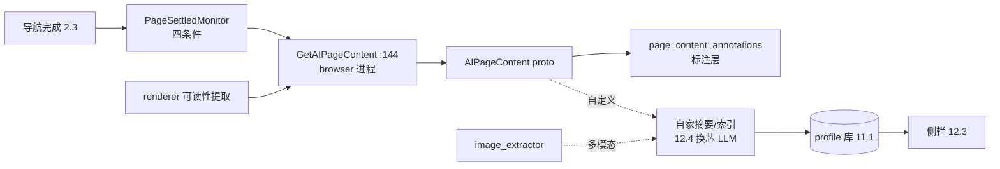

# 12.2 · 页面内容理解管线：DOM 提取 → 结构化 → 摘要/检索（官方 AI 通道深挖）

> AI 浏览器的"读"不止是拿全文——Chrome 官方已经为自家 AI（历史记录搜索/Gemini 页面理解）建了一套**结构化页面内容管线**（PCES/PageSettledMonitor/GetAIPageContent）。本篇把这套官方管线与自建管线对齐，给出复用与替换方案。承接 7.2（五通道）与 12.1（全景）。

## ① 角色定位

官方管线三件套（全部源码实证）：
- **提取**：`GetAIPageContent`（`components/optimization_guide/content/browser/page_content_proto_provider.h:144`）——产出 proto 结构化内容（标题/正文块/可读性判定）
- **时序**：PageSettledMonitor（7.2 走读的四条件状态机）——"页面稳定了再抽"的官方答案（DOMContentLoaded≠load≠settled）
- **消费生态**：`components/page_content_annotations/{content,core}`（标注管线）+ `no_response_ai_page_content_agent`/`page_content_image_extractor`（optimization_guide/content/browser/，含图像抽取）
这套管线喂的是 optimization_guide 的模型（12.4 的底座），**但提取层与时序层是模型无关的**——自产品可直接复用。

## ② 定制切入点全景表

| 想干什么 | 动哪里 | 难度 | 影响面 |
|---|---|---|---|
| 复用官方提取 | `GetAIPageContent`（page_content_proto_provider.h:144）回调拿 proto（结构化正文） | 改逻辑 | 白捡的可读性算法 |
| 复用稳定时序 | PageSettledMonitor 四条件（7.2 §走读）作为自家触发器 | 改逻辑 | 时序正确性 |
| 图像内容 | `page_content_image_extractor`（optimization_guide/content/browser/，含 browsertest 样板） | 改逻辑 | 多模态输入 |
| 无响应代理模式 | `no_response_ai_page_content_agent`（同目录）——不回推 UI 的静默提取范式 | 改逻辑 | 后台批处理 |
| 自家标注管线 | `page_content_annotations/core`（独立于 Google 模型的服务层结构） | 改逻辑 | 摘要/分类挂点 |
| proto 结构定制 | GetAIPageContent 的 proto 定义（.mojom/.proto 一族，7.2 锚 ai_page_content.mojom:728+） | 改逻辑 | 数据契约 |
| 截图脱敏配合 | redaction Rect 通道（ai_page_content.mojom:728/731/747——敏感区域标注后再截） | 改逻辑 | 合规视觉 |
| 增量更新 | PageSettledMonitor 后的内容变更监听（SPA 场景） | 改逻辑 | 动态页 |
| 检索索引 | 自建：提取结果→本地索引（侧栏检索 12.3 消费） | 动架构 | 历史搜索类功能 |
| 摘要调度 | 提取→LLM（12.4 换芯后端）→缓存（11.1 profile 数据落位） | 动架构 | 全链 |
| 每页签策略 | WebContents 粒度的 agent 生命周期（KeyedService 挂载 11.1） | 改逻辑 | 作用域 |
| 隐私边界 | 提取白名单（只抽信任域）/脱敏开关（11.3 联动） | 改配置 | 产品合规 |

## ③ 关键源码走读：官方"读"管线的串联

**第一站：什么时候抽。** PageSettledMonitor（7.2 已走读四条件）判定页面稳定——**这是官方对"DOMContentLoaded≠load≠内容就绪"问题的工程答案**：网络空闲+渲染稳定+交互窗口等条件齐了才算 settled。自建管线 90% 的时序 bug（抽到半截页）抄这个就免疫。

**第二站：抽什么。** `GetAIPageContent`（:144）跑在 browser 进程，聚合 renderer 侧的可读性提取，产出 proto：正文块层级+显著性排序+元信息——**不是裸 innerHTML**，是"喂模型就绪"的结构。7.2 勘误过的 blink 侧基础件（`WebFrameContentDumper::DumpFrameTreeAsText`，web_frame_content_dumper.h:40）是其文本兜底层。

**第三站：给谁用。** `page_content_annotations` 层把 proto 送模型（官方走 optimization_guide→Google；**自定义产品在 12.4 的换芯点截流**）；`no_response_*_agent` 示范了"无 UI 回显"的静默消费（后台建索引场景的标准姿势）；图像抽取（`page_content_image_extractor`）补多模态输入。

## ④ 实操：自产品"页面语义层"最小闭环

目标：每页 settled 后产出（结构化正文+首图+摘要），存 profile 供侧栏检索（12.3 消费）。
1. 触发：挂 PageSettledMonitor（或 WebContentsObserver 的 DidFinishNavigation+延时兜底二段式）；
2. 提取：调 `GetAIPageContent` 拿 proto（免自研可读性算法——省掉最大的坑）；
3. 摘要：proto→自家 LLM（12.4 适配器；无模型期先存原文分块）；
4. 落盘：profile 目录自家库（sqlite；11.1 目录约定+11.3 留存策略）；
5. 消费：chrome://myai 侧栏（12.3）。
**增量演进**：先 1+2+4（纯索引），摘要后补——管线解耦后各段独立上线。

## ⑤ 依赖与数据流

## ⑥ 坑与勘误

- **别用裸 DOM 当语料**：可读性算法（正文/广告/导航区分）是隐藏的大坑，官方 GetAIPageContent 白捡——重造轮子的都是没翻到这个 API 的。
- settled≠永远稳定：SPA 内容持续变化（7.2 的 PageSettledMonitor 后续变更监听），一次性抽取会过时。
- proto 里的 redaction 通道（:728/731/747）是**截图合规**用的（敏感区域先框后截），文本脱敏要另做（11.3 联动）。
- 提取跑 renderer 还是 browser：官方混合（可读性在 renderer 聚合在 browser）——自定义注入的位置决定了拿到的时机与成本。
- 每页签一个 agent 的内存账：长会话多 tab 的提取缓存要上限（11.3 quota 语义借用）。
- 中文可读性：官方算法以英文站调优为主，国内站正文的召回率要自测（必要时 proto 之外补自研分块）。

## ⑦ 验证方法

- chrome://on-device-internals（12.4 §7 同族页）观察 PageContent 事件流（官方通道现网行为）
- 构造测试页矩阵：长文/SPA/iframe 重/图片主导，对照提取结果完整性
- 时序回归：弱网+慢渲染下"半截页"出现率（settled 生效度）
- 端到端：检索一句正文关键词→命中原页（12.3 闭环后）

## ⑧ 延伸

- 通道全景：7.2（必读前置）；模型底座与换芯：12.4；UI 消费：12.3；注入全景：12.1；数据留存：11.3
- 图谱层位：optimization_guide 与 page_content_annotations 子图；7.2 的五通道表是本篇 §1 的底
