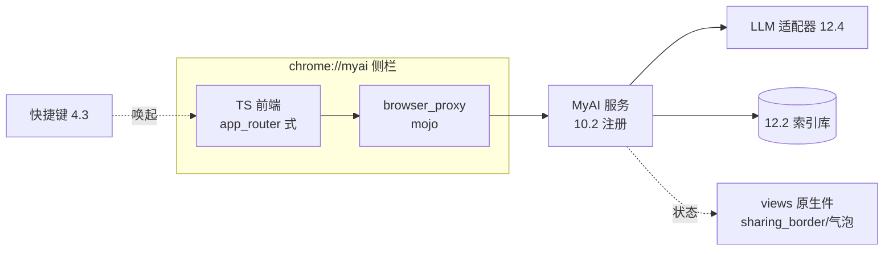

# 12.3 · AI 面板 UI 实操：侧栏/气泡/上下文高亮的浏览器级 AI 界面

> AI 浏览器的"脸"：常驻侧栏、快捷气泡、页面上下文指示——Google glic 是官方满配实现，本篇拆其双端结构给自产品抄作业。UI 通用知识已在 4.1（views）/4.2（WebUI）/4.3（窗口）覆盖，本篇只讲 **AI 面板特有的模式**。

## ① 角色定位

glic 双端（源码实证）：**前端** `chrome/browser/resources/glic/`（TS+WebUI 栈：`app_router.ts` 路由、`browser_proxy.ts` mojo 桥、`glic_api/` 接口定义、`glic_app_controller.ts` 主控）+ **原生侧** `chrome/browser/glic/`（`browser_ui/` 是 views 原生伴生件：`animated_effect_view` 动效、`context_sharing_border_view` 上下文共享边框、`activity_list_bubble` 活动气泡）。**形态=WebUI 侧栏面板（主内容）+ views 原生点缀（跨页面视觉件）**——这正是自产品的推荐架构。

## ② 定制切入点全景表

| 想做什么 | 动哪里 | 难度 | 影响面 |
|---|---|---|---|
| 侧栏面板主体 | 抄 glic 前端结构：WebUI 页（4.2 流程）挂 side_panel 容器（4.1 走读的 SidePanelEntry 注册） | 改逻辑+前端 | 主交互面 |
| 面板↔browser 通信 | `browser_proxy.ts` 模式（mojo 桥，10.2 服务暴露给 WebUI） | 改逻辑 | 数据通道 |
| 上下文高亮 | `context_sharing_border_view`（glic/browser_ui/——"AI 正在读这个页"的视觉指示，原生边框件） | 改逻辑 | 信任感交互 |
| 动效 | `animated_effect_view`（同目录，入场/生成中动效的原生件） | 改逻辑 | 质感 |
| 快捷气泡 | `activity_list_bubble`（活动流气泡范式）+ 4.1 的 bubble 家族 | 改逻辑 | 轻量入口 |
| 快捷键唤起 | accelerator 表（4.3 窗口篇）注册 Ctrl+I 类 | 改配置 | 入口效率 |
| 划词问 AI | selection 通道（7.2 选区回调）→面板注入 prompt | 改逻辑 | 高频交互 |
| 页面状态联动 | PageSettledMonitor（12.2）→ 面板"可摘要"态 | 改逻辑 | 时序 UX |
| 灰度开关 | glic 的 `experimental_opt_in/`（前端灰度范式）+11.2 pref | 改配置 | 发布策略 |
| 面板持久化 | 侧栏开合状态 pref（11.2）+ 多窗口同步 | 改配置 | 记忆感 |
| 无头/无面板模式 | no_response agent 范式（12.2 §2，纯后台无 UI） | 改逻辑 | 静默场景 |
| 移动端形态 | glic/android 分层（5.2 差异清单+底部表单替代侧栏） | 动架构 | Android |

## ③ 关键源码走读：glic 的三层装配

**第一站：前端壳。** `app_router.ts`+`glic_app_controller.ts` 是 TS 侧主控（会话 UI/流式渲染/路由）——**AI 面板 90% 的代码量在这层**（Web 技术，迭代快），全部经 `browser_proxy.ts` 的 mojo 桥与 browser 通信（10.2 的"暴露给 WebUI"通道）。

**第二站：原生伴生件。** `glic/browser_ui/` 的 views 件只做 WebUI 做不了的事：跨页面边框（context_sharing_border——屏幕级视觉，需原生窗口协调）、全局动效、活动气泡。**边界判据：DOM 内的效果放 WebUI，窗口级/跨 WebContents 的放 views**。

**第三站：挂载。** 侧栏容器注册走 4.1 走读过的 SidePanel 体系（SidePanelEntry+CreateContentCallback 返回 WebUI 宿主 view）；快捷键进 accelerator 表（4.3）。

## ④ 实操：MyAI 侧栏最小闭环（接 12.2 管线）

1. **面板**：chrome://myai WebUI 页（4.2 八步）挂 SidePanelEntry（4.1 实操的侧栏节）；
2. **桥**：browser_proxy 式 mojo（MyAIService 的 WebUI 暴露，10.2 三入口之一）；
3. **数据**：面板打开→拉当前页的 12.2 摘要（profile 库）→展示"本页要点"；
4. **问页**：输入框→GetAIPageContent proto+问题→12.4 的 LLM 适配器→流式回填（mojo data pipe 语义，10.1 坑⑤）；
5. **点睛件**：摘录时亮 context_sharing 式边框（抄 glic/browser_ui 范式，信任感质变）。
四天工作量可上线 MVP（管线 12.2/12.4 先行的前提）。

## ⑤ 依赖与数据流

## ⑥ 坑与勘误

- **别把 AI 输出渲染进特权 WebUI 而不加过滤**：LLM 输出含 HTML 时必须 sanitize（WebUI 特权上下文 XSS=全浏览器沦陷；4.2 的 trusted 面纪律对 AI 内容同样适用且更严）。
- 流式输出的 UI 节流：token 级重排会卡渲染（批量 requestAnimationFrame 合并）。
- 侧栏多实例：多窗口各自面板共享服务（10.2 跨 profile 隔离决策），状态同步别走全局单例。
- glic 的 `glic_api` 接口稳定度低（12.4 坑④）——抄架构别 lock 接口版本。
- Android 形态差异：侧栏→底部面板（5.2 清单），快捷键→长按/悬浮球（交互重设计，不是移植）。
- "读屏指示"的隐私悖论：用户要信任感（看得见 AI 在读哪）但不要被监控感轰炸——glic 的边框只在主动交互时亮是正确基线。

## ⑦ 验证方法

- E2E：划词→面板出答案→边框亮→熄灭 全链录屏
- 多窗口：两窗口独立面板互不串状态（10.2 隔离）
- XSS 自查：面板灌含 script 的 LLM 输出确认不执行
- 弱网：流式中断重连的 UI 状态机（重试/降级文案）
- 快捷键冲突扫描：常用扩展键位表对照

## ⑧ 延伸

- UI 基建：4.1/4.2/4.3；管线：12.2；模型：12.4；服务：10.2；全景：12.1
- 图谱层位：chrome 外壳层 glic 子图（前端+browser_ui 双子图）——自产品在图谱上的映射位
