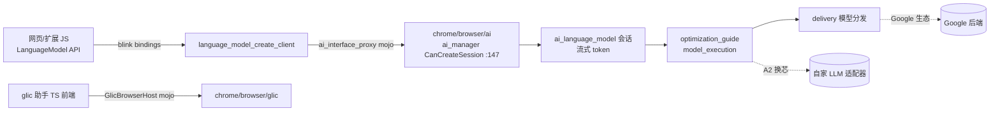

# 12.4 · 内置 AI 深读：chrome/browser/ai 全链与 glic 参考实现

> Chrome 官方"浏览器自带模型"（built-in AI / Prompt API）的完整实现链拆解：网页 JS 怎么调到模型、能力协商怎么做、模型从哪来——以及自产品如何在这条链上换后端。与 12.1（全景）分工：本篇是 A/A2 路线的逐层深读。

## ① 角色定位

内置 AI 是三层结构：**blink 侧 API 面**（`third_party/blink/renderer/modules/ai/`，.idl 定义的 JS 类）→ **browser 侧管理**（`chrome/browser/ai/`，会话/权限/配额）→ **模型底座**（`components/optimization_guide/`，分发+推理）。glic（`chrome/browser/glic/`+`resources/glic/`）则是"浏览器自家 AI 助手"的产品级参考（不暴露给网页，只给自家 UI）。

## ② 定制切入点全景表

| 想干什么 | 动哪里 | 难度 | 影响面 |
|---|---|---|---|
| 看懂 JS API 面 | `third_party/blink/renderer/modules/ai/language_model.cc`+`language_model.idl`（Prompt API）、`decision_model.idl`（Decision API）、`ai_writing_assistance_*`（写作辅助家族） | 只读 | 全部对外 API |
| 能力协商逻辑 | `chrome/browser/ai/ai_manager.h:147-165 CanCreateSession` 双入口：按 `optimization_guide::mojom::OnDeviceFeature` 枚举或 `use_case_string`；`CanCreateSessionWithConfig` 带配置变体 | 改逻辑 | API 可用性判定 |
| 会话实现 | `ai_language_model.cc`（1186 行：会话生命周期/克隆/流式 token） | 改逻辑 | 推理会话 |
| per-profile 服务挂载 | `ai_data_keyed_service_factory`（11.1 的 KeyedService 范式） | 改配置 | 多 profile 隔离 |
| 上下文绑定 | `ai_context_bound_object(_set)`（页面对象与会话的绑定） | 改逻辑 | 长会话 |
| 模型分发 | `components/optimization_guide/core/delivery/`（模型下载/加密/清单） | 动架构 | 模型从哪来 |
| 推理执行 | `optimization_guide/core/inference/`+`model_execution/`（on-device 执行器） | 动架构 | 模型怎么跑 |
| 特性注册 | `optimization_guide/core/feature_registry/`（哪些 feature 走模型） | 改配置 | 能力面 |
| 换自家模型后端 | 在 inference/model_execution 层接自家执行器（断开 Google 分发） | 动架构 | A2 路线主工程 |
| glic 式自家助手 | 抄 `chrome/browser/glic/`（actor/android/browser_ui/common 分层）+`resources/glic/`（TS 前端+`glic_api/` 的 `GlicBrowserHost` mojo 接口） | 改逻辑+前端 | 产品级 AI 助手 |
| glic 对扩展暴露 | `resources/glic/extension/`（扩展消费面） | 参考 | 生态扩展 |
| 权限/策略门 | ai_manager 内 policy 判定+扩展权限白名单（8.x 呼应） | 改配置 | 企业管控 |

## ③ 关键源码走读：一次 `LanguageModel.create()` 的旅程

**第一站：JS 面（blink）。** `modules/ai/language_model_create_client.cc`（v8 绑定可见）发起创建请求，经 `ai_interface_proxy`（blink→browser 的 mojo 桥）进入 browser 侧——**API 形态是 Web 标准（.idl），但实现完全是 Chromium 内部管道**。

**第二站：能力协商（browser）。** `ai_manager.h:147-165` 的 `CanCreateSession` 群是闸门：先问 optimization_guide"这个 feature（OnDeviceFeature 枚举）有没有可用模型"，再叠加权限/配额/策略判定（`FinishCanCreateSession` :232 收口）。**定制产品的第一手感：这里决定"你的浏览器支不支持 AI"**。

**第三站：会话与执行。** 通过后建 `AiLanguageModel` 会话（`ai_language_model.cc`，1186 行）：初始 prompt/克隆/流式 token 输出，推理委托给 optimization_guide 的 model_execution；`ai_context_bound_object_set` 把会话绑到页面对象实现上下文延续。

**第四站：模型从哪来。** `optimization_guide/core/delivery/` 负责"设备上没有模型"的世界：模型清单（Google 服务下发）→按需下载→校验装载。**这就是 A2 路线（换自家后端）的断接点**：delivery 协议是 Google 私有生态，自产品要么在 inference 层换成自家执行器、要么整体用自家 LLM 服务替代这条链（12.1 §4 组合拳）。

## ④ 实操：两条改造路线的最小切口

**路线一（调门槛）**：产品想放宽/收紧 API 可用性——改 `ai_manager.cc` 的 CanCreateSession 判定链（叠加自家策略），不动会话与推理。

**路线二（换心脏）**：保留 blink API 面+会话管理，把 `model_execution` 层的执行器换成"调自家 LLM 服务"的适配器（HTTP/SSE 转流式 token 回 `ai_language_model` 的输出通道）。**收益：网页侧 `LanguageModel` API 全兼容、底层已是自家模型**——这是"自制 AI 浏览器"里最优雅的一条（比 12.1 的 D 路线 UI 面板更底层）。工作量集中在适配器+权限模型重定义（原 API 假设端侧免费，云侧要计费/限流）。

## ⑤ 依赖与数据流

## ⑥ 坑与勘误

- **这套 API 是实验性 flag 门控的**（origin trial/permission policy 双层），自产品全量放开要同时动 flag 默认值+权限策略（about_flags 与 blink 侧 runtime feature，两处）。
- `ai_manager.cc` 2125 行里大量 policy/quota 分支——改判定顺序比删分支安全（配额逻辑互相咬合）。
- **optimization_guide 的 delivery 协议是私有的**：别试图伪造模型清单服务器，工程上比换执行器贵得多。
- glic 的 `glic_api/` 是接口文档+TS 定义形态（`.md` 里 interface 定义）——它的 mojo 面稳定度低于 blink idl，抄结构可以、抄接口要防跟版。
- 会话 token 流是 mojo data pipe，**不是 WebSocket**——网页侧感知不到传输层，但自建适配器时要按 pipe 语义（背压/顺序）设计。
- Android 侧有 `glic/android` 分层差异；blink modules/ai 在 Android 的可用面可能与桌面不同（5.2 双平台核对）。

## ⑦ 验证方法

- 官方调试页：chrome://ai-internals 一带（12.1 §7 同款）看会话/token 流/模型状态
- API 烟测：console 里 `LanguageModel.availability()` → create → prompt 全链
- 换芯后回归：`third_party/blink/renderer/modules/ai/*_test.cc`（仓内测试基线）
- 断链验证：net-export 确认无 optimization_guide 相关 Google 域请求（3.3 §7 同款）

## ⑧ 延伸

- 全景与选型：12.1；UI 面板路线：4.1/4.2/4.3；内容获取：7.2；扩展消费面：8.x
- 图谱层位：chrome 外壳层 ai 子图+blink modules/ai；`components/optimization_guide/` 的 features.gni 是开关总表
