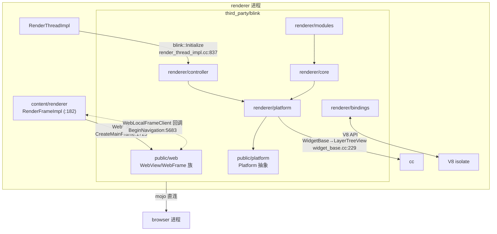

# 13.1 Blink 总览：目录解剖与 renderer 进程内的引擎定位

> 源码 src@8fe2331 行号实证（2026-10 快照）。7.1 把 blink 当渲染管线"起点"一笔带过，本篇下钻内核：目录分层、public 出口面、content 与 blink 的咬合、改引擎的合法切入点。

## ① 角色定位

Blink 在 `third_party/blink`，浏览器引擎本体：HTML/DOM/CSS/布局/绘制/V8 绑定全在此（仅 `renderer/core` 就 60+ 子目录）。图谱位置：`content-child` 层的"内核芯"——向下交绘制产物给 `cc-compositor`（7.1 的 PaintArtifact→cc Layer 树），横向经 bindings 挂 V8，向上只经 `public/` 暴露给 content。一句话：**`public/` 是唯一对外面孔，`renderer/` 内四层分工，content 永远隔着 public 用 blink**。顶层 README 钦定四目录：`common/`（两进程共用）、`public/`（主要消费者是 content）、`renderer/`（绝大部分代码）、`web_tests/`。2.1 讲过"造浏览器改 Content API 不改 blink"；本篇补另一面——钩子不够用必须动引擎时，哪里能碰哪里是雷区。



## ② 四层解剖与 public 出口面

### renderer/ 四层（+两个特殊层）

依赖单向链（renderer/README.md 钉死）：`public/web → controller → extensions → modules(+bindings/modules) → core(+bindings/core) → platform → public/platform → public/common → //base/V8`。写 patch 先问"改动在哪层、允许依赖谁"，反向依赖 DEPS 拒收。下表及③表路径均相对 `third_party/blink/renderer/`。

| 层 | 职责 | 判据（README 原意） | 代表内容 |
|---|---|---|---|
| `core/` | 标准核心：DOM/CSS/HTML/Layout/Paint | 与 HTML/CSS/DOM 强耦合；README 自认"单一巨石" | `core/{dom,css,html,layout,paint}`；public/web 实现类在此（`core/frame/web_local_frame_impl.cc`、`core/exported/`） |
| `modules/` | 按功能聚合的标准特性 | 自包含、数十到数百文件、DEPS 显式声明依赖 | `modules/{media,service_worker,indexeddb,…}` 100+ 模块；实现在 `modules/exported/` |
| `platform/` | 无 DOM 依赖的地基 | core 依赖它，它不依赖 core/modules | `platform/wtf`、`heap`（Oilpan）、`scheduler`、`fonts`+`text`、`graphics`、`widget`（包 cc）、`loader` |
| `controller/` | 驱动 blink 的系统设施 | 仅为驱动 Web 平台或服务 embedder | `blink_initializer.cc`（引擎入口）、`dev_tools_frontend_impl.cc`、`memory_usage_monitor.cc`、`oom_intervention_impl.cc`；可不经 Web* 类型直用 core/modules 类 |

特殊层：`bindings/`（V8 绑定，按 V8 API 使用浓度划分，`bindings/core` 与 `core` 同链接单元）；`extensions/`（**embedder 私有、非 web-exposed API 钦定落点**，13.4 展开）。

### public/ 出口面地图

public/README.md 原文："**does not support binary compatibility**…likely to evolve in **source-incompatible ways**"——public 不是稳定承诺，是绝缘层。stable/unstable 线索实证两处：①梯度——`public/common` 最稳（browser 进程也用且**禁依赖其它 blink 头**），`public/platform`/`public/web` 随 blink 演化；②web 特性稳定度在 `runtime_enabled_features.json5:37-40` 的 `status: ["stable","experimental","test"]`。**目录层面没有 stable/unstable 之分**。

| 出口 | 一句话 | 关键类（行号） |
|---|---|---|
| WebView | 页面顶层视图（≈tab 内容区） | `WebView`（web_view.h:84） |
| WebViewClient | blink→embedder 页面级回调 | web_view_client.h:38 |
| WebFrame | frame 树基类；token 反查 | web_frame.h:66、`FromFrameToken`（:83） |
| WebLocalFrame | 本进程可执行 JS 的 frame；主帧工厂 | web_local_frame.h:141、`CreateMainFrame`（:149） |
| WebRemoteFrame | 跨进程 frame 占位（OOPIF 对端） | `WebRemoteFrame::Create`（render_frame_impl.cc:4489 调用） |
| WebNavigationControl | WebLocalFrame 的导航控制扩展——**content 驱动导航的把手** | web_navigation_control.h:30 |
| WebLocalFrameClient | **blink→content 回流主通道**，909 行纯虚接口 | `BeginNavigation`（:356）、`DidCommitNavigation`（:399） |
| WebFrameWidget | frame 的输入/合成窗口，桥 cc | `InitializeCompositing`（web_frame_widget_impl.cc:2725） |
| Platform | blink 看到的"操作系统"抽象 | `Platform::InitializeMainThread`（blink_initializer.cc:192） |
| WebString | WTF↔STL 边界转换 | web_string.h:83 |

## ③ 定制切入点全景表

| 想改什么 | 动哪里 | 难度 | 影响面 |
|---|---|---|---|
| 加私有 runtime flag / 翻默认值（fork 优先） | `platform/runtime_enabled_features.override.json5`（头注释明言"for downstream forks"，与主 json5 解耦零冲突） | 改配置 | 特性开关面 |
| 临时开/关特性（不重编） | `--enable-blink-features=X`（content_switches.cc:299），RenderThreadImpl 在 blink 初始化前注入（render_thread_impl.cc:830-836） | 改配置 | 零代码验证 |
| 改页面默认观感（UA 样式表） | `core/html/resources/html.css`（:57-59 `body { margin: 8px }`） | 改配置 | 全页面渲染基线 |
| 加私有 CSS 属性 | `core/css/css_properties.json5`（首属性 :951）+解析器+StyleBuilder | 改逻辑 | CSS 子系统（13.x 专篇） |
| 改标准默认行为 | `SpecMapping.md` 反查（spec→类/文件，如 browsing context→`core/frame/local_frame.h`） | 改逻辑 | 依特性 |
| 加非 web-exposed 私有 API | `extensions/`（README 钦定） | 改逻辑 | 嵌入层私有 |
| 加 web-exposed 新 API | `core/`/`modules/`+IDL+`bindings/` 生成（13.4 铺垫） | 动架构 | 全 web 平台 |
| 观测内核事件 | `core/probe/core_probes.pidl`（:54 `interface CoreProbes`；改 pidl 自动重生成探针，:32-33 注释） | 改逻辑 | devtools/遥测面 |
| 性能插桩 | `TRACE_EVENT`+`platform/instrumentation/tracing` | 改逻辑 | chrome://tracing |
| 内存诊断与干预 | `platform/instrumentation/memory_pressure_listener.cc`、`controller/{memory_usage_monitor,oom_intervention_impl}.cc` | 改逻辑 | 渲染稳定性 |
| blink 构建裁剪 | `modules/BUILD.gn`+`modules.gni`（模块自包含可裁）；core 按 `blink_core_sources_*` 分组（core/BUILD.gn:268-279） | 改配置 | 体积/编译时长 |
| 平台适配（字体/线程/事件） | `platform/fonts`、`public/platform`（Platform 接口——blink 对 OS 的全部认知） | 动架构 | 移植层 |
| 调度策略 | `platform/scheduler`（blink 任务全经它排队） | 改逻辑 | 全渲染时序 |
| 自定义合成咬合 | `platform/widget/widget_base.cc:229`（`layer_tree_view_ = make_unique<LayerTreeView>(...)`，blink 侧包 cc 的把手） | 动架构 | cc 交界/上屏 |
| fork 长期维护策略 | 改动收敛在 `extensions/`+`override.json5`+content 钩子；core/modules 私改逐条评估 upstream | 策略 | 升级成本（见⑥） |

## ④ 关键源码走读：RenderFrameImpl 与 blink 的生死绑定

**引擎拉起（进程级一次）**：`RenderThreadImpl` 先调 embedder 钩子 `SetRuntimeFeaturesDefaultsBeforeBlinkInitialization()`（2.1 的 ContentRendererClient 面），再命令行覆写默认值，最后 `blink::Initialize(...)`（render_thread_impl.cc:837）。实现于 `controller/blink_initializer.cc:188`：`Platform::InitializeMainThread`（:192）把 content 的 Platform 实装进 blink，随后初始化 V8 isolate、EndOfTaskRunner、ArrayBuffer partition、内存监视器。

**帧级绑定（每 frame 一次）**：browser 发来 CreateLocalMainFrame 后，`RenderFrameImpl::CreateMainFrame`（render_frame_impl.cc:1706）三步咬合：

1. **建 WebLocalFrame**：`WebLocalFrame::CreateMainFrame(web_view, render_frame, render_frame->blink_interface_registry_.get(), ...)`（:1725）——第二参数把 RenderFrameImpl 自己当 `WebLocalFrameClient*` 递进去（render_frame_impl.h:189），第三是 `blink_interface_registry_`（h:1315），blink 内 mojo 直连 browser 的接口注册器（README 原文"Blink can use Mojo and directly talk to the browser process"——**不是所有通信都绕 content**）。
2. **建 WebFrameWidget 接合成**：`InitializeFrameWidget`（:1744）、`InitializeCompositing`（:1762，实现 web_frame_widget_impl.cc:2725）沿 platform/widget 落到 `WidgetBase` 的 `LayerTreeView`（widget_base.cc:229）——7.1 管线 blink→cc 的握手点；`ApplyVisualProperties`（:1778）注入首帧尺寸。
3. **登记全局映射**：`g_frame_map`（:330-331）emplace（:3587-3588），此后 `FromWebFrame`（:2019）可从任意 WebFrame 反查 content 对象。

RenderFrameImpl 常年持有的 blink 对象：`raw_ptr<blink::WebNavigationControl> frame_`（render_frame_impl.h:1201，WebLocalFrame 的导航控制子接口）、`GetWebView()`（h:352）共享的 `blink::WebView*`、局部根的 `WebFrameWidget*`。

**双向边界挂点**（各三处实证）：

- **content→blink**：`WebLocalFrame::CreateMainFrame`（:1725 建帧）；`frame_->CommitNavigation(...)`（:3121/:3342/:5992/:6946，browser 确认的导航灌进引擎）；`GetWebFrame()->TextSelectionChanged(...)`（:2493，选区推回引擎）。
- **blink→content**：`BeginNavigation`（实现 :5683，声明 web_local_frame_client.h:356——页面任何 `<a>`/`location.href` 的起点，content 收到后 IPC 请示 browser）；`DidCommitNavigation`（:4033，引擎提交文档瞬间回流，:4043-4046 从 `frame_->GetDocumentLoader()` 摘 DocumentState/NavigationState——blink 对象上挂着 content 的状态袋）；`CreateChildFrame`（:3800，DOM 冒出 `<iframe>` 时引擎同步要新帧，:3824 `GenerateFrameRoutingID` 向 browser 预约 routing id）。跨进程侧另有 `WebRemoteFrame::Create`（:4489，frame 被 swap-out 变 remote 代理）。

环：CreateMainFrame（browser 令）→ BeginNavigation（blink 请示）→ CommitNavigation（content 令）→ DidCommitNavigation（blink 回执）→……→ SwapOut 时 WebRemoteFrame 顶替。**每次导航都是一次双向握手**，此环即 2.3 导航生命周期的 renderer 内幕。

## ⑤ 实操：最小 patch 示例

**示例 1：fork 加默认开启的私有特性开关**（零 upstream 冲突）。`platform/runtime_enabled_features.override.json5` 头注释（:3-9）即官方示范，追加：

```json5
{
  name: "MyVendorFeature",
  status: "stable",
}
```

代码里判 `RuntimeEnabledFeatures::MyVendorFeatureEnabled()`（类由 json5 生成，文档 platform/RuntimeEnabledFeatures.md）；`--enable-blink-features=MyVendorFeature` 可无重编验证。用 override 不改主 json5 的理由：主文件 1365 条目上游每周在动（首条目 :242），override 上游承诺不碰——fork 维护第一原则。

**示例 2：改 UA 默认样式**。`core/html/resources/html.css:57` 的 `body { display:block; margin:8px; }` 改 `margin: 0`，重编后 `document.body.style.margin` 仍为空但计算样式变 0——UA 样式表是级联中 author 之前的一层。**样式默认值在 html.css，行为默认值按 SpecMapping.md 反查**。

## ⑥ 坑与勘误

- **fork 维护成本实话实说**（源码实证）：blink 周级合入上游，`WebLocalFrameClient` 909 行、`render_frame_impl.cc` 7341 行都是高频战场。core/ 深处撒私改=每次拉上游手工 rebase。减伤：优先 extensions/+override.json5+content 钩子。
- **public/web 无 stable/unstable 目录**（文档对比）：public/README 只承诺"绝缘不承诺兼容"；别当长期稳定 ABI——真正稳的只有 public/common（禁依赖其它 blink 头）与 mojom。稳定度只有 runtime flag 的 status 三档（json5:37-40）。
- **WTF 与 base 边界是硬纪律**（源码实证）：renderer/README 禁成员变量用 STL 容器/`GURL`/`url::Origin`——用 `blink::String`/`KURL`/`SecurityOrigin`；clang 插件机器强制。从 chrome/content 移代码进 blink 必踩。
- **线程模型禁共享内存**（源码实证）：跨线程只许 message passing，历史 UAF 事故主源。fork 想拿锁同步 blink 对象——红线。
- **controller/README 示例已旧**（源码实证）：还写着 "Native Class"（NaCl 时代）、"RenderProcess/RenderThread"（今属 content）；且 controller 可不经 Web* 类型直用 core/modules 类——看到裸用 `LocalFrame` 不是破坏分层。blink 文档永远以源码+DEPS 为准。
- **WebLocalFrameImpl 不在 core/exported**（勘误）：public/web 实现类分居 `core/frame/web_local_frame_impl.cc`（frame 族）与 `core/exported/`（无 modules 依赖的实现）；modules 的在 `modules/exported/`。

## ⑦ 验证方法

- **runtime flag**：`out/Default/chrome --enable-blink-features=X` 启动验行为；改 override.json5 后重编受影响目标（生成代码在 out/gen，gn 自动跟踪 json5）。
- **UA 样式**：DevTools 勾 "Show user agent styles"，或 `getComputedStyle(document.body).margin` 一行即证。
- **单测**：`autoninja -C out/Default blink_unittests && out/Default/blink_unittests --gtest_filter=...`（目标见 platform/BUILD.gn:3142）；CSS/probe 改动跑 `third_party/blink/tools/run_web_tests.py`。
- **probe/TRACE**：`chrome://tracing` 抓 trace，自定义 TRACE_EVENT 直接出现在时间线。
- **行号复核**：`grep -n "void RenderFrameImpl::DidCommitNavigation" content/renderer/render_frame_impl.cc` 应回 4033——本文行号同法可验。

## ⑧ 延伸

- 一期衔接：`custom-dev/7.1-rendering-pipeline.md`（全管线）、`custom-dev/2.1-content-api-clients.md`（ContentRendererClient——`SetRuntimeFeaturesDefaultsBeforeBlinkInitialization` 即其接口面成员）、`custom-dev/2.3-navigation-lifecycle.md`（④的握手环是其 renderer 内幕）。
- 后续 13.x：CSS 属性添加、DOM/事件定制、导航参数注入、13.4 新 API（extensions/ 全流程）。
- 一手材料：`renderer/SpecMapping.md`、`platform/RuntimeEnabledFeatures.md`、`core/{dom,css,layout,paint}/README.md`、`platform/graphics/compositing/README.md`；renderer/README 首链 "How Blink works" 与 core/README 的 "Life of a Pixel"。
- 图谱：src/.understand-anything/knowledge-graph.json 按 filePath 前缀 `third_party/blink/renderer/` 过滤取内核子图；`explain/` 下 cc/viz 三篇与本篇互补。
