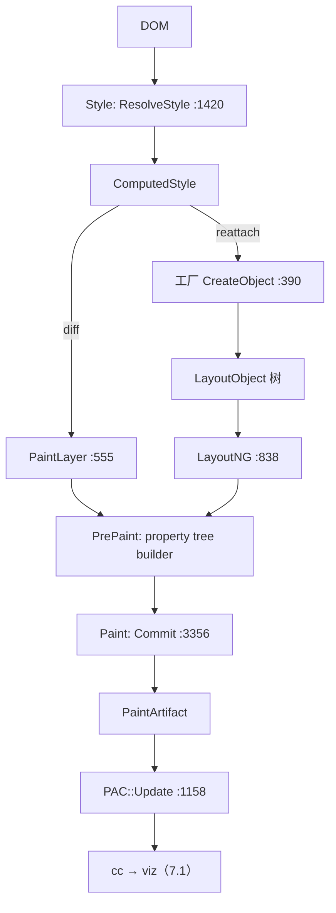

# 13.2 DOM 到像素：Node→LayoutObject→PaintLayer→PaintArtifact 数据流（blink 内部）

## ① 角色定位

本篇 zoom 进 13.1 四层地图中 core+platform 的渲染主线：**DOM→ComputedStyle→LayoutObject 树→PaintLayer/属性树→PaintArtifact→cc LayerTree**。驱动器 `DocumentLifecycle`（`core/dom/document_lifecycle.h:49`）把一帧拆成 Style→Layout→CompositingInputs→PrePaint→Paint。下游唯一出口 `PaintArtifactCompositor::Update`（`platform/graphics/compositing/paint_artifact_compositor.cc:1158`）翻译成 cc 层树，之后交 7.1。四类定制（观感/布局行为/像素/合成开销）分落 css、layout_object 工厂、paint、property tree 四个子系统。7.2 只借道 DOM 面，不碰本篇 layout/paint 段。

## ② 定制切入点全景表

省略路径前缀 `third_party/blink/renderer/`。

| 想改 X | 动哪里 | 难度 | 影响面 |
|---|---|---|---|
| 改 UA 默认观感 | `core/html/resources/html.css:57`；打包 `blink_resources.grd:12` | 改配置 | 全页面基线 |
| 产品级注入 UA 样式 | `LayoutTheme::ExtraDefaultStyleSheet`（`core/layout/layout_theme.cc:345`），拼接 `css_default_style_sheets.cc:120` | 改逻辑 | 平台可分叉 |
| 注入作者级样式 | `StyleEngine::CreateInspectorStyleSheet`（`core/css/style_engine.cc:363`） | 改逻辑 | 动态失效 |
| 自定义伪类/懒加载 UA 规则 | `EnsureDefaultStyleSheetsForElement`（`css_default_style_sheets.h:59`）+`:329` | 改逻辑 | 首遇才解析 |
| 布局行为分支 | 覆写 `Element::CreateLayoutObject`（`element.cc:4291`）；不渲染分支 `Element::LayoutObjectIsNeeded`（`element.cc:4282`） | 改逻辑 | 布局全变/子树不渲染 |
| 强制重排观测 | `Document::UpdateStyleAndLayout`（`document.cc:3174`）+`WillStartForcedLayout`（`:3190`） | 改配置 | 纯埋点 |
| lifecycle 挂点 | observers（`local_frame_view.cc:2466`/:2497）；循环 `:2542` | 改逻辑 | 每帧开销 |
| 绘制阶段拦截 | `PaintLayerPainter::Paint`（`paint_layer_painter.cc:288`）；提交 `local_frame_view.cc:3356` | 改逻辑 | 像素级 |
| paint property 干预 | `paint_property_tree_builder.cc:747`/:926 | 动架构 | 漏 dirty 则 cc 不更新 |
| 合成层提升策略 | `CompositingReasonFinder`（`core/paint/compositing/compositing_reason_finder.h:21`） | 动架构 | 层数/GPU/滚动 |
| composited scrolling | 节点收集+同步（`local_frame_view.cc:3463`、`paint_artifact_compositor.cc:1150`） | 动架构 | 滚动线程化 |
| 无障碍树同步 | `node.cc:1913`/:1930；`CommitAXUpdates`（`local_frame_view.cc:3185`） | 改逻辑 | 读屏/自动化 |
| 打印与屏显分叉 | `UpdateLifecyclePhasesForPrinting`（`local_frame_view.cc:2263`）；paint 早退 `:3092` | 改逻辑 | 打印独立 canvas |
| PaintLayer 生成条件 | `LayerTypeRequired`（`layout_box.cc:555`） | 动架构 | stacking |

## ③ 关键源码走读：lifecycle 一轮

**状态机与驱动**：`document_lifecycle.h:49` 定义单向推进的各 Clean 状态。每帧入口 `UpdateAllLifecyclePhases`（`local_frame_view.cc:2195`）→`UpdateLifecyclePhasesInternal`（`:2542`）——**while 循环**：post-layout 步骤可弄脏 style/layout 逼整轮重跑，一帧多次 layout 由此而来。

**Style（DOM→ComputedStyle）**：`Document::UpdateStyleAndLayoutTree`（`document.cc:2673`）→`StyleEngine::UpdateStyleAndLayoutTree`（`style_engine.cc:4281`）→`Element::RecalcStyle`（`element.cc:5325`）→`StyleResolver::ResolveStyle`（`core/css/resolver/style_resolver.cc:1420`）。级联顺序在 `MatchAllRules`（`:1321`）：**UA（`:1200`）→user→presentational→author**，按 origin 分桶。新旧 diff 决定 reattach 还是仅 repaint。

**LayoutTree rebuild**：`StyleEngine::RebuildLayoutTree`（`style_engine.cc:4228`）→`Element::AttachLayoutTree`（`element.cc:4810`）→`CreateLayoutObject`（`core/dom/layout_tree_builder.cc:108`）：查 `LayoutObjectIsNeeded`（`:127`）后进工厂 `LayoutObject::CreateObject`（`layout_object.cc:390`）按 `style.Display()` switch（`:427`）实例化对应布局类，none/contents 返 nullptr。**PaintLayer 同期诞生**：`StyleDidChange`（`layout_box_model_object.cc:148`）→`LayerTypeRequired`（`layout_box.cc:555`）：stacked→`kNormalPaintLayer`、hidden overflow→`kOverflowClipPaintLayer`、overscroll→`kForcedPaintLayer`，否则无层。

**Layout**：`PerformLayout`（`local_frame_view.cc:743`）推 `kInPerformLayout` 后整树 `LayoutView::LayoutRoot`（`layout_view.cc:838`，LayoutNG 产出 fragment 树）或逐子树根增量。

**PrePaint（属性树+失效）**：`PrePaintTreeWalk::WalkTree`（`core/paint/pre_paint_tree_walk.cc:83`）对每个 LayoutObject 跑 property tree builder——transform/clip/effect/scroll 节点在此生成更新（`paint_property_tree_builder.cc:747`），`PaintInvalidator` 同步算 raster invalidation。属性树是 blink 与 cc 共同的几何真值。

**Paint 与交接 cc**：`PaintTree`（`local_frame_view.cc:3272`）→`PaintLayerPainter::Paint`（`paint_layer_painter.cc:288`）按 paint order 写 display item 进 `PaintController`→`CommitNewDisplayItems`（`:3356`）折叠成 **PaintArtifact**。`PushPaintArtifactToCompositor`（`:3394`）先 `TryFastPathUpdate`（`:3429`），否则调 `PaintArtifactCompositor::Update`（`paint_artifact_compositor.cc:1158`）合成 cc 层树——blink→cc 边界，后续 7.1。

## ④ 实操：最小 patch 示例

**示例 1：注入 UA 级默认样式（C++ 注入点，不动资源文件）**——`CSSDefaultStyleSheets` 构造处（`css_default_style_sheets.cc:117` 起）：

```cpp
// css_default_style_sheets.cc:120 构造内，StrCat 尾部加一项：
              LayoutTheme::GetTheme().ExtraDefaultStyleSheet(),
              // ↓ UA 级注入：body 零边距+自定义元素块级
              "body { margin: 0 } mywidget { display: block }"});
```

经 `ParseUASheet`（`:98`）解析一次。轻量等价法是直接改 `html.css:57`（13.1 示例 2），但升级易冲突。要**作者级**注入则仿 `CreateInspectorStyleSheet`（`style_engine.cc:363`）。优先级真相见 §6-3。

**示例 2：布局行为定制——自定义元素强制块级**。覆写虚函数 `CreateLayoutObject`（`element.h:1006`）即绕过工厂 switch（`layout_object.cc:427`）：

```cpp
  LayoutObject* CreateLayoutObject(const ComputedStyle& style) override {
    return MakeGarbageCollected<LayoutBlockFlow>(this);  // 无视 display:inline
  }
```

配套条件分支：`LayoutObjectIsNeeded` 同为虚函数（`element.h:1007`，缺省 `element.cc:4282`），覆写返回 false 则元素连 LayoutObject 都不生成。注意"需要"到"生成"还隔 `layout_tree_builder.cc:127/131` 两道闸：display 变化天然触发 reattach，自定义条件翻转需自行 `SetNeedsReattachLayoutTree`。

## ⑤ 依赖与数据流



契约：DOM/样式是可变状态（标脏-重算），layout/paint 产物是每帧快照；blink 属性树与 cc property tree 两套对象由 PAC 映射同步；关加速合成时不建 PAC（`local_frame_view.cc:3396`）。

## ⑥ 坑与勘误

1. **强制同步布局=rAF 杀手**（源码实证）：JS 读 `offsetHeight` 同步触发 `UpdateStyleAndLayout`（`document.cc:3174`），读写交替即 layout thrashing；一帧内 while 循环（`:2542`）可重跑多轮。
2. **改 UA sheet 不触发失效**（源码实证）：UA sheet 进程级解析一次并故意泄漏（`css_default_style_sheets.cc:104`），改动只对新 renderer 生效；换 author 样式走 `UpdateActiveStyleSheets`（`style_engine.cc:672`）。
3. **UA !important 博弈**（源码实证）：级联里 author-important 赢 UA-important；media controls/VTT 等必胜 UA 规则靠**独立 RuleSetGroup 二次匹配+后注册覆盖**绕过 specificity（`style_resolver.cc:1268`、`css_default_style_sheets.cc:430`）。定制注入别指望 !important 包打天下。
4. **property 改了 cc 不动**（源码实证）：手改 paint property 没置 dirty 位 → `TryFastPathUpdate`（`local_frame_view.cc:3429`）判无变化直接 return。
5. **目录勘误**：`layout_tree_builder.cc` 在 core/dom 不在 core/layout；`PaintArtifactCompositor` 在 platform/graphics/compositing 不在 core/paint。core 不反向依赖 modules（13.1 纪律）。
6. **打印分叉**（源码实证）：`UpdateLifecyclePhasesForPrinting`（`local_frame_view.cc:2263`）只推到 `kPrePaintClean`，paint 遇 printing 直接 return（`:3092`）——打印像素由 `core/page/print_context.cc` 另行驱动。
7. **生命周期只进不退**：弄脏只能经 `EnsureStateAtMost(kVisualUpdatePending)` 回退（`local_frame_view.cc:2383`）；paint 后 ResizeObserver 回调可跑脚本（`:2678`）致整帧重来。

## ⑦ 验证方法

- UA 注入：控制台 `getComputedStyle(document.body).margin` 应为注入值；author 样式对照验证 origin 覆盖。
- 布局定制：DevTools Computed 面板；`chrome://tracing` 抓 `blink,benchmark` 看 `performLayout`/`LayoutTree:layout_snapshot`。
- 属性树：`ShowAllPropertyTrees`（`pre_paint_tree_walk.cc:117`，VLOG(1)）；合成交接看 DevTools Layers。
- 回归：`content_unittests --gtest_filter=*Layout*`；UA 改动跑 webtests 的 `css/css-cascade`、`fast/layout`、`printing`。

## ⑧ 延伸

- 本系列：`7.1`（cc→viz）、`7.2`（DOM 抽取面）、`13.1`（四层地图）、`13.3`（新标签联动）。
- 图谱：`src/.understand-anything/knowledge-graph.json` 按 filePath 前缀过滤 `core/layout/`、`core/paint/`、`core/css/`。
- explain：`../explain/cc-layer-tree-impl.md`、`viz-root-frame-sink.md`、`render-process-host.md`；一手注释 `document_lifecycle.h`/`paint_artifact.h`。
