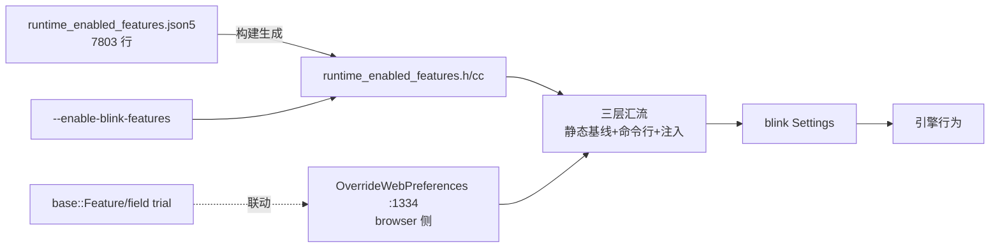

# 13.3 · Web 标准行为定制：runtime features 体系与引擎开关面

> 自制浏览器最锋利的差异化武器：**改变 Web 平台本身的行为**——默认开启实验特性、永久关闭追踪类 API、添加私有 CSS/JS 能力。Blink 用一套三层开关体系管理这一切，本篇给全地图。这是一期 41 篇未覆盖、二期开篇的核心定制面。

## ① 角色定位

Blink 的特性开关三层：**RuntimeEnabledFeatures**（`third_party/blink/renderer/platform/runtime_enabled_features.json5`，**7803 行**——按官方文档，这是 Blink Launch Process 的强制要求：新 Web 特性必须先挂 flag）→ **Settings/WebPreferences**（每页签粒度的引擎设置，browser 侧经 `ContentBrowserClient::OverrideWebPreferences`（content_browser_client.h:1334/1344，参数 `blink::web_pref::WebPreferences`）注入）→ **base::Feature**（Chromium 全局实验框架，与 blink 层经 field trial 联动）。

## ② 定制切入点全景表

| 想干什么 | 动哪里 | 难度 | 影响面 |
|---|---|---|---|
| 默认开实验特性 | json5 条目 status 改 `stable`（或 browser 侧按 profile 强制 enable） | 改配置 | Web 平台面 |
| 永久关特性（追踪/隐私类） | json5 删/降 status +browser 侧覆写关闭（比 about:flags 硬） | 改配置 | 隐私产品核心 |
| 加私有 CSS/JS 特性 | 新 json5 条目+blink 实现（13.2/13.4 铺垫实现位） | 动架构 | 自家 Web 平台 |
| 平台差异默认 | json5 的 status 字典（官方支持 per-platform：`{"android":"stable","default":"experimental"}` 形态，md 文档实证） | 改配置 | 分平台行为 |
| 命令行临时开关 | `--enable-blink-features=Xxx / --disable-blink-features=Xxx`（RuntimeEnabledFeatures 生成类的开关面） | 改配置 | 调试/灰度 |
| 实验全家桶 | `--enable-experimental-web-platform-features`（=about:flags 的开关，四 channel 通用，md 文档实证） | 改配置 | 开发者版形态 |
| per-profile 引擎设置 | OverrideWebPreferences（:1334，WebPreferences 结构体直改每 frame 的 Settings） | 改逻辑 | 企业/身份差异 |
| about:flags 入口 | chrome 层 flag 注册（about_flags.cc 一带）映射到上述开关 | 改配置 | 用户可见面 |
| 非暴露型内部开关 | status 缺省条目（md 表格第 4 列：非 Web 暴露、仅命令行/内部信号触发） | 只读 | 引擎内部行为 |
| web test 特性面 | status=`test`（content_shell+--run-web-tests 才开，md 表格实证） | 只读 | 测试基建 |
| 特性发布流程合规 | Blink Launch Process（flag→Intent to Ship→stable，md 文档）——fork 维护要懂上游节奏 | 流程 | rebase 策略 |
| 兼容性风险回滚 | flag_guarding_guidelines（docs/flag_guarding_guidelines.md，官方指针） | 流程 | 风险控制 |

## ③ 关键源码走读：一个特性开关的一生

**第一站：声明即生成。** json5 按字母序声明（官方模板：`{ name: "AmazingNewFeature", status: "experimental" }`+规范链接注释），构建期生成 `runtime_enabled_features.h/cc` 静态类——**改 json5 重编即得 setter/getter，无需手写胶水**。

**第二站：status 四态矩阵**（RuntimeEnabledFeatures.md 官方表格）：`stable`（全开，无限期承诺）/`experimental`（web test+实验 flag 开）/`test`（仅 web tests）/缺省（默认全关，仅命令行）。**发行版改默认行为的正道=改 status**（而非运行时 hack）。

**第三站：三层汇流。** 页面创建时：json5 生成的静态基线 → 命令行开关叠加 → OverrideWebPreferences（browser 按页注入：WebPreferences 里既有 runtime flags 覆写也有 Settings 级设置如字体/脚本开关）→ 最终 Settings 进 blink。**定制产品的推荐姿势：json5 改基线（全局）+OverrideWebPreferences 做精细面（per-profile/策略联动）**。

## ④ 实操：「隐私优先浏览器」的平台面收紧

目标：默认关 FLoC/Topics/追踪嗅探类 API，默认开隐私友好实验（如 storage partitioning）。
1. grep json5 找目标特性条目（7803 行内按名搜）；
2. 追踪类改 status 缺省或删（激进）——保守派用 OverrideWebPreferences 强制 disable（可随政策回摆）；
3. 隐私特性改 `stable`；
4. about:flags 加自定义聚合开关（产品卖点："隐私模式"一键=一组 feature 覆写）；
5. web test 基线回归（`--run-web-tests` 确认没把正常页面搞坏）。

## ⑤ 依赖与数据流

## ⑥ 坑与勘误

- **改 status=对 Web 兼容性的公开承诺变化**：experimental→stable 意味着"无限期支持"（官方语义）——自家产品无所谓，但想回馈上游时这是评审焦点。
- 运行时覆写（OverrideWebPreferences）与 json5 基线**不是覆盖关系是叠加**——基线 stable 的特性关不掉的部分要实测（个别特性只认静态值）。
- json5 按字母序维护+注释带规范链接是上游硬规矩——fork 随意插入会在 rebase 时哭（保持上游格式纪律）。
- `--enable-blink-features` 的名字是**特性名首字母大写驼峰**（json5 name 原样），不是 flag 惯用 kebab-case——新手最常踩。
- 双体系并存：部分能力在 base::Feature（Chromium 层）不在 blink runtime feature——搜不到时换个体系搜（about:flags 的条目注册处能看出归属）。
- WebPreferences 是 per-RenderView 粒度刷新（导航/设置变化时机）——动态改设置的生效时机有延迟，产品文案别承诺"即时"。

## ⑦ 验证方法

- 目标特性自测页：特性存在性探测（`'xxx' in window`/CSS supports）三态对比（默认/命令行/注入）
- --enable-blink-features=Xxx 单特性冒烟（最快回归通道）
- web tests：`--run-web-tests` 跑受影响目录基线（官方回归面）
- about:flags 开关↔实际行为对账（注册表遗漏=开关失灵静默）

## ⑧ 延伸

- 特性实现位：13.2（DOM/渲染）+13.4（绑定加 API）+13.5（脚本注入）；设置注入钩子：2.1（OverrideWebPreferences 契约位）；AI 特性面：12.4（modules/ai 也是 feature 门控的实例）
- 官方文档：third_party/blink/renderer/platform/RuntimeEnabledFeatures.md（本篇一手来源）+docs/flag_guarding_guidelines.md
- 图谱层位：blink platform 层 feature 子图
