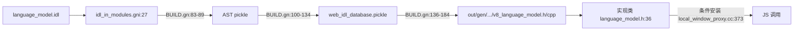

# 13.4 · V8↔Blink 绑定层：bindings 管线与 WebIDL 声明式 API 路线

> 约定：路径未注明者相对 `third_party/blink/renderer/`；`language_model.*`=`modules/ai/language_model.{idl,h,cc}`；`BUILD.gn`=`bindings/BUILD.gn`。

## ① 角色定位

Blink 所有对 JS 可见的 API不靠手写 V8 胶水，而是构建期管线产物：`.idl` → Web IDL 数据库 → 生成器 → `V8Xxx.h/cpp` 桥类 → 链上手写实现类 → 运行时装进全局。管线代码全在 `bindings/`——16 层图谱渲染栈（L3）内 Blink↔V8 对象模型边界（引擎侧另一桥是 L15 gin）。

本篇是"加标准形态 API"的**正规军路线**，产物与原生 Web API 同构。三路线分工：**本篇**（标准形态）；**14.2**（注入式 bridge）；**8.3**（扩展 webidl→json_schema_compiler）。活样本=12.4 的 `language_model.idl`。

## ② 定制切入点全景表

| 想改 X | 动哪里（带行号） | 难度 | 影响面 |
|---|---|---|---|
| 新接口 | 模板 `language_model.idl:21-26`+实现类 `language_model.h:36-39`+清单（末行） | 改逻辑 | 新全局对象 |
| Window/Navigator 加成员 | partial：`modules/device_orientation/window_device_orientation.idl:6-11`；方法版 `modules/webshare/navigator_share.idl:7` | 改逻辑 | 现有对象新成员 |
| 新事件 onXxx | `EventHandler oncontextoverflow`（`language_model.idl:154-155`）→ `DEFINE_ATTRIBUTE_EVENT_LISTENER`（`language_model.h:64`）；partial 用 STATIC 版（同目录 `dom_window_device_orientation.h:19-22`） | 改逻辑 | 事件面 |
| 新 HTML 元素 | 硬路线 `core/html/html_tag_names.json5`+子类；软路线 custom elements（`core/frame/window.idl:45`）零 C++ | 动架构/改配置 | DOM 工厂 |
| partial 扩展现有接口 | 静态工具类（`dom_window_device_orientation.h:19`）或 Supplement（`modules/webshare/navigator_share.h:18-21`） | 改逻辑 | 组合扩展 |
| 命名空间 API | `core/css/css.idl:30-34` `[ImplementedAs=DOMWindowCSS] namespace CSS` | 改逻辑 | 无构造器对象 |
| 回调 JS→C++ | function：`core/dom/mutation_observer.idl:33-34`；interface：`core/dom/node_filter.idl:25` | 改逻辑 | C++→JS 调用 |
| 枚举 | `modules/ai/availability.idl:9`→生成 `V8Availability`（`language_model.h:69` 消费） | 改配置 | 受校验字符串 |
| dictionary 选项 | `modules/ai/language_model_create_options.idl`+占位 .h:9-12 | 改配置 | 参数对象 |
| [Exposed] 作用域 | `language_model.idl:22`；语义 `web_idl/exposure.py:23-40` | 改配置 | 全局可见域 |
| [RuntimeEnabled] 门控 | `language_model.idl:23`/:47；flag 见 13.3（`runtime_enabled_features.json5:455`） | 改配置 | 灰度开关 |
| [ImplementedAs] 改名 | `window.idl:33`（Window→DOMWindow）、`document.idl:37`（URL→urlForBinding）；规则 `blink_v8_bridge.py:20-38` | 改配置 | IDL↔C++ 名解耦 |
| union/typedef | 生成 `v8_union_*.h`（`language_model.h:24` 消费）；映射 `union_name_map.conf:5-9` | 改配置 | 三层类型桥 |
| 加 .idl（共同前置） | `bindings/idl_in_modules.gni:10` 清单加行（照 :24-29） | 改配置 | 不加=静默不编译 |


## ③ 关键源码走读：IDL→C++→JS 全管线



**① 声明**：`language_model.idl:21-26` 标准头：`[Exposed(Window AIPromptAPI, Worker ...)]`+`[RuntimeEnabled=AIPromptAPI]`+`[SecureContext]`。"全局名+feature"写法（`exposure.py:23-40`）：feature 自动识别 origin-trial/context-dependent，走条件安装通道。

**② 收集+数据库**：新 .idl 必须进 `idl_in_modules.gni:10`。`BUILD.gn:21-46` `collect_idl_files` 模板把 .idl 解析成 AST 按组件分组 pickle（`web_idl/README.md:54-72`）；`web_idl_database` 目标（BUILD.gn:100-134）把 `runtime_enabled_features.json5` 喂进编译器（:44-46）——flag 文件是 IDL 编译输入，引用错即报；多阶段 IR 编译（`web_idl/README.md:120-155`：partial 的 `[RuntimeEnabled]` 先传播到成员再并入主接口），pickle=全仓 IDL 唯一事实源。

**③ 生成**：`generate_bindings` 模板（BUILD.gn:136-184）按类型拆 11 个并行 action；dispatch 入口 `generate_bindings.py:95-107`。每接口产桥类 `V8LanguageModel`（命名 `blink_v8_bridge.py:68`）落 `out/gen/.../modules/v8/`，登记 `generated_in_modules.gni:721+`，`bindings/core/v8/BUILD.gn:15-24` 挂编译。签名映射：`CallWith=ScriptState`→首参 `ScriptState*`；`RaisesException`→尾参 `ExceptionState&`；属性→getter（`language_model.h:102`）。EventHandler 特判（`interface.py:2445-2470`）：setter 生成 `JSEventHandler::CreateOrNull` 再调 setOnXxx。

**④ 安装点**：context 创建时 `LocalWindowProxy::Initialize` 调 `InstallConditionalFeatures()`（`bindings/core/v8/local_window_proxy.cc:311`，:373-405）→ `isolate->InstallConditionalFeatures(context)`（:401）——经 `platform/bindings/wrapper_type_info.h:168-178` 函数指针调生成的 `InstallContextDependentProperties`，按当前 context flag 状态装/跳 gated 成员与接口对象；origin trial 令牌后到同路重装（`ForceReinstallConditionalFeaturesForWindow` :150-160）。**闭环**：JS `LanguageModel.create({...})`→`V8LanguageModel` 回调解参→`LanguageModel::create(...)`（`language_model.cc:497`，见 12.4）。

## ④ 实操：给 Window 加 myFeature（四步全行号）

目标：`window.myFeature`+`window.onmyevent`，门控 `MyFeature`。

**Step 1 声明**——新建 `modules/myfeature/window_myfeature.idl`（模板 `window_device_orientation.idl:6-11`）：

```webidl
[
    ImplementedAs=DOMWindowMyFeature,
    RuntimeEnabled=MyFeature
] partial interface Window {
    [SecureContext] attribute DOMString myFeature;
    [SecureContext] attribute EventHandler onmyevent;
};
```

**Step 2 实现**——新建 `modules/myfeature/dom_window_myfeature.h`（模板 `modules/device_orientation/dom_window_device_orientation.h:19-22`）：

```cpp
class DOMWindowMyFeature {
 public:
  static String myFeature(DOMWindow&);   // partial 成员=带 receiver 的静态函数
  static void setMyFeature(DOMWindow&, const String&);
  DEFINE_STATIC_ATTRIBUTE_EVENT_LISTENER(myevent, kMyevent)  // 事件零手写
};
```

partial 成员按"静态函数+receiver 首参"生成调用（`interface.py:2454-2460`）；非事件属性挂 `Supplement<DOMWindow>` 自管存储（模板 `modules/webshare/navigator_share.h:18-21`）。`BUILD.gn` 照 `modules/ai/BUILD.gn:7`（:28 列源文件）写 `blink_modules_sources("myfeature")`。

**Step 3 注册清单**——`bindings/idl_in_modules.gni:10` 列表加一行该 .idl。漏掉=静默忽略，无报错。

**Step 4 门控（13.3 联动）**——`platform/runtime_enabled_features.json5` 加 `name: "MyFeature", status: "experimental"`（见 13.3 ③）。partial 上的 `[RuntimeEnabled]` 由编译阶段自动传播到每成员（`web_idl/README.md:137-150`）。

## ⑤ 依赖与数据流

输入：gni 清单 `*.idl`+`runtime_enabled_features.json5`（BUILD.gn:113）+`union_name_map.conf`（:153）。输出：pickle→各组件 `out/gen/.../v8/V8*`→编入 blink。运行时反向：V8→`WrapperTypeInfo` 函数表→生成代码→实现类；Promise 靠 `ScriptPromiseResolver`（`language_model.cc:512`）。flag 文件双消费：IDL 编译器与运行时 `RuntimeEnabledFeatures`（13.3）。

## ⑥ 坑与勘误

1. **老文档过时**：`IDLCompiler.md:9` 自认 obsolete；idl_compiler.py/Jinja/每文件一编译架构已被 pickle 数据库+bind_gen 取代（scripts/ 目录清单实证）。**`IDLExtendedAttributes.txt` 也不存在了**：注解权威源=`scripts/validator/rules/supported_extended_attributes.py`（`IDLExtendedAttributes.md:9` 明示）。
2. **生成物勿手改**：`v8_*` 在 out/gen，ninja 重跑即覆盖。
3. **同名 .h 期望**：每个 dictionary .idl 需同名 .h，纯生成 dictionary 放占位头（`language_model_create_options.h:9-12`）。
4. **[Exposed] 缺失=静默不可见**：不写则不装到任何全局且无报错；作用域名不受白名单校验，拼错同样安静。
5. **大小写/[ImplementedAs]**：成员 `URL`→`urlForBinding`（`document.idl:37`）；类名保 spec 原拼写（:31-38）。
6. **Exposed(Window Feature) 与 [RuntimeEnabled] 双轨**：`language_model.idl:22-23` 同时用——前者管"哪个全局+哪个 flag 曝光"，后者管整体存在性（可叠 origin trial）。
7. **origin trial 实证**：`AIPromptAPIParams`（`runtime_enabled_features.json5:494-505`）对应 `language_model.idl:144` 成员级门控——token 注入后 `samplingMode` 才出现（local_window_proxy.cc:401 重装）。
8. **扩展 webidl≠blink webidl**：8.3 的 `.webidl` 走 json_schema_compiler 挂 `chrome.*`；同语法两套目标别混。
9. **partial 成员是静态函数非虚函数**：写成 virtual 与生成调用约定不匹配（`interface.py:2454-2460`）。

## ⑦ 验证方法

- `autoninja -C out/Default web_idl_database`（`web_idl/README.md:24`）秒级反馈 IDL 语法/flag 引用错。
- pickle 反射：`PYTHONPATH=third_party/blink/renderer/bindings/scripts python3` 读 pickle 遍历 `database.interfaces`（`web_idl/README.md:29-52`）。
- 生成物核对：`ls out/Default/gen/.../bindings/modules/v8/ | grep myfeature`；再跑 `check_generated_file_list validate_web_idl`（BUILD.gn:294/:464）。
- 运行时：`--enable-blink-features=MyFeature`（13.3）；DevTools `'myFeature' in window`。

## ⑧ 延伸

交叉篇：**12.4**（mojo 会话后半程）、**13.3**（flag 体系，Step 4 枢纽）、**14.2**（注入式对比+三路线总表）、**8.3**（扩展 webidl 差异）、13.1/13.2。讲透Chromium 资产：`onboarding/ONBOARDING.md`、`repo-docs/src`、`docs-online/`。仓内文档：`scripts/web_idl/README.md`、`scripts/bind_gen/README.md`、`IDLExtendedAttributes.md`。
