# 13.5 脚本注入与内容干预：ScriptController/ExecuteJavaScript/isolated world 全景

> 上游：13.1/13.2（blink 与文档生命周期）、14.1（V8 isolate/context/world 模型）。姊妹：7.2（内容抽取单发注入）、12.3（AI 面板消费端）、14.2（API 注入 vs 脚本注入）、8.1/8.3（扩展体系）。

## 1. 角色定位

把 JS"打进"页面，是 embedder 对已加载内容做干预的通用杠杆：AI 助手取正文、划词翻译、阅读模式、用户脚本（油猴类）、企业合规改写，全是同一机制的不同包装。代码横跨三层：**browser 侧** `render_frame_host.h` 的 ExecuteJavaScript 家族，经 mojo（`blink.mojom.LocalFrame`）进 renderer；**renderer 侧**两条入口——mojo 落地 `LocalFrameMojoHandler`（`local_frame_mojo_handler.cc:873/969`）与进程内 WebLayer（`WebLocalFrame::ExecuteScriptInIsolatedWorld`，`web_local_frame.h:404`）；**执行核心**在 blink：`LocalFrame::RequestExecuteScript`（`local_frame.cc:3385`）→ `PausableScriptExecutor` → `ClassicScript` → `V8ScriptRunner`。隔离与安全由 `DOMWrapperWorld`（14.1）承担：world 决定脚本跑在哪个 v8 context、持什么 SecurityOrigin、受不受页面 CSP；时机由 13.2 的文档生命周期决定（document start/end/idle）。勘误先行：标题里的 `ScriptController::ExecuteScriptInWorld` 在当前源码已**不存在**（坑节），`ScriptController` 现只管 `javascript:` URL（`:224`）与 world 级 eval 禁用（`:142`）。

## 2. 定制切入点全景表

| 想改 X | 动哪里（file:line） | 难度 | 影响面 |
|---|---|---|---|
| 单发抽取页面数据（AI 内容获取） | `content/public/browser/render_frame_host.h:624` `ExecuteJavaScriptInIsolatedWorld` + `WebContentsObserver::DOMContentLoaded` 时机；样板 `chrome/browser/glic/host/context/glic_page_features_manager.cc:112` | 改配置 | 目标页主文档，只读无痕 |
| 自建 isolated world 编号 | 仿 `chrome/common/chrome_isolated_world_ids.h:14-30` 自定义 enum（从 `content::ISOLATED_WORLD_ID_CONTENT_END` 后排） | 改配置 | 全产品 world 空间 |
| 给 world 设独立 origin/CSP/名字 | `blink::SetIsolatedWorldInfo`（`third_party/blink/public/platform/web_isolated_world_info.h:62`；样板 `components/translate/content/renderer/isolated_world_util.cc:17`） | 改逻辑 | 该 world 内 XHR 归属、eval 门控 |
| document-start 抢跑注入 | override `ContentRendererClient::RunScriptsAtDocumentStart`（`content/public/renderer/content_renderer_client.h:351`） | 改逻辑 | 每个新文档最早窗口 |
| document-end/idle 注入 | 同上 `:355`/`:359`（end=DOMContentLoaded，idle=min(DCL+timeout, onload)） | 改逻辑 | 页面可见后补注入 |
| 长效用户脚本引擎（油猴类） | 仿 `extensions/renderer/script_injection.cc:271` `InjectJs` + `extensions/renderer/user_script_injector.cc` | 动架构 | 全帧全文档持续生效 |
| GM.\* 原生桥 | `RenderFrameObserver::DidCreateScriptContext`（`content/public/renderer/render_frame_observer.h:139`，触发源 `local_window_proxy.cc:308`）+ gin（组合见 14.2） | 改逻辑 | 每个 world context 创建时 |
| iframe 递归注入 | 仿 `ScriptInjectionManager::OnRenderFrameCreated`（`extensions/renderer/script_injection_manager.cc:262`，每帧挂 RenderFrameObserver `:142`） | 改逻辑 | 全帧树含动态 iframe |
| URL 匹配规则引擎 | 复用 `extensions/common/url_pattern.h`（match pattern 语义）或自写 glob | 改配置 | 脚本命中集 |
| 脚本清单热更新 | 仿 `UserScriptInjector::OnUserScriptsUpdated`（`extensions/renderer/user_script_injector.cc:139`，置空旧指针）+ 自建 mojo set 通知 | 改逻辑 | 免重启换脚本 |
| 主世界注入（与页面同 JS 环境） | `web_local_frame.h:395` `ExecuteScript`（impl `web_local_frame_impl.cc:1066`）或扩展 `ExecutionWorld::kMain` 分支（`script_injection.cc:350`） | 改逻辑 | 页面可感知/可篡改，高风险 |
| 注入对 BFCache 的影响 | `BackForwardCacheAware` 取值：kPossiblyDisallow 注册 sticky `kInjectedJavascript`（`local_frame.cc:3411-3415`）禁 BFCache；kAllow 不禁 | 设计 | 内存占用 vs 回退体验 |
| 注入耗时度量 | 仿 `ScriptInjection::OnJsInjectionCompleted` 的 UMA（`script_injection.cc:373` 起） | 改配置 | 性能预算可视化 |
| 注入异常回收 | callback 收空 `base::Value`（context 销毁，`pausable_script_executor.cc:313-321`）；结果类型 kException/kAborted/kNotRun（`local_frame_mojo_handler.cc:946-960`） | 设计 | 页面零连带损伤 |
| DevTools 注入归因 | `script_injector_id` 参数 + `ScriptInitiationMonitor`（`third_party/blink/renderer/core/ad_tracker/script_initiation_monitor.cc`） | 改逻辑 | 调试/反滥用可观测 |

## 3. 关键源码走读

### 3.1 注入通道矩阵（核心交付）

| 通道 | 层 | API（file:line） | world | 时机 | 形态 | 适用 |
|---|---|---|---|---|---|---|
| A1 单发·主世界 | browser | `ExecuteJavaScript`（`render_frame_host.h:618`，impl `render_frame_host_impl.cc:3866`） | main | 已 commit 任意时刻 | 单发异步 | **仅** chrome://、devtools://、WebUI 进程、about:blank（`CanExecuteJavaScript`，`render_frame_host_impl.cc:14265`，否则 CHECK 崩） |
| A2 单发·隔离 | browser | `ExecuteJavaScriptInIsolatedWorld`（`render_frame_host.h:624`，impl `:3877`） | isolated 1..11 | 同上 | 单发异步+回调 | 任意 https 页面取数据/干预（7.2、12.x 主通道） |
| A3 方法调用 | browser | `ExecuteJavaScriptMethod`（`render_frame_host.h:611`） | main | 同上 | 单发免编译 | WebUI 反复调用同一函数省 eval 成本 |
| A4 测试通道 | browser | `ExecuteJavaScriptForTests`/`WithUserGestureForTests`（`:632`/`:641`） | 任意（含 0=main） | 同上 | 单发 | 仅测试：绕过 A1 限制、可伪造用户激活、可等 promise |
| B1 WebLayer·隔离 | renderer | `WebLocalFrame::ExecuteScriptInIsolatedWorld`（`web_local_frame.h:404`，impl `web_local_frame_impl.cc:1072`） | isolated (0,2²⁹) | 进程内任意点 | 单发同步 | translate 样板（`translate_agent.cc:393`）；不受 11 上限 |
| B2 WebLayer·隔离取值 | renderer | `ExecuteScriptInIsolatedWorldAndReturnValue`（`web_local_frame.h:411`，impl `:1096`） | 同上 | 同上 | 单发同步返 v8::Value | renderer 内同步判定（`translate_agent.cc:406`） |
| B3 WebLayer·主世界 | renderer | `ExecuteScript`（`web_local_frame.h:395`，impl `web_local_frame_impl.cc:1066`） | main | 同上 | 单发同步 | 主世界注入唯一"干净"API |
| C1 通用执行器 | renderer | `WebLocalFrameImpl::RequestExecuteScript`（`web_local_frame_impl.cc:1202`）→`LocalFrame::RequestExecuteScript`（`local_frame.cc:3385`） | main 或 isolated | 同步/异步可选 | 单发+回调+可等 promise+可激活用户手势 | 用户脚本/content script 统一走这条（`script_injection.cc:371`） |
| D1 时机钩子 | content | `RunScriptsAtDocumentStart/End/Idle`（`content_renderer_client.h:351/355/359`） | 由注入方定 | 三档生命周期 | 长效 | embedder 抢跑挂点 |
| E1 context 挂点 | blink→content | `DidCreateScriptContext`（`web_local_frame_client.h:678`，源 `local_window_proxy.cc:308`） | 每 world | context 创建时 | 桥接 | GM.\*/API 注入点（14.2 组合） |
| F1 长效·官方 | extensions | `ScriptInjection::InjectJs`（`script_injection.cc:271`）+`ScriptInjectionManager`（`:262`） | isolated（每扩展一个）/userScript/main | RunLocation 三档（`run_location.mojom:11`） | 长效 | content script 引擎完整参考实现 |

### 3.2 主线：一次 ExecuteJavaScriptInIsolatedWorld 的跨进程旅程

1. **browser 发起**：UI 线程 `RenderFrameHostImpl::ExecuteJavaScriptInIsolatedWorld`（`render_frame_host_impl.cc:3877`）——`CHECK_GT(world_id, ISOLATED_WORLD_ID_GLOBAL)`、`CHECK_LE(world_id, ISOLATED_WORLD_ID_MAX)`（常量在 `content/public/common/isolated_world_ids.h:17/22`：0 是主世界，embedder 自定义池仅 1..11），`AssertFrameWasCommitted()` 保证有已提交文档，随后 `GetAssociatedLocalFrame()->JavaScriptExecuteRequestInIsolatedWorld(...)` 发关联 mojo 消息（接口定义 `third_party/blink/public/mojom/frame/frame.mojom:1069`；`wants_result=false` 时回传 null 避免序列化大结果）。
2. **renderer 落地**：`LocalFrameMojoHandler::JavaScriptExecuteRequestInIsolatedWorld`（`local_frame_mojo_handler.cc:969`）在 IPC 端点二次校验 world id（越界 `mojo::ReportBadMessage` 杀掉恶意/走样消息），转 `frame_->RequestExecuteScript(world_id, ...)`，参数定型：`kDoNotActivate`（不伪造用户激活）、`EvaluationTiming::kSynchronous`、`kDoNotBlock`、`BackForwardCacheAware::kAllow`（不牺牲 BFCache）、`WantResultOption::kWantResultDateAndRegExpAllowed`、`kDoNotWait`（不等 promise）。
3. **world 定位**：`LocalFrame::RequestExecuteScript`（`local_frame.cc:3385`）——world id≠0 则 `DOMWrapperWorld::EnsureIsolatedWorld(isolate, world_id)`（`local_frame.cc:3404`；实现 `dom_wrapper_world.cc:95`，同 id 幂等返回同一 world 对象），并给隔离 world 定策略 `kExecuteScriptWhenScriptsDisabled`（`:3408`）——**页面 JS 被禁/沙箱 iframe 禁脚本时照样执行**（主世界分支则受 content settings 约束）。`ToScriptState(frame, world)`（`v8_binding_for_core.cc:787/693`）经 `WindowProxyManager::GetWindowProxy`（`window_proxy_manager.h:51`）惰性创建该 (frame, world) 的 v8 context。
4. **执行**：`PausableScriptExecutor::CreateAndRun`（`local_frame.cc:3448`；`pausable_script_executor.cc:259`）按 timing 分派——kSynchronous 直接 `Run()`（`:326`，若 context 已被 debugger 冻结则转投递任务）；kAsynchronous `RunAsync()` 投任务。真正执行在 `WebScriptExecutor::Execute`（`:144`）：`ClassicScript::CreateUnspecifiedScript(source, SanitizeScriptErrors::kDoNotSanitize)` → `RunScriptOnScriptStateAndReturnValue(script_state, policy)`（`classic_script.cc:215`）→ `V8ScriptRunner::CompileAndRunScript`（policy 枚举 `v8_script_runner.h:48`）。浏览器注入的脚本由 embedder 编译，不走页面脚本 eval 路径，这是 CSP 豁免的实现层根源。
5. **结果与回调**：`ExecuteAndDestroySelf`（`pausable_script_executor.cc:350`）在 `ScriptState::Scope` 内执行，异常不外泄（"An error event in an isolated world will never be dispatched to a foreign world"，`:147`）；脚本可能删帧（`render_frame_impl.cc:4274` "Do not use \|this\|"），context 失效时 `ContextDestroyed`（`:286`）仍以空值触发回调，结果经 mojo 逆行回 browser 的 `JavaScriptResultCallback`。

对比：A1 主世界路径**不经过** PausableScriptExecutor——`LocalFrameMojoHandler::JavaScriptExecuteRequest`（`local_frame_mojo_handler.cc:873`）直接 `ClassicScript::RunScriptAndReturnValue(DomWindow())`。

### 3.3 world 体系：编号、隔离、生命周期

- **编号空间**（`dom_wrapper_world.h:56-86`）：主世界 0；embedder isolated world 池 [1, 2²⁹)；之上是 XML tree viewer 与 DevTools 世界（各占 2²⁹）。Chrome 惯例排布见 `chrome_isolated_world_ids.h:14-30`（TRANSLATE=CONTENT_END+1、INDIGO、CHROME_INTERNAL、EXTENSIONS 起点）。content browser 通道只放行 1..11，超过要走 renderer 侧 B/C 通道——扩展正是这么做的（`IsolatedWorldManager::GetOrCreateIsolatedWorldForHost` 从 `GetLowestIsolatedWorldId()` 起单调分配，`isolated_world_manager.cc:131`）。
- **隔离语义**：每个 (frame, world) 一个独立 v8 context——自己的 global、自己的 intrinsic 原型、自己的 DOM wrapper 集（`web_local_frame.h:400-403` 注释）。world 可配专属 SecurityOrigin（`local_window_proxy.cc:297`）与专属 CSP（`IsolatedWorldCSPDelegate`，`isolated_world_csp.cc:32`）；security token 是「页面 origin token+world token」拼接（`local_window_proxy.cc:517-529`），故隔离 world 单向可读页面 DOM、页面反向摸不到你的全局变量。
- **生命周期**：world 对象进程级常驻（`EnsureIsolatedWorld` 同 id 复用；map 只增不减，`isolated_world_manager.cc:150-155` 的 TODO 自认"piles up"）；(frame, world) 的 WindowProxy/ScriptState 随文档走——导航时 `ClearForNavigation`（`window_proxy_manager.cc:28-32`），释放走 `WillReleaseScriptContext`（`web_local_frame_client.h:682`）。所以"同一 world id 跨导航"=同一 world 对象、**全新干净 context**，用户脚本的全局状态会被导航重置。

### 3.4 时机钩子：document start 到底多早

document start 的触发链：HTML parser 插入 `<html>` 元素 → `HTMLHtmlElement::InsertedByParser`（`html_html_element.cc:53`）→ `FrameLoader::RunScriptsAtDocumentElementAvailable`（`frame_loader.cc:1871`；注意 `DispatchDocumentElementAvailable` `:1856` 带 `ScriptForbiddenScope`，观察者通知期禁脚本，Run\* 才是放行点）→ `RenderFrameImpl::RunScriptsAtDocumentElementAvailable`（`render_frame_impl.cc:4268`）→ `ContentRendererClient::RunScriptsAtDocumentStart`。此刻 **DOM 里只有 `<!DOCTYPE html><html>`**：head/body 都不存在、`document.body===null`——document-start 脚本能改 documentElement、注入样式/预取，不能 append 到 body。document end = DOMContentLoaded（`render_frame_impl.cc:4302/4314`）；idle 是 DCL+timeout 与 onload 的较早者（`run_location.mojom:17-20`）。扩展侧等价物：`ExtensionFrameHelper::DidCreateDocumentElement`（`extension_frame_helper.cc:285`）与 ScheduleAtDocumentStart/End/Idle 三组回调（Run* `:296-310`、ScheduleAt* `:315-325`）。

### 3.5 CSP 与豁免边界

三条线：① browser 通道 A1 的 CHECK 闸（WebUI-only）本身就是豁免声明——敢让你注主世界的地方都是特权页。② renderer 执行期：embedder 编译的脚本不是页面 eval，页面 CSP 管不着；但**world 内再 eval**（GM 脚本里 `new Function`）受该 world 的 eval 门控——`local_window_proxy.cc:276-286`：主世界跟页面 CSP；isolated world 仅当配了专属 CSP（`IsolatedWorldCSP::HasContentSecurityPolicy`）才做 eval 检查，**没配就豁免 eval 检查**（源码注释原话）。③ world 专属 CSP 可正向收紧：`SetIsolatedWorldInfo` 设 `content_security_policy`（translate 设空串隔离主世界 CSP，`isolated_world_util.cc:31-36`；userScripts world 支持自定 CSP+可选 messaging，`isolated_world_manager.cc:64-103`）。沙箱另有暗门：禁脚本的沙箱帧里 privileged isolated world 例外放行（`local_dom_window.cc:473` 注释，crbug 811528）。

### 3.6 官方先例速览

**扩展 content script**（长效引擎完整参考）：`ScriptInjectionManager` 给每个新 frame 挂 RenderFrameObserver（`:262`，iframe 递归由此免费获得）→ `ScriptInjection::InjectJs`（`script_injection.cc:271`）：document_start 同步、end/idle 异步防 UI jank（`:294-296`）；world 三选一（`:336-350`）；userScript world 每文档上限 10（`:318`）；`script_injector_id` 归因（`:354-361`）；耗时 UMA 按 RunLocation 分桶（`:373` 起）。**translate**：renderer 侧 B1/B2 通道 + 预先 `EnsureIsolatedWorldInitialized` 配 origin/CSP（`translate_agent.cc:513/393`）。**Glic（Google AI 助手）**：browser 侧 A2 通道轮询页面特征、带重试预算（`glic_page_features_manager.cc:112`）——12.x JS 注入式内容获取直接同款。**dom_distiller**：readability 判定注入（`tab_utils.cc:266`）。

## 4. 实操：用户脚本引擎最小实现

油猴类刚需拆成五件，每件都有官方同型件。设产品名 kylin，新增 `kylin/common/kylin_world_ids.h`（world 枚举，从 `ISOLATED_WORLD_ID_CONTENT_END` 后排，同步改 `isolated_world_ids.h` 的 MAX 注释或直接用 renderer 通道避开 11 上限）。

**(1) world 与元信息（一次性，renderer 启动）**——仿 translate：

```cpp
// kylin/renderer/kylin_world_init.cc
void EnsureKylinWorlds() {
  blink::WebIsolatedWorldInfo info;
  info.security_origin =
      blink::WebSecurityOrigin::Create(GURL("https://kylin.userscripts"));
  info.content_security_policy = blink::WebString("");  // 隔离页面 CSP
  info.human_readable_name = blink::WebString("Kylin UserScripts");
  blink::SetIsolatedWorldInfo(KYLIN_WORLD_ID_USERSCRIPTS, info);  // web_isolated_world_info.h:62
}
```

**(2) 引擎主体（renderer，document-start 抢跑 + 匹配 + 注入）**——自建 `ContentRendererClient::RunScriptsAtDocumentStart`（挂点 `content_renderer_client.h:351`；无 embedder 化则改 `chrome_content_renderer_client.cc` 转发）里为每个 frame 挂 RenderFrameObserver：

```cpp
class KylinUserScriptEngine : public content::RenderFrameObserver {
  void DidCreateNewDocument() { scripts_run_ = false; }    // 每文档重置
  void DidCreateDocumentElement() {                        // document-start 钩子
    if (scripts_run_ || !render_frame()->GetWebFrame()) return;
    auto matched = registry_->Match(                       // URLPattern 匹配
        render_frame()->GetWebFrame()->GetDocument().Url());
    if (matched.empty()) return;
    scripts_run_ = true;
    Vector<blink::WebScriptSource> sources;                // 命中脚本源码
    for (auto* us : matched) sources.emplace_back(blink::WebString::FromUtf8(us->code()));
    render_frame()->GetWebFrame()->RequestExecuteScript(   // C1 通道, web_local_frame_impl.cc:1202
        KYLIN_WORLD_ID_USERSCRIPTS, base::span(sources),
        mojom::blink::UserActivationOption::kDoNotActivate,
        mojom::blink::EvaluationTiming::kSynchronous,      // document-start 同步抢跑
        mojom::blink::LoadEventBlockingOption::kBlock,     // 仿 script_injection.cc:365
        base::BindOnce([](std::optional<base::Value> v, base::TimeTicks) {
          // 回收：v 为空即 context 已死，不重试
        }),
        blink::BackForwardCacheAware::kAllow,
        mojom::blink::WantResultOption::kNoResult,
        mojom::blink::PromiseResultOption::kDoNotWait,
        blink::WebString("kylin-userscripts"));            // script_injector_id 归因
  }
};
```

匹配规则复用 `extensions/common/url_pattern.h` 的 `URLPattern`（@match 语义见 `extensions/common/user_script.cc`）；document-end 脚本再加挂 `RunScriptsAtDocumentEnd`（`content_renderer_client.h:355`）分桶。

**(3) GM.\* 桥**：`DidCreateScriptContext(context, world_id)`（`render_frame_observer.h:139`）过滤 `world_id==KYLIN_WORLD_ID_USERSCRIPTS`，gin `ObjectTemplateBuilder` 钉 `GM_getValue/GM_xmlHttpRequest/GM_setClipboard` 到该 context 的 global——手法与 14.2 完全同型，扩展版参考 `Dispatcher::DidCreateScriptContext`（`dispatcher.cc:403`：ScriptContext→ModuleSystem→native handlers）。GM_xmlHttpRequest 走 browser 侧以 world origin 为 initiator 的独立 URLLoaderFactory（`render_frame_host_impl.cc:3820-3834` 一带）。

**(4) 更新通道**：browser 管理脚本清单（下载/校验/订阅 diff），经自建 mojo 推快照到 renderer，收到后整体置换并 `script_ = nullptr` 仿 `user_script_injector.cc:139`；已在跑的页面不重放，等下次导航生效（与扩展一致，避免重复注入）。

**(5) browser 单发（AI 内容获取）**：复用 7.2 样板（`ExecuteJavaScriptInIsolatedWorld` + 自建 world id），与引擎共用 world 常量头。

## 5. 依赖与数据流

```mermaid
flowchart LR
  subgraph Browser
    FEAT[业务: AI/翻译/用户脚本管理] -->|ExecuteJavaScriptInIsolatedWorld| RFH[RenderFrameHostImpl]
    USM[脚本清单+订阅更新] -->|自建 mojo| RS
  end
  RFH -->|blink.mojom.LocalFrame:1069| HANDLER[LocalFrameMojoHandler:969]
  subgraph Renderer
    CRC[ContentRendererClient::RunScriptsAtDocumentStart] --> ENG[用户脚本引擎: 匹配+分桶]
    ENG & HANDLER -->|RequestExecuteScript| LF[LocalFrame:3385]
    LF -->|EnsureIsolatedWorld| W[DOMWrapperWorld Map 进程级]
    LF --> PSE[PausableScriptExecutor] --> CS[ClassicScript/V8ScriptRunner]
    LWP[LocalWindowProxy 每 frame+world 一个 context] -->|DidCreateScriptContext:308| BR[GM.&#42; gin 桥] -->|mojo| Browser
    CS -->|base::Value 回调| RFH
  end
```



输入：JS 源串（browser：u16string 经 mojo BigString16；renderer：WebScriptSource）、world id、时机枚举。输出：`base::Value`（Date/RegExp 在 A2 放行序列化）、console/UMA/DevTools 归因。契约：world id 稳定性（跨导航同 id=同 world 新 context）、`AssertFrameWasCommitted`（必须已 commit）、回调必达（空值=未跑成）。

## 6. 坑与勘误

1. **勘误：ExecuteJavaScript 家族不在 `web_contents.h`**——已迁至 `render_frame_host.h:611-641`，旧资料常见错误定位（源码实证，grep `web_contents.h` 零命中）。
2. **勘误：`ScriptController::ExecuteScriptInWorld` 已删除**——现 `script_controller.cc` 只剩 `ExecuteJavaScriptURL`（`:224`）、`EvaluateMethodInMainWorld`（`:307`）、world 级 eval 禁用（`:142/151`）；注入执行已重构为 PausableScriptExecutor+ClassicScript（源码实证）。同理 `web_local_frame_impl.cc` 已从 `exported/` 移到 `core/frame/`。
3. **A1 通道在 https 页必崩**：`ExecuteJavaScript` 有 `CHECK(CanExecuteJavaScript())`（`render_frame_host_impl.cc:3869`），普通网页调了直接 crash，不是被拒绝——要主世界单发走 renderer 侧 B3（源码实证）。
4. **world id 双层上限不一致**：browser mojo 通道 CHECK 到 11（`isolated_world_ids.h:22`），blink 层允许到 2²⁹（`dom_wrapper_world.h:58`）；>11 的 world 只能 renderer 侧注入（扩展即如此，`isolated_world_manager.cc:131` 从 EXTENSIONS 起单调分配）（源码实证）。
5. **document start 的"最早"只有 `<html>`**：head/body 均无、`document.body` null；且通知期 `ScriptForbiddenScope` 禁脚本、Run\* 挂点才是合法注入窗（`frame_loader.cc:1856-1873`、`html_html_element.cc:53-64`）（源码实证）。
6. **world 生命周期三层要分清**：world 对象进程常驻只增不减；context 每 (frame,world,document) 一份，导航即重置（`window_proxy_manager.cc:28`）；`EnsureIsolatedWorld` 同 id 复用同一对象（`dom_wrapper_world.cc:95-108`）——跨导航想要持久状态必须自己落到 browser/存储（源码实证）。
7. **主世界注入的站点冲突**：页面可 `delete`/篡改你挂的全局、可用 Object.defineProperty 陷阱反向探测；与页面框架（如 SPA 框架接管 DOM）互相踩踏无任何隔离——能用 isolated world 就别用 main（文档对比：`web_local_frame.h:400-403` 注释 vs 14.2 检测对抗行）。
8. **注入脚本异常别拖垮页面**：异常被 TryCatch 吸收且 error event 不跨 world（`pausable_script_executor.cc:147`）；但你的脚本若同步死循环同样卡死 renderer 主线程——长任务要切 async；脚本可能导航/删帧，执行后一律重验 context（`render_frame_impl.cc:4274` "Do not use \|this\|"）。（源码实证+13.2 联动）
9. **BFCache 代价**：`kPossiblyDisallow` 注册 sticky `kInjectedJavascript` 永久禁该页 BFCache（`local_frame.cc:3411-3415`）；A2 与 translate 选 kAllow——但 kAllow 下页面从 BFCache 恢复时文档未变、Run\* 不触发，你的长效脚本**不会重注入**，需在 BFCache 恢复观察者补注（前半源码实证，后半为推论，需自验）。
10. **扩展叠加**：自家引擎与真实扩展 content script 各占 world 互不干扰；userScript world 每文档 10 个上限（`script_injection.cc:318`）提示多租户脚本要合并 world（源码实证）。
11. **content settings 反直觉**：隔离 world 用 `kExecuteScriptWhenScriptsDisabled`（`local_frame.cc:3405-3408`）——用户"禁用 JavaScript"后你的注入仍跑；企业合规类产品要么接受要么自行判 `WebPreferences`（源码实证）。

## 7. 验证方法

- **单发通道**：`--enable-logging --v=1` 看 `TRACE_EVENT_INSTANT` "JavaScriptExecuteRequestInIsolatedWorld"（`local_frame_mojo_handler.cc:970`）；E2E 用 `ExecuteJavaScriptForTests` 直跑断言。
- **world 正确性**：注入 `location.origin+'|'+typeof GM_info`——隔离 world 应见你设的 origin，页面侧应 `typeof GM_info==='undefined'`；DevTools context 下拉按 `human_readable_name` 列出 isolated world。
- **document-start 抢跑**：注入 `document.readyState+'|'+!!document.body` 应得 `loading|false`；document-end 对照 `interactive|true`。
- **CSP 豁免**：对 `script-src 'none'` 测试页注入应成功；GM 脚本内 `eval('1')` 验证 world CSP 门控。
- **异常回收**：注入 `throw 1` 页面应无 window.onerror 涟漪；注入 `location.href='about:blank'` 后回调仍触发（ContextDestroyed 兜底）。
- **引擎级**：UMA 仿 `Extensions.InjectedScriptExecutionTime`（`script_injection.cc:373` 起）+ 自建 feature flag 灰度。

## 8. 延伸

- 图谱层：L15（blink bindings/world）、L1（content/renderer 观察者）、L0（chrome 外壳消费方）；节点：`ScriptController`、`DOMWrapperWorld`、`PausableScriptExecutor`、`ScriptInjection`、`IsolatedWorldManager`。
- 讲透Chromium：`custom-dev/14.2-custom-js-api.md`（API 注入 vs 脚本注入的互补与同型手法）、`custom-dev/7.2-content-capture.md`（browser 单发抽正文全样板）、`custom-dev/12.3-ai-panel-ui.md`（注入结果的消费端 UI）、`custom-dev/13.2-dom-to-pixels.md`（生命周期时机）、`custom-dev/8.1-extensions-architecture.md`（content script 生态全貌）、`custom-dev/2.3-navigation-lifecycle.md`（commit 语义与 `AssertFrameWasCommitted`）。
- 源码目录：`third_party/blink/renderer/core/frame/`（local_frame/pausable_script_executor）、`third_party/blink/renderer/platform/bindings/`（dom_wrapper_world）、`third_party/blink/renderer/bindings/core/v8/`（local_window_proxy/isolated_world_csp/window_proxy_manager）、`extensions/renderer/`（script_injection\*/isolated_world_manager/dispatcher）、`components/translate/content/renderer/`。
