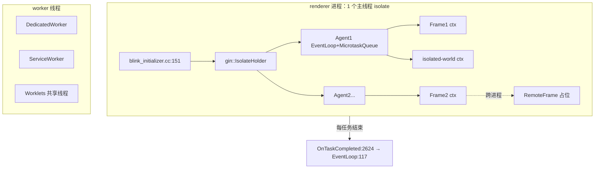

# 14.1 · V8 总览：Isolate/Context/Heap 模型与 Chromium 嵌入形态

> 定制者视角的 V8 入口：三概念在浏览器里的真实拓扑、Chromium 怎么嵌 V8（blink 宿主+gin 胶水）、改 V8 行为的合法通道。编译器内部不在本篇。

## ① 角色定位

V8 对 Chromium 是**嵌入框架**：`v8/include/` 66 个头文件即 embedder API 面，宿主负责 isolate 生命周期、内存供给、context 创建与 GC 集成。两条使用线：**blink 绑定线**（WebIDL 生成的 V8Window 等，跑网页 JS）与 **gin 线**（`gin/` 的 C++ 胶水 converter/wrappable，服务 chrome/renderer 轻量绑定如 loadtimes、WebUI）。关键事实：blink 的 isolate 也经 gin 创建——`V8PerIsolateData` 持有 `gin::IsolateHolder`（v8_per_isolate_data.cc:93），gin 兼管 snapshot 与 `--js-flags`（gin/v8_initializer.cc:274）。上游 13.1 讲 renderer 拉起 blink；本篇钻 V8 实例拓扑与 JS 执行宿主链。下游：14.2（注对象）、14.3（flag）、12.4（modules/ai）。

## ② 定制切入点全景表

| 想改什么 | 动哪里 | 难度 | 影响面 |
|---|---|---|---|
| 加全局 JS 对象（14.2 铺垫） | chrome_render_frame_observer.cc:413 → loadtimes_bindings.cc:128（gin 范本） | 改逻辑 | 全页面/指定 world |
| WebUI/私有协议 bridge | web_ui_extension.cc:92 挂 chrome 对象；分流 render_frame_impl.cc:4939 | 改逻辑 | chrome:// 专属 |
| 传 V8 flag | --js-flags 链：render_process_host_impl.cc:4038 → blink_initializer.cc:151 → gin/v8_initializer.cc:274（细节归 14.3） | 改配置 | 进程级 isolate |
| 堆内存上限 | gin/isolate_holder.cc:194 改 ResourceConstraints（v8-isolate.h:66）；或 --max-old-space-size | 改逻辑 | OOM 边界 |
| context snapshot 定制 | 生成器 tools/v8_context_snapshot/BUILD.gn:56；模式决策 third_party/blink/renderer/bindings/core/v8/v8_initializer.cc:1043 | 动架构 | 冷启动 |
| 预编译脚本缓存 | v8_code_cache.cc + v8_compile_hints_consumer.cc（调用例 v8_script_runner.cc:555） | 改逻辑 | 热站加载 |
| profiler 挂载 | v8-isolate.h:313 code_event_handler（gin/isolate_holder.cc:189 已接）；JS 层 v8-inspector.h | 改逻辑 | 观测开销 |
| 异常钩子 | third_party/blink/renderer/bindings/core/v8/v8_initializer.cc:1099 AddMessageListener；:1115 SetPromiseRejectCallback | 改逻辑 | 错误遥测 |
| 执行拦截/超时熔断 | local_frame.cc:1257 BFC 范本 → local_window_proxy.cc:260 SetAbortScriptExecution | 改逻辑 | 失控 JS 治理 |
| microtask 策略 | event_loop.cc:112 checkpoint；暂停 local_frame.cc:1252；枚举 v8-microtask.h:28 | 改逻辑 | 事件循环 |
| worker 资源隔离 | worker_backing_thread.cc:154 isolate-per-worker 创建点 | 动架构 | 并发内存×隔离 |
| 隔离世界 | isolated_world_manager.cc:131；id 段 dom_wrapper_world.h:54；DevTools 侧 inspector_page_agent.cc:1734 | 改逻辑 | 注入面 |
| per-world 禁 eval/wasm | script_controller.cc:160 → local_window_proxy.cc:283 | 改逻辑 | 安全策略 |
| 版本升级跟随 | v8 是 DEPS 整仓 roll（无 ABI 稳定承诺）：升级=embedder API diff+自家 flag/patch 回归 | 流程 | 升级成本 |

## ③ 关键源码走读

### 3.1 三概念 API 量级

- **Isolate**（v8-isolate.h，1959 行）：:291 注释钉死——"completely separate states. Objects from one isolate must not be used in other isolates"。自带 heap/GC/编译器/默认 microtask 队列，`CreateParams` 携带 constraints/allocator/回调。
- **Context**（v8-context.h，570 行）：:47 "A sandboxed execution context with its own set of built-in objects"——**Realm ≈ v8::Context**（ShadowRealm=新 context 非新 isolate）；global proxy/global object 分离是跨 frame 安全根基（:59）。
- **Handle**（v8-local-handle.h，884 行）：`Local<T>` 仅在 HandleScope 内有效；:114-117 明言 scope 删除后访问=undefined behavior。

### 3.2 浏览器内 V8 实例拓扑（核心交付，源码实证）

| 场景 | Isolate | Context | 证据 |
|---|---|---|---|
| renderer 主线程 | **每 renderer 进程 1 个**，进程内所有 local frame 共享 | — | third_party/blink/renderer/bindings/core/v8/v8_initializer.cc:1072 |
| 同进程 iframe | 共享主 isolate | **每 frame × 每 world 一个** | window_proxy_manager.cc:108；local_window_proxy.cc:350 |
| OOPIF | 本进程仅占位 NewRemoteContext（真身在自家进程） | remote_window_proxy.cc:107-118 |
| 同进程 agent cluster | 同 isolate，**每 Agent 独立 EventLoop+MicrotaskQueue** | window_agent.cc:15 |
| 扩展 content script / DevTools snippet | 同 frame isolate | 追加 isolated world（id 自 ISOLATED_WORLD_ID_EXTENSIONS 起；DevTools 侧自建） | isolated_world_manager.cc:131；inspector_page_agent.cc:1734 |
| Dedicated/Shared/ServiceWorker | **isolate-per-worker** | 每 global scope 一个 | worker_backing_thread.cc:154 |
| Worklet | 每 backing thread 一个 isolate，**多个 worklet 共享线程** | worker_thread.h:83 |
| ShadowRealm | 宿主 isolate | 新 context | third_party/blink/renderer/bindings/core/v8/v8_initializer.cc:1122 |

**开篇三问**：不是每 tab 一个 isolate——**每 renderer 进程**一个（site isolation 决定进程边界）；frame 共享 isolate 但 context 独立（安全边界=Realm+SecurityOrigin+DOMWrapperWorld）；worker 各起 isolate。

### 3.3 走读：一次页面脚本执行的宿主链

**第 0 步（进程级一次）**：blink_initializer.cc:151 `InitializeIsolateHolder(ref_table, --js-flags)` → gin SetFlags+加载 snapshot_blob → 主 isolate 诞生于 `V8PerIsolateData` 构造（v8_per_isolate_data.cc:93；Allocate/Initialize 在 gin/isolate_holder.cc:116/130）。

**第 1 步（每导航）**：文档提交 → `LocalWindowProxy::Initialize`（local_window_proxy.cc:243）→ `CreateContext`（:321）：优先 context snapshot（:336），miss 则 `v8::Context::New(..., DomWindow()->GetMicrotaskQueue())`（:350，传该 frame 所属 Agent 的队列）。就绪后 `DidCreateScriptContext`（:308）→ `RenderFrameImpl`（render_frame_impl.cc:4939，分流 MojoJS 等）→ 观察者（:4988）→ `ChromeRenderFrameObserver`（chrome_render_frame_observer.cc:413）装 `chrome.loadTimes`——**加全局对象的官方挂点**。

**第 2 步（跑 script）**：classic_script.cc:215 → `CompileAndRunScript`（v8_script_runner.cc:571）→ CompileScript（:345，含 code cache）→ RunCompiledScript（:500）：深度闸（:521，上限 44）+ ScriptForbiddenScope（:532）后 `script->Run`（:544）。

**第 3 步（DOM 回调）**：事件派发 → `JSBasedEventListener` 快路径（js_event_listener.cc:84）→ `CallFunction`（v8_script_runner.cc:849）→ `function->Call`（:889）。

**第 4 步（microtask 排水）**：每任务结束 → `OnTaskCompleted`（main_thread_scheduler_impl.cc:2618→:2624）→ `AgentGroupSchedulerImpl`（agent_group_scheduler_impl.cc:108，遍历同 isolate 全部 Agent）→ EventLoop（event_loop.cc:112→:117）；worker 同构（worker_thread.cc:315）。



## ④ 实操：最小 patch 示例

**Patch A：注册私有全局对象（gin 线）**——挂 §3.3 第 1 步观察者：

```cpp
// chrome_render_frame_observer.cc:413，DidCreateScriptContext 尾部追加
// （world_id==0 只进 main world，即 DOMWrapperWorld::kMainWorldId）：
  if (world_id == 0) MyApiBindings::Install(context);
```

实现仿 loadtimes_bindings.cc:128-163：gin::Wrappable + `v8::Function::New` 挂 `window.chrome.myapi`；限定自家域则读 frame SecurityOrigin。完整模板版见 14.2。

**Patch B：每 isolate 堆上限**——gin/isolate_holder.cc:194 `ConfigureDefaults(...)` 后追加：

```cpp
if (physical < 4ull << 30)  // <4GB 设备收紧老生代
  params->constraints.set_max_old_generation_size_in_bytes(1ull << 30);
```

约束：v8-isolate.h:41-48 钉死 heap size 须在 VM 初始化前设、init 后不可调——只能改 CreateParams（--max-old-space-size 是配置级等价物）。

## ⑤ 依赖与数据流

数据流（上=宿主→V8，下=V8→宿主）：blink 绑定线以 per-world DOM wrapper 进 V8；gin 线以 FunctionTemplate 直挂 context；content 经 RenderFrameImpl:4939 的 DidCreateScriptContext 通知两线；进程级输入=--js-flags+snapshot_blob。回流=GC 跨堆标记（Oilpan CppHeap）、异常/PromiseReject 回调、microtask 排水（EventLoop:117）。契约：宿主给 V8 的=CreateParams 四件套（ArrayBuffer allocator、ResourceConstraints、cpp_heap、code_event_handler）；V8 给宿主的=回调面+生命周期契约（Local 随 HandleScope、Persistent 手动）。blink DOM wrapper 由 DOMDataStore per-world 管理、经 EmbedderHeapTracer 与 V8 GC 双向协商——定制最易破坏的就是这条 GC 契约。

## ⑥ 坑与勘误

- **"每 tab 一个 isolate"是错的**：进程粒度而非 tab 粒度；判隔离先画进程边界（--site-per-process 会改答案）。（源码实证）
- **isolate 内存乘数**：每 isolate 独立 heap/内建对象，随 worker 线性涨（worker_backing_thread.cc:154），重 worker 页须限并发。（源码实证+推算）
- **context snapshot 与启动**：快照 miss 回退 Context::New 并 VLOG(1) "created NOT from snapshot"（local_window_proxy.cc:357）；fork 大改 main world 属性可能挤掉快照路径，看 CreateContextTime 直方图（:369）。（源码实证）
- **handle 作用域纪律**：Local 出 HandleScope 即悬挂（v8-local-handle.h:114-117）；跨函数/线程用 Persistent/TracedReference，随机崩溃先查 Local 存成员。（源码实证）
- **v8::Locker 时代已过**：机制仍在（v8-locker.h:25）但 Chromium 全走 kSingleThread（v8_per_isolate_data.cc:93），旧资料"Locker 共享 isolate"是陷阱。（源码实证）
- **microtask 队列 per-Agent 非 per-isolate**（window_agent.cc:15）：直调 isolate 全局通道（event_loop.cc:121）绕过 Agent 边界。（源码实证）
- **--js-flags 进程级**：无法 per-tab 差异（14.3 互证；per-context 走 14.2）。（源码实证）
- **堆上限不可运行期改**（v8-isolate.h:41）：运行期只有 MemoryPressureNotification 类提示（worker_backing_thread.cc:108）。（源码实证）

## ⑦ 验证方法

1. 注入：about:blank 控制台 `Object.keys(chrome)` 见 myapi；`--v=1` 看 "created NOT from snapshot" 判快照路径。
2. 堆上限：`--js-flags=--trace-gc` 看 old space 上限；DevTools Memory 对账；chrome://tracing 勾 memory-infra（gin 每 isolate 出 dump，gin/isolate_holder.cc:135）。
3. 拓扑：DevTools Performance 看 worker 线程数；任务管理器（Shift+Esc）看进程边界；CDP `Page.createIsolatedWorld`（inspector_page_agent.cc:1734）。
4. flag 链：chrome://version 命令行栏确认 --js-flags 进 renderer。
5. 熔断/异常：死循环脚本验证 SetAbortScriptExecution（local_frame.cc:1257）；throw/Promise.reject 打自家上报（:1099/:1115）。

## ⑧ 延伸

本系列：14.2（注对象）、14.3（flag）、13.1（blink 四层）、12.4（modules/ai）、9.1（进程模型=拓扑前置）、8.1（扩展=isolated world 最大用户）。图谱：src/.understand-anything/knowledge-graph.json 的 platform/bindings、core/workers、gin 节点群。讲透资产：onboarding/ONBOARDING.md、explain/ blink 系列、repo-docs/ v8 目录、v8/include/APIDesign.md（embedder 设计一手文档）、js_protocol.pdl（inspector 协议源）。
