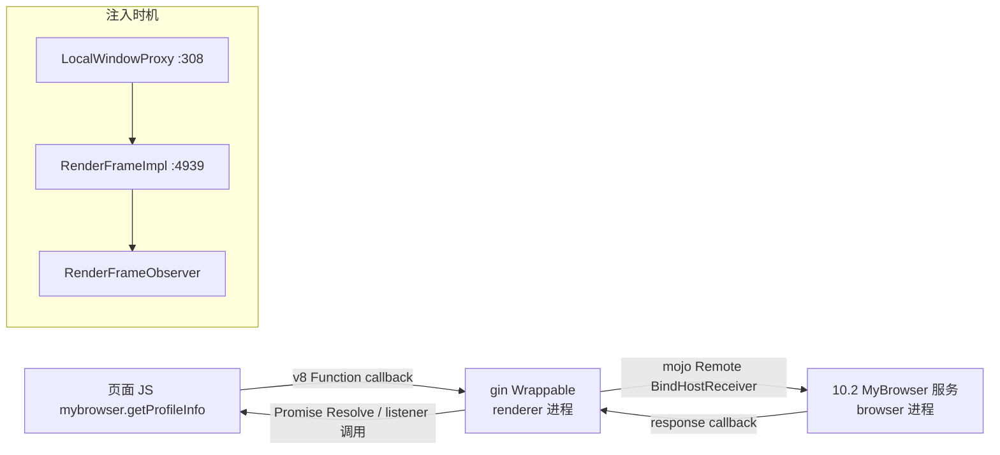

# 14.2 · 向页面注入自定义 JS API：私有全局对象与 bridge 实战

> 上游：14.1（V8 isolate/context/world 模型）、10.2（自建 mojo 服务）。姊妹：13.3/13.4（blink IDL 声明式路线）、8.3（扩展 schema 路线）。

## ① 角色定位

把原生能力暴露成 `mybrowser.foo()` 页面可调的 JS API，本质是在 **context 生命周期的正确挂点上，用 gin/v8 Template 工具把 C++ 对象钉进 global**。图谱位置横跨 L15（gin 胶水）→L1（content/public/renderer 观察者）→chrome 外壳（L0）：blink 每创建一个 world 的 context，经 `LocalWindowProxy`→`LocalFrameClientImpl`→`RenderFrameImpl` 回调链（14.1 已锚），embedder 在链尾挂观察者注入。官方同型先例极多——`chrome.loadTimes`/`chrome.csi`、`domAutomationController`、`chrome.benchmarking`、`chrome.gpuBenchmarking`、WebUI 的 `chrome.send`——全是本篇黄金样板：均 <300 行，均走 gin `Wrappable`+`ObjectTemplateBuilder`（gin/object_template_builder.h:47），均经 mojo 或参数序列化与 browser 通信。注入式定位"轻量、私有、随取随用"；要强类型/大规模/对外发 API 走 13.x IDL 或 8.3 扩展路线（⑤ 对比表）。

## ② 定制切入点全景表

| 想干什么 | 动哪里 | 难度 | 影响面 |
|---|---|---|---|
| 挂私有全局命名空间 `mybrowser.*` | 自建 RenderFrameObserver，注册于 `chrome_content_renderer_client.cc:654`（仿 `ChromeRenderFrameObserver`），在 `DidCreateScriptContext`（`chrome_render_frame_observer.cc:413`）里 `content::GetOrCreateChromeObject`（`content/public/renderer/chrome_object_extensions_utils.cc:13`）后 Set | 改逻辑 | 每个 context（含所有 world） |
| 只挂裸函数 `window.foo()` | `loadtimes_bindings.cc:128` `Install` 模式：`v8::Function::New(context, callback, data)` + `global->Set`（:154-157） | 改逻辑 | 单函数，页面直调 |
| 对象+方法族（Electron 式 API 面） | `gin::Wrappable` 子类 + `GetObjectTemplateBuilder` 链式 `SetMethod`（`gin/object_template_builder.h:67`；样板 `dom_automation_controller.cc:55-60`） | 改逻辑 | 一个 C++ 类=一个命名空间 |
| 属性 getter（值动态、防覆盖） | `SetNativeDataProperty`+空 setter（`loadtimes_bindings.cc:252` 与 :76-81 `EmptySetter`——保持 accessor 态） | 改逻辑 | 页面读到实时值 |
| 事件面 `mybrowser.onX.addListener(cb)` | Wrappable 持 `v8::Global<v8::Function>` 列表，mojo 回调时 `ScriptState::Enter` 后调用（事件回流起点在 10.2 服务的 renderer 端 remote） | 改逻辑 | browser→页面推送通道 |
| Promise 异步桥 | 方法内 `v8::Promise::Resolver`（`v8/include/v8-promise.h:24`），mojo `response_callback` 里 Resolve | 改逻辑 | 长任务不阻塞 JS |
| 同步调 browser 取数 | **不可能**：进程边界无同步 RPC。替代=renderer 缓存+主世界预注，或 browser 提前 push | 设计约束 | 架构决策 |
| 只在私有/扩展 world 注入 | world 判别：`render_frame_impl.cc:4949` `world_id == ISOLATED_WORLD_ID_GLOBAL` 门控样例；建 world 用 `DOMWrapperWorld::EnsureIsolatedWorld`（`third_party/blink/renderer/platform/bindings/dom_wrapper_world.h:125`） | 改逻辑 | 页面脚本不可见 |
| per-origin/per-URL 差异注入 | Install 前查 `render_frame()->GetWebFrame()->GetDocument().Url()`（样例 `chrome_render_frame_observer.cc:404`）或 `GetSecurityOrigin()` | 改逻辑 | 白名单站点专属 API |
| 动态开关（灰度/内部版） | 命令行 switch 门控：`benchmarking_bindings.cc:91-101` `InstallConditionally` 读 `--enable-benchmarking-api` | 改配置 | 一行开关 |
| 版本兼容/弃用计量 | 仿 `UsageCountChromeLoadTimes`（`third_party/blink/public/web/web_local_frame.h:745`；调用于 `loadtimes_bindings.cc:87`）做用量上报再定弃退 | 改逻辑 | 平滑下线 |
| 页面检测对抗（feature 探测可见性） | 主世界注入必然可探测（`typeof mybrowser`）；要不可见→isolated world；要可探测但难伪造→`SetNativeDataProperty` 只读+不可 configurable | 设计 | 反指纹/反滥用 |
| 与 Web 标准 API 命名冲突 | 惯例=收进命名空间对象而非挂 global（chrome.* 即此设计）；裸 global 名撞标准（如 `onscroll`）会被规范演进打脸 | 设计 | 长期兼容 |
| 换挂点：仅主世界注入 | `DidClearWindowObject`（`render_frame_impl.cc:4223`，仅主世界触发）vs `DidCreateScriptContext`（每 world；`local_window_proxy.cc:308` vs :313-315 两条链） | 改逻辑 | 注入时机与范围 |

## ③ 关键源码走读：chrome.loadTimes 先例全解剖

**注册链（谁在何时被调）**：`ChromeContentRendererClient::RenderFrameCreated`（chrome_content_renderer_client.cc:652）`new ChromeRenderFrameObserver`（:654-655，构造即自注册观察者，`OnDestruct` 自 `delete this`）。此后每个 context 创建：`LocalWindowProxy::Initialize` 设完安全 origin/token 即回调 `DidCreateScriptContext(context, world_->GetWorldId())`（local_window_proxy.cc:308）→ `LocalFrameClientImpl::DidCreateScriptContext`（local_frame_client_impl.cc:297）转投 `web_frame_->Client()`（:301）→ `RenderFrameImpl::DidCreateScriptContext`（render_frame_impl.cc:4939）：先做自家特权注入（:4946-4952，`world_id==ISOLATED_WORLD_ID_GLOBAL` 时按 bindings 策略开 MojoJS，WebUI 的 JS 直连 mojo；:4988 遍历观察者）→ `ChromeRenderFrameObserver::DidCreateScriptContext`（chrome_render_frame_observer.cc:413）两行：`BenchmarkingBindings::InstallConditionally`（:416）+ `LoadTimesBindings::Install`（:417）。注意 :417 **无任何 world/origin 过滤**——`chrome.loadTimes` 在所有 world（含扩展 isolated world）都装。

**注入本体（loadtimes_bindings.cc:128-164）**：五步定式——①`HandleScope`+`MicrotasksScope(kDoNotRunMicrotasks)`+`Context::Scope` 三件套（:133-141，防注入触发页面微任务）；②`cppgc::MakeGarbageCollected` 建 C++ 宿主、`GetWrapper` 取 gin wrapper（:143-148，Oilpan 管生命周期）；③`GetOrCreateChromeObject` 取/建 `chrome` 命名空间（:150-151——页面可能已自造 `chrome` 变量，工具函数做"是对象则复用"兜底，chrome_object_extensions_utils.cc:27-35）；④`v8::Function::New(context, LoadTimesCallback, wrapper)` 造函数、`chrome->Set("loadTimes",...)`（:153-157，csi 同型 :160-163）；⑤`LoadTimesCallback`（:106-114）经 `info.DataV2()` 反解 wrapper 指回 C++ 对象。数据面 `GetLoadTimes`（:175-277）从 `WebDocumentLoader`/性能指标取数，逐属性 `SetNativeDataProperty(ctx,name,LoadtimesGetter,EmptySetter,value)`（:245-255）——getter 顺带 `UsageCountChromeLoadTimes` 用量计数（:83-91），`EmptySetter`（:76-81）保属性永驻 accessor 态：页面赋值无效、探测不穿帮。

**权限面（谁允许被装）**：loadTimes 无门控（全 Web 可见，故只暴露性能无害数据）；对照组 `InstallConditionally`（benchmarking_bindings.cc:91-101）先读 `--enable-benchmarking-api`/`--enable-net-benchmarking` 才注入；`GpuBenchmarking::Install`（render_frame_impl.cc:4249-4250，本体 gpu_benchmarking_extension.cc:606）同 switch 门控；WebUI 一族由 `BindingsPolicyValue` 决定（render_frame_impl.cc:4226-4228）。**选型公式：暴露面越危险，门控越靠前（switch > origin 白名单 > world 隔离 > 裸装）**。

## ④ 实操：mybrowser bridge 完整示例（browser 原生服务 ↔ 注入对象 ↔ 页面）

自写样板（仿 dom_automation_controller.cc 全型，配合 10.2 自建 `mybrowser.mojom` 服务）：

```cpp
// chrome/renderer/mybrowser_bindings.h（新文件）
class MyBrowserBindings : public content::RenderFrameObserver,
                          public gin::Wrappable<MyBrowserBindings> {
 public:
  static constexpr gin::WrapperInfo kWrapperInfo = {
      {gin::kEmbedderNativeGin}, gin::kMyBrowserBindings};
  static void Install(content::RenderFrame*);      // 主世界首装
  gin::ObjectTemplateBuilder GetObjectTemplateBuilder(v8::Isolate*) override;
 private:
  // isolated world 各自回调，幂等重挂同一 wrapper（dom_automation_controller.cc:64-84）
  void DidCreateScriptContext(v8::Local<v8::Context>, int32_t world_id) override;
  void OnDestruct() override { delete this; }

  std::string GetVersion();                        // 同步：renderer 本地常量
  v8::Local<v8::Promise> GetProfileInfo(gin::Arguments*);  // 异步：mojo→browser
  bool AddCommandListener(gin::Arguments*);        // 事件：持 Global<Function>

  mybrowser::mojom::MyBrowser* GetService() {      // 仿 benchmarking_bindings.cc:237
    if (!service_.is_bound() && content::RenderThread::Get())
      content::RenderThread::Get()->BindHostReceiver(
          service_.BindNewPipeAndPassReceiver());
    return service_.is_bound() ? service_.get() : nullptr;
  }
  mojo::Remote<mybrowser::mojom::MyBrowser> service_;
  v8::Global<v8::Function> command_listener_;      // context 销毁前必须 Reset
};
```

`GetObjectTemplateBuilder` 照抄 benchmarking_bindings.cc:168-193 的 `SetMethod` 链；`Install` 照抄 dom_automation_controller.cc:23-44（`MainWorldScriptContext()`→`Context::Scope`→`cppgc::MakeGarbageCollected`→`global->Set(..., "mybrowser", wrapper).Check()`）。Promise 桥（10.2 服务侧备 `GetProfileInfo(callback)`）：

```cpp
v8::Local<v8::Promise> MyBrowserBindings::GetProfileInfo(gin::Arguments* args) {
  auto* isolate = args->isolate();
  auto context = isolate->GetCurrentContext();
  auto resolver = v8::Promise::Resolver::New(context).ToLocalChecked();
  auto ret = resolver->GetPromise();
  if (auto* svc = GetService()) {
    pending_resolver_.Reset(isolate, resolver);  // 成员 Global 持有，mojo 回调里 Resolve
    svc->GetProfileInfo(base::BindOnce([](auto result) {
      /* ScriptState::Scope enter → resolver->Resolve(gin::ConvertToV8(result)) */
    }));
  } else {
    resolver->Reject(context, gin::StringToV8(isolate, "service unavailable"));
  }
  return ret;
}
```

接线两处：`ChromeContentRendererClient::RenderFrameCreated`（chrome_content_renderer_client.cc:652 一带）加 `new MyBrowserBindings(render_frame)`；`chrome/renderer/BUILD.gn` 加源文件+`mybrowser.mojom` 依赖。页面即得：`mybrowser.getVersion()` 同步；`await mybrowser.getProfileInfo()` 异步；`mybrowser.addCommandListener(cb)` 收 browser 推送。

## ⑤ 依赖与数据流：三路线对比（核心交付）



| 维度 | 注入式（本篇：gin/v8 Template 手挂） | 声明式（blink WebIDL，13.3/13.4） | 扩展式（schema/WebIDL，8.3） |
|---|---|---|---|
| 代表先例 | chrome.loadTimes / domAutomationController / chrome.gpuBenchmarking | navigator.* 家族新 API、13.3 的私有特性 | chrome.tabs / 8.3 的 chrome.myfeature |
| 开发成本 | 最低：一个类+一处注册，~150 行 | 中：.idl+构建生成+ninja，胶水自动 | 中低：schema+browser 实现，管线全托管 |
| 可见面控制 | 手管：world 门控/origin 白名单/switch 全自写 | 弱：WebIDL 属性天然对全页面暴露 | 强：默认 isolated world+`_api_features` 权限 |
| 升级维护 | 独立新文件，rebase 冲突≈0 | 撞 runtime_enabled_features/bindings 大文件 | schema 生态跟随上游迁移（JSON→WebIDL） |
| 权限模型 | 自建（谁都能调，须自设闸） | feature flag 体系 | 声明式 permission+白名单 |
| 类型/校验 | 手写 gin converter | 生成器强类型 | schema 编译期校验+运行时校验 |
| 跨进程桥 | 自带 mojo 直连（本篇 ④） | 经 bindings 内部管线 | mojom Frame/EventDispatcher |
| 适用 | 私有产品 API、Electron 式 webview 面、诊断面 | 改 Web 平台行为本身 | 让第三方扩展调你的能力 |

## ⑥ 坑与勘误

- **主世界注入=与站点代码共舞**：`mybrowser` 挂 global 后站点 JS 可见、可 `delete`/覆写（`Set` 建的属性 configurable）、可轮询探测。loadTimes 用 `SetNativeDataProperty+EmptySetter`（loadtimes_bindings.cc:76-81,252）正是防覆写手段；真正机密面必须走 isolated world。（源码实证）
- **isolate 生命周期悬挂**：`v8::Global<v8::Function>`（事件 listener）与 pending resolver 若不在 `WillReleaseScriptContext`（render_frame_observer.h:141）/frame 销毁时 `Reset()`，context 被 GC 后回调即崩。gin wrapper 本身由 cppgc 双堆标记保护（14.1 ⑤），只有 Global/Persistent 手柄要自管。（源码实证+14.1 交叉）
- **重入攻击窗**：参数转换可触发任意 JS——`V8ValueConverter::FromV8Value` 可能跑 getter，随后 `frame` 指针即可能失效，官方在 web_ui_extension.cc:172-174 明注并复查 `FrameForCurrentContext()`。任何"转换参数→用 frame"的代码必须照抄此防御。（源码实证）
- **CSP 不拦注入、拦的是调用面**：CSP 管页面脚本（eval/inline），对宿主装上的原生对象无管辖；但若你的 API 内部 `compileScript`/`eval` 页面传参，会被页面 CSP 拒。别把 bridge 设计成"替页面跑代码"。（机制推断）
- **同步桥不可能**：mojo 全异步，renderer 无法同步等 browser 返回——"先 push 后注入"或 renderer 端缓存是唯二解。（机制事实）
- **刷新/导航幂等**：每 navigation context 重建、每 world 各回调一次，Install 必须幂等（loadTimes 每 context 重装新 wrapper 天然幂等；DomAutomationController 特意复用同一 wrapper 重挂，dom_automation_controller.cc:76-77）；忘幂等=同一 context 内重复 Set 或跨 context 泄漏。（源码实证）
- **勘误（本篇任务起点）**："gin/v8_initializer.cc:1072（context 创建）"系误标——gin/v8_initializer.cc 全文仅 685 行；:1072 实位于 `third_party/blink/renderer/bindings/core/v8/v8_initializer.cc`（1172 行，`V8Initializer::InitializeMainThread`，isolate 创建）。14.1 篇内裸写 `v8_initializer.cc:1043/1072/1099/1115/1122` 均指 blink 侧文件，引用务必写全路径。`chrome.searchEngineUI` 在本树 grep 零命中（已删），loadTimes 本身处于弃用计量期（web_local_frame.h:745-749 用量钩子）——**新注入勿以 loadTimes 的"裸装无门控"为师，学它的属性防覆写即可**。（源码实证）

## ⑦ 验证方法

1. 最速闭环：临时在 `ChromeRenderFrameObserver::DidCreateScriptContext`（:413）加 `LOG(INFO) << "ctx world=" << world_id;`，刷新页面看日志频率=world 数。
2. DevTools 探测：`typeof mybrowser`；`Object.getOwnPropertyDescriptor(chrome,'loadTimes')` 应见 accessor 形态（EmptySetter 生效）；`chrome.loadTimes().requestTime` 直测黄金样板。
3. 开关验证：`--enable-benchmarking` 后 `chrome.benchmarking.isSingleProcess()` 可调，无 switch 时 undefined。
4. mojom 链路：10.2 侧服务打日志；Promise 桥测 `await mybrowser.getProfileInfo()` 正常/服务不可用（Reject）两臂。
5. 回归面：`content_browsertests --filter=DomAutomation`；扩展 isolated world 用例（注入不破坏扩展脚本）。

## ⑧ 延伸

- 图谱：L15 gin（wrappable/object_template_builder）、L1 content/public/renderer（render_frame_observer.h:139-143 三钩子）、L0 chrome/renderer 观察者群；节点 `ChromeRenderFrameObserver`/`LoadTimesBindings`/`DomAutomationController`/`RenderFrameImpl`。
- 讲透Chromium：custom-dev/14.1（world/context 模型）、14.3（--js-flags）、10.2（bridge 的 browser 端）、13.3（runtime features）、8.3（schema 路线）、4.2（chrome.send 消费面）；explain/render-process-host.md。
- docs-online/inter-process-communication.md（mojo 基础）；gin/wrappable.h:20-35 官方用法示例。
