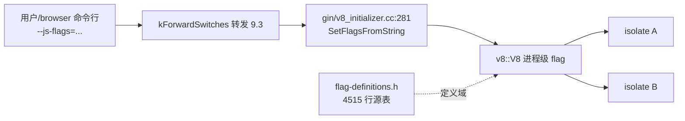

# 14.3 · V8 flag 与性能调优：透传链、调优面与内存上限

> --js-flags 怎么进到引擎、哪些 flag 值得定制者关心（内存/编译策略/GC）、如何为产品定调优基线。14.1 讲了模型，本篇讲旋钮。

## ① 角色定位

V8 的全部 flag 定义在 `v8/src/flags/flag-definitions.h`（**4515 行**——V8 自己的 flag 体系，独立于 Chromium 的 switch 体系）。浏览器侧入口：命令行 `--js-flags=<v8 flags>` 由 **gin** 消费——`gin/v8_initializer.cc:281`（"Apply any --js-flags explicitly specified"）在 isolate 初始化时应用；:520 附近还有 instrumentation 相关的 flag 联动。**gin 是 chromium 层的 V8 宿主胶水**（14.1 定位），这条链=定制 V8 行为的官方通道。

## ② 定制切入点全景表

| 想干什么 | 动哪里 | 难度 | 影响面 |
|---|---|---|---|
| 传 V8 flag | `--js-flags="--max-old-space-size=4096 --jitless"`（gin/v8_initializer.cc:281 消费实证） | 改配置 | 引擎全局 |
| 定产品默认 flag 基线 | 在 v8_initializer 的 flag 应用点（:281 一带）追加自家默认串（fork 定制位） | 改逻辑 | 出厂调优 |
| 查全部 flag | flag-definitions.h（4515 行源表）+ `--js-flags=--help` 行为 | 只读 | 发现面 |
| 内存上限 | `--max-old-space-size`（老生代 MB）/`--max-heap-size` | 改配置 | OOM 边界 |
| 关 JIT（低配/安全） | `--jitless`（解释执行：无 JIT 攻击面但慢 2-5×） | 改配置 | 性能×安全权衡 |
| 编译策略 | `--always-turbofan`/`--no-lazy` 类（激进优化 vs 启动延迟） | 改配置 | 启动×峰值 |
| GC 调节 | `--gc-interval`/`--stress-*`（测试向）/增量标记类 | 改配置 | 停顿特性 |
| snapshot 定制 | `--no-snapshot`/自建 snapshot（启动优化，14.1 快照坑呼应） | 动架构 | 冷启动 |
| Sparkplug/Maglev 层选择 | tiering 相关 flag（版本相关，以 flag-definitions.h 现表为准） | 改配置 | 编译分层 |
| 代码缓存 | `--cache=code` 类（v8 code cache 与 blink 的 HTTP cache 联动） | 改配置 | 热站加载 |
| flag 安全审计 | 产品发布前 --js-flags 攻击面（用户可传任意 flag——沙箱语义下影响有限但要评估） | 流程 | 发布安全 |
| 性能观测 | `--trace-opt`/`--trace-gc`/profiler（inspector 通道优先） | 只读 | 调优闭环 |

## ③ 关键源码走读：flag 从命令行到引擎

**第一站：解析。** browser 命令行的 --js-flags 是**转发型 switch**（9.3 的 kForwardSwitches 体系语义——renderer/gpu 各 isolate 初始化时各自应用，gin/v8_initializer.cc:281 注释明示"explicitly specified by the caller"）。

**第二站：应用。** gin 的 V8Initializer 在每个 isolate 诞生前调 `v8::V8::SetFlagsFromString`——**flag 是进程级全局**（V8 flag 作用于进程内全部 isolate，不能 per-tab 差异；要 per-context 差异得走 14.2 的 API 面或 Settings 面）。

**第三站：生效期。** 部分 flag 仅初始化期有效（heap 上限/snapshot），部分运行期可调（trace 类）——**产品基线必须在启动串定死**。

## ④ 实操：两类产品基线

**低配设备基线**：`--js-flags="--max-old-space-size=1024 --jitless"`——限内存+去 JIT 攻击面（信创/政务终端形态，安全优先于速度）。
**性能旗舰基线**：`--js-flags="--max-old-space-size=8192 --no-lazy-feedback-allocation"` 类（大堆+激进反馈）——实测驱动，别抄数值（每个版本 tiering 行为变）。
**方法论**：flag-definitions.h 找候选→workload 基准（自家 top 站集）→A/B 命令行→定版写进 fork 默认（§2 第二行）。

## ⑤ 依赖与数据流

## ⑥ 坑与勘误

- **V8 flag 是进程级**：想"这个 tab 用 jitless 那个 tab 用 JIT"做不到（14.1 的 isolate 拓扑决定）；产品差异需求改走 Settings/14.2 面。
- flag 名随版本变动（tiering 体系年年演进）：**每次升级 rebase 后重跑基线**，锁死旧 flag 名会静默失效（未知 flag 静默忽略是 V8 传统）。
- --jitless 的代价在真实站点的实测区间大（简单页无感，重计算站数倍）——产品决策要拿自家用户面数据。
- max-old-space 不是总堆上限（还有外部内存/new space 等）——OOM 治理要组合测量（DevTools Memory 面板对账）。
- flag 转发链上被 9.3 的白名单管理：自家 fork 加转发项记得同步 kForwardSwitches（曾有"browser 传了 renderer 不认"的坑案例）。
- 用户可传 --js-flags 本身是攻击面（配合沙箱评估：flag 可关安全机制如 --no-sandbox 类语义的 V8 侧等价物）——受管产品应在 browser 侧过滤该 switch。

## ⑦ 验证方法

- `--js-flags=--print-flag-values`（V8 自带：打印生效 flag 值——基线确认第一手段）
- `--js-flags=--trace-gc,N` 看 GC 节奏（调优前后对比）
- DevTools Performance/Memory 面板与 flag 目标对账（内存上限类）
- 启动串冒烟：--js-flags 传错值的行为（静默 vs 报错）确认产品过滤策略

## ⑧ 延伸

- 模型与 isolate 拓扑：14.1；自定义 JS API（per-context 差异的正道）：14.2；开关转发体系：9.3；进程沙箱联动：9.2
- 官方源表：v8/src/flags/flag-definitions.h（4515 行）；gin 消费点：gin/v8_initializer.cc:281
