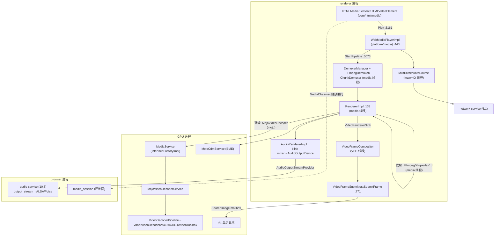

# 15.1 media 栈总览：播放管线与进程分布

> 源码 src@8fe2331 行号实证（2026-10 快照）。7.1 讲像素如何上屏、7.4 讲 GPU 命令流，本篇补齐"像素从哪来"：`<video>` 一次 `play()` 背后的完整管线——DOM 控件→播放器→demuxer→软/硬解码→SharedImage 帧→合成呈现，以及每一段住在哪个进程。15.2（DRM）、15.3（画中画/录制）在本篇铺的地图上展开。

## ① 角色定位

media 栈横跨四类进程，是 Chromium 里"数据面跨进程最远"的子系统（一路从网络服务到 GPU 进程再到显示合成）。图谱位置：blink 引擎层（DOM 面板）之下的 `media` 域，与 `cc-compositor`（7.1）在 VideoFrameSubmitter 处交接、与 `viz/GPU`（7.4）在 SharedImage 处交接、与 audio service（10.3）在 AudioOutputStreamProvider 处交接。代码物理分布是关键认知：

- **renderer 进程**：DOM 层（`blink/renderer/core/html/media/`，HTMLMediaElement/自动播放策略）+ 播放器本体（`blink/renderer/platform/media/`，WebMediaPlayerImpl——原 `media/blink/` 已并入此处）+ 组装车间（`content/renderer/media/media_factory.cc`）
- **`src/media/`**：进程无关的管线件（base/filters/renderers）+ 跨进程实现（mojo）+ 各平台硬件编解码（gpu）
- **GPU 进程**：MediaService（硬解码、CDM）——`content/gpu/gpu_child_thread_receiver_bindings.cc:49` 把 MediaService receiver 路由进 GPU 子线程
- **browser 进程**：audio service（10.3）+ media_session（控制面）

数据面与控制面要分清：视频解码数据走 GPU 进程，而"暂停/上一曲"这类系统媒体键走 `services/media_session/`（browser 进程），两者只经 MediaObserver/播放委托弱耦合。

## ② 定制切入点全景表

| 想改 X | 动哪里（file:line） | 难度 | 影响面 |
|---|---|---|---|
| 自定义协议/容器源（私有格式直读） | `ContentRendererClient::OverrideDemuxerForUrl`（content/public/renderer/content_renderer_client.h:197）返回自研 Demuxer；配合 6.2 的 scheme 注册 | 改逻辑 | 仅 renderer 进程；MSE/普通 src 均可拦 |
| 预加载策略（省流量/秒开取舍） | `WebMediaPlayerImpl::SetPreload`（web_media_player_impl.cc:1329）+ `MultiBufferDataSource::SetPreload`（multi_buffer_data_source.cc:273） | 改逻辑 | 全站流量模型、起播时延 |
| 自动播放策略（产品差异化高频点） | blink `AutoplayPolicy::GetAutoplayPolicyForDocument`（autoplay_policy.cc:66）/`RequestPlay`（:289）；默认值 `settings.json5:1030`；switch 定义 `media_switches.cc:60`（`--autoplay-policy`） | 改配置 | 全站播放行为、Web 兼容性 |
| 禁硬解/强制软解 | `gpu_mojo_media_client_linux.cc:32` `GetPreferredLinuxDecoderImplementation()` 返回 kUnknown 即纯软解；总开关 `media_switches.cc:1493` `kAcceleratedVideoDecodeLinux`；运行时 `content_switches.cc:80` `--disable-accelerated-video-decode` | 改配置 | CPU 占用、电池、4K 可播性 |
| 解码器选择优先级（如指定 dav1d 先于硬解） | `DefaultDecoderFactory::CreateVideoDecoders`（default_decoder_factory.cc:117-160）压栈顺序即优先级 | 改逻辑 | 特定 codec 画质/时延 |
| 倍速与音调（变速不变调） | `WMPI::SetRate`（web_media_player_impl.cc:1222）/`SetPreservesPitch`（:1279）；WSOLA 算法在 `media/filters/audio_renderer_algorithm.cc` | 改逻辑 | 音频链路；高倍速音质 |
| 画面处理（水印/滤镜/审计帧） | 每帧出口 `WMPI::GetCurrentFrameFromCompositor`（web_media_player_impl.cc:3127）；7.3 的层叠加方案对 `<video>` 同样适用（VideoPainter 走 foreign layer） | 改逻辑 | 侵犯受保护内容检测、品牌水印 |
| 画中画（15.3 铺垫） | `WMPI::OnRequestPictureInPicture`（web_media_player_impl.cc:1300）；DOM 面 `modules/picture_in_picture/document_video_picture_in_picture.cc` | 改逻辑 | 需 browser 侧 PiP 窗口配合 |
| 字幕管线（WebVTT/外挂轨） | blink `core/html/track/`（解析/渲染全在 blink，media/ 无字幕件） | 改逻辑 | 仅 renderer |
| DRM/EME 接口位（15.2 铺垫） | blink `platform/media/web_content_decryption_module_impl.cc`→`media/mojo/clients/mojo_cdm.cc`→GPU 进程 `MojoCdmService`（interface_factory_impl.cc:298）；CDM 接口 `media/cdm/api/content_decryption_module.h` | 动架构 | Widevine 为闭源二进制，开源仓只有接口（见⑥） |
| 媒体会话（系统媒体键/锁屏控制） | `services/media_session/media_controller.cc`（browser）+ blink `modules/mediasession/`；设计文档 `services/media_session/controlling_media_playback.md` | 改配置 | 控制面，不碰数据面 |
| 录制与截帧（15.3 铺垫） | MediaRecorder 封装器 `media/muxers/{mp4_muxer,webm_muxer}.cc`；DOM 面 `modules/mediarecorder/`；rVFC 逐帧回调 `modules/video_rvfc/video_frame_callback_requester_impl.cc` | 改逻辑 | 编码走 media/gpu（硬编） |
| 错误与降级链 | `WMPI::OnError`（web_media_player_impl.cc:2040）；解码失败回退观察者 `media/filters/decoder_stream.h:138`；错误码 `media/base/pipeline_status.h` | 改逻辑 | 弱网体验、自定义错误页 |
| 整条管线换成自研 Renderer | `RendererType::kContentEmbedderDefined`（media/base/renderer.h:38）+ `RendererFactorySelector` 注入 | 动架构 | 全播放行为，工作量大收益大 |
| 播放器实例数上限（防页面挂百个 video） | `MediaFactory::CreateMediaPlayer` 的 TooManyWebMediaPlayers 检查（media_factory.cc:365-374）；`--max-web-media-player-count`（media_factory.cc:145） | 改配置 | 内存防护 |
| 后台标签页暂停/继续播放 | `RenderFrameMediaPlaybackOptions`（由 `WMPI::UpdatePlayState` web_media_player_impl.cc:3155 消费） | 改配置 | 移动端省电关键项 |

## ③ 关键源码走读：一次 `video.play()` 的旅程

**阶段 0 加载（play 之前已完成）**。`HTMLMediaElement::LoadResource`（html_media_element.cc:1497）→`StartPlayerLoad`（:1703）→ `frame->Client()->CreateWebMediaPlayer`（:1764），落到 content 层 `MediaFactory::CreateMediaPlayer`（media_factory.cc:350）。组装顺序值得背下：共享音频出口 `AudioDeviceFactory::NewMixableSink`（:397）→ decoder factory（:428 前后 `EnsureDecoderFactory`+`CreateRendererFactorySelector`）→ **media 线程** `RenderThreadImpl::GetMediaSequencedTaskRunner`（render_thread_impl.cc:1532，"Media" 命名线程 :1545）→ embedder demuxer 覆写点 `OverrideDemuxerForUrl`（:456）→ `WebMediaPlayerBuilder::Build`（web_media_player_builder.cc:71）产出 `WebMediaPlayerImpl`（web_media_player_impl.cc:443）。DataSource（URL 型源）走 `MultiBufferDataSource`（web_media_player_impl.cc:994），数据经 ResourceLoader→URLLoader 进 network service（6.1）。

**阶段 1 播放指令**。JS `play()`→`HTMLMediaElement::Play`（html_media_element.cc:3161）先过自动播放闸 `autoplay_policy_->RequestPlay()`（autoplay_policy.cc:289）——被拒则 reject NotAllowedError。通过后 `PlayInternal`（:3198）→ `UpdatePlayState`（:4270）→ `web_media_player_->Play()`（:4291）→ `WMPI::Play`（web_media_player_impl.cc:1017）仅设 `pipeline_controller_->SetPlaybackRate(rate)`（:1028）；真正干活在管线侧。

**阶段 2 管线启动**。`WMPI::StartPipeline`（:3073）→`DemuxerManager::CreateDemuxer`（demuxer_manager.cc:235）：MSE 用 ChunkDemuxer（:278，由 `MediaSource` 直接 AppendBuffer）；普通 URL 用 `CreateFFmpegDemuxer`（:272→:409，FFmpegDemuxer 跑在 media 线程）；HLS 走 `HlsManifestDemuxerEngine`（hls_manifest_demuxer_engine.cc）。demuxer 就绪回调 `OnDemuxerCreated`（web_media_player_impl.cc:3055）→`PipelineController::Start`→`PipelineImpl::Start`（pipeline_impl.cc:1384）→ **media 线程**上的 `RendererWrapper::Start`（:367）用 SerialRunner 串四步：InitializeDemuxer（:392）→ReportMetadata（:398，此时 duration/尺寸已知，HAVE_METADATA）→CreateRenderer（:402）→InitializeRenderer（:406）。

**阶段 3 解码**。`WMPI::CreateRenderer`（:2996）经 `RendererFactorySelector` 选默认 `RendererImplFactory::CreateRenderer`（renderer_impl_factory.cc:80）装配 `AudioRendererImpl`（:89）+`VideoRendererImpl`（:119）+（有 GPU 时）`MappableSharedImageVideoFramePool`（:112，软解帧上传成 SharedImage 用）→`RendererImpl::Initialize`（renderer_impl.cc:144）。音视频各自 `DecoderStream`+`DecoderSelector::SelectDecoderInternal`（decoder_selector.cc:120）按 `DefaultDecoderFactory::CreateVideoDecoders`（default_decoder_factory.cc:117）的压栈顺序试初始化：DecryptingVideoDecoder（:127，EME 用）→**硬件 `MojoVideoDecoder`**（MojoDecoderFactory，mojo_decoder_factory.cc:70，经 `InterfaceFactory::CreateVideoDecoder` interface_factory.mojom:41 跨进程）→libvpx（:148）→dav1d（:154）→FFmpegVideoDecoder（:159）。硬件侧：GPU 进程 `MojoVideoDecoderService` 收请求（mojo_video_decoder_service.cc），`GpuMojoMediaClient::CreateVideoDecoder`（gpu_mojo_media_client.cc:211）按平台分发——Linux 在 `CreatePlatformVideoDecoder`（gpu_mojo_media_client_linux.cc:167）依 `GetPreferredLinuxDecoderImplementation()`（:32）选 VAAPI/V4L2/OOP，产出 `VideoDecoderPipeline::Create`（:178/:190）内嵌 `VaapiVideoDecoder`。

**阶段 4 首帧上屏**。`VideoRendererImpl` 攒到首帧后 `StartSink`（video_renderer_impl.cc:911）`sink_->Start(this)`（:916）——sink 即 `VideoFrameCompositor`（跑在 VFC 专用线程）。合成器按 BeginFrame 节拍 `UpdateCurrentFrame` 拉帧，`VideoFrameSubmitter::SubmitFrame`（video_frame_submitter.cc:771）把帧（mailbox 引用的 SharedImage）提交进 cc 的视频层（7.1 的 begin-frame 管线、7.4 的 SharedImage 纹理在此汇合）。`WMPI::OnFirstFrame`（web_media_player_impl.cc:4021）记录 TimeToFirstFrame 并撤 poster。

**音频并行线**。`AudioRendererImpl::Initialize`（audio_renderer_impl.cc:553）→`InitializeSink`（:600）→ blink 共享 mixer（`modules/media/audio/audio_renderer_mixer.cc`，同主 frame 复用一个物理输出）→`media::AudioOutputDevice`（audio_device_factory.cc:57）→`MojoAudioOutputIPC`（mojo_audio_output_ipc.cc:159）→ browser 进程 audio service `output_stream`（10.3 已铺）→ ALSA/PulseAudio。时钟主从：**音频时钟是主人**，视频向音频对齐（丢帧/重复）。

## ④ 实操：最小 patch 示例

**A. 默认自动播放策略改为"永远允许"**（产品去 YouTube 化常见诉求）。三层任选：①运行时 `--autoplay-policy=no-user-gesture-required`；②编译期改 blink 默认值——`third_party/blink/renderer/core/frame/settings.json5:1033`：

```diff
       name: "autoplayPolicy",
       type: "AutoplayPolicy::Type",
       include_paths: [...],
-      initial: "AutoplayPolicy::Type::kNoUserGestureRequired",
+      initial: "AutoplayPolicy::Type::kNoUserGestureRequired",  // 本已默认允许
```

注意桌面 Chrome 在 chrome 层按平台覆写此默认（Android 默认 kUserGestureRequired），只改 settings.json5 对桌面版通常已生效，对 Android 需查 `chrome/browser/ui/` 的 autoplay 覆写。更稳的做法是 embedder 在 WebPreferences 里显式下发（2.1 的 Content API 路线，零 blink 改动）。

**B. Linux 一刀切禁用硬解**（VAAPI 驱动问题多、产品走纯软解）。`media/base/media_switches.cc:1493`：

```diff
-BASE_FEATURE(kAcceleratedVideoDecodeLinux,
-             base::FEATURE_ENABLED_BY_DEFAULT);
+BASE_FEATURE(kAcceleratedVideoDecodeLinux,
+             base::FEATURE_DISABLED_BY_DEFAULT);
```

一改全链生效：`GetPreferredLinuxDecoderImplementation()` 第一行就查此 feature（gpu_mojo_media_client_linux.cc:33-35），返回 kUnknown 后 `MojoVideoDecoder` 初始化即失败，`DecoderSelector` 顺序滑落到 FFmpeg/libvpx 软解。这比 `--disable-accelerated-video-decode`（content_switches.cc:80）狠在无开关可逆，发版即定死。

## ⑤ 依赖与数据流



**进程分布表**（为什么住这儿）：

| 管线段 | 进程/线程 | 理由 |
|---|---|---|
| DOM/控件/自动播放闸 | renderer，main | DOM 生命期 |
| DataSource 网络缓冲 | renderer，main+IO | 走 URLLoader 进 network service，沙箱内可做 |
| Demuxer/Renderer/软解 | renderer，"Media" 线程 | 解复用解码是 CPU 密集+时延敏感，独立线程防卡 UI；demuxer 亦在 media 线程（demuxer_manager.cc:216 注释钉死 FFmpegDemuxer 单线程） |
| 硬件音视频解码/CDM | GPU 进程 | 驱动库（VAAPI/D3D11）与命令缓冲不可入渲染沙箱；CDM 是第三方代码须隔离（media/mojo/README.md 官方理由） |
| 视频帧存储 | 跨进程 SharedImage | 硬解产出即在 GPU 内存，mailbox 传给 renderer 免拷贝（7.4） |
| 音频输出 | browser 进程 audio service | 平台音频 API 不入沙箱；可配专用 audio 进程（10.3） |
| 媒体会话 | browser | 系统级控制面 |

**media/ 分层目录地图**（33 项按播放主线归组）：`base/`=公共类型与管线骨架（VideoFrame/PipelineImpl/RendererType）；`filters/`=demuxer+软解+播放算法；`renderers/`=RendererImpl 三件套+默认 decoder factory；`formats/`=MSE 容器解析（mp4/webm/hls/mp2t）；`ffmpeg/`=FFmpeg 绑定层（本体在 third_party/ffmpeg）；`gpu/`=平台硬编解码（vaapi/v4l2/windows/mac/chromeos/android）；`mojo/`=跨进程接口面（clients=renderer 侧、services=GPU/browser 侧、mojom=接口）；`audio/`=音频设备栈+平台实现；`cdm/`=EME 解密件+CDM API；`muxers/`=MediaRecorder 封装；`capture/`=采集；`cast/`+`remoting/`=Cast 传输两侧；`capabilities/`=播放能力学习库；`parsers/`=码流解析；`gfx/`=帧绘制入 canvas+MappableSharedImage 池；`video/`=视频编码抽象；`webrtc/`=RTC 桥接；`midi/`+`device_monitors/`+`fuchsia/`+`test/`=外围。**blink 侧三处**：`core/html/media/`（DOM 层）、`platform/media/`（播放器本体，原 media/blink）、`modules/media/audio/`（音频出口工厂）。

## ⑥ 坑与勘误

1. **`media/blink/` 已不存在**：media/README.md:25 仍写"blink/ - Code for interfacing with the Blink rendering engine"，实际目录已拆迁——播放器代码进 `third_party/blink/renderer/platform/media/`（类名同步改蛇形：`webmediaplayer_impl.cc`→`web_media_player_impl.cc`），音频出口进 `modules/media/audio/`。查旧文档/旧博客按 `media/blink/` 找文件必然 404（源码实证：目录 ls + README 对比）。
2. **DemuxerManager 是新层**：旧资料里"WMPI 直接持 DataSource+Demuxer"已过时，现由 `media/filters/demuxer_manager.cc` 统一管理数据源与 demuxer 生命周期（含 HLS/override 分流），且 MSE 的 ChunkDemuxer 由 blink MediaSource 直接喂数据不经 DataSource（demuxer_manager.cc:235-280 实证）。
3. **自动播放策略默认值不在 media/**：blink 侧 `settings.json5:1030` 默认 kNoUserGestureRequired，但桌面/Android Chrome 的"手势才许播"是 chrome 层用 `--autoplay-policy`（media_switches.cc:60）与 WebPreferences 覆写的——定制时只改 media/ 或只改 blink 都可能被上层覆写盖回（文档对比+源码实证）。
4. **硬解/软解行为差异**：同一文件两条路色彩空间可能不同——硬解路径按硬件输出格式走 `GetPreferredRenderableFourccs`（gpu_mojo_media_client_linux.cc:41），软解 FFmpeg 输出 I420/YUV420，HDR/广色域内容切硬解开关后颜色漂移是常见"灵异"；时戳上硬解由驱动回填、软解由 FFmpegDemuxer 推算，seek 精度有差异。调这类问题先 `chrome://gpu`+`chrome://media-internals` 分辨走的哪条路。
5. **MediaService 挂在 GPU 进程，不是独立 utility 进程**：老架构文里的"独立 media 进程"方案现仅 GPU 进程内实现（gpu_child_thread_receiver_bindings.cc:49 实证）；CDM 同在 GPU 进程的 MediaService 内（interface_factory_impl.cc:298），历史上单独 CDM 进程的实验以现源码为准。
6. **EME/Widevine 闭源边界**：开源仓只有 `media/cdm/api/content_decryption_module.h` 接口与 ClearKey 参考实现（`media/cdm/aes_decryptor.cc`），Widevine CDM 二进制运行时下载；想"自带 DRM"只能实现 CDM 接口并解决 license 服务，开源仓无任何 Widevine 秘钥逻辑可抄。
7. **Windows 例外路径**：Windows 走 `RendererType::kMediaFoundation`（media/base/renderer.h:34），整条管线换成 `media/renderers/win/media_foundation_renderer.cc`，demuxer/解码都交给 MF Media Engine——上表的"FFmpegDemuxer+DecoderSelector"流程在 Windows EME 场景不适用（web_media_player_impl.cc:3023 有显式 DisableDemuxerCanChangeType）。

## ⑦ 验证方法

- **管线状态**：`chrome://media-internals`（每个 player 的 demuxer/decoder/render name/缓冲水位/错误日志全在，改自动播放/解码策略后先看这）；DevTools → Elements → 选中 `<video>` → Properties，或 Performance 面板勾 "Media" 轨迹。
- **走了硬解还是软解**：`chrome://gpu` 看 "Video Acceleration Information"；`chrome://media-internals` 的 renderer name/decoder 行；日志 `--vmodule=*video_decoder*=2,*vaapi*=2`；Linux 另跑 `intel_gpu_top` 看解码引擎占用（VDBox 活动即硬解）。
- **自动播放**：`chrome://media-engagement` 看站点分数（高分会豁免手势），配 `--autoplay-policy=user-gesture-required` 复现对照组。
- **开关矩阵**：`--disable-accelerated-video-decode`、`--max-web-media-player-count=N`（media_factory.cc:145）、`--autoplay-policy=...` 三件套冒烟。
- **单元测试**：`media_unittests`（管线件）、`media_blink_unittests`（现随 blink 仓编译目标变化，注意路径迁移）、`media_service_unittests`；改 decoder factory 优先跑 `default_decoder_factory_unittest.cc`。
- **时序**：`about://tracing` 勾 "media" category，看 `DecoderSelector::SelectDecoder`→`VideoFrameSubmitter::SubmitFrame` 首帧链路耗时（对应 :4021 OnFirstFrame 的 TimeToFirstFrame UMA）。

## ⑧ 延伸

- 图谱：`src/.understand-anything/knowledge-graph.json` 按 filePath 前缀 `media/`、`third_party/blink/renderer/platform/media/`、`services/audio/` 过滤，对应图谱 media/rendering 相关层。
- 本系列：7.1（合成呈现终点站）、7.3（层叠加水印对视频的适用）、7.4（SharedImage/video texture）、6.2（自定义 scheme→OverrideDemuxerForUrl 组合拳）、10.3（audio service 详拆）、15.2（DRM/EME 下钻）、15.3（画中画/录制/截帧）。
- 官方文档：`src/media/README.md`（目录总览，注意 blink/ 条目过时）、`src/media/mojo/README.md`（跨进程设计动机，含 renderer_extension_diagram.png）、`src/docs/media/media_pipeline_overview.png`（官方管线图）、`src/services/media_session/controlling_media_playback.md`（控制面设计）、`src/media/gpu/README.md`（硬编解码）。
