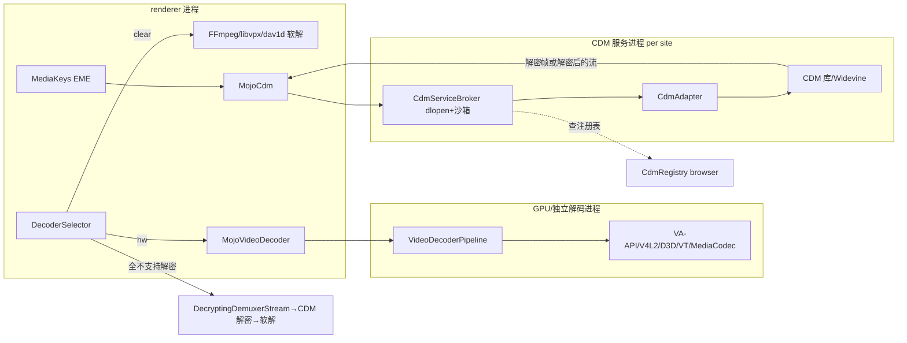

# 15.2 编解码、硬件加速与 DRM：软硬解决策与 Widevine 边界

> 源码 src@8fe2331 行号实证（2026-10 快照）。15.1 铺了管线全景（MojoVideoDecoder→GPU 进程 VideoDecoderPipeline），本篇下沉两层：①一个 codec 到底走软解还是硬解，谁在哪个进程的哪一行拍板；②EME/CDM 这条"内容保护"支线如何挂进同一根管线。前置：15.1（必读）、7.4（GPU 进程）、5.2（平台差异）。

## ① 角色定位

编解码层是 media 栈的"引擎舱"，横跨三处：renderer 进程的 decoder 工厂与选择器（组装优先级）、GPU 进程（或 ChromeOS 的 OOP 独立解码进程）的平台后端（VA-API/D3D/VideoToolbox/MediaCodec）、以及 CDM 专用服务进程（DRM 解密）。与 15.1 的分工：15.1 讲"帧怎么流"，本篇讲"帧由谁产生、加密帧由谁解"。上游契约是 `VideoDecoderConfig`（codec/profile/加密标志），下游契约是 SharedImage 帧格式（NV12/P010/AR24）。DRM 支线与解码线在 `DecryptingVideoDecoder`/`DecryptingDemuxerStream` 两点交汇——这正是"解密后送软解"还是"解密硬解一体"的分岔口。

## ② 定制切入点全景表

| 想改 X | 动哪里（file:line） | 难度 | 影响面 |
|---|---|---|---|
| 强制软解（全局） | `render_thread_impl.cc:996-1003` 三条件编译期改 false；或 `--disable-accelerated-video-decode`（content_switches.cc:79）；或 feature `kAcceleratedVideoDecodeLinux`（media_switches.cc:1493） | 改配置 | CPU 占用暴涨、4K 不可播 |
| 强制硬解/绕过驱动黑名单 | `gpu_mojo_media_client_linux.cc:143` `kVaapiIgnoreDriverChecks`（media_switches.cc:1519，默认关）打开，绕过 NVIDIA/AMD/ARM 检查 | 改配置 | 崩溃/花屏风险自担 |
| 解码器优先级（软解优先） | `default_decoder_factory.cc:117-160` 压栈顺序即优先级；`decoder_selector.cc:59-73` 360p 高度线调整 | 改逻辑 | 指定 codec 走指定路 |
| 禁/放行特定 codec（能力面） | `supported_types.cc:436-470` `IsDefaultDecoderSupportedVideoType` codec switch；HEVC 闸 `:236-250`（`ENABLE_PLATFORM_HEVC`+ChromeOS feature `kPlatformHEVCDecoderSupport`） | 改配置 | `canPlayType`/管线全线 |
| 扩展 ffmpeg 软解 codec 面 | `ffmpeg_video_decoder.cc:119-122`（现仅 H.264）+ gn 参数 `proprietary_codecs`/`ffmpeg_branding`（media/BUILD.gn:90-93 有硬 assert）；ffmpeg 编译配置在 `third_party/ffmpeg`（子模块，含 GPL 组件） | 动架构 | 重新拉+编 ffmpeg，许可面变化 |
| 硬件编码线 | `gpu_video_encode_accelerator_factory.cc:60/73/85/93/100`（V4L2/VAAPI/NDK/VT/MF 五厂） | 改逻辑 | WebCodecs/MediaRecorder/getUserMedia |
| CDM 路径注入（自带 DRM 库） | `content_client.h:111` `AddContentDecryptionModules` 注册 `CdmInfo`（cdm_info.h:32，含 path/CdmType/Robustness）；现成模板 `--clear-key-cdm-path-for-testing`（cdm_registration.cc:311-342） | 动架构 | 需实现 CDM ABI（supported_cdm_versions.h:37，v10/v11） |
| EME 权限面（禁 EME/按域放开） | blink `navigator_request_media_key_system_access.cc:146` permissions policy 拒绝点；`media_key_session.cc` 会话生命周期 | 改逻辑 | 站点级 EME 可用性 |
| L1/L3 安全级策略 | `CdmInfo::Robustness`（cdm_info.h:34-36）；Android `MediaDrmBridge` SecurityLevel（media_drm_bridge.h:59-66，HW_SECURE_ALL=L1）与失败码（media_drm_bridge.cc:274-277） | 改逻辑 | 内容供应商许可要求 |
| DRM 会话管理/持久化 | `CdmCapability.session_types`（cdm_capability.h:77）；CDM 服务进程 idle 超时回收（service_factory.cc:275） | 改配置 | persistent license 行为 |
| HDCP/输出保护 | CDM 进程侧 `output_protection.h`（LinkTypes/ProtectionType::HDCP）→ `mojo_cdm_helper.cc:90-102` 回查 browser；L3 无硬 HDCP（media_drm_bridge.cc:1065-1075） | 改逻辑 | 外接屏策略、4K 播放门槛 |
| 字幕与 DRM 交互 | 硬安全管线下帧不可被 JS 摸（水印/截图全黑），字幕必须 DOM 层渲染；blink `html_media_element_encrypted_media.cc` attach 时序 | 改逻辑 | 字幕烧录 vs 叠加选择 |
| 编解码诊断 | `Media.VaapiLinux.SupportedVideoDecoder` UMA（gpu_mojo_media_client_linux.cc:223）；`decoder_selector.cc:264` "Cannot select" MEDIA_LOG→chrome://media-internals | 改配置 | 线上问题归因 |
| Windows MediaFoundation 例外 | `renderer.h:34` `kMediaFoundation` 整管线绕开 DecoderSelector；MF CDM 走 `media_interface_proxy.cc:574-623` | 动架构 | EME 场景上表全部失效 |

## ③ 关键源码走读

### 解码决策树（本篇核心交付）

一次 `<video>` 播放，"软还是硬"在四级闸门依次判定，任一关不过就静默落到下一级：

```
L1 renderer 总闸（render_thread_impl.cc:996-1003，每 GpuChannelHost 一次）
   Linux 需 feature kAcceleratedVideoDecodeLinux(media_switches.cc:1493,USE_VAAPI 时默认开)
   && 无 --disable-accelerated-video-decode
   && gpu_feature_info 的 ACCELERATED_VIDEO_DECODE==Enabled（GPU 黑名单数据源=software_rendering_list.json）
   → 写入 MojoGpuVideoAcceleratorFactories::video_decode_accelerator_enabled_
L2 工厂压栈（default_decoder_factory.cc:117）
   DecryptingVideoDecoder(:130) → MojoVideoDecoder(外部工厂,:143,需 L1 通过)
   → libvpx(:149) → dav1d(:153) → FFmpegVideoDecoder(:158)
   DecoderSelector 再按 360p 线重排（decoder_selector.cc:59-73）：
   ≥360p 平台解码器优先、<360p 软解优先（省功耗）；仅 src= 非 MSE 生效(:374)
L3 GPU 进程平台后端（GpuMojoMediaClientLinux）
   GetActualPlatformDecoderImplementation(:86)：Vaapi/V4L2 还要过 GL/Vulkan
   模式检查——Vulkan 下仅 Intel driver≥21.1.5 放行(:130-137)，NVIDIA/AMD/ARM
   默认拒(:140-144)；能力表 VideoDecoderPipeline::GetSupportedConfigs
   (video_decoder_pipeline.cc:405-427)→vaQueryConfigProfiles 实测驱动
   (vaapi_wrapper.cc:936)→再按 gpu_workarounds 删 VP8/VP9(:432-444)
L4 运行时回退
   init 失败：decoder_selector.cc:257-273 "Cannot select xxx"→试下一个
   解码失败：decoder_stream.cc:667-686 kFallbackAfterDecodeError
   (media_switches.cc:599,默认开,仅"未产出过帧"时)→ResumeDecoderSelection 换下一个解码器
```

注意 L4 的硬解→软解回退是"整条链换人"：MojoVideoDecoder init 成功但首帧就报错（驱动声称支持实际不行——VA-API 常见）时，靠 `decoder_produced_a_frame_==false` 判定走 `ResumeDecoderSelection`（decoder_stream.cc:686），重选落到 dav1d/FFmpeg。加密流还有第五岔路：所有解码器都不支持解密时，挂 `DecryptingDemuxerStream` 先解密再重选（decoder_selector.cc:291-332）——"CDM 解密+软解"就是这么兜底的。

### 平台硬解后端矩阵（文件锚点）

| 平台 | 解码后端 | 创建点 | 能力查询 |
|---|---|---|---|
| Linux | VA-API（Intel/AMD 主）或 V4L2 | gpu_mojo_media_client_linux.cc:167-206 → VideoDecoderPipeline(VaapiVideoDecoder) | vaapi_video_decoder.cc:117-126 |
| ChromeOS | 默认 OOP 独立解码进程（enable_oop_video_decoder，media_options.gni:22），否则同 Linux | gpu_mojo_media_client_cros.cc:41-47 | video_decoder_pipeline.cc:412 |
| Windows | D3D11/D3D12（kD3D12VideoDecoder feature） | gpu_mojo_media_client_win.cc:49-59 D3DVideoDecoder::Create | 同文件:112-124 |
| macOS | VideoToolbox | gpu_mojo_media_client_mac.cc:25-29 | 同文件:44-46 |
| Android | MediaCodec（MCVD） | gpu_mojo_media_client_android.cc:43-88 | 同文件:98-100 |
| 全平台软解 | FFmpeg(H.264 only)/libvpx/dav1d | default_decoder_factory.cc:148-160 | ffmpeg_video_decoder.cc:119-122；supported_types.cc:581-598 |

后端枚举与 UKM 名称对齐在 `decoder.h:40-65`（kVaapi/kV4L2/kD3D11/kVideoToolbox/kMediaCodec/kOutOfProcess…），日志归因时直接查这个枚举名。

### DRM 集成三路线

DRM 的接入面收敛在一个浏览器进程注册表：`CdmRegistryImpl::Init`（cdm_registry_impl.cc:260-265）回调 embedder 的 `AddContentDecryptionModules`（content_client.h:111）拿 `CdmInfo` 列表（key_system、Robustness、capability、**库路径**）。创建链：renderer `MediaFactory::GetCdmFactory`（media_factory.cc:804-817 MojoCdmFactory）→ browser `MediaInterfaceProxy::CreateCdm`（media_interface_proxy.cc:544）→ `CreateLibraryCdm`（:779）查注册表 → `ConnectToCdmService`（:828）→ `ServiceProcessHost::Launch` 起独立 CDM 服务进程（service_factory.cc:254，按 cdm_type+profile+site 三元组隔离）→ 该进程内 `CdmServiceBroker::GetService`（cdm_service_broker.cc:44）**先 dlopen(cdm_path) 再封沙箱**（:107-137，顺序即安全设计）。三条产品路线：

1. **Widevine 官方**：`widevine.gni:14` 默认仅 Chrome 品牌/Android 编入；Linux 桌面 Chromium 可自开 `enable_widevine`（LICENSE 允许）但二进制须向 Widevine 申请，`GetBundledWidevine`（cdm_registration.cc:115）与组件更新器二选一装路径。闭源不可自签（见⑥）。
2. **自建 CDM**：实现 CDM ABI（接口头位于 media/cdm/api/ 目录——本快照该目录为空，ABI 以 supported_cdm_versions.h 的 include 与注释为准：v10/v11 稳定、v12 实验，:37-40），导出 `CreateCdmInstance/InitializeCdmModule/GetCdmVersion`（cdm_module.cc:140-147），然后 `AddContentDecryptionModules` 注册自有 key_system。仓内模板=ClearKey 库实现 `media/cdm/library_cdm/clear_key_cdm/`（BUILD.gn:13 产物 libclearkeycdm.so），测试注入开关 `--clear-key-cdm-path-for-testing`（cdm_registration.cc:315）就是"任意 CDM 库挂任意 key_system"的现成通道。
3. **无 DRM 裁剪**：gn 关 `enable_library_cdms`/`enable_widevine`，`DefaultCdmFactory` 只剩 ClearKey（default_cdm_factory.cc:22-33）；Android 关 widevine 后仍可走 MediaDrmBridge（platform DRM 不依赖 widevine.gni）。

Windows 例外：硬件安全 CDM 不走库路线，PlayReady/MF-Widevine 走 `MediaFoundationService`（cdm_registration.cc:347-378 注册 PlayReady，path 为空=OS 内建；media_interface_proxy.cc:574-623 分发），进程模型同样独立但由 MF 托管。

## ④ 实操：最小 patch 示例

**A. Linux 上无视 VA-API 驱动黑名单（国产 GPU 适配第一步）**。改 `media/base/media_switches.cc:1519`：

```diff
-BASE_FEATURE(kVaapiIgnoreDriverChecks, base::FEATURE_DISABLED_BY_DEFAULT);
+BASE_FEATURE(kVaapiIgnoreDriverChecks, base::FEATURE_ENABLED_BY_DEFAULT);
```

配合 `gpu_mojo_media_client_linux.cc:86` 的 `GetActualPlatformDecoderImplementation` 才会对非 Intel vendor 放行 kVaapi（:143）。注意这只是"准入"，真实能力仍要过 `vaQueryConfigProfiles`（vaapi_wrapper.cc:936）——驱动若只实现半个 VA-API，运行期在 L4 回退。验证：chrome://gpu "Video Acceleration" 表出现 VAAPI 条目 + UMA `Media.VaapiLinux.SupportedVideoDecoder`。

**B. 把自研 CDM 挂上 EME（免改源码的官方通道）**。编译仓内模板：`media/cdm/library_cdm/clear_key_cdm/BUILD.gn:13` 产出 `libclearkeycdm.so`，把自己的 key_system 逻辑替换 `clear_key_cdm.cc` 后重编，运行：

```bash
out/MyChromium/chrome --clear-key-cdm-path-for-testing=/opt/drm/libmycdm.so
```

`AddExternalClearKey`（cdm_registration.cc:311-342）即注册 externalclearkey key_system→你的库。产品化则把这段逻辑搬进自己的 `ContentBrowserClient::AddContentDecryptionModules`，用自有 key_system 字符串注册（CdmInfo 的 capability 决定 `requestMediaKeySystemAccess` 能力协商结果，cdm_capability.h:52-81）。

## ⑤ 依赖与数据流



解码与 DRM 的契约是 `CdmContext`/`Decryptor` 接口：一体式（硬解内解密，ChromeOS protected media）时 CDM 的 crypto 句柄直接喂平台解码器；分离式走 DDS。输出侧：硬解帧=NV12/P010 dma-buf→SharedImage；GL 老路径 10bit 会被 VPP 转成 8bit AR24（gpu_mojo_media_client_linux.cc:73-80 的 TODO 承认色深损失）。

## ⑥ 坑与勘误

1. **CDM 进程模型（勘误 15.1 #5）**：15.1 写"CDM 同在 GPU 进程 MediaService 内"，现源码实证库 CDM 走**独立 CDM 服务进程**：cdm_service.mojom:19 注释明言 "runs in the CDM (utility) process"，:49 `[ServiceSandbox=kCdm]`，service_factory.cc:254 `ServiceProcessHost::Launch` 按 cdm_type+profile+site 三元组隔离、:275 idle 超时回收。GPU 进程的 `InterfaceFactoryImpl::CreateCdm`（interface_factory_impl.cc:287）路径仍在，但桌面库 CDM 由 browser 直接路由到独立进程（源码实证）。
2. **硬/软解色彩空间差异（15.1 #4 展开）**：Linux GL 模式下硬解 10bit（VP9 P2/HEVC Main10）必经 VPP 降为 AR24 8bit——色深损失是结构性的（gpu_mojo_media_client_linux.cc:73-80）；Vulkan 零拷贝（:40-42 NV12/P010）才保住 10bit。软解 dav1d/libvpx 直出 I420 系全深度。"切硬解开关后 HDR 变灰"八成是这个，不是驱动 bug（源码实证）。
3. **ffmpeg 配置=重编+许可面**：`ffmpeg_video_decoder.cc:121` 注释直言 "We only build support for H.264"——想用 ffmpeg 软解 HEVC/别的格式要改这里+`proprietary_codecs`/`ffmpeg_branding`（media/BUILD.gn:90-93 assert 阻止 Chromium branding 配专有 codec）。ffmpeg 编译配置在 third_party/ffmpeg 子模块（本快照未 checkout），开 GPL 组件（x264 等）则整体产物染 GPL，商业发行必须过法务（文档对比：ffmpeg_branding 语义）。
4. **VA-API 驱动地雷**：Intel 需 Vulkan driver ≥21.1.5（gpu_mojo_media_client_linux.cc:134），NVIDIA "broken implementation of most va_* methods"（:140 注释原话），ARM/AMD untested、ImgTec/Qualcomm 无 vaapi 驱动（:141-142）；Mesa 版本差一个点就是"能力查询过、解码崩"——所以才有 L4 运行时回退兜底（源码实证）。
5. **Widevine 不可自签**：widevine.gni:14 `enable_widevine` 默认绑定 is_chrome_branded；Chromium 自开虽被 LICENSE 允许，但 CDM 二进制与证书体系（`enable_widevine_cdm_host_verification`，widevine.gni:58 签名校验 host 文件）只在 Widevine 官方渠道发放。宣称"内置破解版 Widevine"的第三方浏览器要么拿的是旧版库、要么根本没跑起来（源码+README.chromium 实证：License: Commercial）。
6. **CDM ABI 版本窗口窄**：supported_cdm_versions.h:37 只放 v10/v11，v12 默认禁——自建 CDM 必须钉住接口版本，Chromium 大版本升级常掉接口（可用 `--override-enabled-cdm-interface-version` 调试，supported_cdm_versions.h:24 注释）。
7. **Windows EME 全盘例外**：MF 管线（renderer.h:34 kMediaFoundation）绕开 DecoderSelector 与 FFmpegDemuxer，软硬解决策表对其无效；PlayReady 注册要求 Win11+MF 硬件安全（cdm_registration.cc:349-350），且 MF CDM 拒绝 off-the-record（media_interface_proxy.cc:599-605，防止 incognito 借 REGULAR profile 持久化身份——注释钉版这是安全边界而非 bug）。
8. **Android L1 双实现**：Widevine L1 在新版是"libwidevine + MediaDrm 硬件安全级"（media_drm_bridge.h:64 HW_SECURE_ALL），旧设备退 L3（SW_SECURE_DECODE，:62）；失败码分 kAndroidFailedL1/L3SecurityLevel（media_drm_bridge.cc:276-277），日志归因别混。L3 无硬件 HDCP（:1065-1075），外接屏 4K Netflix 必掉级。

## ⑦ 验证方法

- **决策归因**：chrome://gpu → Video Acceleration 表列平台支持的 codec/profile（数据源=video_decoder_pipeline.cc:405 能力表）；chrome://media-internals 看 decoder 名（kVaapi/kFFmpeg…对应 decoder.h:40 枚举）与 "Cannot select xxx" 选择日志。
- **强制对照**：`--disable-accelerated-video-decode`（content_switches.cc:80）跑软解基线，对比帧率/CPU；`--clear-key-cdm-path-for-testing` 验 CDM 加载（失败在 media-internals 的 CDM 事件流有 cdm_version，cdm_module.cc:162-164）。
- **VA-API 深诊**：`LIBVA_TRACE`/`vainfo` 对照 vaQueryConfigProfiles 输出；UMA `Media.VaapiLinux.SupportedVideoDecoder`（gpu_mojo_media_client_linux.cc:223）线上分桶。
- **EME 能力协商**：页面 `navigator.requestMediaKeySystemAccess('com.widevine.alpha',…)` 的配置项逐项对照 `CdmCapability`（cdm_capability.h:52）；拒绝原因看 `CdmCapabilityQueryStatus` 枚举（:91-114）。
- **测试靶**：`media/test/data/` 加 DRM 的 EME 回归（external_clear_key 流程）；`vaapi_unittest.cc`、`cdm_adapter_unittest.cc`、`decoder_selector_unittest.cc` 是改选择逻辑后的最小回归面。

## ⑧ 延伸

- 图谱：`src/.understand-anything/knowledge-graph.json` 的 media 层（按 filePath 前缀 `media/gpu/`、`media/cdm/`、`content/browser/media/` 过滤）；15.1 的管线全景图（custom-dev/15.1-media-overview.md）。
- explain 系列：讲透Chromium/explain/ 的 media 播放管线篇、GPU 进程篇（7.4 对应）。
- 源内文档：`media/gpu/README.md`、`media/mojo/README.md`（服务布局）、`media/cdm/supported_cdm_versions.h`（CDM ABI 版本权威注释）、`gpu/config/software_rendering_list.json`（硬解黑名单数据源）、docs-online 的 EME/media 架构页。
- 相邻篇：15.3（画中画/录制——编码线消费方）、9.2（沙箱——kCdm 沙箱策略定制）、3.3（去 Google 化——Widevine 移除决策）。
