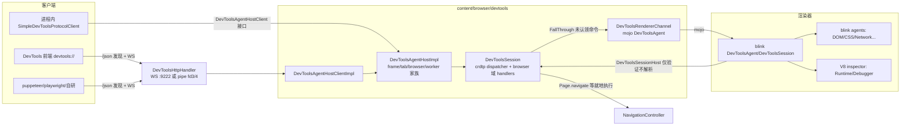

# 16.1 · CDP 总览：DevTools 协议面与宿主架构

> Chrome DevTools Protocol（CDP）是 puppeteer/playwright/chromedriver/DevTools 前端共同的地基。本篇讲清三件事：协议域全景与双层实现、一条命令（`Page.navigate`）从 WebSocket 到执行的完整分发、嵌入者如何暴露/扩展/裁剪这条协议面。16.2（协议扩展实操）、16.3（输入合成自动化）的前置。

## 1. 角色定位

CDP 在 Chromium 全景里横跨三层：**browser 进程层**（`content/browser/devtools/`——协议宿主与会话分发）、**blink 层**（`third_party/blink/renderer/core/inspector/`——渲染器内 agent）、**V8 层**（`Runtime`/`Debugger` 等由 V8 inspector 直接处理）。协议定义在 `third_party/blink/public/devtools_protocol/`（`.pdl` 文件，53 个域），V8 侧另有 `v8/include/js_protocol.pdl`。

对嵌入者，CDP 是 content 层暴露的**第四条产品通道**（另三条：WebContents API、mojo service、WebUI）：外部客户端（DevTools 前端、puppeteer、你的自动化产品）经 WebSocket 或 pipe 连进 browser 进程，把 JSON/CBOR 命令打进 `DevToolsAgentHost`，由 `DevToolsSession` 分发——browser 侧能处理的就地执行（`Page.navigate` 落进 `NavigationController`），否则经 mojo `DevToolsAgent` 转发渲染器，交 V8 inspector 或 blink agent。上游消费样板：`components/devtools/simple_devtools_protocol_client`（进程内客户端，7.2 截图通道即走它）；下游契约：导航系统、network service（观测/拦截）、input（`RenderWidgetHost`）、perfetto（Tracing）。姊妹篇 7.2 已走读 `Page.captureScreenshot`，2.2 已讲 headless 形态，本篇补全协议面本身。

## 2. 定制切入点全景表

| 想改 X | 动哪里 | 难度 | 影响面 |
|---|---|---|---|
| 新增自定义协议域（私有命令） | 新建 `third_party/blink/public/devtools_protocol/domains/MyDomain.pdl` + `content/browser/devtools/protocol_config.json` 加 `{"domain":"MyDomain"}` + 新建 `protocol/my_domain_handler.{h,cc}` + `BUILD.gn:108` outputs 加 `protocol/my_domain.{cc,h}` + `render_frame_devtools_agent_host.cc:419` 区注册 | 动架构 | 协议 JSON 全量再生成；上游 roll 冲突 |
| 命令拦截/审计（记录所有客户端命令） | `content/public/browser/devtools_manager_delegate.h:161` `HandleCommand`（每条命令先过 embedder，调 `callback` 放行） | 改逻辑 | 全部会话；样板 `chrome/browser/devtools/chrome_devtools_manager_delegate.cc` |
| 权限裁剪（受控产品只暴露部分域） | 不注册 handler（`render_frame_devtools_agent_host.cc:419-496` 删行即 MethodNotFound）+ `devtools_session.cc:432` `browser_only_`（`FallThrough` 一律拒绝转发渲染器） | 改逻辑 | puppeteer 等客户端会因缺域报错 |
| 新连接通道（UNIX socket/adopt fd） | 实现 `content::DevToolsSocketFactory` 交 `DevToolsAgentHost::StartRemoteDebuggingServer`（`devtools_agent_host.h:144`）；样板 `headless/lib/browser/headless_devtools.cc:67-96` `TCPAdoptServerSocketFactory` | 改配置 | 仅入网路径，协议层零改动 |
| pipe 模式（fd=3/4，无端口） | `devtools_agent_host.h:73-74`；帧格式二选一：ASCIIZ `\0` 分隔（`devtools_pipe_handler.cc:292-296`）或裸 CBOR（`:299-307`）；headless 接线 `headless_devtools.cc:129-131` | 改配置 | 单客户端独占 browser target |
| Target attach 策略（OOPIF 自动挂） | `protocol/target_handler.cc:1114` `SetAutoAttach`→`:897` `SetAutoAttachInternal`；OOPIF 细节 `frame_auto_attacher.cc`；worker 上报 `devtools_renderer_channel.cc:164-241` | 改逻辑 | 站点隔离下的会话拓扑 |
| 进程内消费 CDP（AI 抓页面） | `components/devtools/simple_devtools_protocol_client/simple_devtools_protocol_client.h:27`：`AttachToWebContents`(:41)、`SendCommand`(:51) | 改配置 | 不开 9222，无外部攻击面 |
| /json 发现接口定制 | `devtools_http_handler.cc:594` `OnJsonRequest`；目标列表数据源 `devtools_manager_delegate.h:116` `RemoteDebuggingTargets` | 改逻辑 | 外部工具发现行为 |
| 信任域/文件权限 | client 能力位：`render_frame_devtools_agent_host.cc:423` `MayWriteLocalFiles`、`:427-428` `MayReadLocalFiles`、`:431-433`/`:463` `IsTrusted`（决定 `TargetHandler::AccessMode`:469-473 与 V8 信任级） | 改逻辑 | 安全边界（chrome.debugger=不可信样板） |
| WS 入口管控 | `devtools_http_handler.cc:842-856` origin 白名单（`--remote-allow-origins`:959-966）+ `:129-137` `RequestIsSafeToServe`（Host 非 IP/localhost 拒答） | 改逻辑 | 远程调试安全面 |
| Network 域定制（脱敏/注入） | `protocol/network_handler.cc`（4509 行，network service 观测/改写）+ 拦截 `devtools_url_loader_interceptor.cc`（Fetch 域联动） | 动架构 | 6.x 网络篇的协议入口 |
| Input 合成定制（16.3 前站） | `protocol/input_handler.cc:1186` `DispatchKeyEvent`、`:1361` `DispatchMouseEvent`（browser 进程造事件直喂 `RenderWidgetHost`，不经 blink） | 改逻辑 | 自动化输入语义 |
| 断连语义 | WS：`devtools_http_handler.cc:360-374` `AgentHostClosed` 回发 `Inspector.detached` 再关连接；pipe：`on_disconnect`（`devtools_agent_host_impl.cc:220-235`） | 改逻辑 | 客户端重连策略 |
| headless 形态差异 | pipe+port 双开逻辑 `headless_devtools.cc:127-146` | 改配置 | 与 2.2 篇衔接 |

## 3. 关键源码走读

### 3.1 协议域分类表：谁在哪实现

一个域的命令落在哪层，决定你改哪里：

| 层 | 域 | 代表命令 | 实现文件 |
|---|---|---|---|
| browser（content） | Page | `navigate`/`reload`/`captureScreenshot` | `content/browser/devtools/protocol/page_handler.cc`（`protocol_config.json:163-172` 声明浏览器侧只生成这些命令） |
| browser | Input | `dispatchKeyEvent` | `protocol/input_handler.cc` |
| browser | Target/Tethering/SystemInfo/Browser | `setAutoAttach`/`bind`/`getInfo` | `protocol/target_handler.cc` 等；browser target 注册 `browser_devtools_agent_host.cc:230-264` |
| browser | Fetch | `enable`/`fulfillRequest` | `protocol/fetch_handler.cc` + `devtools_url_loader_interceptor.cc` |
| browser | Tracing（仅主 frame target） | `start` | `protocol/tracing_handler.cc:144,165`（TracingController/perfetto endpoint） |
| browser | Storage/Security/IO/Emulation(半)/Network(半)/Log(半) | `clearDataForOrigin`… | 对应 `*_handler.cc` |
| blink | CSS/Animation/Accessibility/DOMSnapshot/LayerTree/WebAudio/Media/IndexedDB… | `getMatchedStyles` | `third_party/blink/renderer/core/inspector/inspector_css_agent.cc` 等（blink 生成 32 域：`core/inspector/BUILD.gn:14-27` + `inspector_protocol_config.json`） |
| blink | DOM/Network/Runtime(壳)/Page(事件)/Overlay | `DOM.getDocument` | `inspector_dom_agent.cc`/`inspector_network_agent.cc`——与 browser 层同名域并存 |
| V8 | Runtime/Debugger/HeapProfiler/Profiler | `Runtime.evaluate` | `v8/include/js_protocol.pdl:1050,1529`；直通 `v8_session_->dispatchProtocolMessage`，不进 blink dispatcher |

判据（源码实证）：content 侧生成清单=`protocol_config.json`（`Runtime` 浏览器侧 `include:[]`，:179-182——同名域在 browser 侧一个命令都不生成）；blink 侧清单=`core/inspector/inspector_protocol_config.json`；同名域可**双层并存**，运行期由 dispatcher 分域分命令路由。

### 3.2 主线：`Page.navigate` 从 WebSocket 到执行

客户端发 `{"id":1,"method":"Page.navigate","params":{"url":"https://x"}}`：

**① 通道层（专用 IO 线程）**。`--remote-debugging-port` 起的 server 由 `DevToolsHttpHandler` 构造（`devtools_agent_host_impl.cc:206-217`），跑在 `Chrome_DevToolsHandlerThread`（`devtools_http_handler.cc:76`）。`ServerWrapper::OnWebSocketMessage`（:538-542）只碰 socket，所有回调 `PostTask` 上 UI 线程。握手 `OnWebSocketRequest`（:831）：先 origin 白名单（:842-856），再按路径分靶——`/devtools/browser/<guid>` 建 browser target（:873-886），`/devtools/page/<id>` 按目标 attach（:894-913；查不到 500，`AllowInspectingTarget` 拒绝 403），随即创建 `DevToolsAgentHostClientImpl`（:336，构造函数 :349 即 `AttachClient`）。

**② 宿主与会话层（UI 线程）**。`OnMessage`（:387-391）→ `DevToolsAgentHostImpl::DispatchProtocolMessage`（`devtools_agent_host_impl.cc:353-359`）按 client 反查 `DevToolsSession` → `DevToolsSession::DispatchProtocolMessage`（`devtools_session.cc:287`）。三件事：JSON→CBOR 归一（:325-336，内部统一 CBOR，出向转回）；解析 `call_id/method/sessionId` 成 `crdtp::Dispatchable`（:338-345）；带 `sessionId` 的消息路由到子会话（:356-376——puppeteer flat session 模式的地基）。随后 `DispatchProtocolMessageInternal`（:379）先给 embedder 拦截机会（:395-401 `HandleCommand`），未处理则 `dispatcher_->Dispatch`（:425）——dispatcher 里 wire 着 attach 时注册的全部 browser 侧 handler（`render_frame_devtools_agent_host.cc:419-496`；模板 `devtools_session.h:108` `CreateAndAddHandler`）。

**③ 域执行**。`PageHandler::Navigate`（`page_handler.cc:993-1098`）：URL 校验→`CheckNavigationAllowed`→transition 枚举映射→`NavigationController::LoadURLWithParams`（:1089）——**全程没跨进程**，导航引擎（2.3 篇）接管；异步响应经 `callback->sendSuccess` 原路回推。

**④ FallThrough：转发渲染器**。未被 browser handler 认领的命令走 `FallThrough`（`devtools_session.cc:428-459`）入 pending 队列并 `DispatchToAgent`（:490-513）上 mojo。`Runtime.evaluate` 即此路。两个精妙细节：**IO session 旁路**——`Debugger.pause` 等 13 个"中断类"命令走非关联 `io_session_`（清单 `devtools_session.cc:31-50`；mojo 双 receiver 设计 `devtools_agent.mojom:184-204` 注释），JS 死循环时也能把 pause 送进 isolate；**导航期挂起**——`ShouldSuspendDuringNavigation`（:68-70）在 cross-process 导航中扣住消息，成功后随 `DevToolsSessionState` 重放到新渲染器（`devtools_agent.mojom:98` reattach），断点/override 跨进程迁移不丢。

**⑤ 渲染器侧**。mojo `DevToolsAgent::AttachDevToolsSession`（`devtools_agent.mojom:98-104`）带 `client_expects_binary_responses`/`client_is_trusted`/`session_id`（信任位直传 V8：blink `devtools_session.cc:250-251` `kFullyTrusted/kUntrusted`）。blink `AttachDevToolsSessionImpl`（`devtools_agent.cc:251-280`）建会话；命令抵达 `DispatchProtocolCommandImpl`（blink `devtools_session.cc:309-350`）：`canDispatchMethod`(:334) 判 V8 能处理则直通 `v8_session_->dispatchProtocolMessage`（:337），否则进 blink `inspector_backend_dispatcher_`（:347）派给 `InspectorDomAgent` 等。

**⑥ 回程安全闸**。渲染器响应经 `DevToolsSessionHost::DispatchProtocolResponse`（`devtools_agent.mojom:204` 起）回 browser，`DispatchProtocolResponseOrNotification`（content `devtools_session.cc:576-613`）**不解析、只验证**（`ValidateMessage`:781-860 校验 sessionId 一致/无 `\0`/CBOR 封套合法，违规 `bad_message` 杀渲染器）——前提是渲染器可能已被攻陷。这是 WS/pipe 通道与 mojo 通道安全模型的分水岭。

## 4. 实操：最小 patch 示例

### Patch A：自定义协议域 `MyDomain.getState`（browser 侧）

官方先例：ChromeOS 把 `cros_protocol.pdl` 拼进协议再生成（`chrome/browser/devtools/BUILD.gn:63-83`，:79-81 `is_chromeos` 条件）——embedder 私有域是既有模式。五步：

```diff
# 1. 协议定义（自动并入 protocol.json：blink protocol_version action 的 inputs 含 domains/，
#    third_party/blink/public/devtools_protocol/BUILD.gn:83-100）
+ # third_party/blink/public/devtools_protocol/domains/MyDomain.pdl
+ experimental domain MyDomain
+   command getState
+     returns
+       string state

# 2. content/browser/devtools/protocol_config.json（options 内，仿 :78-80 FindInPage 条目）
+            { "domain": "MyDomain" },

# 3. content/browser/devtools/BUILD.gn（:108 起 outputs）
+     "protocol/my_domain.cc",
+     "protocol/my_domain.h",

# 4. 新建 content/browser/devtools/protocol/my_domain_handler.{h,cc}
#    骨架照抄 find_in_page_handler.h:24-33：继承 DevToolsDomainHandler + MyDomain::Backend，
#    实现 Wire(UberDispatcher*)/Disable()/Response GetState(callback)

# 5. render_frame_devtools_agent_host.cc:419 区（AttachSession 内）
+  session->CreateAndAddHandler<protocol::MyDomainHandler>();
```

`experimental` 标记的意义：官方对非 experimental 命令承诺"合理稳定"（`README.md`），自用域标 experimental 可避开 `check_protocol_compatibility.py` 的 roll 检查干扰。

### Patch B：embedder 级命令审计（零侵入协议）

只要"每条命令记日志/按策略拒绝"：实现 `DevToolsManagerDelegate::HandleCommand`（`devtools_manager_delegate.h:161-163`）。content 在命令进 dispatcher 前调用（`devtools_session.cc:395-401`），拿到 CBOR 原文，审计后调 `NotHandledCallback` 放行（或静默丢弃做白名单）。这是受控自动化产品最便宜的一层闸。

## 5. 依赖与数据流



输入：客户端 JSON（WS 文本帧）或 CBOR（pipe/binary）命令流。输出：`id` 响应 + 无 `id` 事件通知。三条核心契约：**会话状态**（`DevToolsSessionState` 跨渲染器迁移重放，`devtools_agent.mojom` 尾部两 struct）；**信任位**（`IsTrusted` 同时裁剪 `TargetHandler::AccessMode` 与 V8 信任级）；**消息有效性**（渲染器→browser 方向必须过 `ValidateMessage`）。Tracing 是旁路：不经会话分发直接挂 `TracingController`（perfetto）。`devtools://` 前端页面是另一个进程内 client（`devtools_frontend_host_impl.cc:57` `Create`；`devtools_resources.cc:5` 打包的压缩协议 JSON 供 `/json/protocol`）。

## 6. 坑与勘误

1. **CDP 不是公开 API**（文档对比）：`third_party/blink/public/devtools_protocol/README.md:9-20` 明示"may change without notice"，官方只支持 Chrome/DevTools/Lighthouse/Puppeteer/ChromeDriver。自建产品**必须锁 Chromium 版本**，跟主干升级时域可能消失；自定义域的 roll 冲突是常态。
2. **同名域双层实现的行为差异**（源码实证）：`Page` 域 browser 侧只生成 `protocol_config.json:163-172` 列出的命令，其余（`setLifecycleEventsEnabled` 等）落 blink；同域命令不同层执行、时序不同——browser 侧命令不经渲染器排队，走主 session 的消息会被导航挂起（`devtools_session.cc:68-70`），IO 旁路清单内的不会（:31-50）。表现为"导航前发的命令一个生效一个延迟"，不是 bug。
3. **导航中 attach 的竞态**（源码实证）：有 pending navigation 时新会话直接进 SuspendMode（`render_frame_devtools_agent_host.cc:412-417`），且区分 initial provisional（只挂 JS 执行类，清单 :81-93）与全挂——导航风暴中客户端看到的是命令延迟响应而非报错，别当死锁。
4. **WS 与 pipe 的安全边界差**（源码实证）：WS 受 origin 校验（`devtools_http_handler.cc:842-856`）+ Host 校验（:129-137，防 DNS rebinding）双闸，approval 模式下 `/json` 直接 404（:597-601）；pipe 无网络面但**单客户端独占**（fd 3/4 单 reader），断连默认触发 headless 关闭（`headless_devtools.cc:120-131`）。云端自动化选 pipe，本机工具选 WS+`--remote-allow-origins`。
5. **`GetProtocolVersion` 硬编码**（源码实证）：`devtools_agent_host_impl.cc:157-160` 返回字面量 `"1.3"`（TODO 注释承认未生成）——加了自定义域后 `/json/version` 不会变，别拿版本号当协议指纹。
6. **协议 JSON 与生成代码是两棵树**（源码实证）：代码生成走 `concatenate_protocols.py`（blink protocol.json + `js_protocol.pdl` + viz/native profiling 条件拼接，`content/browser/devtools/BUILD.gn:62-90`），而 `/json/protocol` 服务 grit 打包的压缩 JSON（`devtools_resources.cc:5` + `devtools_http_handler.cc:744`）——加 pdl 后 `/json/protocol` 未必同步，前端发现新域要靠自己分发协议文件。

## 7. 验证方法

- **手测通道**：`chrome --remote-debugging-port=9222`，`curl http://localhost:9222/json/version`（:626-644 组装）、`/json/list` 拿 `webSocketDebuggerUrl`，`websocat` 发 `{"id":1,"method":"Page.navigate","params":{"url":"about:blank"}}`。
- **pipe 冒烟**：headless `--remote-debugging-pipe`，向 fd=3 写 `{"id":1,"method":"Target.getTargets"}\0`（ASCIIZ 帧以 `\0` 结尾，`devtools_pipe_handler.cc:296`），fd=4 读。
- **协议自检**：`/json/protocol` 域清单 vs `protocol_config.json` include 列表对照，确认自定义域已生成。
- **追踪分发路径**：Perfetto 过滤 `devtools` category——`DevToolsSession::HandleCommand in Browser`（content `devtools_session.cc:420-424`）/`DispatchToAgent`/renderer 侧 `DispatchProtocolCommandImpl` 三类事件以 `call_id` Flow 串链，命令卡在哪层一目了然。
- **官方测试基建**：协议测试用 JS 写在 `third_party/blink/web_tests/inspector-protocol/`（两个 AGENTS.md 钉版：不新增 C++ 协议测试）；browser 侧参考 `content/browser/devtools/protocol/devtools_protocol_browsertest.cc`。
- **审计闸验证**：Patch B 生效后跑 puppeteer 脚本，`HandleCommand` 日志应逐条出现 method 字段。

## 8. 延伸

- 姊妹篇：`custom-dev/7.2-content-capture.md`（CDP 截图命令全链）、`custom-dev/2.2-embed-examples.md`（headless 形态）、`custom-dev/6.1-network-service.md`（Network 域背后）、16.2（blink 侧域+事件设计进阶）、16.3（Input 合成自动化）。
- explain：`explain/render-process-host.md`（DevToolsAgent 的 mojo 挂载点在 RenderFrameHost 生命周期内）、`explain/net-url-request.md`（Network 域观测底层管线）。
- repo-docs：`repo-docs/inter-process-communication.md`（关联/非关联接口——io_session 设计动因）、`repo-docs/site-isolation.md`（OOPIF 与 auto-attach 动因）。
- 图谱：knowledge-graph 的 `content/browser/devtools` 节点簇（DevToolsSession/DevToolsHttpHandler/RenderFrameDevToolsAgentHost）与 blink inspector 层。
- 上游：`third_party/blink/public/devtools_protocol/README.md`（贡献与稳定性）、`content/browser/devtools/protocol/AGENTS.md`（测试规范）、chromedevtools.github.io/devtools-protocol（官方 schema 站）。
