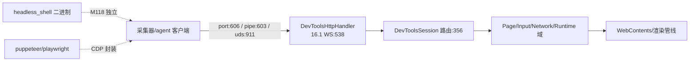

# 16.2 · CDP 自动化实战：页面操控/数据采集/headless 生态对接

> 把 CDP 用起来：三种连接通道选型、puppeteer/playwright 生态对接、采集与操控的工程模式。16.1 讲了协议架构，本篇是实操手册；16.3 把它升级成 AI agent 执行臂。

## ① 角色定位

CDP 自动化的宿主形态两类：**headless shell**（`chrome-headless-shell` 独立二进制——官方 README 实证 M118 起独立分发、M132 起旧 headless 从 Chrome 移除，`--headless=old` 已无效）跑服务器端采集/测试；**有头实例**（用户态浏览器开调试通道）跑 RPA/agent。通道三选一：`--remote-debugging-port`（TCP WS，content_switches.cc:606）、`--remote-debugging-pipe`（:603，stdio 帧协议——无网络暴露面，容器友好）、`--remote-debugging-socket-name`（:911，unix domain socket——本机 IPC 首选）。

## ② 定制切入点全景表

| 想干什么 | 动哪里 | 难度 | 影响面 |
|---|---|---|---|
| 开调试通道 | 三开关选一（:603/:606/:911）；安全边界按 16.1 的 --remote-allow-origins 教训 | 改配置 | 自动化入口 |
| 服务器采集产品 | headless_shell 形态（1.3 args 配方 `import("//build/args/headless.gn")`）+pipe 通道 | 改配置 | 采集后端 |
| 生态库对接 | puppeteer/playwright 连 port/pipe（官方 Node API 也是 CDP 封装——README "Usage from Node.js"） | 复用 | 快速起量 |
| 自建轻客户端 | 直发 CDP JSON（WS 客户端库 50 行；协议域按 16.1 分类表选） | 改逻辑 | 零依赖可控 |
| 页面操控 | Input 域（合成输入，16.3 全链）+Page 域（Navigate/Reload） | 改逻辑 | RPA 核心 |
| 数据采集 | DOM/Runtime 域取树与求值；或 7.2 五通道（CDP 之外的采集面） | 改逻辑 | 爬虫/理解 |
| 网络观测 | Network 域（请求拦截/改写与 6.2 联动） | 改逻辑 | 抓包/API 采集 |
| 会话管理 | Target 域（多 tab/iframe attach——16.1 的 OOPIF 树语义） | 改逻辑 | 并发采集 |
| 登录态复用 | --user-data-dir 持久 profile（11.1）或 Storage.setCookies | 改配置 | 鉴权采集 |
| 指纹伪装 | Emulation 域（UA/视口/时区）+绕检测边界（16.3 坑节） | 改配置 | 反反爬 |
| 截图/渲染 | Page.captureScreenshot（7.2 走读的全页链） | 复用 | 服务端渲染 |
| 受控裁剪 | DevToolsManagerDelegate::HandleCommand（16.1 :161——白名单域，产品级权限） | 改逻辑 | 安全暴露面 |

## ③ 关键源码走读：一个采集循环的最小闭环

**通道握手**：客户端连 port → `http://host:9222/json` 列 Target（16.1 的 AgentHost 面）→ WS 升级 → `Target.attachToTarget`（flatten 会话）→ 后续命令带 sessionId 路由（16.1 走读的子会话路由 :356）。

**导航与就绪**：`Page.navigate`（16.1 全链 :993）→ 就绪判定**别用 loadEventFired 一刀切**——SPA/懒加载用 7.2 的思路（Network 空闲+DOM 稳定双条件，或直接 PageSettledMonitor 语义自实现）。

**取数**：`Runtime.evaluate`（带 awaitPromise）跑提取函数（返回 JSON）优于 DOM 域逐节点爬（往返次数差一个量级）；大数据用 16.1 的 io_session 旁路（截图 blob 等不走 WS 主通道的机制）。

**合成输入**：`Input.dispatchMouseEvent` 系列（坐标=CSS 像素；iframe 内坐标要换算或用 `Input.insertTrustedDispatcher` 类更深层通道——以 16.3 走读为准）。

## ④ 实操：50 行直连采集器（零依赖）

```js
// ws 库 + 三步：列target→attach→navigate+evaluate
// 1) GET /json 找 page target 的 webSocketDebuggerUrl
// 2) WS 连接，发 {"id":1,"method":"Target.attachToTarget",
//        "params":{"targetId":tid,"flatten":true}}
// 3) {"id":2,"sessionId":sid,"method":"Page.navigate","params":{"url":...}}
//    {"id":3,"sessionId":sid,"method":"Runtime.evaluate",
//     "params":{"expression":"document.body.innerText",
//               "awaitPromise":true,"returnByValue":true}}
```
产品化路线：自建客户端（可控可审计）优先于盲引生态库；生态库适合验证期。容器部署用 **pipe 通道**（无端口暴露）+ headless_shell（1.3 配方）。

## ⑤ 依赖与数据流



## ⑥ 坑与勘误

- **--headless=old 已死**（README M132 实证，2.2 勘误呼应）：老资料的无头教程过半失效；新 headless=完整 Chrome 减显示。
- `--remote-debugging-port` 默认绑定 localhost 但**任意本机进程可连**（且历史版本组合 allow-origins 有远程暴露事故——16.1 :842-856 教训）；生产用 pipe/uds。
- CDP 无版本承诺（16.1 坑#1）：采集器**锁大版本**升级时跑协议 diff（GetProtocolVersion 返回恒 "1.3" 不可作兼容判据——16.1 坑#5）。
- Runtime.evaluate 的执行上下文默认主世界：被页面脚本窥探/篡改可期（13.5 的 world 知识对采集同样适用——必要时 isolated world）。
- 多 Target 的 flatten sessionId 漏传=命令发错 tab（经典事故）；iframe 是独立 Target（OOPIF），主会话命令打不进跨进程 iframe。
- 采集频率礼仪：单 Target 的命令串行排队，并发想清楚是要多 Target 还是多实例。

## ⑦ 验证方法

- 通道连通：GET /json/version 三通道各验一次
- 采集正确性：固定测试页对比 innerText/截图哈希
- 就绪策略：弱网+慢 SPA 下半截率统计（§3 判定优化前后）
- 安全：port 通道下外部主机连通性必须不通；pipe 容器外无句柄

## ⑧ 延伸

- 协议架构与域分类：16.1（前置必读）；AI agent 化：16.3；内容采集深面：7.2；网络拦截：6.2；脚本执行世界：13.5
- 官方：headless/README.md（本篇一手来源）、chrome-for-testing 分发说明
