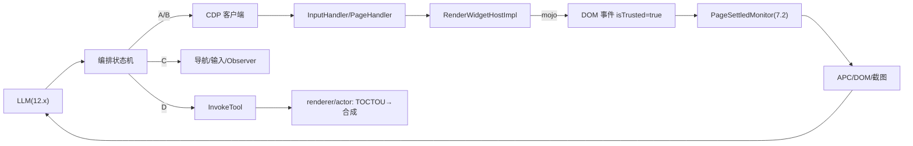

# 16.3 · Agent 通道：CDP 驱动的浏览器自动化

> kylin-ai 类 AI 浏览器的"执行臂"工程：LLM 输出结构化意图（点击/输入/导航/提取），经通道执行并回收观测。16.1 铺协议面，本篇讲产品级 agent 通道：四条执行路线选型、`Input.dispatchMouseEvent` 合成输入全链与真实输入的分叉点、Chrome 官方 agent 执行引擎解剖、kylin-ai 最小 agent 循环骨架。

## 1. 角色定位

Agent 通道是 LLM 大脑与页面间的"脊髓"，横跨四层：**content 协议层**（`input_handler.cc`）、**renderer_host 输入路由层**（`RenderWidgetHostImpl`+`SyntheticGestureController`）、**chrome 应用层**（`chrome/browser/actor/`+`chrome/renderer/actor/`——Gemini in Chrome 官方 agent 执行引擎，本篇最大参照物）、**组件层**（`simple_devtools_protocol_client` 进程内 CDP 客户端，`components/headless/command_handler` 是产品级用例）。上游：12.x AI 面、7.2 内容观测；下游：input 路由、NavigationController、blink DOM 事件。与 13.5 分工：13.5 管"页面内跑什么代码"，本篇管"agent 如何对页面施加动作并闭环回收"。

## 2. 定制切入点全景表

| 想改 X | 动哪里 | 难度 | 影响面 |
|---|---|---|---|
| 通道 A：内嵌 CDP 客户端 | `simple_devtools_protocol_client.h:41`；样板 `headless_command_handler.cc:294-386` | 改配置 | 零攻击面 |
| 通道 B：外挂 WS/pipe | `devtools_http_handler.cc:538`；pipe `devtools_pipe_handler.cc:292-307` | 改配置 | 生态现成 |
| 通道 C：原生 API 直调 | `render_frame_host.h:618` ExecuteJavaScript——**仅 chrome://**（:617 注释） | 改逻辑 | 无 JS 执行 |
| 通道 D：mojo 工具通道 | `chrome_render_frame.mojom:122` InvokeTool；目标 `actor.mojom:18` | 动架构 | renderer 内执行 |
| 合成输入拟人化 | `input_handler.cc:1361`；参照 `click_dispatcher.cc:57-82` | 改逻辑 | 可检测性 |
| 观测采样（快照 vs 事件流） | APC `page_content_proto_provider.h:144`；编排 `tab_observation_controller.cc:255` | 改逻辑 | token 成本 |
| 页面就绪判定 | `observation_delay_controller.h:73` Wait（复用 7.2 PageSettledMonitor） | 改配置 | 截早了问题 |
| 多 tab 会话管理 | `Target.pdl:237` setAutoAttach；`execution_engine.h:260` AddTab | 改逻辑 | OOPIF 拓扑 |
| iframe 穿透 | 免费：`input_handler.cc:1417` 异步 hit test 自动路由子 widget | 改配置 | 主 frame 坐标即可 |
| 下载与弹窗处理 | `execution_engine.h:289` + `actor_navigation_throttle.cc` | 改逻辑 | window.open 门控 |
| 反自动化（isTrusted） | 合成事件 isTrusted=true（`pointer_event_manager.cc:162`）；kFromDebugger 不出 JS（`web_input_event.h:138`） | 改逻辑 | 见坑 1 |
| 失败重试与回滚 | actor_types.mojom ActionResultCode + `tool_controller.cc:271` | 改逻辑 | 错误驱动重试 |
| CDP 权限裁剪 | `devtools_manager_delegate.h:161` HandleCommand（`devtools_session.cc:395` 调用） | 改逻辑 | 安全边界 |
| 审计日志 | 同上抓 CBOR 原文；官方范式 `tool_controller.cc:133` AggregatedJournal | 改逻辑 | 合规回放 |
| 人工接管 | `execution_engine.h:298` UserTakeover/:256 Interrupt/:208 Pause | 改逻辑 | 逃生门 |
| 与 WebMCP/content script 分工 | 页面自声明工具 `script_tool_request.cc:46`（gate kWebMCP） | 改配置 | 能力边界 |

## 3. 关键源码走读

### 3.1 主线：Input.dispatchMouseEvent 全链

发 `{"method":"Input.dispatchMouseEvent","params":{"type":"mousePressed","x":100,"y":200,"button":"left"}}`：

**① 构造**：`InputHandler::DispatchMouseEvent`（`input_handler.cc:1361-1393`）交 `CreateWebMouseEvent`；:165 modifiers 一律先置 `kFromDebugger`（键盘同 :97）。坐标 CSS 像素，ScaleFactor 换算（对照 `SynthesizeTapGesture` :2263 的 `from_devtools_debugger=true` :2265）。
**② wheel 特例**：`HandleMouseEvent`（:1395-1434）对 wheel 先 `InsertVisualStateCallback`（:1428-1430）等合成器出帧，否则动态注册的 listener 丢事件（:1425-1427 注释）。
**③ OOPIF 穿透**：:1409-1424 绑进 `GetRenderWidgetHostAtPointAsynchronously`（`render_widget_host_delegate.h:193`）异步 hit test 找目标 widget 并转坐标——**CDP 输入对 iframe 免费穿透，客户端永远用主 frame 视口坐标**。
**④ 注入**：`OnWidgetForDispatchMouseEvent`（:1629-1651）重写坐标后交 `InputInjector::InjectMouseEvent`（:739-766）：拖拽拦截（:746）→ `Focus()` → `ForwardMouseEvent`（:757）。
**⑤ 分叉与合流**：真实输入 OS→平台 View（`render_widget_host_view_event_handler.cc:965`/`render_widget_host_view_base.cc:815`）；CDP 直构 WebMouseEvent → `render_widget_host_impl.cc:1697`。**分叉在平台事件转换层（CDP 无原生 ui::MouseEvent/OS latency），合流在 `ForwardMouseEventWithLatencyInfo`（:1706）**，此后 input 路由→mojo→renderer 同轨。
**⑥ 回调语义**：`OnInputEventAck`（:835-870）只认带 kFromDebugger 的 ack（:839）——**响应返回=renderer 已 ack，非页面 handler 跑完**；事件被丢弃则注入器自毁（:872）。

旁支：synthesizeTap/Scroll/Pinch（Input.pdl :272-318）走 `QueueSyntheticGesture`（`render_widget_host_impl.cc:1991`）→ `SyntheticGestureController`（`synthetic_gesture_controller.h:30`）逐帧驱动，适合速度曲线滑动；touch 在 kSyntheticPointerActions 下走 :1776 经 `SyntheticPointerDriver`。

### 3.2 四路线对比（核心交付）

| 维度 | A 内嵌 CDP | B 外挂 WS/pipe | C 原生直调 | D mojo 工具通道 |
|---|---|---|---|---|
| 隔离性 | 无新增网络面 | 9222 全机可达（16.1 坑 4） | 无协议面 | mojo 边界即权限 |
| 能力面 | 全 CDP 域 | 同 A | **JS 执行被禁**（render_frame_host.h:617） | 白名单工具 |
| 延迟 | 进程内回调 | WS 往返+编解码 | 最快 | mojo 一跳 |
| 复杂度 | 低 | 低（puppeteer 现成） | 中 | 高（全套框架） |
| 被检测性 | isTrusted=true | 同左；伴 headless/UA 特征 | 不产生用户激活 | 渲染器内合成 isTrusted=true；语义点击 `click_tool.cc:100` |
| 版本耦合 | 同仓编译无漂移 | CDP 随时变（16.1 坑 1） | public 较稳 | 自有接口 |

**结论**：嵌入式产品首选 **A**；复用生态/跨机选 **B**（云端务必 pipe）；投工程量换最强安全选 **D**；**C 单独不成立**，作 A/D 补充（导航/输入/Observer）。

### 3.3 官方先例：chrome/browser/actor 执行引擎

Chrome 把 agent 执行臂做进主线（2025 起，`README.md:55` 可 `--disable-features=GlicActor,GlicActorUi` 关闭）：**编排** `ExecutionEngine`（`execution_engine.h:86`）状态机 :102-110、导航门控 `ShouldNavigationCommit`（:289，十一种裁决 :118-149）；**单工具** `ToolController`（`tool_controller.cc:61-72`）Invoke 前 TOCTOU（:223-232，目标必须在最后 APC 快照内）→ Invoke 后等页面稳定（:279-294）→ 导航则重启观测（:303-318）；**下发** `PageTool::Invoke`（`page_tool.cc:571-634`）经 associated interface `InvokeTool`（:630），挂 observer 防 RFH 换出/BFCache 吞回复（:593-613）；**renderer 执行** `click_dispatcher.cc`：move-before-click（:57-82）→ mouseDown（:98-144，`widget->HandleInputEvent`）→ mouseUp（:146-181），键入 `type_tool.cc:344-362`。与 CDP 的本质差：**"意图→事件"的翻译下沉进 renderer，目标先过 DOM 解析与遮挡校验，坐标只是执行细节**。

## 4. 实操：kylin-ai 最小 agent 循环

感知→规划→执行→回收四拍，走路线 A（伪码但 API 全真，行号实证）：

```cpp
class KylinAgentLoop {
  explicit KylinAgentLoop(content::WebContents* wc) {
    cdp_.AttachToWebContents(wc);               // simple_devtools_protocol_client.h:41
    cdp_.AddEventHandler("Page.loadEventFired", ...);  // :46：事件流半边
    cdp_.SendCommand("Page.enable", {});
  }
  void RunOnce() {                              // ①感知：结构化快照
    cdp_.SendCommand("Runtime.evaluate",        // :51 → V8 inspector
        {"expression": kSnapshotJS, "returnByValue": true},  // 取可点元素 text+rect
        Bind(&KylinAgentLoop::OnObserved));
  }
  void OnObserved(base::DictValue page) {       // ②规划：LLM（12.x）
    Plan plan = llm_.Decide(page);              // {"action":"click","index":3}
    cdp_.SendCommand("Input.dispatchMouseEvent", // ③执行：§3.1 全链
        {"type":"mousePressed","x":plan.x,"y":plan.y,"button":"left"},
        Bind(&KylinAgentLoop::OnActed));        // 另一拍 Page.navigate（page_handler.cc:993）
  }
  void OnActed(base::DictValue) {               // ④回收：等稳+断言
    // 产品级换 ObservationDelayController（.h:73 Wait → PageSettledMonitor，7.2）
    cdp_.SendCommand("Runtime.evaluate",
        {"expression": "document.body.innerText.includes('成功')",
         "returnByValue": true},
        Bind(&KylinAgentLoop::OnVerified));
  }
  void OnVerified(base::DictValue r) {
    journal_.Log(r.ok ? "OK" : "RETRY");        // 审计留痕
    RunOnce();                                  // 循环下一拍
  }
  simple_devtools_protocol_client::SimpleDevToolsProtocolClient cdp_;
};
```

官方等价物：`HeadlessCommandHandler`（`headless_command_handler.cc:294-295` 双客户端 attach → :383-386 `Runtime.evaluate` awaitPromise 跑页面内 harness——复杂编排下放 JS 的思路）。

**Patch：embedder 审计白名单**。实现 `DevToolsManagerDelegate::HandleCommand`（`devtools_manager_delegate.h:161`；命令进 dispatcher 前必过，`devtools_session.cc:395-401`）：白名单放行 `Page.navigate`/`Input.*`/`Runtime.evaluate`，其余记日志后不调 NotHandledCallback（静默丢弃）。样板 `chrome_devtools_manager_delegate.cc`。一层完成"权限裁剪+审计"两个切入点。

## 5. 依赖与数据流



输入：结构化意图（动作+dom_node_id 或坐标）。输出：ActionResult（ActionResultCode+`requires_page_stabilization`，`tool_controller.cc:271-277`）+观测快照。三契约：**坐标空间**（CDP=主 frame 视口 CSS 像素；actor mojo=DIP，renderer 再 DIPsToBlinkSpace，`actor.mojom:22-29`）；**完成语义**（CDP 回调=ack≠handler 跑完；actor=工具完成且页面稳定）；**审计**（每动作一条 journal entry）。

## 6. 坑与勘误

1. **isTrusted 不是合成事件破绽**（源码实证）：合成事件走完整输入管线，DOM 层 isTrusted=true（`pointer_event_manager.cc:155-162`）；kFromDebugger（`web_input_event.h:138`）不映射进 JS。可测的是无轨迹/时序分布——参照 click_dispatcher.cc:57-82 补 move-before-click。
2. **navigator.webdriver 与远程调试无关**（源码实证）：`navigator.cc:84-90` 只看 AutomationControlled flag 与 Emulation 覆盖；开 9222 不置 webdriver。
3. **原生 JS 直调产品不可用**（源码实证）：ExecuteJavaScript 仅 chrome://（`render_frame_host.h:616-617` 注释），无限制版是 ForTests（:632）。
4. **命令返回≠页面处理完**：Input 回调在 renderer ack 即触发（:835-870）；SPA 异步渲染仍在跑，必须叠 PageSettledMonitor（7.2）。
5. **wheel 的 compositor 同步**：:1425-1433 先 InsertVisualStateCallback，绕过则动态 listener 丢事件。
6. **拖拽状态机**：press 序列被 DragController（:983-1150 区）拦截，不完整序列挂起回调；`Input.cancelDragging`（Input.pdl :230）逃生。
7. **CDP 非公开 API 锁版本**（文档对比，16.1 坑 1）：外挂客户端漂移重灾区；A/D 同仓编译免疫。
8. **无头/有头行为差**（源码实证）：pipe 单客户端独占、断连默认关浏览器（16.1 坑 4）；合成手势平台 target 分裂（synthetic_gesture_target_{aura,android,mac}）。
9. **导航竞态三连**（源码实证）：①TOCTOU（官方解法 TimeOfUseValidation 强制目标在最后 APC 内，`page_tool.cc:113-152`）；②RFH 换出/BFCache 吞 mojo 回复（`page_tool.cc:593-613`）；③等待期导航重启观测（`tool_controller.cc:303-318`）。缺一环偶发挂死。
10. **click 语义分层**：CDP 坐标点击会被遮挡层截走；actor kLeftOnOccludedTarget 走 `SimulateAccessibilityClick()`（`click_tool.cc:100`）绕遮挡。页面自声明工具（WebMCP，`script_tool_request.cc:46`）是第三层。

## 7. 验证方法

- **通道手测**：`--remote-debugging-port=9222`，websocat 连 `/json/list` 的 webSocketDebuggerUrl 发 mousePressed/mouseReleased 对；页面挂 `addEventListener('click',e=>document.title=e.isTrusted)` 验坑 1。
- **内嵌冒烟**：照 §4 骨架写 browser_test；或跑 `headless --dump-dom`（HeadlessCommandHandler 全链）。
- **路由追踪**：Perfetto 过滤 input——`render_widget_host_impl.cc:1709` 有 TRACE_EVENT；OOPIF 内点击看 hit test 是否落子 widget。
- **actor 对照**：`chrome://browser-actuator-internals`（资源 `chrome/browser/resources/BUILD.gn:421`）；`click_tool_browsertest.cc`/`page_tool_browsertest.cc` 是行为规格书。
- **协议测试**：自定义 Input 行为按 `content/browser/devtools/protocol/AGENTS.md` 用 JS 写进 `third_party/blink/web_tests/inspector-protocol/`。
- **审计闸/竞态**：Patch 后跑 §4 循环看 HandleCommand 日志逐条出现、白名单外被吞；目标页注入 setInterval 改 DOM，100 拍统计 TOCTOU 失败与挂死。

## 8. 延伸

姊妹篇：16.1（协议宿主/分发/裁剪，前置）、7.2（感知侧 APC+PageSettled）、13.5（脚本注入）、2.2（headless）、12.4（LLM 面对接）。explain：`explain/render-process-host.md`、`explain/net-url-request.md`。repo-docs：site-isolation.md、inter-process-communication.md。上游：`chrome/browser/actor/README.md`、`chrome/renderer/actor/`、`content/common/input/`、chromedevtools.github.io/devtools-protocol。图谱：content-browser（InputHandler/RenderWidgetHostImpl 簇）、chrome-browser（ExecutionEngine/ToolController 簇）、blink-renderer（PointerEventManager）。
