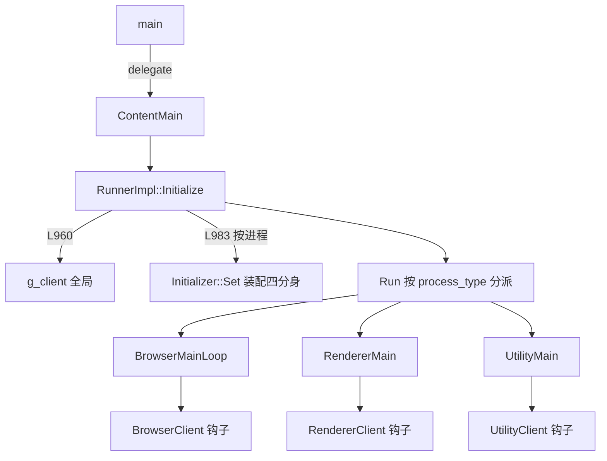

# 2.1 · Content API：三大 Client 与嵌入契约（自制浏览器的接口层）

> 造自己的浏览器，改的不是 Blink 也不是 net，而是 **Content API**——官方留给嵌入者的接口面；content_shell 最简参照、Chrome 满配参照。

## ① 角色定位

Chromium 是"content 内核 + chrome 壳"双层：`//content` 实现多进程内核（进程模型/沙箱/导航），`//chrome` 只是最大嵌入者；接缝即 `//content/public`，README（content/public/README.md:6-9）：隔离 Chrome 开发者与 content 内部、让边界清晰。

接口面五个类：根 `ContentClient`（content_client.h:82，品牌/资源/scheme 面）+ 四分身 `ContentBrowserClient`（browser 进程，头文件 3430 行、约 375 个 virtual——全系统最大嵌入接口）、`ContentRendererClient`（484 行）、`ContentUtilityClient`/`ContentGpuClient`（59/75 行，钩子极少）。"三大 Client"即前三个；注入工厂是 `ContentMainDelegate`（content_main_delegate.h:204-208）。content 在关键时机回调 Client，覆写即接管；CEF、Android WebView、headless 全踩在这套 API 上。

## ② 定制切入点全景表

未注明行号者均属 `content/public/browser/content_browser_client.h`：

| 想接管的能力 | 覆写哪个方法 | 难度 | 影响面 |
|---|---|---|---|
| 浏览器行为总入口 | 实现 `ContentBrowserClient`（L305-313，自称 escape hatch） | 动架构 | 全局 |
| 启动流程 | `CreateBrowserMainParts`（L363） | 动架构 | browser 启动链 |
| 品牌 UA | `GetUserAgent` 族三钩子（L2513-2519） | 改逻辑 | UA 全链 |
| 私有 scheme | `ContentClient::AddAdditionalSchemes`（content_client.h:164；Schemes L117-162） | 改逻辑 | scheme 注册表 |
| 站点分组/隔离 | `GetEffectiveURL`（L434）+`ShouldUseProcessPerSite`（L474）+`CanCommitURL`（L668） | 动架构 | SiteInstance/安全 |
| 自定义协议加载 | `CreateNonNetworkNavigationURLLoaderFactory`（L1810）+`RegisterNonNetworkSubresourceURLLoaderFactories`（L1847） | 改逻辑 | 导航/子资源管线 |
| 网络栈参数 | `ConfigureNetworkContextParams`（content_browser_client.cc:1199-1208） | 改逻辑 | NetworkContext |
| 证书错误 | `AllowCertificateError`（L1222）+`SelectClientCertificate`（L1246） | 改逻辑 | SSL 决策 |
| Web 设置 | `OverrideWebPreferences`（L1332）+`...AfterNavigation`（L1341） | 改配置级 | Blink 设置 |
| 子进程命令行 | `AppendExtraCommandLineSwitches`（L904） | 改配置级 | 所有子进程 |
| 进程生命周期 | `RenderProcessWillLaunch`（L426）+`BrowserChildProcessHostCreated`（L429） | 改逻辑 | 进程事件 |
| 文件系统后端 | `GetAdditionalFileSystemBackends`（L1420） | 动架构 | FileSystem API |
| 导航拦截 | `CreateThrottlesForNavigation`（L1593）+`BrowserURLHandlerCreated`（L1364） | 改逻辑 | 每次导航 |
| AI 模型服务 | `CreateModelBrokerClient`（L1297-1299） | 动架构 | on-device AI |
| renderer JS 注入 | `RunScriptsAtDocumentStart/End`（content_renderer_client.h:351-359） | 改逻辑 | 文档加载 |

## ③ 关键源码走读：main() 到钩子回调

**main()→ContentMain。** `ChromeMain()`（chrome/app/chrome_main.cc:108）核心一行 L224 `content::ContentMain(...)`——`ContentMainParams`（content/public/app/content_main.h:36-95）的 delegate 在此进场。`ContentMain()`（content/app/content_main.cc:348-351）进 `RunContentProcess()`（同文件 189-344）：L311 `Initialize()`、L337 `Run()`。

**Initialize=注入发生地。** `ContentMainRunnerImpl::Initialize()`（content_main_runner_impl.cc 940-1112）四步：L960-961 `ContentClientCreator::Create`（L556-563）调 `delegate->CreateContentClient()` 再 `SetContentClient`——写静态全局 g_client（content_client.cc:27）；L962-963 `BasicStartupComplete()`；L982 `RegisterContentSchemes`——AddAdditionalSchemes 的结果入注册表并锁定（content_main_delegate.h:100-112）；L983 **`ContentClientInitializer::Set` 按进程分派**（L565-587）：process_type 空（browser）→只设 `browser_=CreateContentBrowserClient()`；renderer/utility/gpu 各设对应分身；`--single-process` 四者同建（L579-585）。

**Run=进程分派与钩子。** `Run()`（L1145）按 `--process-type`：空→RunBrowserProcessMain（L744-756）→BrowserMainLoop L534 调 CreateBrowserMainParts；子进程表 L773-777 分派 Utility/Renderer/GpuMain。之后： renderer：renderer_main.cc:238 取 client；render_thread_impl.cc:564 `RenderThreadStarted()`、L866 `DidSetUserAgent()`（UA 自 browser 侧经 IPC 而来）。browser 持续回调：render_frame_host_impl.cc:11930 `CanCommitURL()`（安全闸）、ssl_manager.cc:369 AllowCertificateError、web_contents_impl.cc:4249 OverrideWebPreferences。`GetContentClient()` 仅 CONTENT_IMPLEMENTATION 下导出（content_client.h:64-67）。

**导出面。** content/public/browser/BUILD.gn:16-23 的 `group("browser")` 是外部唯一入口，`browser_sources` `visibility=["//content/*"]`（L27）；**嵌入者只能 include `content/public/**`、链 public group**（README:87-88）。控制流单向；签名三范式：bool 决策、填充（写 map）、工厂。

## ④ 实操：最小 patch——私有 scheme+自定义加载

以接管 `myapp://` 协议为例（改逻辑）。三步缺一白屏：

第一步 scheme 注册（根 Client，启动期一次）：覆写 `AddAdditionalSchemes`，向 `standard_schemes`/`secure_schemes` 各 push `"myapp"`（语义见 content_client.h:139）。第二步导航请求接管：

```cpp
mojo::PendingRemote<network::mojom::URLLoaderFactory>
MyContentBrowserClient::CreateNonNetworkNavigationURLLoaderFactory(
    const std::string& scheme, FrameTreeNodeId id) {
  if (scheme != "myapp") return {};   // 其余走默认（L1800-1806）
  mojo::PendingRemote<network::mojom::URLLoaderFactory> remote;
  new mybrowser::MyAppURLLoaderFactory(remote.InitWithNewPipeAndPassReceiver());
  return remote;
}
```

第三步子资源接管：覆写 `RegisterNonNetworkSubresourceURLLoaderFactories`（L1847，向 map 填 "myapp"，调用点 render_frame_host_impl.cc:12978）。配套 `IsHandledURL`（L646）承认 scheme（参照 shell_content_browser_client.cc:421-440）；共进程控制动 `GetEffectiveURL`（L434）——Chrome 用它归组 chrome://。

入手路径：仿 `content/shell/app/shell_main_delegate.cc:473-510`（四个 Create 不足 40 行）搭同构 delegate；满配对照 chrome_main_delegate.cc:1868-1914。UA 品牌定制见 3.3 篇（`GetUserAgent` 族三钩子一起改，默认返回空串：content_browser_client.cc:1435-1437）。

## ⑤ 依赖与数据流




## ⑥ 坑与勘误

1. **`OverrideWebkitPrefs` 已不存在**：现名 `OverrideWebPreferences`（L1332；类型迁 blink::web_pref，L140-142）。老博客普遍旧名。（源码实证）
2. **`RegisterNonNetworkNavigationURLLoaderFactories` 是讹传名**：真实 API 为 `CreateNonNetworkNavigationURLLoaderFactory`（L1810，单 scheme 返回 PendingRemote）；三个 RegisterNonNetwork*（L1824/L1836/L1847 填 map）是另一族。（源码实证）
3. **UI 线程假设**：类注释 L307-308 默认 UI 线程，例外看方法注释。（源码实证）
4. **scheme 注册一次性**：L982 后锁死，运行期无门。（源码实证）
5. **--single-process/zygote 假象**：四 Client 同进程全建（L579-585）；zygote fork 后二次注入（L651）。（源码实证）
6. **GetContentClient 不开放**：CONTENT_IMPLEMENTATION 挡导出（content_client.h:64-67）。（源码实证）
7. **"public 只有头文件"不准**：README:45-52 允许 .cc，test 允许具体类。（文档对比）

## ⑦ 验证方法

- **注入验证**：`ContentClientInitializer::Set`（content_main_runner_impl.cc:565）断点看命中分支；或每覆写方法 `LOG(ERROR)<<__func__`。
- **scheme**：导航 `myapp://test`+`--log-net-log` 看 factory 替换；ps 查 renderer 进程命令行。
- **回归面**：content_shell 全家+content_browser_client_unittest.cc 跑通即契约未破。

## ⑧ 延伸

- 本知识库：`../onboarding/ONBOARDING.md`；本系列 2.2（Chrome vs shell 对比）、2.3（导航与 NavigationThrottle）、3.1/3.3。
- 源内一手：content/public/README.md（API 宪法）、content/shell/；外部：CEF 的 CefContentBrowserClient。
- 图谱：knowledge-graph.json 按 content/public 前缀过滤反查调用邻居。
