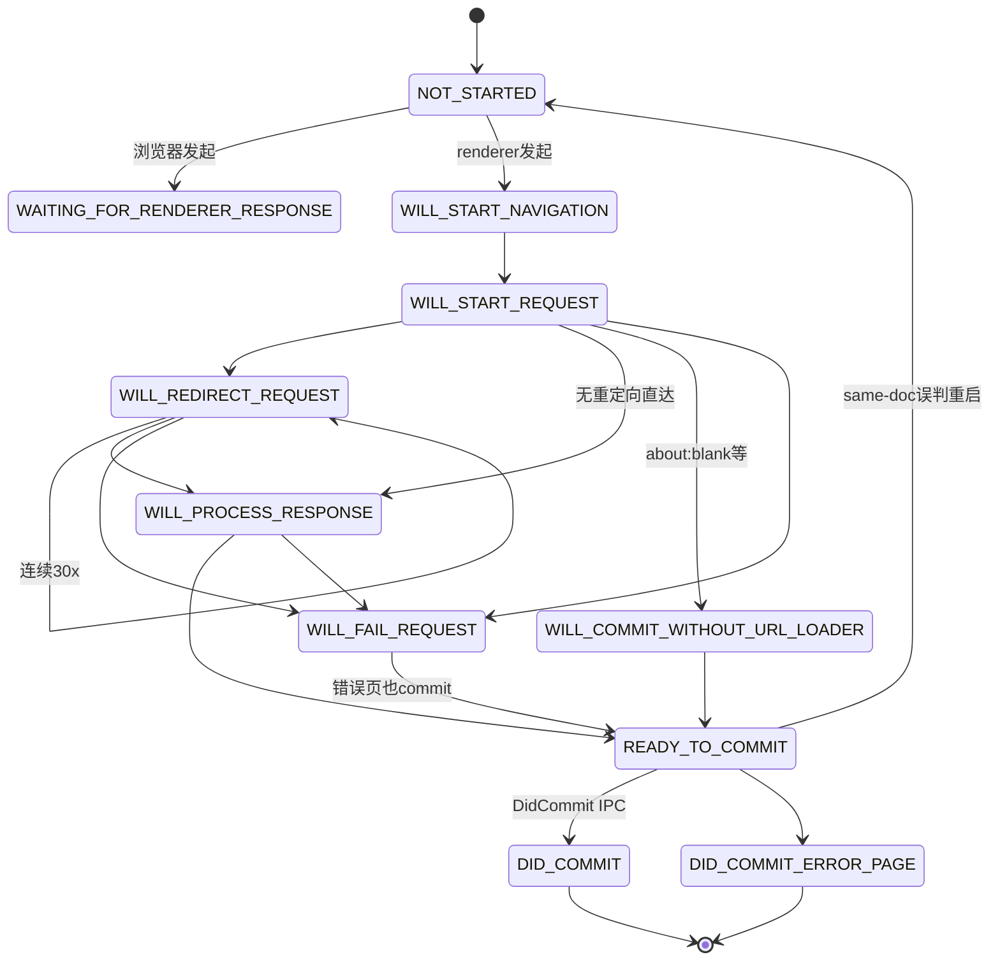
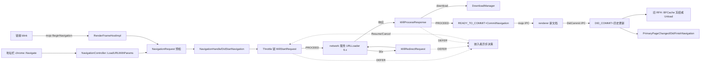

# 2.3 WebContents 与导航生命周期（嵌入者/定制者视角）

> 基线：chromium/chromium @8fe2331（2026-10 main）。本篇回答一个问题：**从地址栏回车/链接点击到旧文档被替换，中间发生了什么、你在哪一步能伸手**——这是"接管浏览器行为"（拦截跳转、重写 URL、管控新窗、注入逻辑）的核心知识面。

## ① 角色定位

导航是横跨三进程的最长事务：browser 进程决策、network 进程取数、renderer 进程渲染。本篇聚焦 browser 侧"总账房"——`content/browser/renderer_host/` 的 NavigationRequest 状态机，及它暴露给嵌入者的两张契约面：**决策面**（`WebContentsDelegate` 决定"去哪开"；`NavigationThrottle` 经 `ContentBrowserClient::CreateThrottlesForNavigation`（content_browser_client.h:1593）注册，决定"放不放行"）与**观察面**（`WebContentsObserver` 只读播报全程）。`WebContents`（SetDelegate web_contents.h:484、GetController :492）是页面容器常青树：**一次导航全程 WebContents 对象不变**，变的是内部 RenderFrameHost（可能换 speculative 新 RFH）与 NavigationEntry。`NavigationController` 管 session history，是浏览器发起导航的 API 入口。上游接 chrome 层 `chrome::Navigate`，下游接网络栈（6.x）与进程模型（9.1）。

## ② 定制切入点全景表

| 想改什么 | 动哪里（file:line） | 难度 | 影响面 |
|---|---|---|---|
| 拦截/放行导航（三关 WillStartRequest/WillRedirectRequest/WillProcessResponse） | 自定义 NavigationThrottle（navigation_throttle.h:155/174/194）+ 注册钩子 `CreateThrottlesForNavigation`（content_browser_client.h:1593） | 改逻辑 | 每次跨文档导航 |
| 异步决策（弹窗/云审后再放行） | 返回 DEFER（navigation_throttle.h:53）+ `Resume()` :242 / `CancelDeferredNavigation()` :251 | 改逻辑 | 单次导航，卡加载 |
| 重写 URL（A→B 再导航） | `BrowserURLHandlerCreated`（content_browser_client.h:1364）+ `BrowserURLHandler::AddHandlerPair`（browser_url_handler.h:60） | 改逻辑 | 所有导航起点，早于 throttle |
| 新窗/tab 中控（target=_blank 去向） | `WebContentsDelegate::OpenURLFromTab`（web_contents_delegate.h:170）、`AddNewContents` :205；chrome 范例 `GetBrowserAndTabForDisposition`（browser_navigator.cc:253 定义/:802 调用） | 改逻辑 | 所有开新窗行为 |
| 否决 renderer 发起的跨进程导航 | `ShouldAllowRendererInitiatedCrossProcessNavigation`（web_contents_delegate.h:178） | 改逻辑 | 安全敏感 |
| 下载拦截（响应转下载的分叉点） | `is_download_` 判定（navigation_request.cc:4977）→ `DownloadManagerImpl::InterceptNavigation`（:6700）；查询面 `IsDownload`（navigation_handle.h:627） | 动架构 | 导航/下载边界 |
| 历史记录干预 | `PruneAllButLastCommitted`（navigation_controller.h:776）、`PruneForwardEntries` :710、`LoadURLParams::should_replace_current_entry` :332 | 改逻辑 | 后退/前进行为 |
| 跨 origin 导航手动确认 | 自写 throttle 比对 `GetInitiatorOrigin`（navigation_handle.h:678）vs `GetURL` :175，DEFER+对话框 | 改逻辑 | UX 层 |
| 阻特定 scheme（禁 file:/tel:） | 范例 BlockedSchemeNavigationThrottle（blocked_scheme_navigation_throttle.cc）+ BLOCK_REQUEST（navigation_throttle.h:66） | 改逻辑 | 主 frame data/filescheme 已有内置兜底 |
| bfcache 控制（禁某页进缓存） | `BackForwardCache::DisableForRenderFrameHost`（back_forward_cache.h:198/208 静态 API）+ NotRestoredReason 枚举 :37 起 | 改配置 | 后退秒开 vs 内存 |
| 页面生命周期观察（埋点/AI 联动，8.x 呼应） | 派生 `WebContentsObserver`（构造 :1079/`Observe` :1088，web_contents_observer.h）：DidStartNavigation :340、DidFinishNavigation :391、PrimaryPageChanged :186、RenderFrameCreated :138 | 改逻辑 | 每 WebContents 一份 |
| JS 注入（commit 前初始化 renderer 侧） | `ReadyToCommitNavigation`（web_contents_observer.h:357）里 `ExecuteJavaScriptInIsolatedWorld`（render_frame_host.h:624；:618 为普通版） | 改逻辑 | 注意 CSP |
| 子 frame 导航管控 | throttle 过滤 `!IsInMainFrame()`（navigation_handle.h:192）+ `BLOCK_REQUEST_AND_COLLAPSE`（navigation_throttle.h:71，塌陷元素） | 改逻辑 | 广告/嵌入过滤 |
| same-document（pushState/hash）也要管 | `CreateThrottlesForCommitWithoutUrlLoader`（content_browser_client.h:1602）+ `WillCommitWithoutUrlLoader`（navigation_throttle.h:212）——普通 throttle 不跑 same-document | 改逻辑 | SPA 路由监控 |
| beforeunload 行为 | `DispatchBeforeUnload`（render_frame_host_impl.cc:12064）+ BeforeUnloadExecutionMode kSync/kAsync（navigation_handle.h:97-149） | 动架构 | 关页/跳转确认 |

（"2.1 已定位"的钩子行号与本篇一致：CreateThrottlesForNavigation 在 content_browser_client.h:1593。）

## ③ 关键源码走读：一次导航的状态机全程

NavigationRequest 是每次导航一个的对象。状态枚举 navigation_request.h:154-217，**合法迁移表硬编码在 `CheckStateTransition()`（navigation_request.cc:11741，DCHECK 校验）**，官方配图 `docs/navigation-request-navigation-state.png`（graphviz 源 `.gv` 同目录）：



（CANCELING 分支与自环略；全表见 navigation_request.cc:11741-11804。）

**1 入口分叉**。浏览器发起（地址栏）：`NavigateImpl`（browser_navigator.cc:596）决定"在哪开"——`GetBrowserAndTabForDisposition`（:802）选 Browser/tab，`LoadURLWithParams`（:960）交给 `NavigationControllerImpl::LoadURLWithParamsForResult`（navigation_controller_impl.cc:1745；全参数 `LoadURLParams` navigation_controller.h:206）。renderer 发起（链接点击）：blink 经 mojo 调 `RenderFrameHostImpl::BeginNavigation`（render_frame_host_impl.cc:11276）。两路汇入 `NavigationRequest::BeginNavigation()`（navigation_request.cc:2468）。

**2 BeginNavigationImpl 预检**（:2869）：SetState(WILL_START_NAVIGATION) 后依次 Android 独有 `ShouldOverrideUrlLoading`（:2878）→ CSP 检查（:2937，**早于 throttle 且能改写请求**）→ Connection-Allowlist（:2993）。任一失败立即 `OnRequestFailedInternal`（:5730）收尾。

**3 StartNavigation：导航对嵌入者可见**（:3271）——创建 NavigationHandle（throttle/observer 的公开句柄）并 `GetDelegate()->DidStartNavigation(this)`（:3438/:3448）播报。同一 frame 可**并发多个 NavigationHandle**，且不保证上一个 DidFinishNavigation 先于下一个 DidStartNavigation（web_contents_observer.h:327-337）。

**4 WillStartRequest：throttle 第一关**（:9232）。`RegisterNavigationThrottles()`（navigation_throttle_registry_impl.cc:73）按固定序装配：**嵌入者 `CreateThrottlesForNavigation` 最先（:94）**，内置依序追加——BlockedScheme :105 → AncestorThrottle/XFO :119 → MixedContent → … → BackForwardCacheSubframeNavigationThrottle :165（注释钉死"必须最后"），testing 垫底（:170-174）。`NavigationThrottleEvent`（navigation_throttle_registry_impl.h:33-40）逐个跑，任一非 PROCEED 即停。结果经 `OnStartChecksComplete`（:5990）：CANCEL 族 → PostTask `OnRequestFailedInternal`（:6030 起，防重入）；PROCEED → 建 ServiceWorker handle、启动网络请求（6.x 接管）。

**5 重定向与响应**。每个 30x 触发 `OnRequestRedirected`（:3764）→ 跑 WillRedirectRequest 关（此关里 GetURL() 已是新 URL、GetRedirectChain() 已追加，navigation_throttle.h:166-173）。最终响应 `OnResponseStarted`（:4946）：先判 `is_download_`（:4977），再跑第三关（:9327）。裁决 `OnWillProcessResponseChecksComplete`（:6632）：下载 → `download_manager->InterceptNavigation`（:6700）移交下载系统并 abort；204/205/不可渲染 → abort；PROCEED → commit。

**6 CommitNavigation：换文档**（:7058）。`ReadyToCommitNavigation(false)`（:7146，实现 :9802）：speculative RFH 升格 kPendingCommit（:9833）、SetState(READY_TO_COMMIT)、observer 收 `ReadyToCommitNavigation`（:9890，**第一个能拿到目标 RenderFrameHost 的时间点**）；随后 mojo `GetRenderFrameHost()->CommitNavigation(...)`（:7449）发给 renderer，跨 site 时发生 RFH/进程切换（speculative 已并行预热，见 9.1）。

**7 DidCommit 与旧文档处置**。renderer 回 DidCommit IPC → `RenderFrameHostImpl::DidCommitNavigation`（render_frame_host_impl.cc:17501，入口即防御：bfcache 中的 RFH 收到 commit 会杀 renderer）→ `NavigationRequest::DidCommitNavigation`（navigation_request.cc:9399）：SetState(DID_COMMIT/DID_COMMIT_ERROR_PAGE)、更新 NavigationEntry/地址栏。**旧文档不是立刻销毁**：可能进 bfcache 冻结（back_forward_cache.h:19-23），否则 `Unload`（render_frame_host_impl.cc:6828）。完成路径统一 `DidFinishNavigation`（navigation_request.cc:2388）——**覆盖 commit/abort/被顶掉三种结局**，用 `HasCommitted()`（navigation_handle.h:505）区分。

**旁路 same-document**：renderer 发起的 pushState/hash 在 renderer 内同步完成，browser 只收事后通知 `DidCommitSameDocumentNavigation`（render_frame_host_impl.cc:6614）；浏览器发起的 same-document/about:blank/srcdoc 走 `WillCommitWithoutUrlLoader()`（navigation_request.cc:9350）——要拦必须用 `CreateThrottlesForCommitWithoutUrlLoader` 注册（navigation_throttle.h:196-212）。observer 回调序（主 frame 成功路径）：DidStartNavigation →（重定向则 DidRedirectNavigation）→ ReadyToCommitNavigation → PrimaryPageChanged（:186）→ DidFinishNavigation → DidStartLoading（:420）/DocumentOnLoadCompletedInPrimaryMainFrame（:483）/DidStopLoading（:421）。

## ④ 实操：自定义 NavigationThrottle 拦截 example.com 并重定向

**核心约束**：NavigationThrottle **不能直接改写 URL**——词表只有 PROCEED/DEFER/CANCEL 族/BLOCK 族（navigation_throttle.h:35-79）。"重定向"= CANCEL_AND_IGNORE + 异步发起新导航。照抄 chrome 层 TabUnderNavigationThrottle 工厂模式（tab_under_navigation_throttle.h:64-74；**新 API 构造函数吃 `NavigationThrottleRegistry&`** 而非旧文档的 `NavigationHandle*`）：

```cpp
// chrome/browser/ui/example/example_redirect_navigation_throttle.cc（新文件）
void ExampleRedirectNavigationThrottle::MaybeCreateAndAdd(
    content::NavigationThrottleRegistry& registry) {
  auto& handle = registry.GetNavigationHandle();
  if (handle.IsInMainFrame() && !handle.IsSameDocument()) {
    registry.AddThrottle(
        base::WrapUnique(new ExampleRedirectNavigationThrottle(registry)));
  }
}

content::NavigationThrottle::ThrottleCheckResult
ExampleRedirectNavigationThrottle::WillStartRequest() {
  const GURL& url = navigation_handle()->GetURL();
  if (url.DomainIs("example.com") || url.DomainIs("www.example.com")) {
    // 顺序关键：先抓弱指针再返回——CANCEL 返回后 NavigationHandle/this
    // 会被销毁（navigation_throttle.h:238-251 的警告）
    base::WeakPtr<content::WebContents> wc =
        navigation_handle()->GetWebContents()->GetWeakPtr();   // web_contents.h:500
    content::NavigationController::LoadURLParams params(
        GURL("https://example.org/welcome"));
    params.transition_type = ui::PAGE_TRANSITION_CLIENT_REDIRECT;
    // 必须异步：同步 re-enter NavigationController 撞
    // ScopedPendingEntryReentrancyGuard 的 CHECK（navigation_handle.h:118-127）
    content::GetUIThreadTaskRunner({})->PostTask(
        FROM_HERE, base::BindOnce([](base::WeakPtr<content::WebContents> wc,
                                     content::NavigationController::LoadURLParams p) {
          if (wc) wc->GetController().LoadURLWithParams(p);
        }, std::move(wc), std::move(params)));
    return NavigationThrottle::CANCEL_AND_IGNORE;  // 不留错误页
  }
  return NavigationThrottle::PROCEED;
}
content::NavigationThrottle::ThrottleCheckResult
ExampleRedirectNavigationThrottle::WillRedirectRequest() {
  return WillStartRequest();  // 30x 落到 example.com 的也拦；GetNameForLogging 返回类名字符串即可
}
```

**注册点**（两选一）：①路线 B 自制浏览器——你的 ContentBrowserClient 子类覆写 `CreateThrottlesForNavigation`（声明 content_browser_client.h:1593，签名 `void CreateThrottlesForNavigation(NavigationThrottleRegistry&)`），体内调 `MaybeCreateAndAdd(registry)`；②路线 A Chrome 发行版——加进 `CreateAndAddChromeThrottlesForNavigation`（chrome_content_browser_client_navigation_throttles.cc；TabUnderNavigationThrottle 注册在同文件 :422，插旁边；chrome 转发入口 chrome_content_browser_client.cc:5721）。只观察不拦截则用 observer 更轻：`ReadyToCommitNavigation` 里 `ExecuteJavaScriptInIsolatedWorld`（render_frame_host.h:624）。

## ⑤ 依赖与数据流



契约要点：throttle/observer 全在 UI 线程；网络细节被 NavigationURLLoader 隔离；跨进程数据经 CommonNavigationParams/CommitNavigationParams mojo 传递（commit 前 clone+sanitize，navigation_request.cc:7435-7448）。错误页是"第二次导航"（WILL_FAIL_REQUEST → READY_TO_COMMIT → DID_COMMIT_ERROR_PAGE，迁移表 :11787-11800），**错误页也完整走一遍 observer 链**。

## ⑥ 坑与勘误

1. **throttle 顺序有讲究**：嵌入者 throttle 最先跑（navigation_throttle_registry_impl.cc:94）——比 SafeBrowsing/混合内容更早看到请求，但要自己兜底 CSP 交互；文件尾部"DO NOT ADD any throttles after this line"（:171）钉死内置顺序契约。（源码实证）
2. **bfcache 让"页面销毁"语义失效**：DidFinishNavigation ≠ 页面没了——旧文档可能进 bfcache 冻结、被后退激活回来。observer 文档明文建议：per-document 状态用 DocumentUserData/PageUserData，切页面监听 `PrimaryPageChanged`（web_contents_observer.h:380-389）。bfcache 恢复/prerender 激活是 IsPageActivation 导航，**不跑 NavigationThrottle**，只跑 CommitDeferringCondition（navigation_throttle.h:22-26、content_browser_client.h:1608-1612）。（源码实证）
3. **same-document vs cross-document**：普通 throttle 对 pushState/hash 完全不触发（navigation_throttle.h:197-205），监控 SPA 必须走 `CreateThrottlesForCommitWithoutUrlLoader`（content_browser_client.h:1602）；observer 里用 `IsSameDocument()`（navigation_handle.h:472）过滤。（源码实证）
4. **WebContents 是同一对象，RenderFrameHost 不是**：跨 site commit 换的是 RFH（speculative 升格 navigation_request.cc:9828-9833），旧 RFH 指针在 DidFinishNavigation 里已不可当"当前页"——用 `navigation_handle->GetRenderFrameHost()`（navigation_handle.h:438）拿新文档。（源码实证）
5. **生命周期红线两条**：①throttle 里同步 LoadURL 会撞 ScopedPendingEntryReentrancyGuard 的 CHECK，官方注释点名必须 PostTask（navigation_handle.h:118-127，crbug.com/40353566）；②返回非 PROCEED 后不得再碰 navigation_handle()——NavigationHandle 与全部 throttle（含 this）可能当场销毁（navigation_throttle.h:238-251）。（源码实证）
6. **DEFER 是性能税**：头文件直言 slows page load、除非别无选择，建议改异步送数据/延后 interstitial（navigation_throttle.h:44-52）。（源码实证）
7. **老资料三连过时**：①构造签名已从 `NavigationThrottle(NavigationHandle*)` 改为 `(NavigationThrottleRegistry&)`（navigation_throttle.h:145，2025 迁移）；②chrome 的 browser_navigator.cc 已搬到 `chrome/browser/ui/navigator/`；③`RegisterThrottleForTesting` 仅测试通道，生产注册唯一入口是 CreateThrottlesForNavigation（navigation_handle.h:867-873 注释）。（源码实证）
8. **迁移表比流程图诚实**：READY_TO_COMMIT 能回 NOT_STARTED（navigation_request.cc:11787-11791，对应 same-document 误判后的 ResetForCrossDocumentRestart :3456），别假设状态单调前进。（源码实证）

## ⑦ 验证方法

- **功能**：导航 `https://example.com` → 落在 `https://example.org/welcome`；`--vmodule=navigation_request=1` 看 DVLOG（如自引用取消日志 navigation_request.cc:9239）。
- **tracing**：chrome://tracing 勾 `navigation` category——NavigationRequest 全生命周期 TRACE_EVENT 带 perfetto::Flow 串成链（如 :9399-9403），throttle 卡点在时间线上一眼可见。
- **throttle 生效**：chrome://histograms 搜 `Navigation.ThrottleCount`（navigation_throttle_registry_impl.cc:178 打点）应 +1；卡死时报表用 GetNameForLogging 字符串。
- **网络侧**：chrome://net-export 抓重定向链，与 `GetRedirectChain()` 对账。
- **回归面**：单测模板 navigation_request_unittest.cc:579/1982（伪造 CreateThrottlesForNavigation 的 TestBrowserClient）；browser 测试范例 blocked_scheme_navigation_browsertest.cc。
- **bfcache**：`--disable-features=BackForwardCache` 对照后退行为；chrome://bfcache-internals 看 NotRestoredReason。

## ⑧ 延伸

- 本系列：2.1（三大 Client 契约——CreateThrottlesForNavigation 钩子宿主）、2.2（shell/headless 嵌入范例的 LoadURL 起点）、9.1（进程模型——speculative RFH 预热）、6.x（网络栈）。
- 本知识库：`../onboarding/ONBOARDING.md`；explain/ 的 `render-process-host.md`（RFH 生命周期）、`net-url-request.md`；repo-docs/src/docs/navigation.md 与 navigation_concepts.md（官方导航设计文档镜像）。
- 源码树一手：`docs/navigation-request-navigation-state.png` + 同名 `.gv`（与本篇 mermaid 同源）。
- 图谱：src/.understand-anything/knowledge-graph.json 按 `content/browser/renderer_host/navigation_` 前缀过滤反查 NavigationRequest 调用邻居；`chrome/browser/ui/navigator` 前缀看 chrome 层编排。
- 外部对照：CEF 的 CefRequestInterceptor 是同能力在 CEF 的投影（路线 C）。
