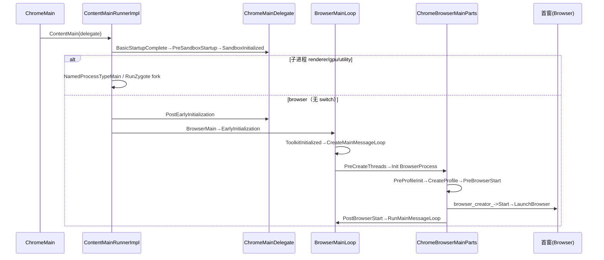

# 3.1 · 桌面启动全链：main → ChromeMainDelegate → ChromeBrowserMainParts → Browser

> 定制者第一问："启动时想干自己的事，代码挂哪？"本篇沿 Linux（Aura/Ozone）桌面版走透入口到首窗。源码 @8fe2331，行号已核对。

## ① 角色定位

启动链是 Chromium 的"总装线"：`chrome/app/`（壳层入口+MainDelegate）→ `content/`（嵌入框架主循环）→ `chrome/browser/`（产品逻辑）。同一可执行文件被 `--process-type` 切成 browser/renderer/gpu/utility，分流点在前半段；BrowserMainParts 各阶段仅 browser 进程走完。定制视角：**改行为不动渲染/网络的挂点大多在此**——MainDelegate 回调/ExtraParts/延迟任务。

## ② 定制切入点全景表

| # | 想改什么 | 动哪里（file:line） | 难度/影响面 |
|---|---|---|---|
| 1 | 参数预注入 | `CHROME_EXTRA_FLAGS`，`chrome/app/chrome_main_linux.cc:55-68` | 改配置/全进程 |
| 2 | 最早期代码注入 | `chrome/app/chrome_main.cc:165-188` | 改逻辑/全进程 |
| 3 | 最早 delegate 回调 | `BasicStartupComplete`，`chrome/app/chrome_main_delegate.cc:1180` | 改逻辑/全进程 |
| 4 | 子进程侧定制 | `PreSandboxStartup`，`chrome_main_delegate.cc:1539` | 改逻辑/多进程 |
| 5 | browser 专属最早 hook | `PostEarlyInitialization`，`chrome_main_delegate.cc:863` | 改逻辑/仅 browser |
| 6 | 特性开关/field trial | `chrome/browser/chrome_browser_field_trials.cc:76` | 改逻辑/全周期 |
| 7 | **分阶段 hook（最常用）** | ExtraParts 子类+`AddParts`，`chrome/browser/chrome_browser_main.cc:769-874` | 改逻辑/按 stage |
| 8 | UI 工具链初始化 | `ui/views/chrome_browser_main_extra_parts_views.cc:89,109` | 动架构/UI |
| 9 | 增删全局子系统 | `chrome/browser/browser_process_impl.cc:372,1591` | 动架构/全局 |
| 10 | 首窗/会话恢复 | `ui/startup/startup_browser_creator.cc:727,742` | 改逻辑/首窗 |
| 11 | 延迟初始化 | `PostAfterStartupTask`，`chrome/browser/chrome_content_browser_client.cc:1799` | 改逻辑/不拖启动 |
| 12 | 启动性能测量 | `--trace-startup`（`components/tracing/common/tracing_switches.cc:55`） | 只读/无 |

注：未写全路径以 `chrome/browser/` 为根。

## ③ 关键源码走读

**第一跳：入口。** `chrome/app/chrome_exe_main_aura.cc:16-18` 的 `main()` 直调 `ChromeMain`（`chrome_main.cc:108`）：构造 `ChromeMainDelegate` 装进 `ContentMainParams`——delegate 是壳层↔content 的唯一通道；`CommandLine::Init`（162 行）、展开 `CHROME_EXTRA_FLAGS`（187 行）后交棒 `content::ContentMain`（`content/app/content_main.cc:348`）。

**第二跳：content 分流。** `RunContentProcess`（`content_main.cc:189`）做 POSIX 通用初始化（**未设置的 `DBUS_SESSION_BUS_ADDRESS` 被写为 `disabled:`**）。`ContentMainRunnerImpl::Initialize`（`content/app/content_main_runner_impl.cc:857`）按序敲 delegate：`BasicStartupComplete`（`--version`/`--help` 在此退出）→ `PreSandboxStartup`（1061 行：目录/日志/pak/Crashpad/Ozone）→ `SandboxInitialized`。`Run()`（1145 行）按 `--process-type` 分流：空=browser → `RunBrowser`（1249 行，含**进程单例争夺**与 FeatureList 创建）→ `BrowserMain`；renderer/gpu/utility → `RunOtherNamedProcessTypeMain`（762 行）查 `kMainFunctions` 表（773-777 行）直进对应 Main；zygote → `RunZygote` fork 后按新 process-type 走同一张表（603 行）。

**第三跳：BrowserMainLoop 分阶段。** `BrowserMainRunnerImpl::Initialize`（`browser_main_runner_impl.cc:75`）串联：`EarlyInitialization`（570 行调 `parts_->PreEarlyInitialization`——**Chrome 在此 new `BrowserProcessImpl`**，`chrome_browser_main.cc:1013`）→ `ToolkitInitialized`（Views 初始化）→ `CreateMainMessageLoop`（主线程更名 `CrBrowserMain`）→ `CreateStartupTasks`（Pre/PostCreateThreads、PreMainMessageLoopRun 等；早于此禁建线程，1139-1142 行注释）。parts 由 `ChromeBrowserMainParts::Create`（`chrome_browser_main.cc:769`）按序 `AddParts` 组装（Gpu 恒最后，868 行）；**AddParts 顺序=同 stage 回调执行顺序**。

**第四跳：首窗。** `PreMainMessageLoopRunImpl`（1771 行）：`PreProfileInit()` → `CreateInitialProfile` → `PreBrowserStart()` → **`browser_creator_->Start()`（2122）**→ 建 RunLoop 挂 QuitWhenIdle → `PostBrowserStart()` → `RecordBrowserStartupTime()`。首窗由 `StartupBrowserCreatorImpl::Launch`（`startup_browser_creator_impl.cc:250`）完成；随后 `RunMainMessageLoop`（`browser_main_loop.cc:1144`）进 `RunLoop::Run()`——启动代码至此跑完。

## ④ 实操：最小 patch 示例

**Patch A：注册自己的分阶段 hook。** 新建 `chrome/browser/mycompany/my_browser_main_extra_parts.h/.cc`：

```cpp
#pragma once
#include "chrome/browser/chrome_browser_main_extra_parts.h"
class MyBrowserMainExtraParts : public ChromeBrowserMainExtraParts {
 public:
  void PreProfileInit() override;
  void PostBrowserStart() override;
};
```

`.cc` 里两个 override 各打一行 `LOG(ERROR)` 即可验证。`chrome/browser/BUILD.gn` sources 加两行（先例 1812 行）；注册在 `chrome_browser_main.cc:868` 后加 `AddParts(std::make_unique<MyBrowserMainExtraParts>())`。12 个 stage 钩子定义见 `chrome_browser_main_extra_parts.h:27-46`。

**Patch B（零代码）**：`CHROME_EXTRA_FLAGS="--my-switch" ./out/Default/chrome`，先于一切 delegate 回调（`chrome_main_linux.cc:55-68`）。

## ⑤ 依赖与数据流



契约：chrome↔content 接口只有 `ContentMainDelegate` 回调族与 `BrowserMainParts` 虚函数族；`--process-type` 是全链身份令牌。

## ⑥ 坑与勘误

1. **旧接口名误导**：delegate 的 `RunNamedProcessTypeMain` 现名 `RunProcess`（`chrome_main_delegate.cc:1783`；返回 int=退出、返回 params=让 content 继续）。（源码实证）
2. **双重 `CommandLine::Init`**：`chrome_main.cc:162` 与 `content_main.cc:244` 都调，后者幂等返回 false（`base/command_line.cc:266-272`）。（源码实证）
3. **renderer 编译宏陷阱**：`chrome_main_delegate.cc` 大段 `#if !defined(BUILDING_CHROME_RENDERER)`（1187 行）：无宏代码 renderer 也会执行。（源码实证）
4. **启动暗门**：`--disable-web-security` 须配非默认 `--user-data-dir` 否则被 RemoveSwitch；未设的 `DBUS_SESSION_BUS_ADDRESS` 被改 `disabled:`，xvfb 下 auto-launch 依赖会挂。（源码实证）
5. **Linux 构建无独立 ExtraPartsOzone 注册**：`chrome_browser_main.cc:831-835` 是 IS_LINUX 加 ExtraPartsLinux、其他 Ozone 平台才加；前者继承后者（`chrome_browser_main_extra_parts_linux.cc:56-59`）。（源码实证）
6. **Zygote 子进程不走 main()**：`src/docs/design/startup.md:40-45` 自述：fork 克隆恢复，入口初始化只跑一次后被继承。入口起线程/持锁会污染沙箱子进程。（文档+源码）

## ⑦ 验证方法

- **stage 打点**：Patch A 的 `LOG(ERROR)` + `--enable-logging=stderr`。
- **分流确认**：`ps aux | grep -- --process-type` 或 `chrome://process-internals`。
- **启动性能**：`--trace-startup --trace-startup-duration=10s --trace-startup-file=s.json`，Perfetto 过滤 `"startup"` 类别；UMA：`about:histograms` 搜 `Startup.*`。
- **env 通道**：`CHROME_EXTRA_FLAGS="--v=1"` 见 verbose 即通。

## ⑧ 延伸

- 图谱：chrome-app 层→chrome-browser 生命周期层→ui-views 层。
- 交叉阅读：`../explain/child-process-launcher.md`（Zygote）、`../explain/chrome-profile.md`、`../explain/views-widget.md`、`../explain/base-thread-pool.md`。
- 官方：`src/docs/design/startup.md`（注意坑 6）。
