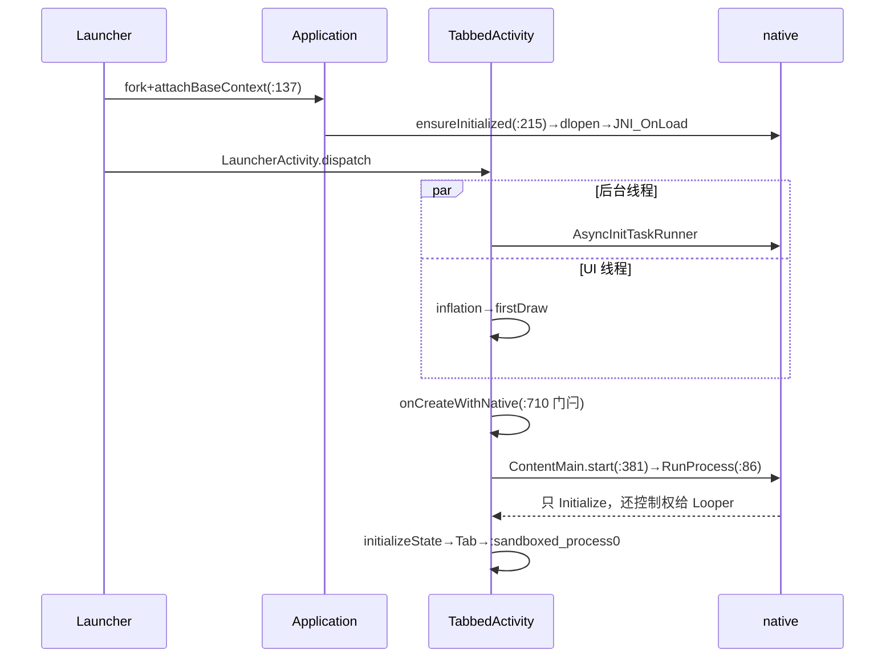

# 3.2 · Android 启动链与 chrome/android 结构：Java→JNI→native 全链

## ① 角色定位

桌面 Chromium 由 `main()` 向下驱动（3.1 篇）；Android 上方向倒转：**驱动源是 framework 的 Activity/Application 生命周期，native 是被 Java 调用的一方**。`chrome/android/` 就是这个 Java 壳层，承担桌面 `chrome/browser/ui`+平台窗口的全部职责（Android 无 aura/views：`build/config/ui.gni:32` 的 `toolkit_views` 不含 `is_android`，5.1 篇已证），经两条脐带连内核：`base/android`（JNI 桥/库加载）与 `content/public/android`（BrowserStartupController）。结构四块：`chrome/android/java/`（浏览器 Java 源码）、`chrome/app/android/`+`chrome/browser/*_android.cc`（native 差异）、`content/{public,app}/android/`（content 桥）、`android_webview/`（对照产品线）。构建组织在 `chrome/android/BUILD.gn`+`chrome_public_apk_tmpl.gni`+`trichrome.gni`。与 3.1 分工：ContentMainRunner 之后共享段不重复，只讲 Android 特有的 Application 早期初始化、Launcher 分派、库加载与 JNI 时序、"不跑 BrowserMain()"的收尾。

## ② 定制切入点全景表

| 想改 X | 动哪里 | 难度 | 影响面 |
|---|---|---|---|
| 包名 | `chrome_public_apk_tmpl.gni:29` `chrome_public_manifest_package` | 改配置 | APK 身份/升级链 |
| 应用名 | `res_chromium_base/values/channel_constants.xml:10` `app_name` | 改配置 | 图标与设置页 |
| 图标 | `AndroidManifest.xml:222-223` `ic_launcher` 指向的 res 树 | 改配置 | Launcher |
| Application 注入 | `ChromeApplicationImpl.java:47` `onCreate`；更早 `base/SplitCompatApplication.java:137` `attachBaseContext` | 改逻辑 | 全进程，按 `isBrowserProcess()` 分流 |
| Activity 注入 | `ChromeTabbedActivity.java:3417/1626/4128`（preInflation/startNativeInit/deferred）；分派 `document/ChromeLauncherActivity.java:90` | 改逻辑 | 冷启动关键路径 |
| native 三层注入 | `chrome_main_delegate_android.cc:50`；`chrome_browser_main_android.cc:49/63/106`；`chrome_entry_point.cc:8` | 改逻辑 | 3.1 ExtraParts 的 Android 版 |
| Google 服务脱钩 | `AppHooks.java:31`（ServiceLoader 钩子面） | 改逻辑 | WebAPK/policy 等 |
| 进程模型 | `AndroidManifest.xml:1372-1406`（sandboxed/privileged Service 声明；改名须同步 `chrome_constants.cc`） | 动架构 | 渲染/GPU 与安全边界 |
| trichrome 打包 | `trichrome.gni:19/24/100`；目标 `BUILD.gn:2293-2303` | 改配置 | 分发形态 |
| ChromiumLinker | `base/android/linker/config.gni:12`+`chrome_public_apk_tmpl.gni:627` | 改配置 | RELRO/内存 |
| 启动加速 deferred | `init/ProcessInitializationHandler.java:571`；`ChromeTabbedActivity.java:4125` | 改逻辑 | 首帧后任务 |
| zygote 预加载 | `AndroidManifest.xml:229/241`+`chrome/app/TrichromeZygotePreload.java` | 改配置 | 子进程速度/内存 |
| 命令行通道 | `SplitCompatApplication.java:229`（非 root 需 feature，:373） | 改配置 | 一切 switch 入口 |
| proguard/R8 | `chrome/android/proguard/main.flags`（jni_zero 内置保 `@CalledByNative`） | 改配置 | 体积/反射安全 |
| DFM 模块 | `chrome/android/modules/`+`SplitChromeApplication.java:57` | 动架构 | 按需模块 |
| WebView 对照 | `WebViewChromiumFactoryProvider.java:115`+`AwBrowserProcess.java:56`+`monochrome_entry_point.cc:10` | 动架构 | 嵌宿主进程/库模型 |

## ③ 关键源码走读

**1. Application。** Manifest `AndroidManifest.xml:221` 声明 Application=`…base.SplitChromeApplication`——**网传 `ChromeApplication.java` 已不存在**：重构为 SplitCompat 两层，真实逻辑在反射实例化的 `ChromeApplicationImpl`（类名钉在 `SplitChromeApplication.java:49`）。

`SplitCompatApplication.attachBaseContext`（`base/SplitCompatApplication.java:137`）是全链最早注入点：L158 `ContextUtils.initApplicationContext`；L191 挂库加载失败回调（跳 `LaunchFailedActivity`，manifest:929）；L223 `setLinkerImplementation(ProductConfig.USE_CHROMIUM_LINKER)`（ProductConfig.java 由 GN 生成，`build/config/android/rules.gni:2078`）；L229 读 `/data/local/tmp/chrome-command-line`；L241 `performBrowserProcessPreloading`；L256 `ColdStartTracker.initialize()`。**进程身份判定极简：`isBrowserProcess()`（:338）= 进程名不含 `":"`**。

`performBrowserProcessPreloading`（`SplitChromeApplication.java:269`）：L273 后台预载 chrome split（非 bundle 构建退化为 L282 ClassLoader 预热）；L311→L212 `ensureInitializedInMainProcess()`（主进程=RELRO 生产者）→L215 `LibraryLoader.getInstance().ensureInitialized()`。**native 库在 Application 阶段加载完毕**，与 Activity 并行。随后 `onCreate`（:297）分派 `ChromeApplicationImpl.onCreate`。

**2. Launcher 分派。** 点图标走 `ChromeLauncherActivity`（manifest:255，无 UI 中转）：`onCreate`（`ChromeLauncherActivity.java:61`）消毒 intent 后 `dispatch()`（:90）+finish。纯 Java 路由：web search→Webapp 复用→bringTabToFront→**FirstRun（L138）**→Custom Tab→WebAPK，默认 L154 `dispatchToTabbedActivity` 启动 `ChromeTabbedActivity`（多窗口走 `ChromeTabbedActivity2`）。

**3. Activity×native 状态机（核心）。** 继承链 …→`app/ChromeActivity.java`→`init/AsyncInitializationActivity.java`。`onCreate` 是 final（:334），真身 `onCreateInternal`（L410）末尾 L462 `ChromeBrowserInitializer.getInstance().handlePreNativeStartupAndLoadLibraries(this)`。

`init/ChromeBrowserInitializer.java:34`（单例编排器）L107：`ProcessInitializationHandler.initializePreNative`→`preInflationStartup`→L117 `setContentViewAndLoadLibrary`（`AsyncInitializationActivity.java:214`）：**L225 `NativeInitializationController.startBackgroundTasks` 与布局 inflation 并行**——库加载藏在 UI 充气之下（crbug.com/41361935 注释钉版）。

`init/NativeInitializationController.java:32` 是双条件门闩：L80 `startBackgroundTasks`（后台拉 variations/spare child connection）；L133 `firstDrawComplete`（由 `FirstDrawDetector.waitForFirstDraw` 触发，`AsyncInitializationActivity.java:238`）。两者就绪后 L119-126 放行 `onCreateWithNative`（L710）→L712 `handlePostNativeStartup(true,this)`（`ChromeBrowserInitializer.java:158`：preconnect→initializeCompositor→initializeState→startNativeInitialization→L232 `startChromeBrowserProcessesAsync`）。**首帧绘制与 native 初始化互为 AND**——Java UI 先画、native 幕后追。

**4. 进 native。** `content/public/android/java/src/org/chromium/content/browser/BrowserStartupControllerImpl.java:347` `contentStart()`→L381 `ContentMain.start()`→JNI 直调 `content/app/android/content_main_android.cc:61`→`StartContentMain`（:50）交 `RunContentProcess`。**delegate 从哪来？** 回溯库加载时刻：`LibraryLoader.ensureInitialized()`（`base/android/java/src/org/chromium/base/library_loader/LibraryLoader.java:504`）→`loadAlreadyLocked`（L649，ChromiumLinker L629 或 `System.loadLibrary` L641）触发 `JNI_OnLoad`（`base/android/jni_onload.cc:11`，只 InitVM+挂 hook）→Java 侧 `initializeAlreadyLocked`（L732）调 native `libraryLoaded`（L745）→`LibraryLoaded`（`base/android/library_loader/library_loader_hooks.cc:49`）→L64 执行 hook=`chrome_entry_point.cc:8`→`chrome/app/android/chrome_jni_onload.cc:13`：content 注册（ICU/scheme，`content/app/android/library_loader_hooks.cc:56/61`）+L17 `SetContentMainDelegate(new ChromeMainDelegateAndroid())`。**delegate 注入时机在库加载完成那一刻，而非 ContentMain 调用时**。

native 走 3.1 的 `ContentMainRunnerImpl::Initialize`，到 Android 分岔点 `ChromeMainDelegateAndroid::RunProcess`（`chrome_main_delegate_android.cc:86`）：browser 进程 L116 `BrowserMainRunner::Create()`+L119 `Initialize()` 后**直接 return——L120 注释钉版 "On Android we do not run BrowserMain()"**。主循环就是 framework Looper，BrowserMainLoop 只完成 CreateThreads 等装配即还控制权给 Java。随后 `ChromeBrowserMainPartsAndroid`（`chrome/browser/chrome_browser_main_android.cc`）：`PreEarlyInitialization`:96（`Compositor::Initialize()`）、`PreCreateThreads`:49、`PostProfileInit`:63（无多 profile）、`PostBrowserStart`:106（UMA→Statsd、Java Mojo 注册 L119）。

**5. Tab 呈现。** `ChromeTabbedActivity.initializeCompositor`:924 建 CompositorViewHolder→`initializeCompositorContent`:1447 挂 ContentView/Tab→`initializeState`:2455 建 TabModelSelector/恢复 Tab→WebContents 导航→渲染进程（`:sandboxed_process0`）。首帧后杂务走 `DeferredStartupHandler`:4125。

**对照表**（3.1 为基准）：

| 阶段 | 桌面 | Android |
|---|---|---|
| 进程入口 | `main()` | Zygote fork+framework 回调 |
| 早期初始化 | ChromeMain 内 CommandLine::Init | `attachBaseContext:137`（更早） |
| UI 工具包 | aura/views | 无——Java UI+`Compositor::Initialize`:99 |
| 库加载 | 无 | **独有**：LibraryLoader+Linker/RELRO |
| 主循环 | `RunLoop::Run()` | **缺失**：framework Looper 即主循环 |
| 子进程 | zygote+`--process-type` | manifest Service+Binder |
| 首窗 | `StartupBrowserCreatorImpl::Launch` | dispatch→ChromeTabbedActivity |
| 首帧策略 | 无门闩 | firstDraw∧native（Controller:119） |

## ④ 实操：最小 patch 示例

**Patch A（native 启动打点）**：`chrome_browser_main_android.cc:106` `PostBrowserStart()` 首行插 `LOG(ERROR) << "MY-HOOK: Android browser started";`（无需改 BUILD.gn）。出现即证明 Application→库加载→ContentMain→BrowserMainParts 全链贯通。更早可挂 `chrome_main_delegate_android.cc:50` `BasicStartupComplete`。

**Patch B（零代码命令行）**：`adb shell 'echo "_ --enable-logging=stderr" > /data/local/tmp/chrome-command-line'` 后 force-stop 重启。非 root 需 feature `sCommandLineOnNonRooted`（`SplitCompatApplication.java:373`，debug 构建默认可用）。switch 经 :229 读入、库加载后切 native 实现（`LibraryLoader.java` `ensureCommandLineSwitched`）——`--trace-startup` 等一切 switch 走同一通道。

## ⑤ 依赖与数据流

跨层契约：**进程名**（无冒号=browser，定加载深度与 RELRO 角色）；**CommandLine**（Java 构造→native 接管）；**RELRO bundle**（主进程生产→子进程消费）。

## ⑥ 坑与勘误

1. **`ChromeApplication.java` 已不存在**（源码实证）：现为 SplitChromeApplication+ChromeApplicationImpl 反射委托；`ChromeActivity` 在 `app/` 子目录。市面教程一律过时。
2. **不跑 `BrowserMain()`**（`chrome_main_delegate_android.cc:120` 注释）：无 `RunMainMessageLoop` 等价物；"循环启动后"逻辑挂 `PostBrowserStart`/Java Handler。
3. **无 aura/views**（gn 实证）：桌面 Views 定制经验不可平移。
4. **JNI 注册时序**（源码实证）：`JNI_OnLoad` 只 InitVM+挂 hook；方法注册发生在 `libraryLoaded`（L745）链上，jni_zero 默认 dlsym 懒解析+R8 内置 keep。**native 就绪前调 `@NativeMethods` 必崩**。
5. **isolated splits ClassLoader**：chrome split 加载后必须 `JniZero.setJniClassLoader`（`SplitChromeApplication.java:296`）+替换 Application ClassLoader（L294），否则 JNI 找错类。
6. **proguard/R8**：`@IdentifierNameString` 字段被内联即坏；自定义反射进 `proguard/main.flags`。
7. **clank/ 缺位是常态**：`BUILD.gn:259/962/2433` 有 `//clank/` 引用但目录空（Google 内部增量），开源构建按 GN 条件排除；公开钩子面=`AppHooks`（ServiceLoader），内部增量只能自研替代（3.3 篇）。
8. **`:sandboxed_process` 进程名是 API**（manifest:1369 注释）：改名须同步 `chrome_constants.cc`；Service 数量（2+10）是 ChildProcessAllocator 配置源。trichrome 下 Chrome 与 library APK 的 ABI/版本须配套（`trichrome.gni:41` `TRICHROME_VERSION_MAP`）。

## ⑦ 验证方法

- `adb logcat -s chromium`：`SplitCompatApplication.java:177` 的 `version=… processName=…` 与 `LibraryLoader.java:753` `Successfully loaded native library` 两行都在=Java→native 桥健康。
- Patch A：`adb logcat | grep MY-HOOK`，配 `--enable-logging=stderr`。
- 进程拓扑：`adb shell ps -A | grep chromium` 应见主进程+`:sandboxed_process0`+`:privileged_process*`。
- 包名：`adb shell dumpsys package org.chromium.chrome | grep versionName`。
- 启动性能：Perfetto 搜本链 TraceEvent 名（`ChromeApplication.attachBaseContext`/`content::Start`）；UMA `Startup.Android.*`（`SplitChromeApplication.java:230`）。
- trichrome：`apksigner verify --print-certs` 比对 `trichrome.gni:24`；安装顺序 library→chrome。

## ⑧ 延伸

- 图谱：`src/.understand-anything/knowledge-graph.json` 按 `chrome/android/…/browser/init/`、`content/public/android`、`base/android/library_loader` 前缀过滤。
- 姊妹篇：`3.1-desktop-startup.md`（共享段权威走读）、`2.1-content-api-clients.md`、`5.1-platform-abstraction.md`、`9.1-process-model.md`、`3.3-branding-degoogle.md`（改包名/去 Google 清单）。
- repo 文档：`docs/android_native_libraries.md`（Linker/RELRO 权威说明）、`docs/android_build_instructions.md`、`third_party/jni_zero/README.md`。
- WebView：`WebViewChromiumFactoryProvider.java` 与 `monochrome_entry_point.cc:10`（单库双角色分流）。
