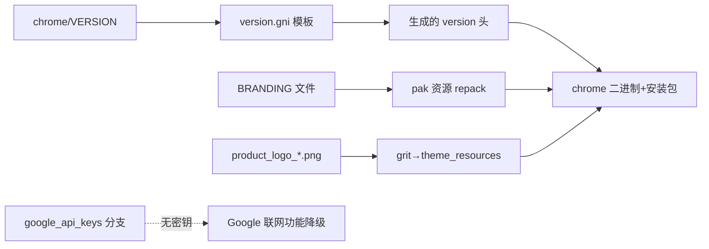

# 3.3 · 品牌定制实操与去 Google 化清单

> "把 Chromium 变成我的浏览器"：改名、改图标、改版本号、改默认服务、剥离 Google 后台连接——本篇是全清单实操。所有路径已在本机源码 @8fe2331 实证。

## ① 角色定位

品牌定制分散在三层：**构建层**（args 与版本文件）、**资源层**（theme 目录与 grd 资源串）、**行为层**（Google 服务绑定与遥测）。三层独立可改，但发布产品通常三者都要动。注意 chrome/ 层大量代码假设"这是 Chrome"——品牌化的本质是让这些假设为你所用而不是绑死 Google。

## ② 定制切入点全景表

| 想改什么 | 动哪里 | 难度 | 影响面 |
|---|---|---|---|
| 产品全名/公司名 | `chrome/app/theme/chromium/BRANDING`（COMPANY_FULLNAME/PRODUCT_FULLNAME 等 8 键，已实证） | 改配置 | 安装包/关于页/系统注册 |
| 图标全套 | `chrome/app/theme/chromium/product_logo_16~256.png` + `product_logo.svg`（各尺寸齐备，实测存在） | 换资源 | 全 UI + 安装器 |
| 版本号 | `chrome/VERSION`（当前 `MAJOR=157 MINOR=0 BUILD=8093 PATCH=0`，构建时注入） | 改配置 | about、更新判定 |
| macOS bundle id | 同 BRANDING 文件 `MAC_BUNDLE_ID=org.chromium.Chromium` | 改配置 | 仅 mac |
| 安装器品牌 | `chrome/installer/linux/BUILD.gn:401` 消费 `$branding_dir/BRANDING`（deb/rpm 元数据） | 改配置 | Linux 包元数据 |
| Chrome 官方资源 | `is_chrome_branded`（`build/config/chrome_build.gni:12`，见 1.3） | 改配置 | 官方 logo/受版权资源/部分闭源组件 |
| Google API 密钥（ Maps/翻译等） | `google_apis/google_api_keys.cc`：默认走环境变量/`google_api_keys.h` 机制；`USE_OFFICIAL_GOOGLE_API_KEYS`（20 行）与 `SUPPORT_EXTERNAL_GOOGLE_API_KEY` BUILDFLAG（52/156 行）分支 | 改逻辑 | 联网 Google 功能 |
| 去登录/账号体系 | `chrome/browser/signin/`、`components/signin/`（裁剪或门禁） | 动架构 | 账号、同步 |
| 去同步 | `components/sync/`、`chrome/browser/sync/` | 动架构 | 数据同步 |
| 去遥测 | `components/metrics/`、`chrome/browser/metrics/` + UMA 开关默认值 | 改逻辑 | 隐私合规 |
| 去更新检查 | updater 组件（Linux 包托管走系统包管理器即可） | 改配置 | 更新通道 |
| 默认搜索引擎 | `components/search_engines/`（prepopulated 数据） | 改配置 | omnibox |
| 默认首页/NTP | `chrome/browser/resources/new_tab_page/` + default pref 值 | 改逻辑 | 产品入口 |
| 用户数据目录名 | `chrome/common/chrome_constants.*`（用户数据目录/缓存路径常量定义处） | 改配置 | 与官方版共存的关键 |
| about 页面文案 | `chrome/browser/resources/version/` 等资源目录 | 换资源 | 内部页 |

## ③ 关键源码走读：三个注入链

**品牌字符串链**：`chrome/VERSION` 四段版本号在构建时被 `chrome/version.gni` 的模板（process_version_rc_template 等）注入生成的头文件；BRANDING 文件的 PRODUCT_FULLNAME 则被 repack 进资源 pak（`chrome/chrome_paks.gni`）。UI 层显示的"Chromium"字样多数来自 `IDS_PRODUCT_NAME` 等 grit 资源 ID——改 BRANDING + 重编即可全局换名，**但 WebUI HTML 里硬编码的字符串要单独 grep**（`grep -rn "Chromium" chrome/browser/resources/` 逐个排查）。

**图标链**：`chrome/app/theme/chromium/` 下按尺寸齐备的 png（16/22/24/48/64/128/256 + mono + svg 源）被 `chrome/app/theme/BUILD.gn` 的 grit 规则打进 theme_resources；平台安装器（如 `chrome/installer/linux/BUILD.gn:401`）从 `$branding_dir/BRANDING` 读元数据生成 deb/rpm 描述。**实操=同名替换 png（保持尺寸/格式），桌面版还要处理 `chrome/app/theme/default_100_percent/` 与各平台子目录**。

**API 密钥链**（去 Google 化的核心开关之一）：`google_apis/google_api_keys.cc` 的行为分三档——`USE_OFFICIAL_GOOGLE_API_KEYS`（官方编译才有，20 行）、运行时环境变量（`GOOGLE_API_KEY` 等，个人开发常用）、`SUPPORT_EXTERNAL_GOOGLE_API_KEY` BUILDFLAG（52/156 行，外部注入机制）。**自定义发行版标准做法：不设密钥→相关联网功能（地理编码、翻译 API 等）自动降级/禁用**，代码里有完善的缺密钥回退分支——不必删代码，无密钥即静默。

## ④ 实操：最小品牌换肤（半天工作量）

1. `chrome/app/theme/chromium/BRANDING`：8 个键全改（PRODUCT_FULLNAME=MyBrowser...）
2. 同目录 png 全套替换（svg 源也留一份，方便后续生成）
3. `chrome/VERSION` 改成自己的版本线（如 1.0.0.0）
4. 用户数据目录常量改名（chrome_constants）→ 与用户已装的 Chrome/Chromium 数据隔离
5. `out/release/args.gn`：`is_official_build=true is_chrome_branded=false`（见 1.3 配方）
6. 重编后验证：`chrome://version` 与 deb 包元数据、任务栏图标、默认用户数据目录三处全换即成功

**进阶（去 Google 化）**：在 ContentBrowserClient/浏览器层关服务（配合 2.1/3.1）——同步、signin、metrics 的总开关分散在 pref 默认值与 `--no-*` 命令行开关；追求彻底则在 BUILD.gn 层裁 deps（注意 chrome/BUILD.gn 6404 行的依赖图是强耦合的，裁剪建议从 feature flag 入手而非硬删源文件）。

## ⑤ 依赖与数据流

品牌资源只影响展示层；**行为层的去 Google 化在另一条线**（服务绑定/密钥/pref 默认值），两条线独立推进互不阻塞。

## ⑥ 坑与勘误

- **`is_chrome_branded=true` 不会给你 Google 的闭源组件**——它只切换"官方品牌资源与授权资产"路径，且部分资产不在开源仓里，自建产品永远保持 false。
- 改 BRANDING 后**必须 gn gen 重跑**（资源重打包依赖 BUILD 图，见 1.3 §7）。
- WebUI/扩展商店文案里的 "Chromium" 硬编码散点多，grep 资源目录逐个清；**不要全局 sed 源码里的 "chrome" 字样**（那是内部标识符，会碎一地）。
- 版本号 major 别跟着 157 走：更新服务与 UA 字符串都吃这个值，自产品应从自己的版本线开始。
- 用户数据目录不改名→与用户已装 Chromium 互相吃 profile（升级/降级弹窗、扩展丢失），发行前必改。
- 去服务裁剪走 **feature flag（`base::Feature`）+ args** 优先于删源文件：chrome/browser/BUILD.gn 的依赖断言会拦硬裁（1.2 篇展开）。

## ⑦ 验证方法

- `chrome://version`：名字/版本/命令行/用户数据路径四合一检查点
- deb 包：`dpkg -I out/*.deb | grep -i version`（installer 元数据来自 BRANDING）
- 图标：桌面启动器与任务栏（缓存问题重启 shell）
- API 密钥：chrome://version 底部 API Keys 区显示"Not provided"即为去密钥状态
- 遥测：about://traces 或 net-export 抓连接，确认无 Google 域请求（配合 6.x 网络篇）

## ⑧ 延伸

- 打包细节：1.4（品牌与打包分发）、5.3（各平台差异）；启动行为定制：3.1
- 图谱层位：chrome 外壳层（第 1-2 层）+ resources 子图
- 官方文档：`docs/google_chrome_branded_builds.md`（官方品牌构建说明，含内部资产依赖清单——自产品不适用但可了解边界）
