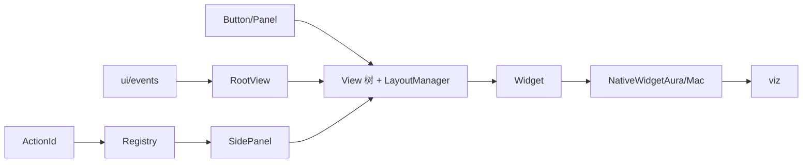

# 4.1 views 框架定制：在浏览器里加自己的原生 UI

> 定制对象：桌面端唯一的原生 UI 框架 `ui/views`。View/Widget 基类内部见 `../explain/views-view.md`、`../explain/views-widget.md`，本篇纯定制视角。

## 1. 角色定位

views 是 Chromium 自研保留模式 C++ UI 工具包（`src/ui/views/`），向上支撑 `chrome/browser/ui/views/`——浏览器全部桌面 UI。View 树装进 `views::Widget`（原生窗口），经 NativeWidgetAura/Mac 落到平台。定制意义：浏览器 chrome 本身就是 views 写的，你的控件与官方控件共用布局/主题/无障碍/事件管线；与 WebUI 并行，嵌 AI 面板不开 WebContents 时 views 侧栏是原生落点（衔接 12.1）。边界：**views 只在桌面**——Android 是 Java/Compose、iOS 是 UIKit（模型层为 Android 分叉 SidePanelNativeViewAndroid，side_panel_native_view.h:13-23 实证）。

## 2. 定制切入点全景表

| # | 想做什么 | 动哪里（文件:行） | 难度 | 影响面 |
|---|---|---|---|---|
| 1 | 加工具栏按钮 | `toolbar_view.cc:461`（HomeButton 后）；继承 `ToolbarButton`（toolbar_button.h:51） | 改逻辑 | 工具栏 |
| 2 | 加侧栏面板（AI 落点；嵌网页用 webview） | `side_panel_entry_id.h:23` X-macro → `actions.xml` → `side_panel_helper.cc:30` 注册 | 动架构（4 处联动） | 自动出按钮 |
| 3 | 改下拉/右键菜单 | ctor 传 `ui::MenuModel`（home_button.cc:146）；运行链 `toolbar_button.cc:587-642` | 改逻辑 | 单按钮 |
| 4 | 改全局快捷键 | `accelerator_table.cc:173,237`（{VKEY,flags,IDC_*} 三元组） | 改配置 | 键序 |
| 5 | 加对话框 | 气泡继承 `BubbleDialogDelegateView`（home_button.cc:49）；模态 `dialog_delegate.h:690` | 改逻辑 | 锚点/Widget |
| 6 | 改主题色 | view.h:1116 GetColorProvider()；色板 color_provider_browser_helper.cc | 改逻辑 | 外观 |
| 7 | 托盘图标 | `views/status_icons/`（linux/win/chromeos 分叉） | 改逻辑 | 托盘 |
| 8 | 触控适配 | `touch_ui_controller.h:28`；订阅 `toolbar_button.h:392-395`；双图标 home_button.cc:155-158；尺寸 `layout_constants.cc:215` | 改逻辑 | 触屏 |
| 9 | 无障碍 | SetName()（home_button.cc:161）；焦点环 focus_ring.cc | 改配置 | 读屏 |
| 10 | view 树探针 | `--enable-ui-devtools=0`（ui_devtools_browsertest.cc:29-32） | 改配置 | 零代码 |
| 11 | 改 tab 形状 | tab_style_views.h:96 TabStyleViews::GetPath | 改逻辑 | 标签页 |
| 12 | 窗口 decorations | opaque_browser_frame_view.h:43 + 同名 layout.cc | 动架构 | 边框 |

（表内文件名省略目录，在 chrome/browser/ui{,/views}/、ui/views/ 按名检索）

## 3. 关键源码走读

### 3.1 主线：工具栏按钮从创建到点击

**① 挂载与创建**：`BrowserView` 把 `ToolbarView` 挂进 TopContainerView（`browser_view.cc:945-949`），`browser_view.cc:5028` 调 `toolbar_->Init()`（toolbar_view.cc:330），从左到右顺序 AddChildView。HomeButton 加装点在 toolbar_view.cc:461-464：`home_ = AddChildView(make_unique<HomeButton>(browser_, BindRepeating(callback, browser_, IDC_HOME)))`；callback 为共用 lambda（L402-406）→ ExecuteCommandWithDisposition。`HomeButton` 构造是装配样板：基类 `ToolbarButton(PressedCallback, MenuModel, nullptr)`（toolbar_button.h:74-77）+ 标准装配（home_button.cc:143-163）。

**② 布局与绘制**：`InitLayout()`（toolbar_view.cc:1569）用 `views::FlexLayout`（flex 语义见类注释 flex_layout.h:21-72）。子 View 用**属性而非子类**声明意图：kFlexBehaviorKey 定伸缩优先级（L1604-1607）、kMarginsKey 定边距；变窄按 order 先挤掉（L1575-1587），溢出走 ToolbarController（L1682-1687）。窗口级摆放由 `BrowserViewLayout` 决定——加新 View 在其 CalculateProposedLayout() 里 `layout.AddChild(view, bounds, visible)`（how-to：frame/layout/README.md）。绘制入口 `View::OnPaint`（view.h:1943），颜色从 GetColorProvider()（view.h:1116）取。

**③ 事件与菜单**：鼠标按下 → Widget → `RootView::OnMousePressed`（`root_view.h:122`）命中路由 → `ButtonController` 判定后 NotifyClick（button_controller.cc:23,37）→ ctor 的 `PressedCallback`（button.h:106-115）→ ①的 lambda。菜单见切入点 #3。

### 3.2 主线：侧栏面板注册与显示

**容器层**：`SidePanel`（side_panel.h:28）由 BrowserView 挂载（browser_view.cc:976），自带 resize/动画/header；`Open/Close` 是唯一可见性机制（side_panel.h:101-104），内容挂载点 GetContentParentView()（L118）。

**模型层与注册**：`SidePanelEntry`（side_panel_entry.h:33）核心是 `CreateContentCallback = RepeatingCallback<SidePanelNativeView(SidePanelEntryScope&)>`（L37-38）；桌面即 `unique_ptr<views::View>`（side_panel_native_view.h:22）——**任意 View 子树都能当面板内容，不强制 WebUI**。注册链：Coordinator 构造（side_panel_coordinator.cc:46-63）调 PopulateGlobalEntries（side_panel_helper.cc:26-61），样板 reading_list_side_panel_coordinator.cc:47-54。

**显示链与按钮联动**：Toggle/Show → PopulateSidePanel（side_panel_coordinator.cc:262-349）：定对齐与 header（L277-283），旧 view CacheView 复用（L308-310），AddChildView(entry->GetContent())（L319-321，内部调你的工厂）后 Open（L326）。SidePanelEntryId（side_panel_entry_id.h:23-49）每项绑一个 actions::ActionId（chrome_action_id.h:522），驱动工具栏自动出可固定按钮——按钮/快捷键/溢出/UMA 全免费。

## 4. 实操：加工具栏按钮 + 侧栏面板

### 4.1 "MyAI" 工具栏按钮（5 文件约 40 行，零布局代码）

1. **图标**：新建 `chrome/app/vector_icons/my_ai.icon`（语法同 home.icon），`BUILD.gn` 列表（L167）登记。
2. **按钮类**：新建 `toolbar/my_ai_button.h/.cc`：

```cpp
MyAiButton::MyAiButton(BrowserWindowInterface* browser)
    : ToolbarButton(base::BindRepeating(
          [](BrowserWindowInterface* b, const ui::Event&) {
            SidePanelCoordinator::From(b)->Toggle(  // 直连逻辑，免注册 IDC
                SidePanelEntry::Key(SidePanelEntry::Id::kMyAi),
                SidePanelOpenTrigger::kKeyboard);
          }, browser)) {
  SetVectorIcons(kMyAiIcon, kMyAiIcon);  // 余同 home_button.cc:143-163
}
```

3. **挂载与可见性**：`toolbar_view.cc:464`（HomeButton 后）插 `my_ai_button_ = AddChildView(make_unique<MyAiButton>(browser_));`；toolbar_view.h L418 旁加成员、BUILD.gn 登记新文件（越早 AddChildView 越靠左）。visible：构造后 SetVisible(FeatureList::IsEnabled(features::kMyAi))，运行时仿 Chrome Labs pref 驱动（L535-553）。

### 4.2 纯 views 的 "MyAI" 侧栏面板

1. `side_panel_entry_id.h:23` X-macro 加 `V(kMyAi, kActionSidePanelShowMyAi, "MyAi")`，并在 `tools/metrics/actions/actions.xml` 与 `chrome_action_id.h` 登记（参照 chrome_action_id.h:511）；
2. 内容工厂：`CreateMyAiPanel(SidePanelEntryScope&)` 返回 `unique_ptr<views::View>`：BoxLayoutView 纵排 + Label/TextField；
3. `side_panel_helper.cc:30` 里 Register(make_unique<SidePanelEntry>(Key(Id::kMyAi), BindRepeating(&CreateMyAiPanel), NullCallback()));

开合/拖宽/header/固定按钮/UMA 全自动获得；常驻网页换 SidePanelWebUIView（`side_panel_web_ui_view.h`）即 12.1 路线。

## 5. 依赖与数据流



控件三条契约：preferred size（CalculatePreferredSize(SizeBounds)，view.h:1846-1848）；布局失效（PreferredSizeChanged()/InvalidateLayout()，flex_layout.h:68-72）；颜色只从 ColorProvider 取；side panel 工厂须可重复调用（view 会被缓存复用）。

## 6. 坑与勘误

1. **FlexLayout 管子 View 可见性**：外部 SetVisible(false) 会被 flex 规则顶掉，排除用布局器排除机制（flex_layout.h:54-58）。
2. **生命周期归 View 树**：AddChildView(unique_ptr) 后所有权转移（view.h:467-471 有 CHECK），再持 unique_ptr 是 double-free 级错误，应存 raw_ptr（toolbar_view.h:410）。
3. **Layout(PassKey) 新协议**：view.h:865 禁止外部直调 view->Layout()；改内容不触发 PreferredSizeChanged 会"画了新内容但占位不变"（flex_layout.h:68-72）。
4. **平台分叉**：Linux/ChromeOS 走 native_widget_aura.cc、macOS 走 native_widget_mac.mm（菜单锚定也分叉，toolbar_button.cc:590-607）；Android 不用 views，跨端只共享模型层（side_panel_native_view.h:20-23）。
5. **WebUI toolbar 迁移进行中**：多数按钮有 features::IsWebUIXxxButtonEnabled() 分叉（toolbar_view.cc:432/452/461/466），按钮"消失"先查 WebUI 分支。
6. **注释过时**：side_panel.h:34-36 所指 LayoutSidePanelView 已并入 BrowserViewLayoutImpl。
7. **SidePanelEntryId 三处联动**：X-macro 顶部 LINT.IfChange（side_panel_entry_id.h:21-22），改枚举须同步 histograms.xml，否则 UMA 漂移。
8. **触控双轨**：insets 与图标按 touch_ui 双份（layout_constants.cc:215-216、home_button.cc:155-158）；`--top-chrome-touch-ui=enabled` 强制触控布局（均源码实证）。

## 7. 验证方法

- **UI DevTools（首选）**：`out/Custom/chrome --enable-ui-devtools=0`（0=随机端口，ui_devtools_browsertest.cc:29-32），日志打印地址，Chrome 打开可 inspect 整棵 view 树；`--top-chrome-touch-ui=enabled` 对照。
- **测试与定位**：`unit_tests --gtest_filter=ToolbarView.*`，交互级参照 app_menu_interactive_uitest.cc / side_panel_interactive_uitest.cc；控件加 SetProperty(kElementIdentifierKey) + SetID(VIEW_ID_*)（home_button.cc:148/163）。

## 8. 延伸

图谱：`src/.understand-anything/knowledge-graph.json` 按 `src/ui/views/` 与 `chrome/browser/ui/views/{toolbar,side_panel}/` 前缀查；explain：`../explain/views-view.md`、`../explain/views-widget.md`；本系列：4.3 窗口结构、12.1 AI 集成地图、5.1 平台抽象、3.3 品牌定制。一手文档：`chrome/browser/ui/views/frame/layout/README.md`、`ui/views/layout/flex_layout.h`、`components/vector_icons/vector_icons.gni`。
