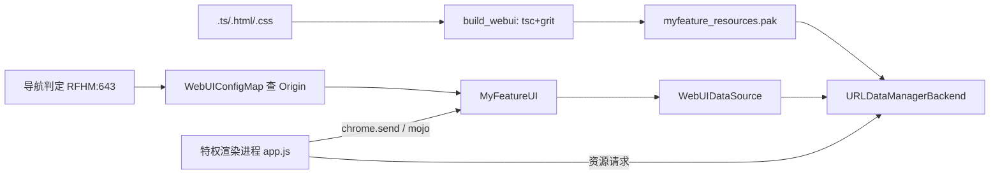

# 4.2 WebUI 体系与自建 chrome:// 页面实操

> 源码基线：/usr-data/data1/browser/chromium/src（行号实测核对）

## 1. 角色定位

浏览器自绘 UI 两条线：**views**（C++ 原生控件）与 **WebUI**（设置/历史/NTP/flags 等内部网页）。WebUI=跑在特权渲染进程的本地网页：资源不走网络、由浏览器进程从 pak 吐出；JS 经特权通道（`chrome.send`/mojo）调浏览器 C++。改 UI 只写 HTML/TS 不碰 views 布局，是定制 UI 高频首选。分层：content 层定契约（`WebUI`/`WebUIController`/`WebUIDataSource`）并掌导航判定；chrome 层把 `chrome://host` 映射到 controller（`WebUIConfigMap`）；资源侧 `build_webui.gni` 驱动 tsc+grit 打 pak。图谱 16 层属 UI 层，下接进程模型（WebUI 页独占渲染进程）、ResourceBundle、mojo。

## 2. 定制切入点全景表

| # | 需求 | 文件:行 | 难度 |
|---|---|---|---|
| 1 | 新增 chrome:// 页 | `chrome/browser/ui/webui/system/system_info_ui.h:15-27`（Config+Controller 样板）+ `chrome/browser/resources/about_sys/BUILD.gn:9` | 配置+代码 |
| 2 | 注册分发（必做） | `chrome/browser/ui/webui/chrome_web_ui_configs.cc:254` 内 `map.AddWebUIConfig`（:413 样例） | 改逻辑 |
| 3 | 定 host 名 | `chrome/common/webui_url_constants.h:333` + `.cc:122` `kChromeURLHosts`（进 chrome://chrome-urls） | 改配置 |
| 4 | 资源进 pak | `chrome/browser/resources/BUILD.gn:61` 常驻组，或 :428/:521（internals 走 dev_ui） | 改配置 |
| 5 | 改现有页面 | `chrome/browser/resources/<page>/*.ts`（about_sys/app.ts:17 Lit 组件） | 改逻辑 |
| 6 | 加 chrome.send | `system_info_ui.cc:113-118` + cr.ts:62 `sendWithPromise` | 改逻辑 |
| 7 | 加 mojo 接口 | `.mojom`（`location_internals/BUILD.gn:7-10`）+ `location_internals_ui.cc:30` + `chrome_browser_interface_binders_webui.cc:263` | 逻辑+架构 |
| 8 | 本地化 | generated_resources.grd:7241 + `system_info_ui.cc:54-65` | 改配置 |
| 9 | 放开某条 CSP | `web_ui_data_source.h:147` OverrideContentSecurityPolicy | 改逻辑 |
| 10 | 允许 WebUI 联网 | `chrome_web_ui_controller_factory.cc:341-357` 白名单 | 动架构 |
| 11 | 禁用/重定向页 | `chrome_content_browser_client.cc:7608`；开关 `components/webui/chrome_urls/pref_names.h:15` | 改逻辑 |
| 12 | untrusted iframe | `chrome_untrusted_web_ui_configs.cc:47` + `untrusted_web_ui_controller.h:14` | 动架构 |
| 13 | lit/polymer 选型 | 资源 BUILD.gn ts_deps | 改配置 |
| 14 | 页面 favicon | `chrome_web_ui_controller_factory.cc:405-407` | 改逻辑 |
| 15 | 主题资源 | `chrome://theme/`（version_ui.cc:166） | 改逻辑 |
| 16 | 整页替换 NTP | `chrome_web_ui_configs.cc:398` + override（factory:285） | 动架构 |

## 3. 关键源码走读：chrome://system 一次访问

**纠偏：注册枢纽已不是工厂 if-chain**。老教程往 `ChromeWebUIControllerFactory::GetWebUIFactoryFunction` 加分支——实证该函数只剩 devtools://（`chrome_web_ui_controller_factory.cc:161-176`），chrome:// 分发已迁 **WebUIConfig**：`webui_config.h:33` 按 (scheme,host) 注册，核心 `CreateWebUIController()`（:77），`DefaultWebUIConfig<T>`（:95-120）自动 new T；`webui_config_map.cc:64-68` 构造时把自身包装成工厂 adapter 注册进老协议；同 Origin 重复注册 `CHECK` 崩（:83-89）；`GetConfig()`（:91-110）按 Origin 查表。chrome 总注册在 `chrome_web_ui_configs.cc:254`（约 200 个 config），`chrome_browser_main.cc:1910` 于 PreProfileInit 后调用；content 自有页在 `content_web_ui_configs.cc:34-52`。最小样板即 `system_info_ui.h:15-27` 三行构造；开发者专用页用 `DefaultInternalWebUIConfig`（`internal_webui_config.h:40`，见坑 3）。

**判定与隔离**：① omnibox 输入修复把 `about:system` 换成 `chrome://system`（`url_fixer.cc:617-624`）——about:// 映射仅此一处。② `HandleWebUI`（`chrome_content_browser_client.cc:7608`）处理别名与禁用页改写。③ `NavigationRequestUsesWebUI()`（`render_frame_host_manager.cc:643-650`）查工厂链。④ :2868-2905：WebUI 类型不同或目标 URL 不可接受（仅 WebUI URL+about:blank+debug URL，`web_ui_controller_factory_registry.cc:75-86`）即换进程——**WebUI 页独占渲染进程**。

**创建与特权**：`NavigationRequest::CreateWebUIIfNeeded()`（`navigation_request.cc:12634`）new `WebUIImpl`（:12657）→ config 建 controller（:12660）；controller 构造（`system_info_ui.cc:154-159`）挂 handler+数据源；renderer 提交时 `GrantWebUIBindings`（`render_frame_host_impl.cc:8317-8320`）+ `SetUpMojoConnection`（`web_ui_impl.cc:305`）建每页独立 mojo broker（:330-337）。

**数据源**：`system_info_ui.cc:50-70` 样板——`WebUIDataSource::CreateAndAdd(profile, host)`（`web_ui_data_source.h:54`）挂进 `URLDataManagerBackend`，按 host 查表从 pak 取字节；`kAboutSysResources`/`IDR_ABOUT_SYS_ABOUT_SYS_HTML` 由 build_webui 生成（gen/chrome/grit/）；共享库走 `chrome://resources`（`url_data_manager_backend.cc:90`）。i18n 双通道：编译期 `$i18n{}` vs 运行期 `UseStringsJs()` 虚拟 `/strings.m.js`（web_ui_data_source.h:94）。

**双 RPC**：chrome.send——`sendWithPromise`（`cr.ts:62-69`）→ `RegisterMessages`（`system_info_ui.cc:113-118`）回调回传，无 IDL 适合只读页。mojo（推荐）——controller 继承 `ui::MojoWebUIController`（`mojo_web_ui_controller.h:41-54`）+ `WEB_UI_CONTROLLER_TYPE_DECL/IMPL`（`web_ui_controller.h:119-130`）+ `BindInterface`（`location_internals_ui.cc:30-33`）；binder 注册（`chrome_browser_interface_binders_webui.cc:263-264`）或新式 `registry.ForWebUI<T>().Add<I>()`（parts_desktop.cc:589-591）；JS `Handler.getRemote()`（location_internals.ts:53-57）。

## 4. 实操：加 chrome://myfeature（8 步）

**① 资源** `chrome/browser/resources/myfeature/`：myfeature.html（`<script type="module" src="app.js">`+自定义元素）、app.ts（Lit 组件，抄 about_sys/app.ts:17）、browser_proxy.ts（`sendWithPromise<string>('requestMyFeatureInfo')`，抄 browser_proxy.ts:10）、app.css。

**② 资源 BUILD.gn**（抄 `about_sys/BUILD.gn:9-27`）：

```gn
import("//ui/webui/resources/tools/build_webui.gni")
build_webui("build") {
  grd_prefix = "myfeature"              # 决定 IDR_MYFEATURE_* 与 pak 名
  static_files = [ "myfeature.html" ]
  web_component_files = [ "app.ts" ]    # Lit 组件；css/html wrapper 自动生成
  css_files = [ "app.css" ]
  ts_files = [ "browser_proxy.ts" ]
  ts_composite = true
  ts_definitions = [ "//tools/typescript/definitions/chrome_send.d.ts" ]
  ts_deps = [ "//third_party/lit/v3_0:build_ts", "//ui/webui/resources/js:build_ts" ]
  webui_context_type = "trusted"        # trusted 才有 mojo/chrome.send
}
```

内部 10 步（`build_webui.gni:195-207` 钉版）：preprocess `<if expr>`→tsc→wrapper→**grit 打 pak**（:10 import grit_rule.gni）→可选 minify。

**③ controller** `chrome/browser/ui/webui/myfeature/myfeature_ui.{h,cc}`：.h 抄 system_info_ui.h:15-27；.cc：

```cpp
MyFeatureUI::MyFeatureUI(content::WebUI* web_ui) : content::WebUIController(web_ui) {
  web_ui->AddMessageHandler(std::make_unique<MyFeatureHandler>());
  CreateAndAddMyFeatureDataSource(Profile::FromWebUI(web_ui));  // 抄 :50-70
}
void MyFeatureHandler::RegisterMessages() {  // system_info_ui.cc:113 同款
  web_ui()->RegisterMessageCallback("requestMyFeatureInfo",
      base::BindRepeating(&MyFeatureHandler::HandleGetInfo, base::Unretained(this)));
}
```

**④ controller BUILD.gn**：`source_set("myfeature")`，deps 必含资源 target 与 `//ui/webui`（抄 system/BUILD.gn）。

**⑤ 四个聚合点（漏一即断链）**：`chrome/browser/ui/webui/BUILD.gn:262` 旁、`chrome/browser/BUILD.gn:1266` 旁、`chrome/browser/resources/BUILD.gn:61`（internals 页改 :428+:521）、**`chrome_web_ui_configs.cc:413` 旁加 `map.AddWebUIConfig(std::make_unique<MyFeatureUIConfig>());`**。

**⑥ host 常量**：webui_url_constants.h 加 `kChromeUIMyFeatureHost[]="myfeature"`（:333 样式）+ `.cc:122` kChromeURLHosts。

**⑦ i18n**：grd 加 `IDS_MYFEATURE_TITLE`，controller kStrings 加 `{"title",...}`。

**⑧（可选）mojo**：mojom 目标抄 `location_internals/BUILD.gn:7-10`（`webui_module_path="/"`）；controller 改继承 MojoWebUIController+宏+BindInterface；binders_webui.cc:263 旁加 binder；前端 BUILD.gn 加 `mojo_files_deps/mojo_files`（location_internals 前端 BUILD.gn:28-37）。

## 5. 依赖与数据流



契约：config 的 host、data source 的 host、pak 前缀三者一致，查表对不上即白页。`SetupWebUIDataSource`（`ui/webui/webui_util.h:38-40`）隐含启用 trusted-types。

## 6. 坑与勘误

1. **老工厂 if-chain 已废**（源码实证）：加分支无效；但该类联网白名单 :341-357、favicon :405 仍生效。
2. **chrome://version 资源已搬家**：在 `components/webui/version/resources/`（BUILD.gn:29），controller 在 `version_ui.cc:76-125`。
3. **Internal 页默认被禁**：`internal_only_uis_enabled` pref 默认 false（pref_names.cc:12），访问被改写到 internal-debug-pages-disabled（`chrome_content_browser_client.cc:6575-6582`）。产品页别用 Internal 变体。
4. **WebUI 默认禁网**（仅 4 host 白名单）：外部 API 走浏览器侧代理。
5. **CSP 三板砖**（`url_data_source.cc:78-86`）：`script-src chrome://resources 'self'`、`frame-ancestors 'none'`、`require-trusted-types-for 'script'`，无 unsafe-eval；嵌 iframe 须显式覆盖 frame-src。
6. **重复 host=启动即崩**（webui_config_map.cc:83-89）：别在 Ash 与 chrome 两处重复注册。
7. **TS 必须 build_webui 管**：chrome.send 类型要 chrome_send.d.ts，跨目录引用要 ts_path_mappings。
8. **about:// 映射只在输入层**：代码内导航一律写 chrome://。
9. **平台差异**：about_sys 资源 `assert(!is_android)`（BUILD.gn:7）。
10. **internals 页只进 dev_ui pak**（BUILD.gn:508，非 official build 打包）：产品功能页误放会发行版丢页。
11. **mojo JS 名带 `-webui` 后缀**：漏设 `webui_module_path` 不生成 `*.mojom-webui.js`，前端 import 404。
12. **两套字符串机制别混**：`$i18n{}` 编译期 vs strings.m.js 运行期。

## 7. 验证方法

1. 编译后查 `out/Default/gen/chrome/grit/myfeature_resources_map.h` 与 `myfeature_resources.pak`——缺失=聚合点漏。
2. `chrome chrome://myfeature` 直开；`chrome://chrome-urls` 同时消费 host 数组与 `GetWebUIConfigList()`（`chrome_urls_handler.cc:72`），两处都出现才算闭环。
3. F12 直接可调；JS 错误看 `chrome://webui-js-error`（:423）；`chrome://process-internals` 看 WebUI 进程。
4. host 查表失败=无资源白页而非报错页：断点 `URLDataManagerBackend`（不走网络栈）。
5. 自动化：`chrome/test/data/webui/about_sys/about_sys_browsertest.cc:10-14`（WebUIMochaBrowserTest）；官方 docs/webui/testing_webui.md。

## 8. 延伸

- **图谱**：WebUI 节点密集于 `chrome_browser_interface_binders_webui*.cc`（146 文件节点）；与 9.1 进程模型篇交叉。
- **姊妹篇**：`custom-dev/12.1-ai-integration-map.md`（glic 满配 TS WebUI，`chrome/browser/resources/glic/BUILD.gn:42`）；`custom-dev/3.3-branding-degoogle.md`；explain/ 的 views-view.md、render-process-host.md。
- **官方文档**（src/docs/webui/）：webui_in_chrome.md（官方加页教程 :324 起，与本篇一致）、webui_explainer.md、webui_build_configuration.md（参数全集）、chrome_untrusted.md、trusted_types_on_webui.md、webui_using_lit.md。
- **可运行样例**：`ui/webui/examples/`（README：`<output_dir>/webui_examples` 免全量编译跑 chrome://webui-gallery）。
