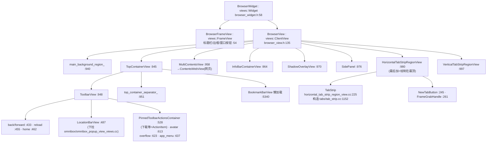
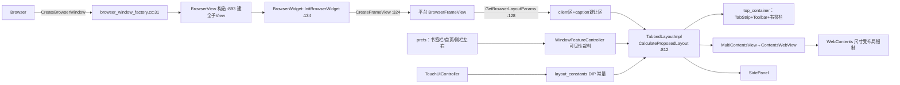

# 4.3 浏览器窗口结构定制：BrowserWidget/BrowserView/Toolbar/TabStrip

> 源码基线：Chromium 157.0.8093.0（git 8fe2331，2026-10-08），`file:line` 均已核实。
> 姊妹篇 4.1 讲"加新控件"；本篇专讲**既有窗口骨架的改造面**——谁包含谁、各段在哪定义、动哪里。

## 1. 角色定位

桌面浏览器全部 Chrome UI 长在一棵 views View 树上。图谱 16 分层中属 chrome 外壳（L0）的 `chrome/browser/ui/views/` 子树，压在 UI 栈（views→gfx）上，与渲染栈只经 `ContentsWebView`（包装 WebContents 的 NativeViewHost）薄胶水相接。三层骨架：

- **窗口层**：`BrowserWidget`（browser_widget.h:58，继承 views::Widget）持原生窗口；`BrowserFrameView`（browser_frame_view.h:54，继承 views::FrameView）画标题栏/边框/窗口按钮。
- **内容层**：`BrowserView`（browser_view.h:135）同时是 views::ClientView 与 BrowserWindow 接口实现（Browser→窗口唯一入口），TabStrip/Toolbar/地址栏/书签栏/SidePanel 都是它的子孙。
- **布局层**：`BrowserViewLayout`（frame/layout/browser_view_layout.h:97）自研 LayoutManager，按窗口类型分派 tabbed/app/popup 三实现。

勘误级演进：**老教程的 `BrowserFrame` 类已不存在**，职责由 BrowserWidget+views::FrameView 接管（第 6 节）。另有两场迁移进行中：工具栏 WebUI 化（默认关）、按钮 Actions API 化（默认开，ui_features.cc:33）。本篇以默认路径（原生 views+Actions API）为主线。

## 2. 定制切入点全景表

| 想改什么 | 动哪里（文件:行） | 难度 | 影响面 |
|---|---|---|---|
| 增删工具栏固定按钮 | toolbar/toolbar_view.cc:433-462；溢出次序表 overflow_menu.cc:99 | 改逻辑 | ToolbarController 溢出、快捷键、a11y 焦点链 |
| 下载按钮显隐/位置 | pinned_toolbar_actions_container.cc:892（GetButtonFor(kActionShowDownloads)）；pin 状态在 PinnedToolbarActionsModel | 改配置→改逻辑 | 气泡锚点 :898 随 overflow 回退 |
| Tab 宽/高/圆角 | tabs/tab_style.cc:28（宽 232）、:97/:101（圆角 10/12）；layout_constants.cc:102（高 34+overlap） | 改配置 | GM2 形状、hover 卡片、拖拽布局态 |
| Tab 间距/重叠/分隔条 | tab_style.cc:105（GetTabOverlap）、:118；layout_constants.cc:113-116 | 改配置 | inactive 最小宽反推依赖 overlap（tab_style.cc:85） |
| 隐藏 Tab 条（kiosk） | window_feature_controller.cc:77（kFeatureTabStrip 分支） | 改逻辑 | GetDisplayMode（toolbar_view.cc:193）变 kLocation |
| 隐藏整个工具栏 | window_feature_controller.cc:84-85 两个 case 同改；出口 browser_view.cc:3063 | 改逻辑 | 见第 4 节实操 |
| 标题栏/窗口装饰 | 分派 browser_frame_view_factory_views.cc:120；Linux browser_frame_view_linux_native.cc:21；Win browser_frame_view_win.cc:27/Opaque:43；WebApp 无框 browser_view.h:458 | 动架构 | 每平台一套（5.1 呼应） |
| 书签栏默认显隐 | bookmark_utils.cc:454（默认 false）；懒挂树 browser_view.cc:5340 | 改配置 | 高度链 tabbed_layout_impl.cc:1485-1493 |
| 侧栏挂面板/停靠侧 | side_panel_coordinator.cc:136（Show）；左右 pref+布局 tabbed_layout_impl.cc:1091-1147 | 改逻辑 | 注册走 SidePanelEntry（4.1/12.1） |
| 状态栏（状态气泡） | status_bubble_views.cc:842（SetStatus）、:795 | 改逻辑 | 独立 popup Widget，锚内容区左下角 |
| 暗色/主题色 | toolbar_view.cc:1519（OnThemeChanged）+:294 级联色；映射在 ui/color/ | 改配置 | 硬编码 SkColor 逃逸主题体系 |
| 紧凑/触屏密度 | layout_constants.cc touch_ui 三目（:121 等）；ui::TouchUiController（browser_view.cc:1331 订阅） | 改配置 | ChromeOS 平板触发 reparent（:3834） |
| DPI 缩放行为 | 常量全 DIP；2px 补绘 hack browser_view_layout_impl.cc:280-295 | 改逻辑 | 改高度须过 125%/150% 回归 |
| 全屏行为 | browser_view.cc:5523（ProcessFullscreen）；自动藏部件 window_feature_controller.cc:86；沉浸 reparent :3781 | 动架构 | Mac/ChromeOS/Linux 三套机制 |

## 3. 关键源码走读

### 3.1 组装时序

入口 `BrowserWindow::CreateBrowserWindow`（frame/browser_window_factory.cc:31）：

1. `new BrowserView`（ChromeOS 为 BrowserViewAsh）。构造函数（browser_view.cc:893）完成全部子 View 创建挂树：main_background_region_(:940)→top_container_(:945)→toolbar_ 挂入 top_container(:948)→multi_contents_view_(:958，网页的家)→infobar(:965)→shadow_overlay(:971)→side_panel_(:976)→horizontal_tab_strip_region_view_(:980)→（垂直模式）vertical_tab_strip_region_view_(:997)及圆角→find_bar_host(:1032)→ScrimView(:1034)。
2. `BrowserWidget(view)`+`InitBrowserWidget()`（browser_widget.cc:134）：组装 InitParams（恢复 bounds/show_state）→Init 建原生窗口，期间回调 `CreateRootView`(:319，BrowserRootView)与 `CreateFrameView`(:324→factory_views.cc:120 按平台造 FrameView)。
3. BrowserView::AddedToWidget（browser_view.cc:4980）：`toolbar_->Init()`(:5028)（按钮真正创建在 toolbar_view.cc:330）；WebApp 补 web_app_frame_toolbar_(:5068)；装布局 `SetLayoutManager(BrowserViewLayout::CreateLayout(...))`(:5119)；`CHECK(toolbar_button_provider)`(:5127)——ToolbarView 构造时已注册自己为 Browser 的 ToolbarButtonProvider（toolbar_view.cc:278-280），气泡锚点取按钮都经它。

### 3.2 View 树层级（定义处行号）



要点：①**z-order=child order**——TabStrip 区刻意最后挂树以绘制在最顶（browser_view.cc:978-979 注释）；②**top_container_ 是会整体滑走的顶栏盒子**——非沉浸时 TabStrip 区直挂 BrowserView（browser_view.h:1136-1138 注释），沉浸式才被 ReparentTabStripAndWebAppViewsToTopContainer（browser_view.cc:3834）搬入 top_container 再搬进 overlay(:3781)，ChromeOS 手势滑顶栏同样是平移 top_container；③网页内容在 MultiContentsView 里（分屏=多个 ContentsContainerView），set_contents_view(:960)。

### 3.3 布局系统：自研 LayoutManager

`BrowserViewLayout::CreateLayout`（layout/browser_view_layout.cc:137）按类型分派：NORMAL→Tabbed 版；APP/APP_POPUP→App 版；POPUP/DEVTOOLS/PIP→Popup 版。主流程 `BrowserViewLayoutImpl::Layout`（browser_view_layout_impl.cc:216）：取参→预计算→CalculateProposedLayout 产 ProposedLayout→一次应用→配背景→视觉后调整。**它不只布直接子节点，还伸进 top_container 内部与 overlay widget**——与标准 BoxLayout 的本质区别（layout/README.md:16-19 明言）。

Tabbed 版 `CalculateProposedLayout`（browser_view_tabbed_layout_impl.cc:812）自上而下：scrim(:822)→organizer 托盘(:834)→水平 TabStrip 区(:864-878，`SetTop(bottom()-kTabstripToolbarOverlap)` 与工具栏咬合 1px)→垂直 TabStrip 区+圆角(:886-1036)→main_background(:1070)→**工具栏高的 SidePanel**(:1091-1147，在 top_container 之前布——侧栏可从窗口顶延伸)→阴影罩(:1170)→top_container(:1176)→InfoBar(:1188)。top_container 内部由 `CalculateTopContainerLayout`(:1443) 布：TabStrip 区（沉浸 reparent 后才在此，:1449）→Toolbar(:1467-1481)→BookmarkBar(:1485-1493)→分隔条(:1496)。

Frame↔布局契约=`BrowserLayoutParams`（frame/layout/browser_view_layout_params.h:72）：visual_client_area+leading/trailing_exclusion（caption 按钮避让区），由 `BrowserFrameView::GetBrowserLayoutParams`（browser_frame_view.cc:128）从 caption 按钮边界算出——"Tab 条顶进标题栏但不撞窗口按钮"的机制。`--show-browser-frame-regions`（browser_frame_view.cc:48）可画彩框直看。

工具栏内部回归标准体系：`ToolbarView::InitLayout`（toolbar_view.cc:1569）装 FlexLayout，地址栏 kScaleToMinimum/kUnbounded 弹性；窄窗溢出由 ToolbarController(:1682) 按 overflow_menu.cc:99 表收纳；高度乘 size_animation_（toolbar_view.cc:1436）做显隐动画。

## 4. 实操：裁掉工具栏做"极简浏览器"

目标：TYPE_NORMAL 只留 Tab 条+网页。**错误做法**是不创建 ToolbarView——`CHECK(toolbar_button_provider)`（browser_view.cc:5127）直接崩，且大量代码经 `toolbar_->location_bar()` 取地址栏。正确姿势：子 View 照常建，只改"可见性裁判"。

唯一必改点 window_feature_controller.cc:77：

```diff
     case WindowFeature::kFeatureTabStrip:
-    case WindowFeature::kFeatureToolbar:
-    case WindowFeature::kFeatureLocationBar:
       return check_can_support || !IsFullscreen();
+    case WindowFeature::kFeatureToolbar:
+    case WindowFeature::kFeatureLocationBar:
+      // [custom] 极简浏览器：普通窗口不显示工具栏/地址栏。
+      // 返回 check_can_support 而非 false：保持"结构上支持"语义，
+      // 与 :86/:99 写法一致，不破坏 CanSupportWindowFeature 调用方。
+      return check_can_support;
```

生效链路零额外代码：`IsToolbarVisible()`（browser_view.cc:3063，OR 逻辑）→false→布局 `toolbar_visible=false`（tabbed_layout_impl.cc:1466-1481）→toolbar 零高不占位→top_container 只剩 Tab 条+分隔条，网页上移。书签栏要砍把 kFeatureBookmarkBar 一并改。

**残留行为清单**（实测必读）：①下载/权限气泡仍锚到零高工具栏里的按钮（pinned_toolbar_actions_container.cc:898），锚点退化到窗口顶——要么连 pinned actions 一起隐藏，要么锚点改挂 TabStrip；②Ctrl+L 仍 focus 隐藏的 LocationBarView，无视觉反馈但不崩，彻底禁用可在 SetFocusToLocationBar 入口短路；③只改 kFeatureToolbar 不改 kFeatureLocationBar **工具栏不会消失**（OR 逻辑，头号坑）。参照：popup 本来无 TabStrip（window_feature_controller.cc:93-106），GetDisplayMode（toolbar_view.cc:193-206）选 `DisplayMode::kLocation`——只留地址栏+pinned actions 的官方"半极简"形态（toolbar_view.cc:376-399），能借用就不必发明。

**Tab 条下移提纲**（动架构级，四个咬合点）：①把 :864-878 的 TabStrip 布局块移入 CalculateTopContainerLayout(:1443) 排 toolbar 后，overlap 补偿反转；②caption 避让语义反转——原来 TabStrip 避让按钮（GetBoundsWithExclusion），下移后须由 toolbar 避让（:1470-1476 needs_exclusion 分支），重审 GetHorizontalTabStripLeadingMargin(:369)；③拖拽 hit-test：TopContainerView::IsPositionInWindowCaption（top_container_view.cc:35）落在 toolbar 上，须扩展其递归判定（toolbar_view.cc:223 起），否则窗口无空白拖拽区；④z-order 保持 TabStrip 最后绘制（tab 拖入帧/hover 卡依赖）。

## 5. 依赖与数据流



输入：Browser 类型+create_params（定形态）、frame 几何、prefs、TabStripModel。输出：各 View bounds/visibility、`GetContentsSize()`（RWHV 尺寸同步，browser_view.cc:2940）。气泡/对话框单向依赖本层锚点（ToolbarButtonProvider、dialog_anchor :5169）。

## 6. 坑与勘误

1. **BrowserFrame 已删除**（源码实证）：157 无 browser_frame.cc；BrowserWidget(browser_widget.h:58)+BrowserFrameView(browser_frame_view.h:54，本体 ui/views/window/frame_view.h:33)接管。旧书"改 BrowserFrame::xxx"全失配。
2. **布局自研**（layout/README.md:16-19）：官方铁律"不要在 CalculateProposedLayout 之外改 BrowserViewLayout 管辖 View 的 bounds"——别处 SetVisible/SetBounds 会被下次布局覆盖或竞态。
3. **窗口装饰每平台一套**（factory_views.cc:35-126）：Linux 系统主题时 caption 由 GTK NavButtonProvider 画；Win DWM/Opaque 双轨；Mac 走 factory_mac.mm 独立。改标题栏至少 Win/Linux 各一份（5.1）。
4. **沉浸/触屏会 reparent**（browser_view.cc:3834-3892）：新顶栏 View 不进 top_container 就不跟全屏滑动走。
5. **ChromeOS 滑动期间禁布局**：TopControlsSlideController 平移期间只许一次 Layout（browser_view.cc:4873-4883）；"Layout 不跑"先查这里与 in_process_fullscreen_(:4837)。
6. **可见性 OR 逻辑**（browser_view.cc:3078-3085）：只关一个 feature 隐藏不了工具栏。
7. **WebUI 工具栏迁移是活工地**：kInitialWebUI（content_features.cc:572）/kWebUIToolbar（chrome_features.cc:1962）默认关，原生是默认路径；toolbar_view.cc 散布 14+ 个 IsWebUI*Enabled() 分支，patch 贴分支外减少合并冲突。
8. **按钮 Actions API 化**：kUseActionsForBrowserCommands 默认开（ui_features.cc:33），下载按钮已是 ActionItem（pinned_toolbar_actions_container.cc:892）。新按钮优先注册 ActionItem（4.1 工作流），否则进不了溢出/pin 体系。
9. **Layout(PassKey) 新签名**（browser_view.cc:4833）：自定义子 View 仍写旧 `Layout()` 会变成新虚函数，编译过但永不调用。
10. **不可见窗口吞布局**：kDeferLayoutDuringBrowserStartup 下未显示窗口第二次起 Layout 直接 return（browser_view.cc:4843-4871），自动化"没生效"多半是它。
11. **改圆角要连 overlap**：GetTabOverlap=2×底圆角−分隔条（tab_style.cc:105-110），只改圆角挤压态会缝隙/错位。

## 7. 验证方法

- 快验：起 chrome 肉眼比对；`--show-browser-frame-regions`（browser_frame_view.cc:48）画客户区/caption 避让彩框，验证布局契约。
- 结构检查：`--enable-ui-devtools` 右键 Inspect 浏览 View 树（等价 DOM inspector），确认父节点与 bounds。
- 密度/DPI：`--force-device-scale-factor=1.25/2` 过 Tab 收缩与溢出。
- 测试（必跑）：`unit_tests --filter=BrowserViewLayout*`（layout_params_unittest.cc）；`browser_tests --filter=BrowserView*`（frame/browser_view_browsertest.cc，实操一需同步改 IsToolbarVisible 断言）、`--filter=ToolbarView*`、TabStrip 用 tabs/ 下 `*_unittest.cc` 与 horizontal_tab_strip_region_view_browsertest.cc。
- 日志：在 Layout（browser_view_layout_impl.cc:216）临时打 visual_client_area 与子 View bounds，定位"谁吃掉了高度"。

## 8. 延伸

- 图谱：src/.understand-anything/knowledge-graph.json（40,412 节点/16 分层）；本篇属 chrome 外壳 L0，关键节点 browser_view.cc/toolbar_view.cc/tab_strip.cc/browser_view_tabbed_layout_impl.cc 按 filePath 过滤；上游 views 层、下游挂 content/public。
- explain：`explain/views-widget.md`（Widget 生命周期——为何 AddedToWidget 才 Init 工具栏）、`explain/views-view.md`（View 树与布局失效）。
- 姊妹篇：4.1（加控件工作流）、12.1（AI 面板挂点）、5.1（平台矩阵）。
- 仓内文档：frame/layout/README.md（布局系统官方 how-to 与加 View 模板）、views/BUILD.gn（新文件编译注册）。
- 上游动向：WebUI toolbar 迁移（webui/webui_toolbar/）、垂直 TabStrip（kTabStripUnification）——landed 会移动本篇行号，rebase 后先跑第 7 节测试。
