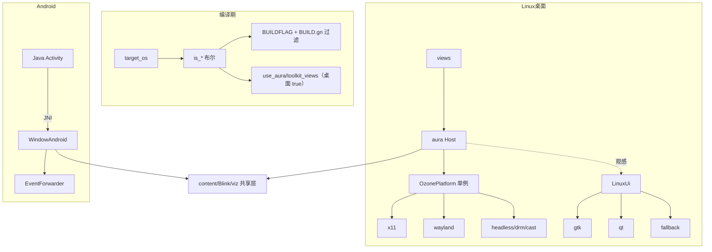

# 5.1 平台抽象全景：os 分支机制 / ozone / aura / gtk 与 Android×Linux×桌面差异地图

## 1. 角色定位

Chromium 用一套 C++ 主干支撑 6+ 平台，靠**两根正交的平台轴**：

- **编译期轴**：`target_os` → GN 布尔 `is_linux/is_android`（`build/config/BUILDCONFIG.gn:336-347`）→ 宏 `OS_LINUX/OS_ANDROID`（`build/build_config.h:69,95`）→ `#if BUILDFLAG(IS_ANDROID)`。决定哪些源文件进编译。
- **运行期轴**：同一份桌面二进制里，UI 栈底层由 **ozone** 运行时绑定 x11/wayland/headless 等后端（`docs/ozone_overview.md:17` "Interfaces, not ifdefs" 原则）；Linux 原生观感（主题/对话框/IME）另由 **LinuxUi 桥**绑到 gtk/qt。

图谱分层里它在 ui 层最底部：views/aura 平台无关，往下经 `ui/platform_window/platform_window.h` 的 PlatformWindow 落到 ozone 后端（Linux 系）或 WinWindow；**Android 绕开 aura**——`use_aura/toolkit_views` 在 `build/config/ui.gni:27,32` 均不含 Android，其 UI 是 Java（`chrome/android/java/`）+ `ui/android/` 胶水。content 以下全平台共享，是"一套代码 6 平台"的主体。

## 2. 定制切入点全景表

| 想改什么 | 动哪里 | 难度 | 影响面 |
|---|---|---|---|
| 判断目标平台（GN 级） | `build/config/BUILDCONFIG.gn:336-347`（is_* 唯一定义处） | 改配置 | 全仓 |
| C++ 加平台分支 | `#if BUILDFLAG(IS_ANDROID)`；范例 `base/files/file_util.cc:195` | 改逻辑 | 单点 |
| BUILD.gn 平台源过滤 | `base/BUILD.gn:1721-1726`（is_android 加源文件） | 改配置 | 目标级 |
| 选 ozone 后端（编译期） | `build/config/ozone.gni:11` use_ozone；`ozone_platform_x11/wayland`（:81-84） | 改配置 | Linux UI 栈 |
| 运行时切 ozone 后端 | `--ozone-platform=wayland`（`ozone_switches.cc:10`；`platform_selection.cc:17-47`） | 零代码 | 窗口/输入 |
| out-of-tree ozone 后端 | `build/config/ozone_extra.gni` 填 ozone_external_platforms/deps | 动架构 | 新平台移植 |
| 切 Linux 工具包 | `--ui-toolkit=qt`（`ui/linux/linux_ui_factory.cc:120-125`）；`build/config/linux/gtk/gtk.gni:9` | 改配置 | 主题/IME |
| 改 Linux 原生观感 | `ui/linux/linux_ui.h`：CreateSelectFileDialog/CreateInputMethodContext/GetNativeTheme（:181/:193/:315） | 改逻辑 | 桌面皮肤层 |
| 改窗口行为（Linux） | `ui/ozone/platform/x11/x11_window.cc`（事件分发 :1467-1469）；`wayland/host/wayland_window.h:65` | 改逻辑 | 窗口交互 |
| Android Java UI | `chrome/android/java/.../app/ChromeActivity.java`（JNI 由 rules.gni 生成） | 改逻辑 | Android 前端 |
| Android 打包产物 | `chrome/android/BUILD.gn:2111`（chrome_public_apk）；`android_webview/BUILD.gn:84`（system_webview_apk） | 改配置 | 发布形态 |
| 挂平台化启动逻辑 | `chrome/browser/chrome_browser_main.cc:775-797`（Linux:785、Android:788）+ extra_parts 链 | 改逻辑 | 启动流程 |
| 无显示环境运行 | `ui/ozone/platform/headless/`；M132 起与 chrome 分离（`headless/README.md:12-14`） | 改配置 | 服务器场景 |
| GPU/合成平台绑定 | `ui/ozone/public/gl_ozone.h:41`（GLOzone）+ surface_factory_ozone | 动架构 | 渲染链路 |

## 3. 关键源码走读

**OS 判定的诞生**：`BUILDCONFIG.gn:336-347` 把 current_os 映射成 is_* 布尔；:329-331 注释钉死语义——"is_linux 只对桌面 Linux 为真，不含 ChromeOS 与 Android"。C++ 侧由 `-DOS_ANDROID` 驱动 `BUILDFLAG_INTERNAL_IS_ANDROID()`（`build_config.h:69,156-159`）；`OS_CHROMEOS` 由 GN 传入（:93-95 注释）。

**桌面开窗链（Linux）**：`ui/aura/window_tree_host_platform.cc:93-97` CreateAndSetPlatformWindow → `CreatePlatformWindow`（:232-238）`#if BUILDFLAG(IS_OZONE)` 分支调 `OzonePlatform::GetInstance()->CreatePlatformWindow`（接口 `ozone_platform.h:287-289`）。GetInstance 首调经 `platform_selection.cc:28-47` 按 `--ozone-platform`（缺省取 `kPlatformNames[0]`）从 `generate_constructor_list.py` 生成的构造表选后端；X11 例 `ozone_platform_x11.cc:102-108` 直接 `make_unique<X11Window>(delegate)`。事件回流 `x11_window.cc:1467-1469` 交 `PlatformWindowDelegate::DispatchEvent`（`platform_window_delegate.h:141`）。

**LinuxUi 第二条桥**：ozone 只管窗口/输入/显示，观感由 `ui/linux/linux_ui.h:68` LinuxUi 承担（头注释禁止 GTK/QT 代码绕过该接口）。装配在 `linux_ui_factory.cc:120-125`：`--ui-toolkit` 显式指定，否则按桌面环境探测（:186 起，GNOME→kGtk、KDE→kQt），兜底 FallbackLinuxUi。

**Android 另一张地图**：`ui/views/BUILD.gn:17` `assert(toolkit_views)` 把 views 关在门外。窗口根是 `ui/android/window_android.h:43` WindowAndroid，触摸从 Java MotionEvent 经 JNI 进 `event_forwarder.h` 的 EventForwarder。启动分派在 `chrome_browser_main.cc:775-797`：Android 的 PreEarlyInitialization 先 `content::Compositor::Initialize()`（`chrome_browser_main_android.cc:96-105`）且单 Profile（:63-65）。Linux extra parts：`chrome_browser_main_extra_parts_ozone.cc:21-29` 把 shutdown 回调交 ozone；`chrome_browser_main_extra_parts_linux.cc:55-60` 记录显示服务器 UMA 后转调 ozone。

## 4. 实操：最小 patch 示例

**Patch A（切默认 ozone 后端为 Wayland）**，`build/config/ozone.gni:77-84`：

```diff
     } else if (is_linux) {
-      ozone_platform = "x11"
+      ozone_platform = "wayland"
```

**Patch B（out-of-tree ozone 后端插槽）**：不改 `ui/ozone/`，只写 `build/config/ozone_extra.gni`：

```gn
ozone_external_platforms = [ "myfb" ]
ozone_external_platform_deps = [ "//third_party/myfb_ozone" ]
```

提供 `CreateOzonePlatformMyfb()` 实现纯虚接口（窗口族可抄 `ui/ozone/platform/headless/headless_window.cc` 骨架）；`ui/ozone/BUILD.gn:17` 起卷进代码生成，运行时 `--ozone-platform=myfb` 生效。

## 5. 依赖与数据流



契约要点：PlatformWindow↔Delegate 双向——操作下行（`platform_window.h:38-46`），事件上行（`platform_window_delegate.h:135,141,175`）。GPU 侧契约（`gl_ozone.h:41`）：browser 管窗口与输入，GPU 画 buffer，Wayland 下经 IPC 回 browser 注册 wl_buffer（README 的 host//gpu/ 分工）。

## 6. 坑与勘误

1. **is_linux 不含 Android/ChromeOS**（源码实证 BUILDCONFIG.gn:329-331）。覆盖所有 Linux 内核平台须写 `IS_LINUX || IS_CHROMEOS || IS_ANDROID`，`base/files/file_util.cc:195` 即此写法。
2. **src/clank/ 存在但为空**（本仓 ls 实证）：Google 内部 overlay 挂载点，开源 Android UI 在 `chrome/android/java/`。
3. **Android 无 aura/views/ozone**（ui.gni:27,32 实证）：把桌面定制塞进 views 的 `#if BUILDFLAG(IS_ANDROID)` 不可行——该分支在 Android 编译里不存在。
4. **双编≠双启用**：Linux 默认 x11+wayland 都编进二进制（ozone.gni:81-84），运行时默认 x11。
5. **headless 老用法已死**：M118 起独立发布 chrome-headless-shell，M132 起 `--headless=old` 无效（headless/README.md:8-14）。
6. **Wayland 目录迷路**：窗口类在 `host/` 子目录、GPU 侧在 `gpu/`，根下没有 wayland_window.cc；按老资料路径 grep 会漏。
7. **LinuxUi 与 ozone 是平行两桥**：改窗口行为去 ozone，改对话框/字体/IME 去 LinuxUi；`--disable-gtk-ime` 在 Android 无意义（ui_base_switches.h:54）。

## 7. 验证方法

- 编译期：`gn args out/My --list` 查真值；`cat out/My/gen/ui/ozone/platform_list.txt` 看编进的后端（`ui/ozone/BUILD.gn:75-77` 生成）。
- 运行期：`--ozone-platform=wayland` 启动后到 `chrome://version` 核对；`--ozone-dump-file`（ozone_switches.cc:13）dump 平台信息。
- LinuxUi：`--ui-toolkit=fallback` 看观感退化，对比 gtk。
- Android 用 `build/android/adb_command_line.py` 注入开关验证行为。
- 启动差异：`--enable-logging --v=1` 与 `adb logcat` 看 MainParts 链。

## 8. 延伸

- 图谱：knowledge-graph.json 的 ui/ozone/platform、ui/aura/window_tree_host、ui/linux、chrome_browser_main 节点群。
- explain：讲透Chromium explain/ 合成/viz 篇（GPU 平台契约上游）、views 框架篇。
- 文档：`docs/ozone_overview.md`、wayland README、`android_webview/README.md`、`headless/README.md`。
