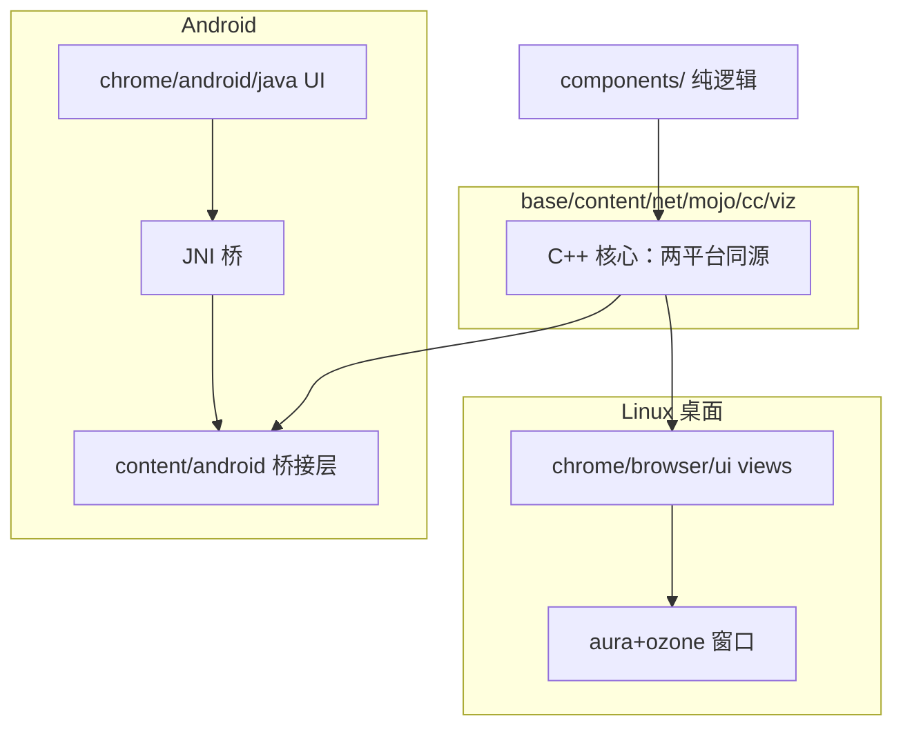

# 5.2 · Android × Linux：同一代码库的两个世界

> 同时维护桌面版与 Android 版（kylin-ai 类产品的典型姿势）需要一张精确的差异地图：构建怎么分叉、代码怎么分叉、运行时行为怎么分叉。本篇综合 5.1（平台抽象双轴）/3.1（桌面启动）/3.2（Android 启动）的实证素材，给出双平台维护工作流。

## ① 角色定位

Android 不是"Linux 的一个变体"——**它共享 base/content/net 的 C++ 地基，但换掉了整个 UI 栈（Java 化）、进程入口（Activity 生命周期）、打包（APK）与部分安全模型**。BUILDCONFIG.gn:336 的 `is_android = current_os == "android"` 与 `is_linux = current_os == "linux"`（340 行）是两个**互斥**的判定——源码里大量 `is_linux` 分支不包含 Android（5.1 坑①），这是双平台维护第一原则。

## ② 定制切入点全景表（双平台差异维度）

| 维度 | 想干什么 | 动哪里 | 难度 |
|---|---|---|---|
| 构建分叉 | 同仓出两平台产物 | 两个 out 目录：`out/linux/`（host）与 `out/android/`（args.gn 加 `target_os="android"`，1.3 §4 配方） | 改配置 |
| Android NDK 链 | 交叉工具链配置 | `build/config/android/` 配置群（BUILDCONFIG 的 android 段引用） | 改配置 |
| 代码分叉（C++） | 平台分支代码 | `#if BUILDFLAG(IS_ANDROID)` / `*_android.cc` 后缀文件（BUILD.gn sources 过滤，5.1/1.2） | 改逻辑 |
| 代码分叉（Java） | Android UI/入口层 | `chrome/android/java/`（Java 层与 C++ 经 JNI 桥接，3.2 走读的反射委托结构） | 改逻辑 |
| UI 栈选择 | 桌面 views vs Android | 桌面 `toolkit_views=true`+aura+ozone（ui.gni:24-40）；Android 无 views（`ui/views/BUILD.gn` assert 关门，5.1）——**UI 代码不可共享** | 动架构 |
| 启动链 | 两套入口 | 桌面：chrome_exe_main_aura→ChromeMain（3.1）；Android：Manifest→SplitChromeApplication→JNI→ContentMain（3.2）——注入点完全不同 | 改逻辑 |
| Profile | 数据布局差异 | 桌面多 profile（11.1）；Android 单 profile（`chrome_browser_main_android.cc`，3.2 实证） | 改配置 |
| 进程模型 | 隔离基线不同 | Android 默认隔离更激进（9.1 §6） | 改配置 |
| 打包 | deb vs APK | 1.4（linux_package）vs 5.3（chrome_public_apk） | 改配置 |
| 测试 | 双平台测试 | out 目录各自跑单元测试；Android 走 adb+instrumentation（`chrome/android/javatests/`） | 流程 |
| 共享业务逻辑 | 跨平台核心 | 放 components/ 或纯 C++ 层（无 UI 依赖）——**唯一可双平台复用的增量代码位置** | 改逻辑 |

## ③ 关键源码走读：一个功能的两地实现

以「浏览器启动」为样本（3.1/3.2 已各自深解，此处对照）：

| 阶段 | Linux 桌面（3.1） | Android（3.2） |
|---|---|---|
| 进程入口 | chrome_exe_main_aura.cc:16 → ChromeMain | APK 安装→Activity 起，Application=SplitChromeApplication（Manifest:221） |
| Main 分派 | ChromeMainDelegate→ContentMain→RunProcess 按 --process-type | 库加载链（chrome_entry_point.cc→chrome_jni_onload.cc:17）注入 delegate→ContentMain |
| BrowserMainParts | ChromeBrowserMainParts 全阶段序列（3.1 时序图） | ChromeBrowserMainPartsAndroid（部分阶段不跑，BrowserMain 语义被 Activity 生命周期替代） |
| 首窗 | browser_creator_->Start→BrowserFrame/Widget | Activity+ContentView（Java 容器） |
| UI 语言 | views/C++ | Java/XML + JNI 桥 |

**规律**：越靠近 base/content/net，两平台越一致；越过 chrome/browser/ui 与 chrome/android 边界，分叉越大。**定制代码想双平台存活，就往分叉线下放**（components/ 纯逻辑层）。

## ④ 实操：双平台维护工作流

1. **目录**：`out/linux-dev`（component build 开发）+ `out/android-dev`（`target_os="android"`）两套 args（1.3 配方）；共享源码改动后各自增量编。
2. **改动检查清单**（每次 PR 自查）：
   - 改动是否落在 `*_android.cc`/`IS_ANDROID` 分叉内？（桌面不回归）
   - 反向：纯桌面改动是否误碰共享层导致 Android 编译挂？（Android 的编译矩阵更严：无 glib/无 aura）
   - Java 侧改动：JNI 签名与 native 侧同步（`base/android/jni_generator` 生成物）
3. **验证**：桌面跑 `--user-data-dir=/tmp/t` 冒烟；Android `adb_install_apk.py` 装机跑 CTS 式冒烟（5.3 §7）。
4. **长期策略**：产品差异大的功能做两套 UI（views 版+Java 版）共享 components 核心；差异小的只出单平台。

## ⑤ 依赖与数据流

## ⑥ 坑与勘误

- **`is_linux` 不含 Android**（BUILDCONFIG:336/340 互斥实证）——grep `is_linux` 时心里要有数；想要"桌面 Linux + Android"用 `is_posix` 或显式两分支。
- **UI 代码零共享**：views 被 Android 关在门外（5.1），Android UI 是 Java——"一套 UI 两平台"在 Chromium 里不存在，别信老文章的 ui/android views 移植计划。
- Android 的 BrowserMain 阶段被 Activity 生命周期切碎（3.2 实证"Android 不跑 BrowserMain"的表述要点）——桌面式的"启动钩子"要换到 Activity 回调找。
- glib 依赖：`use_glib = is_linux && target_os != "android"`（ui.gni:30-34 实证）——Android 二级工具链会碰到"误以为有 glib"的坑。
- 双平台 ≠ 双启用：一次构建只能一个 target_os（1.3 的 args 唯一性），"同 out 目录切平台"必踩 stale 产物。
- 测试矩阵成本：Android 的 instrumentation 测试慢（装机+跑），核心逻辑尽量下沉到 components/ 用 gtest 覆盖。

## ⑦ 验证方法

- 构建侧：两 out 目录各自 `gn args --list=target_os` 回读确认
- 编译矩阵：`gn ls out/android` 对比 `gn ls out/linux` 目标差异；Android 编译挂时先查 IS_ANDROID 分支误用
- 运行侧：同一 URL 两平台开，DevTools 的 process 树对照（进程模型差异肉眼可见，9.1 §7）
- JNI 链：`adb logcat | grep -i jni` 看注册时序异常

## ⑧ 延伸

- 平台抽象机制：5.1；两平台启动链：3.1/3.2；打包：1.4/5.3；args：1.3
- 图谱层位：16 层中 Android 子图与桌面子图的分界带；repo-docs：`docs/android_build_instructions.md`
- kylin-ai-browser 项目（本机并行任务）即此模式的实战消费方
